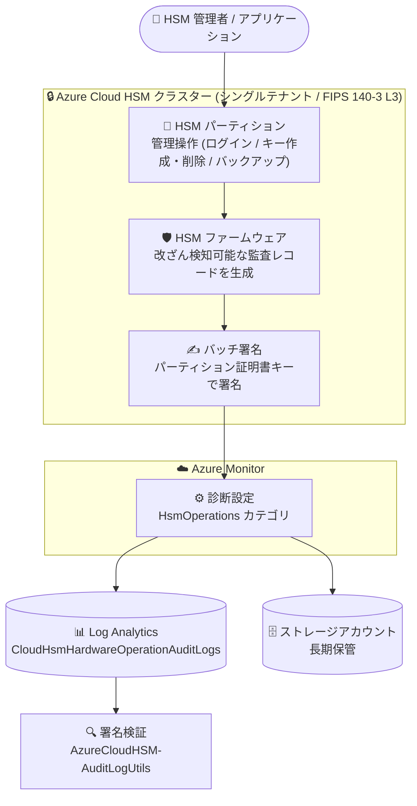

# Azure Cloud HSM: ハードウェア監査ログ (Hardware Audit Logging) の一般提供開始

**リリース日**: 2026-10-14

**サービス**: Azure Cloud HSM

**機能**: ハードウェア監査ログ (Hardware Audit Logging)

**ステータス**: Launched (GA)

[このアップデートのインフォグラフィックを見る](https://takech9203.github.io/azure-news-summary/20261014-cloud-hsm-hardware-audit-logging.html)

## 概要

Azure Cloud HSM のハードウェア監査ログ (Hardware Audit Logging) が一般提供 (GA) になりました。この機能は、サポート対象の HSM 管理操作に対して、HSM ハードウェア (ファームウェア) 自身が生成する改ざん検知可能 (tamper-evident) な監査レコードを提供します。組織のセキュリティ監視、コンプライアンスレポート、ガバナンス、フォレンジック調査の強化を支援します。

監査レコードは、サインイン、ユーザー管理、キーの作成・削除、キーのインポート・エクスポート、バックアップ・リストアといった HSM パーティション上の管理操作を記録します。レコードは HSM パーティションからバッチ単位で取得され、各バッチはパーティション証明書キーを使用して HSM により署名されます。人間が読める形式のレコードに加えて、HSM 署名付きのバイナリ監査データ・署名・証明書も提供されるため、顧客は署名済み監査バッチの真正性と完全性を独立して検証できます。

監査イベントは Azure Monitor の診断設定を通じて Log Analytics ワークスペースやストレージアカウントに配信され、既存の監視・調査ワークフローの中で活用できます。Azure Cloud HSM は FIPS 140-3 Level 3 検証済みのシングルテナント HSM サービスであり、金融・政府機関など厳格な規制要件を持つ組織にとって、監査証跡の信頼性を HSM ハードウェアのレベルで担保できることは大きな意味を持ちます。

**アップデート前の課題**

- HSM パーティション上で実行された管理操作 (ログイン、キー作成・削除、バックアップなど) について、ハードウェア由来の改ざん検知可能な監査証跡を Azure Monitor 経由で取得する標準的な手段がなかった
- 監査ログの完全性・真正性を顧客側で独立して暗号学的に検証することが難しく、コンプライアンス報告やフォレンジック調査での証拠能力に課題があった

**アップデート後の改善**

- HSM ファームウェアが生成する改ざん検知可能な監査レコードを、診断設定の `HsmOperations` カテゴリ経由で Log Analytics ワークスペースとストレージアカウントに集約可能になった
- 各監査バッチが HSM によりパーティション証明書キーで署名され、署名と HSM 公開証明書チェーン (パーティション証明書、デバイス証明書、製造元ルート証明書など) がレコードに含まれるため、顧客が監査証跡の完全性と真正性を独立して検証できるようになった
- Azure Cloud HSM SDK リポジトリで提供される監査ログユーティリティ (`AzureCloudHSM-AuditLogUtils`) により、ダウンロードしたログの署名検証が可能になった

## アーキテクチャ図



HSM パーティション上の管理操作は HSM ファームウェアによって監査レコード化され、バッチ単位で署名された後、Azure Monitor 診断設定を通じて Log Analytics とストレージアカウントに配信されます。顧客は署名と証明書チェーンを用いて監査証跡の完全性・真正性を独立検証できます。

## サービスアップデートの詳細

### 主要機能

1. **ハードウェア生成の改ざん検知可能な監査レコード (`HsmOperations` カテゴリ)**
   - HSM ファームウェアが、HSM パーティション上で実行された管理操作の改ざん検知可能なレコードを生成
   - サインイン / セッション管理、ユーザー管理、キー生成、キーのラップ・インポート・エクスポート、オブジェクトライフサイクル、バックアップ・リストア、M-of-N トークン操作、ファームウェア / セキュアアプリケーション操作などを記録
   - 読み取り専用クエリと記録対象外の操作は `HsmOperations` にはキャプチャされない

2. **HSM 署名付きバッチと独立検証**
   - レコードは各 HSM パーティションからバッチ単位で取得され、各バッチはパーティション証明書キーで HSM により署名される
   - 同一バッチのすべてのレコードは同じ `CorrelationId` を共有
   - バッチには署名レコード (`BATCH_BINARY_SIGNATURE`: HSM 生成署名と SHA-256 ハッシュ) と証明書レコード (パーティション ID 証明書、HSM デバイス証明書、製造元ルート証明書、HSM 所有者認証証明書) が含まれ、監査証跡の完全性・真正性を検証可能

3. **Azure Monitor / Log Analytics への配信**
   - 診断設定で `HsmOperations` カテゴリを有効化すると、ログが Log Analytics ワークスペースの `CloudHsmHardwareOperationAuditLogs` テーブルとストレージアカウントにエクスポートされる
   - KQL による検索・分析、既存の監視・調査ワークフローへの統合が可能

4. **サービス操作ログ (`HsmServiceOperations`) の併用**
   - Cloud HSM サービスが観測したリクエストを記録する `HsmServiceOperations` カテゴリも提供 (テーブル: `CloudHsmServiceOperationAuditLogs`)
   - トラブルシューティング用の補完として同じ診断設定で併用可能だが、HSM が記録した操作の監査には `HsmOperations` を主ソースとして使用する

## 技術仕様

| 項目 | 詳細 |
|------|------|
| ログカテゴリ | `HsmOperations` (主)、`HsmServiceOperations` (補完) |
| Log Analytics テーブル | `CloudHsmHardwareOperationAuditLogs`、`CloudHsmServiceOperationAuditLogs` |
| レコード生成元 | HSM ファームウェア (ハードウェア生成、改ざん検知可能) |
| 署名方式 | バッチ単位でパーティション証明書キーにより HSM が署名。`BATCH_BINARY_SIGNATURE` レコードに署名と SHA-256 ハッシュを格納 |
| バッチ関連付け | 同一バッチの全レコードが同じ `CorrelationId` を共有 |
| 証明書チェーン | `BATCH_PARTITION_IDENTITY_CERT` / `BATCH_HSM_DEVICE_CERT` / `BATCH_HSM_MANUFACTURER_ROOT_CERT` / `BATCH_HSM_OWNER_AUTH_CERT` |
| 記録対象の操作名 | `CN_` プレフィックスの管理コマンド (例: `CN_LOGIN`、`CN_GENERATE_KEY`、`CN_DESTROY_OBJECT`、`CN_BACKUP_BEGIN` など) |
| エクスポート先 | ストレージアカウント、Log Analytics ワークスペース (リテンション 30 日以上) |
| ログ反映時間 | 通常は数分〜約 20 分。新規診断設定の初回有効化は最大 90 分かかる場合あり。設定前のログはバックフィルされない |
| 署名検証ツール | Azure Cloud HSM SDK リポジトリの `AzureCloudHSM-AuditLogUtils` |
| 対象リソース | `Microsoft.HardwareSecurityModules/cloudHsmClusters` |

## 設定方法

### 前提条件

1. 有効なサブスクリプションを持つ Azure アカウント
2. デプロイ済みの Azure Cloud HSM リソース (オンボーディングガイド参照)
3. サブスクリプションで `Microsoft.Insights` リソースプロバイダーが登録済みであること

### Azure CLI

```bash
# ログ保管用ストレージアカウントの作成
az group create --name "<resource-group>" --location "<location>"
az storage account create \
  --name "<storage-account-name>" \
  --resource-group "<resource-group>" \
  --location "<location>" \
  --sku Standard_LRS \
  --kind StorageV2

# Log Analytics ワークスペースの作成 (リテンションは 30 日以上)
az monitor log-analytics workspace create \
  --resource-group "<resource-group>" \
  --workspace-name "<workspace-name>" \
  --location "<location>" \
  --retention-time "<NumOfDays>"

# 診断設定で HsmOperations カテゴリを有効化
resourceId="/subscriptions/<subscription-id>/resourceGroups/<resource-group>/providers/Microsoft.HardwareSecurityModules/cloudHsmClusters/<hsm-name>"
storageAccountId="/subscriptions/<subscription-id>/resourceGroups/<resource-group>/providers/Microsoft.Storage/storageAccounts/<storage-account-name>"
workspaceId="/subscriptions/<subscription-id>/resourcegroups/<resource-group>/providers/microsoft.operationalinsights/workspaces/<workspace-name>"

az monitor diagnostic-settings create \
  --resource $resourceId \
  --name "my-chsmAuditLogs" \
  --storage-account $storageAccountId \
  --workspace $workspaceId \
  --export-to-resource-specific true \
  --logs '[{"category":"HsmOperations","enabled":true}]'
```

ログの確認は Log Analytics の KQL クエリで行います。

```kusto
// HSM 管理操作レコードの一覧
CloudHsmHardwareOperationAuditLogs
| where OperationName startswith "CN_"
```

```kusto
// ログイン・セッションイベントの確認
CloudHsmHardwareOperationAuditLogs
| where OperationName in ("CN_LOGIN", "CN_LOGOUT", "CN_CLOSE_SESSION", "CN_CLOSE_ALL_SESSIONS", "CN_CLOSE_PARTITION_SESSIONS")
| project TimeGenerated, OperationName, ResultType, UserID, SessionHandle, HsmInstance, SequenceNumber
```

## メリット

### ビジネス面

- コンプライアンスレポート・ガバナンス・フォレンジック調査に利用できる、ハードウェアレベルで信頼性が担保された監査証跡を確保できる
- HSM 署名と証明書チェーンにより監査証跡の真正性・完全性を顧客側で独立検証できるため、監査人や規制当局への証拠提示力が向上する
- FIPS 140-3 Level 3 検証済み HSM と組み合わせることで、金融・政府機関などの厳格な規制要件への対応を強化できる

### 技術面

- 診断設定を 1 つ作成するだけで、Log Analytics とストレージアカウントの両方にログを集約でき、既存の Azure Monitor ベースの監視・アラート基盤に統合できる
- 同一バッチのレコードが `CorrelationId` で関連付けられており、署名・証明書レコードとあわせた完全なバッチ単位の検証が可能
- KQL でログイン、ユーザー作成・削除、キー作成・削除などのイベントを柔軟に検索・分析できる

## デメリット・制約事項

- 読み取り専用クエリや操作一覧 (Glossary) に記載のない操作は `HsmOperations` には記録されない
- 診断設定の作成前に生成されたログはバックフィルされない (設定後の操作のみが記録対象)
- ログの反映には時間がかかる場合がある (通常数分〜約 20 分、新規診断設定の初回有効化は最大 90 分)
- Log Analytics ワークスペースのリテンションは 30 日以上が必要
- 監査レコードにはユーザー ID、セッションハンドル、キーハンドルなどの運用上の識別子が含まれるため、エクスポート先のストレージアカウントと Log Analytics ワークスペースへのアクセスを厳格に制限する必要がある
- 署名検証のためにログをエクスポートする際は、対象 `CorrelationId` の全レコード (署名・証明書レコードを含む) を欠落なく含める必要がある (`take` や `limit` を付けると署名済みバッチが不完全になる恐れ)

## ユースケース

### ユースケース 1: コンプライアンス監査向けの署名検証付き監査証跡の保全

**シナリオ**: 金融機関が、HSM 上のキー管理操作 (キー作成・削除・エクスポート) について、改ざんされていないことを暗号学的に証明できる監査証跡を定期的に保全し、監査人に提出する。

**実装例**:

```bash
# 過去 7 日間の署名済みバッチを完全な形でエクスポート
workspaceCustomerId=$(az monitor log-analytics workspace show \
  --resource-group "<resource-group>" \
  --workspace-name "<workspace-name>" \
  --query customerId --output tsv)

query=$(cat <<EOF
let recentBatches =
    CloudHsmHardwareOperationAuditLogs
    | where TimeGenerated >= ago(7d)
    | where _ResourceId =~ "$resourceId"
    | distinct CorrelationId;
CloudHsmHardwareOperationAuditLogs
| where _ResourceId =~ "$resourceId"
| where CorrelationId in (recentBatches)
EOF
)

az monitor log-analytics query \
  --workspace "$workspaceCustomerId" \
  --analytics-query "$query" \
  --output json > ./logs/CloudHsmOperationLogsLast7Days.json
```

エクスポート後、Azure Cloud HSM SDK リポジトリの `AzureCloudHSM-AuditLogUtils` を使用してバッチ署名と証明書チェーンを検証します。

**効果**: HSM が署名した監査バッチを完全な形で保全し、第三者が独立して完全性・真正性を検証できる監査証跡を確立できる。

### ユースケース 2: 不正操作検知とフォレンジック調査

**シナリオ**: セキュリティ運用チームが、HSM パーティションへの不審なログインやユーザー作成・削除、キー削除イベントを Log Analytics で監視し、インシデント発生時にハードウェア由来のレコードで操作履歴を追跡する。

**実装例**:

```kusto
// ユーザー作成・削除イベントの監視
CloudHsmHardwareOperationAuditLogs
| where OperationName in ("CN_CREATE_USER", "CN_CREATE_CO", "CN_CREATE_APPLIANCE_USER", "CN_CREATE_PRE_OFFICER", "CN_DELETE_USER")
| project TimeGenerated, OperationName, ResultType, UserID, HsmInstance, SequenceNumber, AdditionalInfo
```

```kusto
// キー削除イベントの追跡
CloudHsmHardwareOperationAuditLogs
| where OperationName in ("CN_DESTROY_OBJECT", "CN_TOMBSTONE_OBJECT", "CN_DELETE_TOMBSTONED_OBJECT")
| project TimeGenerated, OperationName, ResultType, UserID, HsmInstance, SequenceNumber, AdditionalInfo
```

**効果**: HSM ハードウェアが生成した改ざん検知可能なレコードに基づき、誰が・いつ・どの操作を行ったかを高い信頼性で特定でき、インシデント対応とフォレンジック調査の精度が向上する。

## 料金

ハードウェア監査ログ機能自体の追加料金に関する公式情報は、本レポート作成時点で確認できませんでした。Azure Cloud HSM 本体の料金について公式に確認できた内容は以下のとおりです。

- Azure Cloud HSM は HSM クラスターごとの時間課金 (SKU: Standard B1)
- 課金はリソースの「作成」時点で開始され、一時停止・停止はできず、削除によってのみ課金が終了する
- 具体的な単価はリージョン・通貨により異なるため、料金ページまたは料金計算ツールで確認

また、ログのエクスポート先となるストレージアカウントおよび Log Analytics ワークスペースには、それぞれの料金が別途適用されます。

- [Azure Cloud HSM 料金ページ](https://azure.microsoft.com/pricing/details/azure-cloud-hsm/)
- [Azure Monitor 料金ページ](https://azure.microsoft.com/pricing/details/monitor/)

## 関連サービス・機能

- **Azure Monitor / Log Analytics**: 診断設定を通じて監査ログを収集・分析する基盤。`CloudHsmHardwareOperationAuditLogs` テーブルに対して KQL クエリやアラートを構成できる
- **Azure Storage**: 監査ログの長期保管先。コンプライアンス要件に応じたリテンションを実現する
- **Azure Key Vault Managed HSM**: Azure の PaaS/SaaS サービスとのカスタマーマネージドキー統合が必要な場合の選択肢。Azure Cloud HSM は IaaS のみでの利用が前提であり、用途に応じて使い分ける
- **Azure Cloud HSM SDK (GitHub)**: `AzureCloudHSM-AuditLogUtils` ユーティリティを提供し、ダウンロードした監査ログの署名・証明書チェーン検証に使用する

## 参考リンク

- [インフォグラフィック](https://takech9203.github.io/azure-news-summary/20261014-cloud-hsm-hardware-audit-logging.html)
- [公式アップデート情報](https://azure.microsoft.com/updates?id=576377)
- [Tutorial - Configure and Query HSM Operation Audit Logs for Azure Cloud HSM](https://learn.microsoft.com/azure/cloud-hsm/tutorial-hsm-operation-audit-logs)
- [What is Azure Cloud HSM?](https://learn.microsoft.com/azure/cloud-hsm/overview)
- [Microsoft Azure Cloud HSM SDK (GitHub)](https://github.com/microsoft/MicrosoftAzureCloudHSM)
- [Azure Cloud HSM 料金ページ](https://azure.microsoft.com/pricing/details/azure-cloud-hsm/)

## まとめ

Azure Cloud HSM のハードウェア監査ログの GA により、HSM パーティション上の管理操作について、HSM ファームウェアが生成し HSM 自身が署名する改ざん検知可能な監査証跡を Azure Monitor / Log Analytics で一元管理できるようになりました。署名と証明書チェーンによる独立検証が可能な点は、FIPS 140-3 Level 3 準拠の HSM を利用する規制業種にとって特に重要です。Azure Cloud HSM を利用中、または Azure Dedicated HSM / AWS CloudHSM からの移行を検討している組織は、診断設定で `HsmOperations` カテゴリを有効化し、ログの収集・保全・署名検証のワークフローを早期に確立することを推奨します。診断設定の作成前のログはバックフィルされないため、HSM デプロイ後は速やかに有効化すべきです。

---

**タグ**: Azure Cloud HSM, Security, Audit Logging, Compliance, Azure Monitor, Log Analytics, FIPS 140-3, GA
