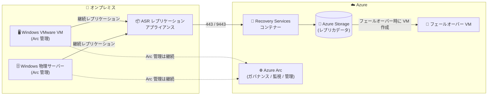

# Azure Site Recovery: Azure Arc 対応 Windows VMware VM / 物理サーバーのディザスターリカバリーサポート (GA)

**リリース日**: 2026-10-14

**サービス**: Azure Site Recovery

**機能**: Azure Arc-enabled Windows VMware VM / オンプレミス物理サーバーのディザスターリカバリーサポート

**ステータス**: Launched (GA)

[このアップデートのインフォグラフィックを見る](https://takech9203.github.io/azure-news-summary/20261014-site-recovery-arc-enabled-windows-servers.html)

## 概要

Azure Site Recovery (ASR) が、Azure Arc-enabled servers として管理されている Windows の VMware 仮想マシンおよびオンプレミス物理サーバーのディザスターリカバリー (DR) 保護に一般提供 (GA) で対応しました。プレビュー期間を経ずに直接 GA としてリリースされたアップデートです。

これまで、Azure Arc を導入しているマシンで ASR による保護を有効化しようとすると、互換性の問題が発生する可能性がありました。今回のアップデートにより、ASR はソースマシン上の Arc サービス (Connected Machine Agent) の存在を検出し、保護の有効化時に既存の Arc 構成との互換性を維持できるようになりました。顧客はガバナンス、インベントリ、監視、管理に Azure Arc を引き続き利用しながら、同じマシンを ASR で DR 保護できます。

ハイブリッド環境のサーバー管理に Azure Arc を標準採用している企業にとって、「Arc による統合管理」と「ASR による BCDR (事業継続・災害復旧)」を両立できる重要なアップデートです。

**アップデート前の課題**

- Azure Arc を導入した Windows VMware VM / 物理サーバーで ASR の保護を有効化すると、互換性の問題が発生する可能性があった
- Arc による統合管理と ASR による DR 保護の併用が保証されておらず、ハイブリッド管理戦略と BCDR 戦略のどちらかを優先する判断を迫られるケースがあった

**アップデート後の改善**

- ASR がソースマシン上の Arc サービスの存在を検出し、保護の有効化中も既存の Arc 構成との互換性を維持するようになった
- Arc によるガバナンス・インベントリ・監視・管理の構成を中断することなく、ASR による DR 保護を導入できるようになった

## アーキテクチャ図

Arc 管理下の Windows VMware VM / 物理サーバーのデータを ASR レプリケーションアプライアンス経由で Azure に継続レプリケーションし、災害時には Azure 上で VM としてフェールオーバーします。保護の有効化後も Azure Arc によるガバナンス・監視・管理は中断されません。

## サービスアップデートの詳細

### 主要機能

1. **Arc-enabled Windows VMware VM / 物理サーバーの DR 保護**
   - Azure Arc で管理されている Windows の VMware 仮想マシンおよびオンプレミス物理サーバーを、ASR で Azure へレプリケーションし DR 保護できるようになった

2. **Arc サービスの自動検出と互換性の維持**
   - ASR がソースマシン上の Arc サービスの存在を検出し、保護有効化の処理中も既存の Arc 構成との互換性を維持する

3. **Arc ベースの運用管理と BCDR の両立**
   - Arc によるガバナンス、インベントリ、監視、管理の構成を中断せずに ASR を導入できるため、ハイブリッド管理戦略を変更する必要がない

## 技術仕様

| 項目 | 詳細 |
|------|------|
| 対象シナリオ | オンプレミス VMware VM / 物理サーバー → Azure への DR (モダナイズドアーキテクチャ) |
| 対象 OS | Windows (本アップデートの対象は Windows のみ) |
| 対象マシン | Azure Arc-enabled servers (Connected Machine Agent 導入済み) の VMware VM および物理サーバー |
| レプリケーション方式 | ASR レプリケーションアプライアンス経由の継続レプリケーション |
| Arc との関係 | ASR が Arc サービスを検出し、保護有効化時に既存の Arc 構成との互換性を維持 |

VMware VM / 物理サーバーの DR でサポートされる Windows OS (レプリケーション対象マシン) には Windows Server 2016 / 2019 / 2022 / 2025 などが含まれます。詳細は [VMware/物理サーバー DR サポートマトリックス](https://learn.microsoft.com/azure/site-recovery/vmware-physical-azure-support-matrix) を参照してください。

## 設定方法

### 前提条件

1. Recovery Services コンテナーを作成していること
2. オンプレミス側に ASR レプリケーションアプライアンスを展開していること (主な要件: 8 CPU コア、16 GB RAM、ディスク 2 本、Windows Server 2022 (Desktop Experience、英語ロケール)、ポート 443 (制御チャネル) / 9443 (データ転送))
3. 保護対象マシンがサポートマトリックスの要件 (OS、ディスク構成など) を満たしていること
4. Arc 管理対象マシンの場合、Azure Connected Machine Agent が導入・接続済みであること (ASR が Arc サービスを検出し互換性を維持)

具体的な保護有効化の手順は [VMware から Azure への DR 構成ドキュメント](https://learn.microsoft.com/azure/site-recovery/vmware-azure-architecture-modernized) を参照してください。

## メリット

### ビジネス面

- Arc によるハイブリッド統合管理を維持したまま BCDR 戦略を強化でき、管理方針の二者択一が不要になる
- セカンダリデータセンターを維持することなく、Azure を DR サイトとして活用しコストと複雑さを削減できる
- GA のため本番環境のワークロードに適用可能

### 技術面

- ASR が Arc サービスを自動検出するため、保護有効化の前に Arc 構成を手動で退避・変更する作業が不要
- Arc 経由のガバナンス (Azure Policy)、インベントリ、監視 (Azure Monitor)、更新管理 (Azure Update Manager) を DR 保護と並行して継続利用できる
- DR ドリル (テストフェールオーバー) を本番のレプリケーションに影響を与えずに実行できるという ASR の既存機能をそのまま活用できる

## デメリット・制約事項

- 本アップデートの対象は **Windows** の VMware VM / 物理サーバーであり、Linux マシンについては言及されていない
- VMware VM / 物理サーバーの保護には ASR レプリケーションアプライアンスの展開が必要 (8 コア / 16 GB RAM / Windows Server 2022 など)
- VMware VM / 物理サーバー保護のクラシック (従来) アーキテクチャは 2026 年 3 月 30 日に廃止済みのため、モダナイズドアーキテクチャでの構成が前提となる

## ユースケース

### ユースケース 1: Arc で統合管理中のオンプレミス Windows サーバー群への BCDR 導入

**シナリオ**: Azure Arc で全社のオンプレミス Windows サーバー (VMware VM および物理サーバー) をインベントリ管理・ポリシー適用・監視している企業が、DR 対策として Azure へのレプリケーションを追加したい。

**効果**: Arc の管理構成を変更せずに ASR の保護を有効化でき、災害時には Azure 上へフェールオーバーして業務を継続できる。セカンダリデータセンターの維持コストが不要になる。

### ユースケース 2: 物理サーバーのクラウド DR

**シナリオ**: 仮想化されていない Windows 物理サーバーで基幹業務を運用しており、Arc で管理している。ハードウェア障害やサイト障害に備えた DR サイトを低コストで確保したい。

**効果**: 物理サーバーのデータを Azure に継続レプリケーションし、障害時には Azure VM として復旧できる。復旧計画 (Recovery Plan) により複数サーバーの復旧順序も制御可能。

## 料金

Azure Site Recovery は保護対象インスタンス単位の月額課金です。

| 項目 | 料金 |
|------|------|
| 保護対象インスタンス (最初の 31 日間) | 無料 |
| 保護対象インスタンス (32 日目以降) | インスタンスごとの月額課金 (リージョン・通貨により異なる) |

無料枠: 新規に保護された各インスタンスは最初の 31 日間無料。課金は月間の 1 日平均保護インスタンス数に基づきます。

このほか、レプリカストレージ、ストレージトランザクション、リージョン間レプリケーション時の送信データ転送 (egress)、回復ポイント (スナップショット)、テストフェールオーバー / フェールオーバー時の VM コンピューティング費用が別途発生します。最新の金額は [Azure Site Recovery 料金ページ](https://azure.microsoft.com/pricing/details/site-recovery/) を参照してください。

## 利用可能リージョン

公式アップデートにリージョン個別の記載はありません。Site Recovery の提供リージョンは [リージョン別の利用可能な製品](https://azure.microsoft.com/global-infrastructure/services/?products=site-recovery) を参照してください。

## 関連サービス・機能

- **Azure Arc-enabled servers**: オンプレミスや他クラウドの Windows / Linux サーバーを Azure リソースとして管理するサービス。本アップデートにより ASR 保護との併用の互換性が確保された
- **Azure Backup**: データの保護・復旧を担うサービス。ASR (サイト復旧) と組み合わせて BCDR 戦略を構成する
- **Azure Monitor**: ASR の組み込みアラート (レプリケーション正常性、フェールオーバー失敗、エージェント期限切れなど) の通知に利用できる
- **Azure Business Continuity Center**: ASR の保護状況をソリューション横断で一元管理できる
- **Azure Update Manager / Azure Policy**: Arc 経由での更新管理・ガバナンスを ASR 保護と並行して継続利用できる

## 参考リンク

- [インフォグラフィック](https://takech9203.github.io/azure-news-summary/20261014-site-recovery-arc-enabled-windows-servers.html)
- [公式アップデート情報](https://azure.microsoft.com/updates?id=576214)
- [What's New in Azure Site Recovery (該当セクション)](https://learn.microsoft.com/azure/site-recovery/feature-updates-whats-new#azure-site-recovery-support-for-azure-arc-enabled-windows-vmwarephysical-servers)
- [Azure Site Recovery の概要](https://learn.microsoft.com/azure/site-recovery/site-recovery-overview)
- [VMware/物理サーバー DR サポートマトリックス](https://learn.microsoft.com/azure/site-recovery/vmware-physical-azure-support-matrix)
- [Azure Arc-enabled servers の概要](https://learn.microsoft.com/azure/azure-arc/servers/overview)
- [料金ページ](https://azure.microsoft.com/pricing/details/site-recovery/)

## まとめ

Azure Site Recovery が Azure Arc-enabled servers として管理されている Windows の VMware VM / オンプレミス物理サーバーの DR 保護に GA 対応しました。ASR が Arc サービスを検出して既存構成との互換性を維持するため、Arc によるガバナンス・インベントリ・監視・管理を中断せずに BCDR を導入できます。Arc をハイブリッド管理の基盤として採用している組織は、オンプレミス Windows サーバー群の DR 対策として ASR の適用を検討することを推奨します。導入時はモダナイズドアーキテクチャが前提となる点、レプリケーションアプライアンスの要件、保護対象 OS のサポートマトリックスを事前に確認してください。

---

**タグ**: Azure Site Recovery, Azure Arc, Disaster Recovery, BCDR, VMware, Physical Servers, Management and Governance, Migration, GA
