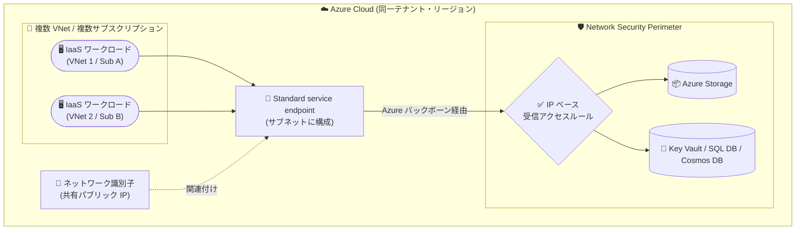

# Azure Private Link: Standard service endpoint の一般提供開始 (GA)

**リリース日**: 2026-10-15

**サービス**: Azure Private Link / Azure Virtual Network

**機能**: Standard service endpoint

**ステータス**: Launched (GA)

[このアップデートのインフォグラフィックを見る](https://takech9203.github.io/azure-news-summary/20261015-private-link-standard-service-endpoint.html)

## 概要

Azure Private Link ファミリーの新機能である Standard service endpoint が一般提供 (GA) になりました。Standard service endpoint は、Azure IaaS ワークロードから Azure PaaS サービスへの接続を、スケーラブルかつセキュアに実現する新しい接続方式です。従来の (classic/basic) サービスエンドポイントが抱えていた管理性とスケールの制限に対処します。

Standard service endpoint の中核となるのは「ネットワーク識別子 (network identifier)」という概念です。サブネットのサービスエンドポイントにパブリック IP アドレスを関連付け、その IP を VNet からサービスへ直接接続するトラフィックの識別にのみ使用します (ルーティングには使用されません)。PaaS リソース側は Network Security Perimeter (NSP) で保護し、ネットワーク識別子に一致する IP ベースの受信アクセスルールでトラフィックを承認します。同一テナント・同一リージョン内であれば、同じパブリック IP を複数のサブスクリプション・複数の VNet・すべてのサブネットに割り当てられるため、従来方式と比べて必要な ACL エントリ数を大幅に削減できます。

**アップデート前の課題**

- 従来のサービスエンドポイントでは、PaaS リソース側の仮想ネットワークルール (ACL) をサブネット単位で管理する必要があり、VNet/サブネットが増えるほど ACL エントリが増大して管理が煩雑だった
- 大規模環境ではサービスエンドポイントのスケール制限 (リソースプロバイダーのスロットリングなど) に達する可能性があった
- サブネットのライフサイクル変更 (追加・削除) のたびに、サービス側のアクセスルールの更新が必要だった

**アップデート後の改善**

- 単一のパブリック IP をネットワーク識別子として複数のサブネット・VNet・サブスクリプション (同一テナント・リージョン内) で共有でき、構成がシンプルになった
- 従来のサービスエンドポイントのスケーラビリティ制限を克服し、リソースプロバイダーのスロットルに達することなく数千規模の接続が可能になった
- Network Security Perimeter と統合し、リソースごとの ACL 管理ではなく、境界ベースのルールでアクセス制御を一元化できるようになった
- サブネットのライフサイクル変更時にサービス側アクセスルールの更新が不要になった

## アーキテクチャ図



複数の VNet・サブスクリプションにまたがる IaaS ワークロードが、共有パブリック IP (ネットワーク識別子) を関連付けた Standard service endpoint 経由で PaaS サービスに接続します。PaaS リソース側は Network Security Perimeter の IP ベース受信ルールでネットワーク識別子からのトラフィックのみを承認します。

## サービスアップデートの詳細

### 主要機能

1. **ネットワーク識別子 (Network identifier)**
   - パブリック IP アドレスをサブネットのサービスエンドポイントに関連付け、トラフィックの識別に使用する (ルーティング判断には使用されない)
   - 同一リージョン・サブスクリプション内のすべてのサブネットに同じパブリック IP を割り当て可能で、単一のネットワーク識別子で多数の VNet・サブネットを代表できる

2. **Network Security Perimeter (NSP) 統合**
   - PaaS リソースを NSP 内に配置し、ネットワーク識別子に一致する IP ベースの受信アクセスルールでアクセスを一元管理
   - リソースごとの ACL 管理が不要になり、境界ベースのセキュリティを適用できる

3. **クロスサブスクリプション対応**
   - 同一テナント・同一リージョン内であれば、サブスクリプションをまたいでパブリック IP をネットワーク識別子として再利用可能

4. **スケールと信頼性の向上**
   - 従来のサービスエンドポイントのスケール制限を克服し、リソースプロバイダーのスロットルに達することなく数千規模の接続に対応

### 接続オプションの比較

Microsoft Learn ドキュメントに記載されている比較表の要約:

| 項目 | Basic (従来) service endpoint | Standard service endpoint | Azure Private Link |
|------|------------------------------|---------------------------|--------------------|
| プライベート接続 (パブリックエンドポイント非公開) | 非対応 | 非対応 | 対応 |
| オンプレミスからの接続 | 非対応 | 非対応 | 対応 |
| データ流出 (exfiltration) 保護 | 非対応 | 非対応 | 対応 |
| セットアップの容易さ | 簡単 | 簡単 | 複雑 (DNS、エンドポイント作成、承認) |
| スケーラブルなソリューション | 非対応 | 対応 | 対応 |
| 対応サービス数 | 限定的 (約 10 サービス) | 限定的 (4 サービス) | 広範 (70 以上) |
| 料金 | 無料 | 有料 | 有料 |

## 技術仕様

| 項目 | 詳細 |
|------|------|
| 対応サービス | Azure Storage (*Microsoft.Storage*)、Azure Key Vault (*Microsoft.KeyVault*)、Azure SQL Database (*Microsoft.Sql*)、Azure Cosmos DB (*Microsoft.AzureCosmosDB*) — いずれも全 Azure リージョンで GA |
| ネットワーク識別子の要件 | Standard SKU、静的 (Static) 割り当て、IPv4、プロビジョニング状態が Succeeded の既存パブリック IP |
| IP 共有範囲 | 同一テナント・同一リージョン内でサブスクリプションをまたいで再利用可能 (クロステナント・クロスリージョン共有は非対応) |
| NSP の IP ベースルール上限 | NSP あたり最大 200 プレフィックス、1,000 PaaS リソース |
| NSP のその他の上限 | サブスクリプションあたり最大 100 NSP、NSP あたり最大 200 プロファイル |
| クロスリージョン接続 | Azure Storage / Key Vault / Cosmos DB は VNet と PaaS リソースが別リージョンでも対応。Azure SQL Database は非対応 |
| 必要な権限 | Network Contributor ロール以上 (`Microsoft.Network/publicIPAddresses/joinServiceEndpointNetworkIdentifier/action` 権限) |

## 設定方法

### 前提条件

1. アクティブなサブスクリプションを持つ Azure アカウント
2. Network Contributor ロール以上 (`Microsoft.Network/publicIPAddresses/joinServiceEndpointNetworkIdentifier/action` 権限)
3. Azure CLI 2.x 以降

### Azure CLI

```bash
# 1. ネットワーク識別子用のパブリック IP プレフィックスとパブリック IP を作成
az network public-ip prefix create \
  --resource-group test-rg \
  --name public-ip-prefix \
  --length 31 \
  --location eastus2

az network public-ip create \
  --resource-group test-rg \
  --name public-ip-1 \
  --public-ip-prefix public-ip-prefix \
  --sku Standard \
  --allocation-method Static

# 2. サブネットにサービスエンドポイント + ネットワーク識別子を関連付け
az network vnet subnet update \
  --resource-group test-rg \
  --vnet-name vnet-1 \
  --name subnet-1 \
  --add serviceEndpoints '{"service":"Microsoft.Storage","networkIdentifier":{"id":"/subscriptions/<subscription-id>/resourceGroups/test-rg/providers/Microsoft.Network/publicIPAddresses/public-ip-1"}}'

# 3. Network Security Perimeter を作成し、PaaS リソースを関連付け
az network perimeter create \
  --name nsp-1 \
  --resource-group test-rg \
  --location eastus2

az network perimeter profile create \
  --perimeter-name nsp-1 \
  --resource-group test-rg \
  --name profile-1

az network perimeter association create \
  --perimeter-name nsp-1 \
  --resource-group test-rg \
  --association-name assoc-storage \
  --access-mode Learning \
  --profile "{id:/subscriptions/<subscription-id>/resourceGroups/test-rg/providers/Microsoft.Network/networkSecurityPerimeters/nsp-1/profiles/profile-1}" \
  --private-link-resource "{id:/subscriptions/<subscription-id>/resourceGroups/test-rg/providers/Microsoft.Storage/storageAccounts/<storage-account-name>}"

# 4. ネットワーク識別子に一致する IP ベースの受信アクセスルールを作成
az network perimeter profile access-rule create \
  --perimeter-name nsp-1 \
  --resource-group test-rg \
  --profile-name profile-1 \
  --access-rule-name allow-se-standard \
  --direction Inbound \
  --address-prefixes "<public-ip-prefix-range>"
```

### Azure Portal

Azure Portal / Azure PowerShell での設定手順は Microsoft Learn のガイドを参照してください:

- [Configure a standard service endpoint using the Azure portal](https://learn.microsoft.com/azure/private-link/configure-service-endpoint-standard-portal)
- [Configure a standard service endpoint using Azure PowerShell](https://learn.microsoft.com/azure/private-link/configure-service-endpoint-standard-powershell)

## メリット

### ビジネス面

- VNet・サブネットの増加に伴う ACL 管理コストを削減し、大規模環境の運用負荷を軽減できる
- Private Endpoint のような DNS 構成やエンドポイント作成・承認の複雑さなしに、セキュアな IaaS-to-PaaS 接続をスケールできる
- NSP による境界ベースの一元的なアクセス制御で、ガバナンスとコンプライアンス対応を簡素化できる

### 技術面

- 単一のパブリック IP (ネットワーク識別子) を同一テナント・リージョン内の複数 VNet・サブスクリプションで共有でき、ACL エントリ数を大幅に削減できる
- 従来のサービスエンドポイントのスケール制限を克服し、数千規模の接続に対応
- サブネットの追加・削除時にサービス側アクセスルールの更新が不要
- セットアップは従来のサービスエンドポイント同様にシンプル (比較表で「Simple」と評価)

## デメリット・制約事項

- プライベート接続ではない (パブリックエンドポイントは引き続き公開される)。完全なプライベート接続、オンプレミスからの接続、データ流出保護が必要な場合は Private Link / Private Endpoint を使用する
- オンプレミスのサービスから Azure サービスへのトラフィックには使用できない (サブネット上で有効化する機能のため)
- 対応サービスは現時点で 4 サービス (Storage、Key Vault、SQL Database、Cosmos DB) に限定される
- 1 つのサブネット内のすべてのサービスエンドポイントは同じネットワーク識別子を参照する必要がある (異なる場合は操作が失敗する)
- クロステナント・クロスリージョンでのパブリック IP 共有は非対応
- Azure SQL Database では VNet と PaaS リソースが別リージョンの構成は非対応
- 既存のサービスエンドポイントにネットワーク識別子を追加・変更するとアクティブなフローがリセットされる (メンテナンスウィンドウでの実施を推奨)
- NSP は許可 (allow) ルールのみをサポートし、拒否 (deny) ルールは設定できない
- 従来のサービスエンドポイントが無料なのに対し、Standard service endpoint は有料機能

## ユースケース

### ユースケース 1: 大規模マルチ VNet 環境からの Azure Storage へのスケーラブルな接続

**シナリオ**: 同一テナント内に多数のサブスクリプション・VNet を持つ大企業が、各 VNet 上の IaaS ワークロードから Azure Storage へセキュアに接続したい。従来のサービスエンドポイントではサブネットごとの仮想ネットワークルール管理が限界に達している。

**実装例**:

```bash
# 共有パブリック IP をネットワーク識別子として各サブネットに関連付け
# (同一テナント・リージョン内のサブスクリプションをまたいで同じ IP を再利用可能)
az network vnet subnet update \
  --resource-group rg-workload-a \
  --vnet-name vnet-a \
  --name subnet-app \
  --add serviceEndpoints '{"service":"Microsoft.Storage","networkIdentifier":{"id":"<shared-public-ip-resource-id>"}}'
```

**効果**: サブネット単位の ACL エントリを単一のネットワーク識別子 + NSP ルールに集約でき、VNet が増えてもサービス側のアクセスルール変更が不要になる。

### ユースケース 2: Network Security Perimeter による PaaS リソースの一元的なアクセス制御

**シナリオ**: Storage、Key Vault、SQL Database、Cosmos DB など複数の PaaS リソースへのネットワークアクセス制御を、リソースごとのファイアウォール設定ではなく境界単位で統一的に管理したい。

**実装例**: PaaS リソースを NSP に関連付け、Learning モードで診断ログを 1〜2 週間監視してすべてのアクセスパターンがルールでカバーされていることを確認した後、enforced モードに移行する (ドキュメント記載のベストプラクティス)。

**効果**: dev/prod 環境やアプリケーションチームごとにプロファイルを分離し、アクセス要件が近いリソースをグループ化した一元管理が可能になる。

## 料金

Standard service endpoint は有料の Azure 機能です。Azure Private Link の料金ページでは「Standard service endpoint: 仮想ネットワークごと・時間単位の課金 (per virtual network per hour)」として掲載されています。具体的な金額はリージョン・通貨により異なるため、料金ページまたは Azure 料金計算ツールで確認してください。

| 項目 | 料金 |
|------|------|
| Standard service endpoint | 仮想ネットワークごと・時間単位の課金 (金額はリージョン・通貨により異なる) |
| (参考) 従来の Basic service endpoint | 無料 |

詳細: [Azure Private Link の料金](https://azure.microsoft.com/pricing/details/private-link/)

## 利用可能リージョン

- 対応 4 サービス (Storage、Key Vault、SQL Database、Cosmos DB) すべてで、全 Azure リージョンで一般提供
- Azure パブリッククラウドに加え、国家クラウドの UsSec と UsNAT で利用可能。Bleu、Delos、GovSG では GA 対象外

## 関連サービス・機能

- **Network Security Perimeter (NSP)**: Standard service endpoint の中核となる統合先。PaaS リソースを境界内に配置し、IP ベースの受信ルールでネットワーク識別子からのトラフィックを承認する
- **Azure Private Link / Private Endpoint**: 完全なプライベート接続、オンプレミス接続、データ流出保護が必要な場合の選択肢。70 以上のサービスに対応するが、セットアップは複雑
- **従来の (Basic) サービスエンドポイント**: 無料でシンプルだがスケール制限がある。小規模環境では引き続き有効な選択肢
- **Azure Public IP / Public IP Prefix**: ネットワーク識別子として使用。NAT Gateway や Load Balancer など他のデプロイシナリオでも同じプレフィックスを利用可能

## 参考リンク

- [インフォグラフィック](https://takech9203.github.io/azure-news-summary/20261015-private-link-standard-service-endpoint.html)
- [公式アップデート情報](https://azure.microsoft.com/updates?id=571025)
- [What is a standard service endpoint? (Microsoft Learn)](https://learn.microsoft.com/azure/private-link/service-endpoint-standard-overview)
- [Azure virtual network service endpoints (Microsoft Learn)](https://learn.microsoft.com/azure/virtual-network/virtual-network-service-endpoints-overview)
- [Configure a standard service endpoint using the Azure CLI (Microsoft Learn)](https://learn.microsoft.com/azure/private-link/configure-service-endpoint-standard-cli)
- [What is a network security perimeter? (Microsoft Learn)](https://learn.microsoft.com/azure/private-link/network-security-perimeter-concepts)
- [料金ページ (Azure Private Link)](https://azure.microsoft.com/pricing/details/private-link/)

## まとめ

Standard service endpoint の GA により、従来のサービスエンドポイントのスケール・管理性の課題と、Private Endpoint の構成の複雑さの間を埋める第 3 の IaaS-to-PaaS 接続オプションが正式に利用可能になりました。単一のパブリック IP (ネットワーク識別子) と Network Security Perimeter の組み合わせで、多数の VNet・サブスクリプションにまたがるアクセス制御を一元化できます。多数の VNet から Storage、Key Vault、SQL Database、Cosmos DB への接続を管理している Solutions Architect は、現行の仮想ネットワークルールの運用負荷と有料化のトレードオフを評価したうえで、大規模環境での採用を検討する価値があります。なお、完全なプライベート接続やデータ流出保護が要件の場合は引き続き Private Endpoint が推奨されます。

---

**タグ**: Networking, Azure Private Link, Features, Pricing & Offerings, SDK and Tools, Network Security Perimeter, Service Endpoint, GA
