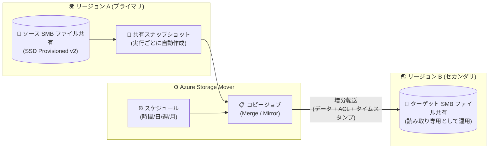

# Azure Storage Mover: Azure Files クロスリージョン データコピー・同期 (Public Preview)

**リリース日**: 2026-10-15

**サービス**: Azure Storage Mover / Azure Files

**機能**: Azure Files cross-region data copy and synchronization with Azure Storage Mover

**ステータス**: In preview

[このアップデートのインフォグラフィックを見る](https://takech9203.github.io/azure-news-summary/20261015-storage-mover-azure-files-cross-region.html)

## 概要

Azure Storage Mover を使用して、SMB Azure ファイル共有のデータを別のストレージアカウント、別の Azure リージョン、別のサブスクリプション (同一 Microsoft Entra テナント内) のファイル共有へコピー・同期できる機能がパブリックプレビューになりました。単発実行だけでなく、スケジュールによる定期的な増分転送をサポートし、ビジネス継続性 (BCP/DR) を支えるセカンダリコピーを維持できます。

各ジョブ実行時にはソースファイル共有の共有スナップショットが自動作成され、そのスナップショットからデータがコピーされるため、ソースを利用中でも一貫性のあるコピーが得られます。コピーはファイルデータだけでなく、ACL (アクセス許可) やタイムスタンプなどのメタデータにも適用されます。

なお、プレビューへのアクセスはサブスクリプション単位の有効化が必要で、サインアップフォームからの申請が必要です。

**アップデート前の課題**

- Azure Files のジオ冗長 (GRS/GZRS) はペアリージョンへの複製に限定され、任意のリージョンにセカンダリコピーを置くことができなかった
- Premium (SSD) ファイル共有はジオ冗長ストレージ (GRS) をサポートしておらず、リージョン障害に備えたコピー維持にはカスタムのコピー処理が必要だった
- Storage Mover のクラウド間転送は Azure Blob 間や AWS S3 → Azure などが対象で、Azure ファイル共有間のコピーはサポートされていなかった

**アップデート後の改善**

- ペアリージョンに限らず、任意の Azure リージョン・ストレージアカウント・サブスクリプション (同一テナント内) のファイル共有へコピー・同期できるようになった
- 時間単位 (1/2/3/4/6/8/12 時間)・日次・週次・月次の定期スケジュールで増分コピーを自動実行し、DR 用のセカンダリコピーを維持できるようになった
- マネージドサービスとして実行されるため、エージェント VM や自前のコピースクリプトの運用が不要になった

## アーキテクチャ図

Storage Mover のコピージョブは、ソース共有のスナップショットから一貫性のあるデータを読み取り、別リージョン・別サブスクリプションのターゲット共有へ増分転送します。スケジュールを有効化すると定期的に同期が実行され、DR 用のセカンダリコピーが維持されます。

## サービスアップデートの詳細

### 主要機能

1. **Azure Files 間のクロスリージョン・クロスサブスクリプション コピー**
   - ソースとターゲットは別のストレージアカウント・サブスクリプション・リージョンに配置可能 (同一 Microsoft Entra テナント内であることが条件)
   - ペアリージョンに限定されず、任意のリージョンを DR 先として選択可能

2. **スケジュールによる増分同期**
   - 「スケジュールなし (手動実行)」「1 回限り」「定期実行」から選択
   - 定期実行は Hourly (1/2/3/4/6/8/12 時間間隔、既定 12 時間)・Daily・Weekly・Monthly をサポート
   - 終了日はスケジュール作成日から 1 年以内、開始日は作成日から 90 日以内に設定

3. **2 つのコピーモード**
   - **Merge content into target**: ソースに存在しないファイルもターゲットに保持。名前・パスが一致するファイルはソースに合わせて更新 (複数共有の統合に有用)
   - **Mirror source to target**: ソースに存在しないファイルはターゲットから削除し、ソースと一致させる

4. **スナップショットベースの一貫性コピー**
   - ジョブ実行ごとにソース共有の共有スナップショットを作成し、そこからコピーするため、ソース利用中でも一貫性を確保
   - スナップショットはジョブ完了時に自動削除 (削除できなかった場合は警告付き完了となり手動削除が必要)

5. **RBAC ロールの自動割り当て**
   - ジョブ開始時に Storage Mover のマネージド ID へ、ソース/ターゲットのファイル共有に対する「Storage File Data Privileged Contributor」、ストレージアカウントに対する「Storage Account Contributor」ロールが自動割り当てされる

6. **モニタリングとログ**
   - Monitoring タブで処理ファイル数、データ量、処理内訳 (Copied / Failed / Unsupported / Skipped / No copy needed)、スループットを確認可能
   - コピーログ・ジョブ実行ログによるファイル単位の結果トレースに対応

## 技術仕様

| 項目 | 詳細 |
|------|------|
| 対象プロトコル | SMB Azure ファイル共有のみ (NFS は非サポート) |
| 推奨メディア階層 (プレビュー期間中) | ソース・ターゲットともに SSD Provisioned v2 共有 |
| テナント要件 | ソースとターゲットは同一 Microsoft Entra テナント内 |
| コピー範囲 | ファイル共有全体 (サブディレクトリの選択は不可) |
| コピー対象 | ファイルデータ + メタデータ (ACL、タイムスタンプ) |
| 同時実行ジョブ数 | サブスクリプションあたり各 Storage Mover リージョンで 10 (サポートリクエストで引き上げ可、ただし 1 Storage Mover リソースあたり 50 まで) |
| 操作インターフェース | Azure Portal のみ (プレビュー期間中は PowerShell / CLI 非サポート) |
| Storage Mover リソースの利用可能リージョン | North Europe、Sweden Central、East US、East US 2、West Central US、West US 3 の 6 リージョン |
| プレビュー利用 | サインアップフォームによるサブスクリプション単位の申請・有効化が必要 |

## 設定方法

### 前提条件

1. Azure サブスクリプションに Storage Mover リソースをデプロイ済みであること
2. ソースおよびターゲットの SMB Azure ファイル共有 (プレビューでは SSD Provisioned v2 を使用)。異なるストレージアカウント・サブスクリプション・リージョンでもよいが、同一 Microsoft Entra テナント内であること
3. プレビューのサインアップが完了し、サブスクリプションで機能が有効化されていること

### Azure Portal

プレビュー期間中は Azure Portal のみサポートされます。

1. **ソースエンドポイントの作成**: Storage Mover リソースの「Storage endpoints」→「Source endpoints」→「Create endpoint」で、Migration type に「Azure to Azure」、Source type に「Azure File share (Preview)」を選択し、サブスクリプション・ストレージアカウント・ファイル共有を指定 (プロトコルは SMB)
2. **ターゲットエンドポイントの作成**: 「Target endpoints」タブから同様にターゲットのファイル共有を指定
3. **プロジェクトの作成**: 「Projects」の Get started タブで「Azure to Azure」+「Azure File share (Preview)」を選択し、ソース・ターゲット・プロジェクトをガイドに沿って設定
4. **ジョブ定義の作成**: ジョブ名を入力し、Schedule タブでスケジュール (なし / 1 回 / 定期) を設定、Settings タブでコピーモード (Merge / Mirror) を選択して作成
5. **ジョブの実行**: 「Start job」で RBAC ロールの自動割り当てを確認して開始。スケジュールを設定した場合は「Schedule」→「Enable」で有効化

## メリット

### ビジネス面

- Premium (SSD) ファイル共有を含め、GRS に依存せず任意のリージョンに DR 用セカンダリコピーを維持でき、ビジネス継続性計画の選択肢が拡大
- ターゲット共有は読み取り可能なため、プライマリワークロードに影響を与えずに DR 訓練や検証に利用可能
- リージョン統合、データレジデンシー要件への対応、コンピュートに近いリージョンへのデータ再配置を計画的に実行可能

### 技術面

- フルマネージドのコピー・同期で、エージェント VM やカスタムスクリプト (AzCopy の定期実行など) の運用が不要
- スナップショットベースのコピーにより、ソース共有を利用中でも一貫性のあるコピーを取得
- ACL・タイムスタンプを含むメタデータが維持されるため、SMB アクセス制御をそのままセカンダリに引き継げる
- Merge モードで複数のファイル共有を 1 つの共有に統合可能

## デメリット・制約事項

- RPO (目標復旧時点) の保証はない。復旧ポイントは「最後に成功したジョブ実行の完了時刻」であり、スケジュール頻度ではない
- NFS Azure ファイル共有は非サポート (SMB のみ)。プレビューでは SSD Provisioned v2 共有の使用が推奨され、他の構成は本番前に十分なテストが必要
- コピー範囲はファイル共有全体のみで、サブディレクトリ単位の指定は不可
- ジョブ実行間にターゲット共有を変更してはならない (競合解決は行われず、変更が上書き・消失する可能性があるため、ターゲットは読み取り専用として扱う)
- 前回の実行中に次のスケジュール実行が開始されるとエラーで失敗する (頻発する場合は実行間隔を長くする)
- 同時実行ジョブはサブスクリプションあたり各 Storage Mover リージョンで 10 まで (引き上げ可、1 リソースあたり上限 50)
- 定期スケジュールの終了日は作成日から 1 年以内、開始日は 90 日以内
- 同一ジョブで同じソースとターゲットのエンドポイントは指定不可。また「移動」ではなく「コピー」であり、ソース共有はそのまま残る
- プレビュー利用にはサインアップフォームからの申請とサブスクリプション単位の有効化が必要

## ユースケース

### ユースケース 1: Premium ファイル共有のクロスリージョン DR コピー

**シナリオ**: GRS をサポートしない Premium (SSD) ファイル共有について、ペアリージョン以外の任意のリージョンにセカンダリコピーを維持し、プライマリリージョン障害時の復旧ポイントとして利用する。

**実装例**: ソース共有 (例: East US) とターゲット共有 (例: West US 3) のエンドポイントを作成し、Mirror モード + 12 時間間隔の定期スケジュールでコピージョブを構成。ターゲットは読み取り専用として運用し、DR 訓練時の検証にも活用する。

**効果**: GRS 非対応の Premium 共有でもリージョン障害に備えたセカンダリコピーを自動維持でき、復旧先リージョンを自由に選択できる。

### ユースケース 2: リージョン移行・データレジデンシー対応

**シナリオ**: リージョン統合やデータレジデンシー要件、またはデータを利用するコンピュートへの近接配置のため、ファイル共有データを別リージョンへ移行する。

**実装例**: 初回フルコピーの後、定期スケジュールで増分同期を継続し、カットオーバー時に最終同期を実行してワークロードをターゲット共有へ切り替える。

**効果**: ダウンタイムを最小化しながら、ACL・タイムスタンプを維持したままリージョン間移行を完了できる。

### ユースケース 3: 複数ファイル共有の統合

**シナリオ**: 複数のファイル共有の内容を 1 つの共有に統合してストレージアカウントを再編成する。

**実装例**: ソース共有ごとにコピージョブを作成し、同一のターゲット共有に対して「Merge content into target」モードで実行する。

**効果**: 既存ファイルを保持しながら複数共有のコンテンツを 1 つの共有へ集約できる。

## 料金

Azure Storage Mover サービス自体の現行機能はすべて無料で提供されています。ただし、以下の関連コストが発生する可能性があります。

| 項目 | 内容 |
|------|------|
| Storage Mover サービス利用料 | 現行機能は無料 |
| ターゲットストレージ | Provisioned 課金モデル (SSD Provisioned v2 など) ではプロビジョニング容量に課金。従量課金モデルではトランザクションと使用容量に課金 |
| ネットワーク | 転送帯域には通常の Azure トラフィックと同じ料金が適用され、Storage Mover 固有の追加料金はない |

本機能 (Azure Files 間コピー) 固有の料金は公式ページで確認できませんでした。詳細は以下を参照してください。

- [Azure Storage Mover の課金について (Microsoft Learn)](https://learn.microsoft.com/azure/storage-mover/billing)
- [Azure Files 料金ページ](https://azure.microsoft.com/pricing/details/storage/files/)
- [帯域幅 (データ転送) 料金ページ](https://azure.microsoft.com/pricing/details/bandwidth/)

## 利用可能リージョン

Storage Mover リソースは以下の 6 リージョンで利用可能です (ターゲットファイル共有に最も近いリージョンへのデプロイが推奨されます)。

- (Europe) North Europe
- (Europe) Sweden Central
- (US) East US
- (US) East US 2
- (US) West Central US
- (US) West US 3

プレビューの有効化はサブスクリプション単位で行われ、対象リージョンで利用可能になった時点で通知されます。

## 関連サービス・機能

- **Azure Files**: コピー対象となる SMB ファイル共有サービス。本機能はソース・ターゲットの両方に Azure Files を使用する
- **Azure Files 共有スナップショット**: ジョブ実行ごとに自動作成され、一貫性のあるコピーの読み取り元として利用される
- **Azure Storage の冗長性 (GRS/GZRS)**: ペアリージョンへの複製を提供する既存の冗長オプション。本機能は任意リージョンへのコピーという補完的な選択肢を提供する
- **Azure Monitor / ログ**: Storage Mover のコピーログ・ジョブ実行ログを有効化して、ファイル単位の転送結果をトレース可能
- **Azure RBAC / マネージド ID**: ジョブ開始時に Storage Mover のマネージド ID へ必要なロールが自動割り当てされる

## 参考リンク

- [インフォグラフィック](https://takech9203.github.io/azure-news-summary/20261015-storage-mover-azure-files-cross-region.html)
- [公式アップデート情報](https://azure.microsoft.com/updates?id=576542)
- [Get started with Azure Files-to-Azure Files data copy in Azure Storage Mover (preview) - Microsoft Learn](https://learn.microsoft.com/azure/storage-mover/azure-files-to-azure-files-copy)
- [What is Azure Storage Mover? - Microsoft Learn](https://learn.microsoft.com/azure/storage-mover/service-overview)
- [Job scheduling in Azure Storage Mover - Microsoft Learn](https://learn.microsoft.com/azure/storage-mover/job-scheduling)
- [Understanding Azure Storage Mover billing - Microsoft Learn](https://learn.microsoft.com/azure/storage-mover/billing)
- [プレビュー サインアップフォーム](https://forms.cloud.microsoft/pages/responsepage.aspx?id=v4j5cvGGr0GRqy180BHbR8CNg9dCXCtNsi4tmyLcYApUOENIOThaQlpMRzlVTk9JVURNNEVUWDVGSC4u&origin=lprLink&route=shorturl)

## まとめ

Azure Storage Mover による Azure Files 間のクロスリージョン コピー・同期機能のパブリックプレビューにより、GRS を利用できない Premium (SSD) ファイル共有を含め、任意のリージョン・サブスクリプションへセカンダリコピーをスケジュール維持できるようになりました。特に DR 戦略でペアリージョン以外への複製が求められる環境や、リージョン移行・共有統合を計画している組織にとって重要なアップデートです。利用にはプレビューのサインアップが必要で、現時点では SMB 共有 (SSD Provisioned v2 推奨)・Azure Portal のみのサポート、RPO 保証なしといった制約があるため、本番適用前に要件との適合性を検証することを推奨します。

---

**タグ**: Azure Storage Mover, Azure Files, Storage, Disaster Recovery, Cross-Region, Data Copy, Synchronization, Public Preview
