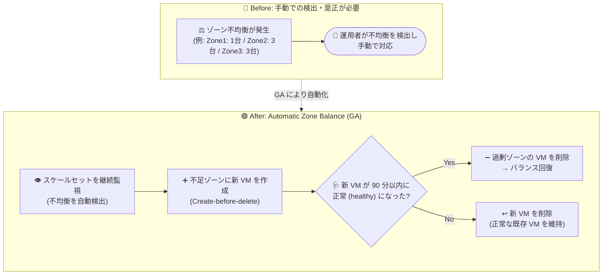

# Azure Virtual Machine Scale Sets: Automatic Zone Balance の一般提供開始 (GA)

**リリース日**: 2026-10-15

**サービス**: Azure Virtual Machine Scale Sets (VMSS)

**機能**: Automatic Zone Balance (ゾーン間の VM インスタンス自動再分散)

**ステータス**: Launched (GA)

[このアップデートのインフォグラフィックを見る](https://takech9203.github.io/azure-news-summary/20261015-vmss-automatic-zone-balance.html)

## 概要

Virtual Machine Scale Sets (VMSS) の Automatic Zone Balance (自動ゾーンバランス) が一般提供 (GA) となりました。本機能は、複数の可用性ゾーンにまたがってデプロイされたスケールセットを継続的に監視し、ゾーン間で VM インスタンス数の不均衡が発生した場合に、自動的に VM を再分散します。

複数ゾーンにまたがるスケールセットは、VM をできる限り均等にゾーンへ分散しようとしますが、キャパシティ制約やスケーリング操作などの要因により、時間の経過とともにゾーン間の不均衡が発生することがあります。この不均衡は気付かれないまま放置されがちで、単一ゾーンの障害時に想定以上の割合の VM が影響を受け、アプリケーションの可用性が低下するリスクを高めます。Automatic Zone Balance はこの不均衡をバックグラウンドで検出・是正し、手動介入を減らしてレジリエンシーを向上させます。

なお、従来からある「ゾーンバランシング (best-effort / strict)」はスケーリング操作時のインスタンス配置を制御する仕組みであるのに対し、Automatic Zone Balance は既に発生した不均衡をプロアクティブに検出し、不足ゾーンへの VM 作成と過剰ゾーンからの VM 削除によって是正する機能である点が異なります。

**アップデート前の課題**

- キャパシティ制約やスケーリング操作により、スケールセットのゾーン間不均衡が時間とともに発生し、気付かれないまま放置されることがあった
- 不均衡状態では、単一ゾーン障害時に想定以上の割合の VM が影響を受け、アプリケーションの可用性が低下するリスクがあった
- 不均衡の検出と是正に手動での介入 (監視・再分散) が必要だった

**アップデート後の改善**

- スケールセットのゾーン間不均衡を継続的に自動監視し、検出時にバックグラウンドで自動的に再分散する
- Create-before-delete 方式 (新 VM の正常性を確認してから旧 VM を削除) により、アプリケーションへの影響を最小限に抑えて再分散する
- 手動介入が不要になり、ゾーンレベルのレジリエンシーが維持される

## アーキテクチャ図



従来は運用者がゾーン不均衡を検出して対応する必要がありましたが、GA となった Automatic Zone Balance が不均衡を継続的に監視し、不足ゾーンへの VM 作成 → 正常性確認 → 過剰ゾーンの VM 削除という安全な手順で自動的に再分散します。

## サービスアップデートの詳細

### 主要機能

1. **ゾーン不均衡の継続監視**
   - 2 つ以上の可用性ゾーンにまたがるスケールセットを常時監視し、ゾーン間の VM 数の差が ±1 台を超える不均衡を検出する
   - 不均衡を検出し、安全条件を満たし、不足ゾーンにキャパシティがある場合、即座に再分散を開始する

2. **Create-before-delete による安全な再分散**
   - 最も VM が少ないゾーン (under-provisioned zone) に新しい VM を作成し、正常 (healthy) になったことを確認してから、最も VM が多いゾーン (over-provisioned zone) の VM を削除する
   - 新 VM が 90 分以内に正常にならない場合、ソース VM が正常であれば新 VM を削除して元の状態を維持する (ワークロードの健全性を優先)
   - 1 回の再分散操作で移動する VM は 1 台のみで、操作間にはクールダウン期間が設けられ、変更が段階的かつ制御された形で行われる

3. **安全チェック (Safety checks)**
   - スケールセットが削除対象でないこと、過去 60 分以内に PUT/PATCH/POST 操作 (VM の追加・削除、アップグレードなど) がないことを確認してから再分散を開始する
   - インスタンス保護ポリシーが適用された VM、割り当て解除状態・削除予定の VM は移動対象外

4. **Automatic Instance Repairs との統合**
   - Automatic Zone Balance を有効化すると、既定で Automatic Instance Repairs (インスタンスの自動修復) も有効になり、インスタンスレベルの健全性監視とゾーンレベルのレジリエンシーの両方を確保できる (個別に無効化も可能)

## 技術仕様

| 項目 | 詳細 |
|------|------|
| 対象 | 2 つ以上の可用性ゾーンにまたがる (zone-spanning) スケールセット。すべての VM がゾーンに割り当てられている必要があり、リージョナル (非ゾーン) VM を含むスケールセットは対象外 |
| バランスの定義 | 各ゾーンの VM 数が他のゾーンと比べて ±1 台以内であれば「バランスされている」とみなす |
| 再分散方式 | Create-before-delete (RebalanceBehavior: `CreateBeforeDelete`)、Recreate (RebalanceStrategy: `Recreate`)。1 回につき 1 台のみ移動 |
| 正常性判定 | Application Health Extension または Load Balancer Health Probe によるアプリケーション正常性監視が必須。新 VM の正常化を最大 90 分待機 |
| API バージョン | Compute API 2024-07-01 以降 |
| 設定プロパティ | `properties.resiliencyPolicy.AutomaticZoneRebalancingPolicy` |
| 一時的なキャパシティ増加 | 再分散中はスケールセットのキャパシティが一時的に 1 台分増加する (クォータとオートスケールの上限に余裕が必要) |
| SKU | 再分散で作成される新 VM は常にスケールセットモデルの最新 SKU を使用 (異なる SKU の VM は再分散後に元の SKU を保持しない) |
| 監視 | Azure Monitor アクティビティログ (`BalanceVMsAcrossZones` 操作)、Uniform モードでは Instance View API の `orchestrationServices` (`AutomaticZoneRebalancing`) で状態確認可能 |

## 設定方法

### 前提条件

1. アプリケーション正常性監視の有効化 (Application Health Extension または Load Balancer Health Probe のいずれか一方)
2. スケールセットが 2 つ以上の可用性ゾーンにまたがって構成されていること (すべての VM がゾーンに割り当て済み)
3. Compute API バージョン 2024-07-01 以降を使用すること
4. (プレビュー時点のドキュメントでは) サブスクリプションでの機能フラグ `Microsoft.Compute.AutomaticZoneRebalancing` の登録が必要とされていた
5. オートスケールの最大インスタンス数とサブスクリプションのクォータに、再分散中の一時的な 1 台分の増加を許容する余裕があること

### Azure CLI

```bash
# Application Health Extension を追加 (Automatic Zone Balance に必須)
az vmss extension set \
    --resource-group myResourceGroup \
    --vmss-name myVMScaleSet \
    --name ApplicationHealthLinux \
    --publisher Microsoft.ManagedServices \
    --version 2.0 \
    --settings '{"protocol": "http", "port": 80, "requestPath": "/healthEndpoint"}'

# インスタンスをアップグレードして拡張機能をインストール
az vmss update-instances \
    --resource-group myResourceGroup \
    --name myVMScaleSet \
    --instance-ids "*"

# Automatic Zone Balance を有効化
az vmss update \
    --resource-group myResourceGroup \
    --name myVMScaleSet \
    --enable-automatic-zone-balancing true \
    --automatic-zone-balancing-behavior CreateBeforeDelete \
    --automatic-zone-balancing-strategy Recreate
```

### Azure Portal

**新規スケールセット作成時:**

1. スケールセット作成の「Basics」タブで、「Availability zone」で 2 つ以上のゾーンを選択
2. 「Health」タブでアプリケーション正常性監視を有効化・構成
3. 「Automatic zone balancing」のチェックボックスを選択して作成

**既存のスケールセット:**

1. スケールセットの「Availability + scale」>「Availability」で 2 つ以上のゾーンが選択されていることを確認
2. 「Operations」>「Health and repair」でアプリケーション正常性監視が有効であることを確認
3. 「Resiliency」セクションで「Automatic zone balancing」のチェックボックスを選択して保存

## メリット

### ビジネス面

- ゾーン障害時に影響を受ける VM の割合を抑え、アプリケーションの可用性低下リスクを低減できる
- ゾーン不均衡の監視・是正にかかる運用負荷 (手動介入) を削減できる
- GA となったことで本番環境での利用が正式にサポートされる

### 技術面

- Create-before-delete 方式と正常性確認により、再分散中もワークロードの健全性が優先される
- 1 回 1 台の移動・クールダウン期間・事前の安全チェックにより、スケールセットへの変更が段階的かつ制御された形で行われる
- Automatic Instance Repairs との統合により、インスタンスレベルとゾーンレベルの両方のレジリエンシーを一度に確保できる
- アクティビティログや Instance View API で再分散操作を監視・追跡できる

## デメリット・制約事項

- **ステートレスワークロード向けに推奨**: 再分散は VM の削除・再作成によって行われるため、インスタンス ID、ネットワーク構成、ディスクは保持されない
- **ベストエフォート動作**: 不足ゾーンのキャパシティが限られている場合、再分散が遅延または開始されないことがある
- **クォータの制約**: 再分散中に一時的に VM 数が 1 台増加するため、サブスクリプションに十分なクォータが必要 (不足している場合は再分散が実行されない)
- **SKU の非保持**: 新 VM は常にスケールセットモデルの最新 SKU で作成されるため、異なる SKU の VM は再分散後に元の SKU を保持しない (特定の VM を再分散対象から除外したい場合はインスタンス保護ポリシーを適用する)
- **ゾーン障害復旧の代替にはならない**: 本機能は VM の正常性を監視してゾーン障害を検出するものではなく、ゾーンダウン時の復旧メカニズムとして使用すべきではない

## 料金

Automatic Zone Balance 自体の追加料金に関する公式情報は、今回のアップデート情報からは確認できませんでした。なお、再分散中はスケールセットのキャパシティが一時的に 1 台分増加する点に留意してください。VM の料金は以下を参照してください。

- [Virtual Machine Scale Sets の価格](https://azure.microsoft.com/pricing/details/virtual-machine-scale-sets/)

## 利用可能リージョン

リージョンに関する公式情報は確認できませんでした。可用性ゾーンをサポートするリージョンの一覧は以下を参照してください。

- [可用性ゾーンをサポートする Azure リージョン](https://learn.microsoft.com/azure/reliability/availability-zones-region-support)

## 関連サービス・機能

- **Automatic Instance Repairs**: 不健全な VM インスタンスを監視・修復する機能。Automatic Zone Balance の有効化時に既定で併せて有効化され、インスタンスレベルの健全性とゾーンレベルのレジリエンシーを両立する
- **Application Health Extension / Load Balancer Health Probe**: Automatic Zone Balance の前提条件となるアプリケーション正常性監視。再分散時に新 VM の正常性判定に使用される
- **ゾーンバランシング (best-effort / strict)**: スケーリング操作時のインスタンス配置を制御する既存機能。Automatic Zone Balance は既存の不均衡を是正する点で補完関係にある
- **インスタンス保護ポリシー**: 特定の VM を再分散対象から除外するために使用できる
- **Azure Monitor アクティビティログ**: `BalanceVMsAcrossZones` 操作のログで再分散の実行状況を監視できる

## 参考リンク

- [インフォグラフィック](https://takech9203.github.io/azure-news-summary/20261015-vmss-automatic-zone-balance.html)
- [公式アップデート情報](https://azure.microsoft.com/updates?id=576334)
- [Microsoft Learn: Automatic zone balance for Virtual Machine Scale Sets](https://learn.microsoft.com/azure/virtual-machine-scale-sets/auto-zone-balance-overview)
- [Microsoft Learn: Enable Automatic Zone Balance on Virtual Machine Scale Sets](https://learn.microsoft.com/azure/virtual-machine-scale-sets/auto-zone-balance-enable)
- [Microsoft Learn: Availability zone options for Azure Virtual Machine Scale Sets](https://learn.microsoft.com/azure/virtual-machine-scale-sets/virtual-machine-scale-sets-use-availability-zones)
- [料金ページ (Virtual Machine Scale Sets)](https://azure.microsoft.com/pricing/details/virtual-machine-scale-sets/)

## まとめ

VMSS の Automatic Zone Balance が GA となり、可用性ゾーンにまたがるスケールセットのゾーン間不均衡を自動的に検出・是正できるようになりました。従来は気付かれにくかった不均衡によるゾーン障害時の可用性リスクを、手動介入なしで低減できる点が大きな価値です。マルチゾーン構成の VMSS を運用している場合、特にステートレスワークロードでは有効化を検討することを推奨します。有効化にあたっては、アプリケーション正常性監視の構成、クォータとオートスケール上限の 1 台分の余裕、再分散時にインスタンス ID・ディスクが保持されない点を事前に確認してください。

---

**タグ**: #Azure #VMSS #VirtualMachineScaleSets #AvailabilityZones #Resiliency #HighAvailability #GA #Compute
