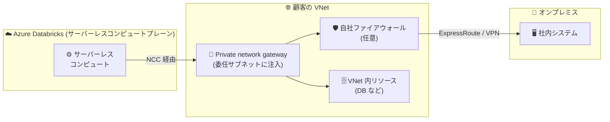

# Azure Databricks: Private network gateway (Public Preview)

**リリース日**: 2026-10-16

**サービス**: Azure Databricks

**機能**: Private network gateway

**ステータス**: In preview

[このアップデートのインフォグラフィックを見る](https://takech9203.github.io/azure-news-summary/20261016-databricks-private-network-gateway.html)

## 概要

Azure Databricks の Private network gateway がパブリックプレビューになりました。この機能により、Azure Databricks のサーバーレスコンピュートが、単一のマネージドゲートウェイを通じて、顧客の仮想ネットワーク (VNet) 内のリソース、および ExpressRoute や VPN で推移的に接続されたネットワーク (オンプレミスなど) のリソースに接続できるようになります。

仕組みとしては、VNet 内の 1 つのサブネットを `Microsoft.Databricks/workspaces` に委任すると、Azure Databricks がそのサブネットにゲートウェイを注入し、サーバーレスの送信トラフィックがゲートウェイ経由で VNet およびその先のネットワークへルーティングされます。既存のネットワーク接続構成 (NCC) をそのまま再利用する設計で、NCC 内にゲートウェイを作成しワークスペースに NCC をアタッチするだけで、対象ワークスペースのサーバーレス製品が自動的にゲートウェイを利用できます。Private Link (NCC のプライベートエンドポイントルール) を置き換えるものではなく補完する位置づけで、特定のクラウドマネージドリソースへの直接接続には Private Link、VNet 内・接続ネットワーク内のリソースへの到達や自社ファイアウォール経由の egress には Private network gateway を使い分けます。

**アップデート前の課題**

- サーバーレスコンピュートからプライベートリソースへ接続するには、NCC のプライベートエンドポイントルールをリソースごとに個別に構成する必要があった (リソース単位のオンボーディングが必要)
- サーバーレスの送信トラフィックを自社のファイアウォールやネットワークセキュリティアプライアンス経由でルーティングする手段がなかった
- サーバーレスの egress は Databricks 管理の IP から送信されるため、ダウンストリームシステムがネットワークレイヤーでトラフィックを識別・許可リスト化することが困難だった

**アップデート後の改善**

- 単一のマネージドゲートウェイで、VNet 内の多数のリソースや ExpressRoute / VPN 経由のオンプレミスシステムに、リソースごとの構成なしで到達可能になった
- サーバーレスの egress を自社のファイアウォール (Palo Alto や Azure Firewall など) 経由でルーティングし、ネットワーク外に出る前にコンテンツ検査できるようになった
- 自社の IP アドレスセットから安定した識別可能なソース IP で送信できるようになり、マルチテナント環境での安全な許可リスト運用が可能になった

## アーキテクチャ図



サーバーレスコンピュートの送信トラフィックが、VNet 内の委任サブネットに注入された単一のマネージドゲートウェイを経由して、VNet 内リソースや推移的に接続されたオンプレミスネットワークに到達します。自社ファイアウォール経由のルーティングも可能です。

## サービスアップデートの詳細

### 主要機能

1. **リソース単位のオンボーディング不要な広範な接続**
   - VNet 内の多数のリソース、および ExpressRoute / VPN で接続されたオンプレミスシステムに、リソースごとのプライベートエンドポイント構成なしで到達できる

2. **自社セキュリティアプライアンス経由の egress**
   - サーバーレスの送信トラフィック (インターネット向けを含む) を自社のファイアウォールやネットワークセキュリティアプライアンス経由でルーティングし、コンテンツ検査が可能

3. **安定した識別可能なソース IP**
   - サーバーレスの egress を自社の IP アドレスセットから送信でき、ダウンストリームシステムがネットワークレイヤーでトラフィックを識別可能

4. **2 つのトラフィックモード**
   - `SPECIFIC_DESTINATIONS`: 指定した DNS 名のみゲートウェイ経由でルーティング (推奨)。サフィックスマッチ対応 (例: `mydb.contoso.com` は `sub.mydb.contoso.com` にもマッチ)。指定した宛先は egress コントロールで自動的に許可される
   - `ALL_TRAFFIC`: Private Link などより具体的なルートを除く全送信トラフィックをゲートウェイ経由でルーティング。この場合、接続先はすべて egress ネットワークポリシーに明示的に追加する必要がある

5. **既存 NCC との統合**
   - 新しいオブジェクトモデルを導入せず、既存の NCC 内にゲートウェイを作成する。プライベートエンドポイントルールが存在するリソースへのトラフィックは、`ALL_TRAFFIC` モードでも常にプライベートエンドポイントが優先される

### トラフィック経路の優先順位

| 優先度 | 経路 | 適用対象 |
|--------|------|---------|
| 1 | プライベートエンドポイントルール (Private Link) | プライベートエンドポイントルールが構成された特定のクラウドマネージドリソース |
| 2 | Azure サービスエンドポイント | サービスエンドポイントにマッチするトラフィック (ゲートウェイでオーバーライド不可。Blob ストレージは常にこの経路) |
| 3 | Private network gateway | `SPECIFIC_DESTINATIONS` モードで指定した宛先、または `ALL_TRAFFIC` モードの残りの全 egress |
| 4 | 既定の Databricks サーバーレス egress | その他すべての送信トラフィック |

## 技術仕様

| 項目 | 詳細 |
|------|------|
| ゲートウェイの配置 | VNet 内の `Microsoft.Databricks/workspaces` に委任したサブネットに注入 |
| サブネット要件 | `/28` 以上の専用サブネット (他リソースとの共用不可)、NCC・ワークスペースと同一リージョン |
| 帯域幅ティア | 10 / 30 / 50 / 100 Gbps (アカウントコンソールの初期選択は 30 Gbps) |
| 構成手段 | アカウントコンソール、Networking v1 REST API、Terraform (`databricks_private_network_gateway`) |
| 上限 | 1 NCC あたり最大 2 ゲートウェイ、1 ゲートウェイあたり最大 2 DNS リゾルバー・最大 100 宛先 |
| 対応製品 | サーバーレスの Databricks Runtime 製品および AI サービス |
| DNS | Azure 提供 DNS を推奨 (VNet にリンクされたプライベート DNS ゾーンを解決)。カスタムリゾルバーも指定可 (ゲートウェイサブネットから到達可能であること) |
| テナント要件 | 委任サブネットを含む VNet のサブスクリプションは、ワークスペースのサブスクリプションと同一 Microsoft Entra ID テナントであること |

## 設定方法

### 前提条件

1. Premium プランの Azure Databricks アカウントと、サーバーレスコンピュートが有効なワークスペースが 1 つ以上あること
2. Azure Databricks アカウント管理者権限
3. 対象 VNet でサブネットを `Microsoft.Databricks/workspaces` に委任できる Azure サブスクリプション権限
4. ゲートウェイ専用の `/28` 以上のサブネット (NCC・ワークスペースと同一リージョン)
5. アカウントコンソールの「Previews」ページでプレビュー機能へのアクセスを有効化 (アカウント管理者が管理)

### 設定手順の概要

1. **NCC の作成または選択**: 対象リージョンに NCC がなければ作成する
2. **サブネットの委任**: Azure Portal で対象 VNet のサブネットを `Microsoft.Databricks/workspaces` に委任する
3. **ゲートウェイの作成**: アカウントコンソール (**Security > Network connectivity configurations > Private network gateway** タブ)、REST API、または Terraform で作成する
4. **NCC のワークスペースへのアタッチ**: アカウントコンソールまたは REST API でアタッチする

### REST API での作成例

```bash
# SPECIFIC_DESTINATIONS モードでゲートウェイを作成
curl --request POST \
  'https://accounts.azuredatabricks.net/api/networking/v1/accounts/{account_id}/network-connectivity-configs/{ncc_id}/private-network-gateways' \
  --header 'Authorization: Bearer <access_token>' \
  --header 'Content-Type: application/json' \
  --data '{
    "display_name": "my-azure-png",
    "bandwidth_tier_gigabits_per_second": 30,
    "traffic_mode": "SPECIFIC_DESTINATIONS",
    "azure_cloud_connection": {
      "gateway_subnet": {
        "resource_id": "/subscriptions/{subscription_id}/resourceGroups/{rg}/providers/Microsoft.Network/virtualNetworks/{vnet}/subnets/{subnet}"
      }
    },
    "private_dns_resolvers": [],
    "destinations": [
      { "destination_type": "DNS_NAME", "value": "myserver.internal.contoso.com" }
    ]
  }'
```

作成は長時間実行オペレーションとして返されるため、`done: true` かつ `state: ESTABLISHED` になるまでポーリングして確認します。

## メリット

### ビジネス面

- プライベートリソースごとの個別構成が不要になり、サーバーレス移行時のネットワーク構成・運用コストを削減できる
- 自社ファイアウォール経由の egress 検査により、組織のセキュリティ・コンプライアンス要件を満たしながらサーバーレスコンピュートを採用できる

### 技術面

- 単一ゲートウェイで VNet・オンプレミス (ExpressRoute / VPN 経由) の多数のリソースに到達でき、構成がシンプル
- 安定したソース IP により、データベースや SaaS 側での IP 許可リスト運用が可能
- 既存の NCC・Private Link・egress コントロール (ネットワークポリシー) と整合的に動作し、優先順位が明確

## デメリット・制約事項

- パブリックプレビュー段階であり、アカウントコンソールの「Previews」ページでの有効化が必要
- Premium プランが必要。課金は 2026 年 12 月 1 日以降に開始予定
- ゲートウェイとそのサブネットは NCC と同一リージョンである必要がある
- サービスエンドポイント経由で到達するクラウドホステッドサービス (Azure Data Lake Storage など) には接続できない。Blob ストレージは常にサービスエンドポイント経路となり、ゲートウェイでオーバーライド不可
- 1 NCC あたり最大 2 ゲートウェイ、1 ゲートウェイあたり最大 2 DNS リゾルバー・最大 100 宛先という上限がある
- ゲートウェイサブネットの変更は不可 (削除して再作成が必要)。ゲートウェイを削除すると依存するプライベートリソースへの接続が切断される
- 帯域幅ティアの変更は非同期で反映され、新しい容量が利用可能になったことを示すシグナルは API から提供されない

## ユースケース

### ユースケース 1: サーバーレスからオンプレミスデータベースへの接続

**シナリオ**: サーバーレス SQL ウェアハウスやサーバーレスジョブから、ExpressRoute で接続されたオンプレミスのデータベースにフェデレーションクエリを実行したい。

**実装例**: `SPECIFIC_DESTINATIONS` モードでゲートウェイを作成し、`destinations` にオンプレミス DB の DNS 名 (例: `onprem-db2.corp.contoso.com`) を追加する。

**効果**: リソースごとのプライベートエンドポイント構成なしで、サーバーレスコンピュートからオンプレミスリソースにプライベートに到達できる。

### ユースケース 2: 全 egress の自社ファイアウォール経由ルーティング

**シナリオ**: セキュリティポリシー上、サーバーレスの全送信トラフィック (インターネット向け含む) を自社のファイアウォールで検査する必要がある。

**実装例**: `ALL_TRAFFIC` モードでゲートウェイを作成し、VNet 内のファイアウォール (Azure Firewall や Palo Alto など) を経由するルーティングを構成する。接続先は egress ネットワークポリシーに明示的に追加する。

**効果**: サーバーレスの egress をネットワーク外に出る前にコンテンツ検査でき、自社の専用 IP アドレスセットからの送信となる。

## 料金

Private network gateway には Premium プランが必要です。ゲートウェイ自体の課金は 2026 年 12 月 1 日以降に開始されます。また、サーバーレスワークロードが顧客リソースに接続する際のネットワークコストは Azure Databricks によって課金されます。具体的な料金は以下の公式ページを参照してください。

- [Azure Databricks 料金ページ](https://azure.microsoft.com/pricing/details/databricks/)
- [Databricks ネットワークコストの理解](https://learn.microsoft.com/en-us/azure/databricks/security/network/serverless-network-security/cost-management)

## 利用可能リージョン

パブリックプレビュー期間中は以下の Azure リージョンで利用可能です (ゲートウェイとサブネットは NCC と同一リージョンであること):

`australiaeast`, `brazilsouth`, `canadacentral`, `centralindia`, `centralus`, `eastasia`, `eastus`, `eastus2`, `francecentral`, `germanywestcentral`, `japaneast`, `koreacentral`, `northcentralus`, `northeurope`, `southcentralus`, `southeastasia`, `swedencentral`, `switzerlandnorth`, `uaenorth`, `uksouth`, `westcentralus`, `westeurope`, `westus`, `westus2`, `westus3`

日本では `japaneast` (東日本) が対象です。

## 関連サービス・機能

- **ネットワーク接続構成 (NCC)**: ゲートウェイは既存の NCC 内に作成され、NCC をワークスペースにアタッチすることで利用可能になるアカウントレベルのリージョナルオブジェクト
- **Azure Private Link (NCC プライベートエンドポイントルール)**: 特定のクラウドマネージドリソース (オブジェクトストレージなど) への直接プライベート接続に使用。ゲートウェイはこれを補完し、プライベートエンドポイントルールが常に優先される
- **サーバーレス egress コントロール (ネットワークポリシー)**: `SPECIFIC_DESTINATIONS` モードの宛先は自動的に許可される。SEG ポリシーが拒否する宛先はゲートウェイより先に評価される点に注意
- **Azure ExpressRoute / VPN Gateway**: VNet に推移的に接続されたオンプレミスネットワークへの到達経路として利用
- **Azure Firewall / ネットワークセキュリティアプライアンス**: サーバーレス egress の検査ポイントとしてゲートウェイの下流に配置可能

## 参考リンク

- [インフォグラフィック](https://takech9203.github.io/azure-news-summary/20261016-databricks-private-network-gateway.html)
- [公式アップデート情報 (Azure Updates)](https://azure.microsoft.com/updates?id=576556)
- [Private network gateway (Microsoft Learn)](https://learn.microsoft.com/en-us/azure/databricks/security/network/serverless-network-security/private-network-gateway)
- [Configure a private network gateway (Microsoft Learn)](https://learn.microsoft.com/en-us/azure/databricks/security/network/serverless-network-security/private-network-gateway/configure-private-network-gateway)
- [Serverless compute plane networking (Microsoft Learn)](https://learn.microsoft.com/en-us/azure/databricks/security/network/serverless-network-security/)
- [Azure Databricks 料金ページ](https://azure.microsoft.com/pricing/details/databricks/)

## まとめ

Private network gateway は、Azure Databricks サーバーレスコンピュートのプライベート接続における構成負担を大幅に軽減するアップデートです。従来はリソースごとに必要だったプライベートエンドポイント構成が、サブネット委任と単一のマネージドゲートウェイで広範なリソース (VNet 内・オンプレミス) をカバーできるようになり、自社ファイアウォール経由の egress 検査や安定ソース IP といったエンタープライズ要件にも対応します。サーバーレス移行を検討している組織、特にオンプレミスデータソースへのフェデレーションや厳格な egress 制御が必要な組織は、プレビュー対象リージョン (日本では東日本) での検証を推奨します。課金が 2026 年 12 月 1 日以降に開始される点と、サービスエンドポイント経由のリソース (Blob ストレージなど) はゲートウェイを経由しない点に留意してください。

---

**タグ**: Azure Databricks, Networking, Serverless, Private network gateway, NCC, Security, Public Preview
