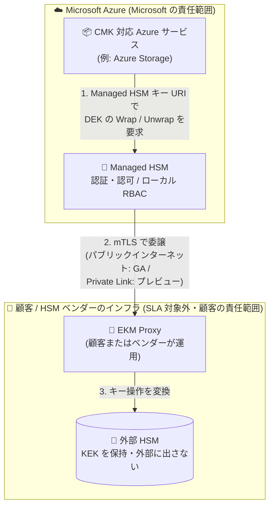

# Azure Key Vault Managed HSM: External key management (外部キー管理) が一般提供開始

**リリース日**: 2026-10-16

**サービス**: Azure Key Vault Managed HSM

**機能**: External key management (EKM / 外部キー管理)

**ステータス**: Launched (GA)

[このアップデートのインフォグラフィックを見る](https://takech9203.github.io/azure-news-summary/20261016-key-vault-managed-hsm-external-key-management.html)

## 概要

Azure Key Vault Managed HSM の External key management (EKM) が、すべての Azure パブリックリージョンで一般提供 (GA) になりました。EKM は、キー暗号化キー (KEK) を物理的に自社管理下に置くことを求める規制・主権 (ソブリンティ) 要件を持つ組織向けの機能です。Managed HSM と連携するカスタマーマネージドキー (CMK) 対応の Azure サービスが、Microsoft インフラストラクチャの外部にある顧客運用のハードウェアセキュリティモジュール (HSM) に保持されたキーを利用できるようになります。

Managed HSM は、キーの Wrap / Unwrap 操作を顧客が運用する「EKM Proxy」経由で外部 HSM に委譲します。外部のキー素材 (KEK) は Microsoft インフラストラクチャの外部に留まり、Microsoft 側に渡ることはありません。GA 時点では EKM Proxy へのパブリックインターネット経由の接続が利用可能で、Azure Private Link 統合はパブリックプレビューです。外部 HSM・Proxy・ネットワークの可用性は顧客または HSM ベンダーの責任範囲であり、Managed HSM の SLA の対象外です。

なお、Azure Updates ページでは「アクセスには Microsoft アカウントチームを通じた有効化が必要」と記載されている一方、Microsoft Learn ドキュメントではサブスクリプションごとの機能登録 (`MHSM_EKM`、登録は自動承認) の手順が案内されています。

**アップデート前の課題**

- Managed HSM は Azure 内の FIPS 140-3 Level 3 HSM にキーを保持するため、「キー素材を Microsoft インフラストラクチャの外に物理的に保持しなければならない」という法規制・契約上の要件を持つ組織は、Managed HSM 経由の CMK 暗号化を利用できなかった
- EKM は 2026 年 7 月からプレビュー提供されており、本番利用には GA を待つ必要があった

**アップデート後の改善**

- CMK (Managed HSM) 対応の Azure サービスで、外部 HSM に保持した KEK を使ったサービス側暗号化 (encryption at rest) が本番利用可能になった
- すべての Azure パブリックリージョンで利用可能になり、パブリックインターネット経由の Proxy 接続が GA となった (Private Link 統合はプレビュー)
- Microsoft が公開する標準の EKM Proxy API により、任意の HSM ベンダー製品 (または自前実装の Proxy) を利用できるベンダー非依存の構成が可能になった

## アーキテクチャ図



Azure サービスは従来どおり Managed HSM のキー URI を参照し、Managed HSM が認証・認可を行ったうえでキー操作を mTLS 経由で顧客運用の EKM Proxy に委譲、外部 HSM が KEK を外部に出すことなく Wrap / Unwrap を実行して DEK のみを返します。セキュリティ境界 (Microsoft の責任範囲と顧客の責任範囲) が Managed HSM と EKM Proxy の間に明確に引かれています。

## サービスアップデートの詳細

### 主要機能

1. **外部 HSM に保持した KEK による CMK 暗号化**
   - エンベロープ暗号化の KEK 操作 (DEK の Wrap / Unwrap) を外部 HSM に移す。Unwrap は DEK を Azure サービスに返すのみで、外部 KEK 自体は決して Microsoft インフラストラクチャに保存・通過しない
   - 対象は「CMK with Managed HSM」をサポートする Azure サービスのサービス側暗号化 (encryption at rest)

2. **標準 EKM Proxy API によるベンダー非依存の統合**
   - Microsoft は公開 API 仕様を提供し、Proxy 自体は提供しない。HSM ベンダーが準拠 Proxy を実装するほか、顧客自身で実装することも可能
   - 対応ベンダー (ドキュメント記載): Entrust、Eviden、Fortanix、Futurex、Securosys SA、Thales、Utimaco

3. **既存の Managed HSM 統合をそのまま利用**
   - Azure サービスはベンダー固有 API を呼ばず、既存の Managed HSM キー URI と統合を使用。アクセス制御は Managed HSM のローカル RBAC で管理

4. **ネットワーク接続オプション**
   - EKM Proxy への接続は mTLS で保護。パブリックインターネットモデルが GA、Azure Private Link モデルはパブリックプレビュー

## 技術仕様

| 項目 | 詳細 |
|------|------|
| キー素材の場所 | Microsoft インフラストラクチャ外の顧客所有 HSM (Managed HSM キーは Azure 内 FIPS 140-3 Level 3 HSM) |
| 対象シナリオ | CMK (Managed HSM) 対応 Azure サービスの encryption at rest (エンベロープ暗号化の KEK 操作) |
| 有効化 | サブスクリプションごとに機能登録が必要 (`Microsoft.KeyVault/MHSM_EKM`、自動承認) |
| ネットワーク | パブリックインターネット (GA) / Azure Private Link (プレビュー)、いずれも mTLS |
| SLA | Managed HSM サービス自体は SLA 対象。EKM Proxy・外部 HSM・外部キーのエンドツーエンド可用性は SLA 対象外 |
| geo レプリケーション | 外部キーでは非サポート (Managed HSM のマルチリージョンレプリケーションは使用不可) |
| Secure Key Release (SKR) | 非サポート (SKR を要する Confidential VM ディスク暗号化シナリオも非サポート) |
| バックアップ / リストア | 外部キーでは非サポート (リストアを試みると Managed HSM リソースが劣化状態になる可能性。外部キー参照の再作成で回復) |
| 外部キー識別子 | 割り当て後は不変 (イミュータブル)。ローテーションは新しいキーバージョンの作成で行う |
| ログ | Managed HSM 側は Azure Monitor。Proxy / 外部 HSM のログは顧客の責任 |
| レイテンシー | 各キー操作に Proxy + 外部 HSM へのネットワーク往復が追加され、Managed HSM キーより高くなる |
| 提供リージョン | すべての Azure パブリックリージョン (Azure Government / Azure China などソブリンクラウドは対象外) |

## 設定方法

### 前提条件

1. 利用する Azure サービスが「CMK with Managed HSM」をサポートしていることを確認する
2. 外部 HSM と EKM Proxy を顧客 (または HSM ベンダー) 側で展開し、可用性・運用体制を整える
3. サブスクリプションの機能登録を行える権限 (Contributor / Owner など `Microsoft.Features/*` 権限) を持つこと。これは Managed HSM データプレーンのロールとは別

### Azure CLI

```bash
# サブスクリプションで EKM 機能を登録する
SUBSCRIPTION_ID="<subscription-id>"

az feature register \
    --namespace Microsoft.KeyVault \
    --name MHSM_EKM \
    --subscription "$SUBSCRIPTION_ID"

# 登録状態を確認する (Registered になるまで待機)
az feature show \
    --namespace Microsoft.KeyVault \
    --name MHSM_EKM \
    --subscription "$SUBSCRIPTION_ID" \
    --query properties.state \
    --output tsv
```

登録後、Proxy 接続の登録と外部キー参照の作成を Azure CLI または Azure Portal のクイックスタートに従って行い、Azure サービスにキーへのアクセスを許可して CMK 設定に Managed HSM キー URI を指定します。

## メリット

### ビジネス面

- キー素材を物理的に自社管理下に置くことを求める法規制・契約・主権要件 (physical HSM possession) に準拠しながら Azure サービスを利用できる
- 標準 EKM Proxy API によりベンダーロックインを回避でき、既存の HSM 投資 (Thales、Entrust など) を活用できる
- Microsoft による追加の操作課金はなく、標準の Managed HSM 料金のみ (Proxy インフラと HSM ベンダーライセンスのコストは顧客負担)

### 技術面

- Azure サービス側は既存の Managed HSM 統合 (キー URI、ローカル RBAC) をそのまま使用でき、サービスごとの個別対応が不要
- KEK は外部 HSM から一切出ず、Unwrap は DEK のみを返す設計で「キーが Microsoft インフラを通過しない」ことが保証される
- Microsoft (Managed HSM まで) と顧客 (Proxy・外部 HSM・ネットワーク) の責任境界が明確

## デメリット・制約事項

- **エンドツーエンドの Microsoft SLA がない**: EKM Proxy や外部 HSM の障害は依存する Azure ワークロードを停止させ得るが、Azure サービスや Managed HSM の SLA にはカウントされない。外部コンポーネントの高可用性・DR・サポートは顧客または運用委託先の責任
- **可用性・性能の低下**: すべての外部キー操作に Proxy と外部 HSM へのネットワーク往復が加わる。Managed HSM キーの方が高速・高可用
- **運用コストの増加**: Proxy と外部 HSM のプロビジョニング、パッチ適用、スケーリング、監視は顧客の責任。Microsoft は Proxy / 外部 HSM を提供・サポートしない
- **機能制約**: geo レプリケーション非対応、Secure Key Release (SKR) 非対応、外部キーのバックアップ / リストア非対応、外部キー識別子は変更不可
- Microsoft Learn は「外部保管の要件がない場合は Managed HSM キーを使うべきであり、EKM は法的・契約的要件がある場合の最終手段 (last-resort) であって汎用的なアップグレードではない」と明記している

## ユースケース

### ユースケース 1: 規制業種におけるキーの物理的保持要件への対応

**シナリオ**: 金融機関や公共部門など、法規制・契約により「暗号鍵を物理的に自社 (国内) の HSM に保持すること」が義務付けられている組織が、Azure Storage などの CMK 対応サービスでデータを暗号化したい。

**実装例**:

```bash
# 1. サブスクリプションで EKM を有効化
az feature register --namespace Microsoft.KeyVault --name MHSM_EKM

# 2. 外部 HSM / EKM Proxy を展開 (ベンダー製品または自前実装) し、
#    Managed HSM に Proxy 接続と外部キー参照を登録 (クイックスタート参照)
# 3. Azure サービスの CMK 設定に Managed HSM のキー URI を指定し、
#    保護対象ワークロードで読み書きを検証
```

**効果**: KEK が Microsoft インフラストラクチャに存在・通過しないことを保証しつつ、Azure サービスの CMK 暗号化を本番利用できる。

## 料金

External key management 自体に Microsoft の追加の操作課金はなく、標準の Managed HSM 料金が適用されます。EKM Proxy のインフラコストと外部 HSM (ベンダーライセンス含む) のコストは顧客負担です。

詳細は料金ページを参照: [Azure Key Vault の料金](https://azure.microsoft.com/pricing/details/key-vault/)

## 利用可能リージョン

- External key management および Azure Private Link 統合 (プレビュー) は、**すべての Azure パブリックリージョン**で利用可能
- ソブリンクラウド (Azure Government、Azure China) は対象外

## 関連サービス・機能

- **カスタマーマネージドキー (CMK) 対応 Azure サービス**: Azure Storage など「CMK with Managed HSM」をサポートするサービスが EKM の利用対象。各サービスの CMK 構成ドキュメントに従って設定する
- **Azure Private Link**: Managed HSM から EKM Proxy への閉域接続を提供 (パブリックプレビュー)
- **Azure Monitor**: Managed HSM 側の操作ログを提供。Proxy / 外部 HSM 起因の失敗もログで識別可能 (Proxy・HSM 自体のログは顧客責任)
- **Managed HSM マルチリージョンレプリケーション**: Managed HSM キーでは利用可能だが、外部キーでは非サポート

## 参考リンク

- [インフォグラフィック](https://takech9203.github.io/azure-news-summary/20261016-key-vault-managed-hsm-external-key-management.html)
- [公式アップデート情報 (Azure Updates)](https://azure.microsoft.com/updates?id=574296)
- [Microsoft Learn: What is Managed HSM external key management?](https://learn.microsoft.com/azure/key-vault/managed-hsm/external-key-management-overview)
- [Microsoft Learn: EKM のネットワークと mTLS 構成](https://learn.microsoft.com/azure/key-vault/managed-hsm/external-key-management-networking)
- [Microsoft Learn: EKM の SLA と共有責任モデル](https://learn.microsoft.com/azure/key-vault/managed-hsm/external-key-management-shared-responsibility)
- [料金ページ (Azure Key Vault)](https://azure.microsoft.com/pricing/details/key-vault/)

## まとめ

Azure Key Vault Managed HSM の External key management の GA により、キー素材を Microsoft インフラストラクチャ外に物理的に保持する必要がある組織でも、CMK 対応 Azure サービスの暗号化を本番環境で利用できるようになりました (プレビュー開始は 2026 年 7 月、GA ではパブリックインターネット接続が正式提供、Private Link はプレビュー継続)。一方で、EKM Proxy と外部 HSM は SLA 対象外の顧客責任領域であり、可用性・性能・運用コストのトレードオフが大きいため、「物理的なキー保持の規制要件がある場合の最終手段」という位置付けを理解したうえで採用を判断すべきです。該当要件を持つ組織は、共有責任モデルと制約事項 (geo レプリケーション・SKR・バックアップ非対応) を確認し、HSM ベンダーの Proxy 実装の評価から着手することを推奨します。

---

**タグ**: Azure Key Vault, Managed HSM, External Key Management, Security, Customer-Managed Keys, HSM, GA
