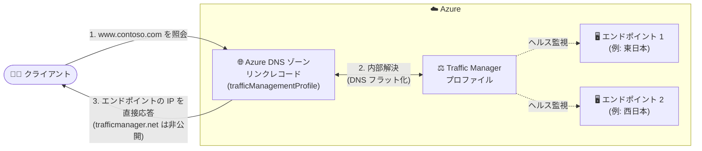

# Azure DNS: Traffic Manager リンクレコードによる DNS ベースの負荷分散が一般提供 (GA)

**リリース日**: 2026-10-19

**サービス**: Azure DNS / Azure Traffic Manager

**機能**: Traffic Manager Linked Records (Traffic Manager リンクレコード)

**ステータス**: Launched (GA)

[このアップデートのインフォグラフィックを見る](https://takech9203.github.io/azure-news-summary/20261019-azure-dns-traffic-manager-linked-records.html)

## 概要

Azure DNS と Azure Traffic Manager のシームレスな統合により、DNS ベースの負荷分散を実現する「Traffic Manager Linked Records (リンクレコード)」が一般提供 (GA) になりました。Azure DNS のレコードセットを Traffic Manager プロファイルに直接関連付けられるようになり、`trafficmanager.net` ドメインを指す CNAME レコードを作成する必要がなくなります。

リンクレコードでは、レコードセットの新しいプロパティ `trafficManagementProfile` でリンクを宣言します。DNS クエリの解決時に Azure DNS が Traffic Manager プロファイルを内部的に解決し、エンドポイントの IP アドレス (A / AAAA レコード) または FQDN (CNAME レコード) をクライアントに直接返します。この仕組みは「DNS フラット化 (DNS flattening)」と呼ばれ、リンクレコードでは常に統合モードで動作します。

中間の CNAME ルックアップが不要になることで DNS ルックアップのレイテンシーが削減されるほか、署名されていない `trafficmanager.net` ドメインが DNS 解決チェーンから除去されるため、負荷分散対象レコードでの DNSSEC 互換性が実現します。

**アップデート前の課題**

- Traffic Manager を利用するには `trafficmanager.net` を指す CNAME レコード (またはエイリアスレコード) が必要で、CNAME 型では追加の DNS ルックアップが発生しレイテンシーが増加していた
- 署名されていない `trafficmanager.net` が解決チェーンに入るため、DNSSEC の信頼チェーンが途切れ、DNSSEC 署名済みゾーンで Traffic Manager を利用できなかった
- `trafficmanager.net` は全 Azure 顧客のプロファイルをホストする共有ドメインであり、クライアント側のファイアウォールで許可すると他の顧客のプロファイルへのアクセスも意図せず許可してしまう懸念があった
- エイリアスレコードの型検証は Azure DNS 側でエンドポイントの現在の状態に基づいて行われるため、構成ミスへの保護が限定的だった

**アップデート後の改善**

- Azure DNS レコードセットを Traffic Manager プロファイルに直接関連付け、エンドポイントの IP / FQDN を DNS 応答で直接返却 (中間 CNAME ホップを排除しルックアップレイテンシーを削減)
- DNS 解決が Azure DNS インフラ内で完結するため DNSSEC の信頼チェーンを維持でき、DNSSEC 署名済みゾーンでも Traffic Manager による負荷分散が可能に
- `trafficmanager.net` が DNS 応答に一切現れず、ファイアウォール許可も不要になり攻撃対象領域を削減
- Strictly Typed Profiles (STP) により Traffic Manager 側で型検証を実施し、構成ミスを強力に防止

## アーキテクチャ図

リンクレコードでは Azure DNS が Traffic Manager プロファイルを内部的に解決し、クライアントには最適なエンドポイントの IP アドレスを直接返します。従来必要だった `trafficmanager.net` への追加ルックアップが不要になります。

## サービスアップデートの詳細

### 主要機能

1. **DNS フラット化 (統合解決)**
   - レコードセットの `trafficManagementProfile` プロパティで Traffic Manager プロファイルを直接リンク
   - Azure DNS がプロファイルを内部解決し、A / AAAA レコードはエンドポイント IP を、CNAME レコードは FQDN を直接応答
   - リンクレコードでは統合モードが常に有効

2. **DNSSEC 互換性**
   - 解決が Azure DNS インフラ内で完結し、署名されていない中間ホップが存在しないため DNSSEC の信頼チェーンを維持
   - DNSSEC 署名済みゾーンでの Traffic Manager 利用に適合

3. **ゾーン APEX (ネイキッドドメイン) サポート**
   - DNS プロトコル上 CNAME を配置できないゾーン APEX でも IP アドレスを直接返すことで利用可能 (例: `www.contoso.com` だけでなく `contoso.com` でも Traffic Manager を利用可能)

4. **Strictly Typed Profiles (STP) による型強制**
   - リンクレコード作成時に Azure DNS が Traffic Manager 側でプロファイルのエンドポイント構成と DNS レコード型の互換性を検証
   - プロファイルは作成時 (または既存プロファイルへの設定時) に IP 型 (A 型 / AAAA 型) が固定され、正しい IP バージョンのエンドポイントのみ追加可能

5. **ネストされた Traffic Manager プロファイルのサポート**
   - エイリアスレコードでは非対応だったネストされたプロファイルを、すべてのプロファイルタイプでサポート

6. **安全な削除保護**
   - リンクレコードが参照している間は Traffic Manager プロファイルの削除がブロックされ、DNS レコードの意図しない破損を防止

### エイリアスレコードとの比較

| 項目 | エイリアスレコード (`targetResource`) | リンクレコード (`trafficManagementProfile`) |
|------|------|------|
| 解決モード | CNAME 型は `trafficmanager.net` への CNAME ホップ / A・AAAA 型は統合 | 常に統合 (IP を直接返却) |
| TTL のソース | DNS レコードセットの値 | 常に Traffic Manager プロファイルから継承 |
| 型検証 | Azure DNS がエンドポイントの現在の状態に基づき実施 | Traffic Manager が STP により実施 |
| 構成ミス保護 | 限定的 | 強力 (プロファイル型を TM 側で強制) |
| ネストされた TM プロファイル | 非対応 | 全プロファイルタイプで対応 |
| プロファイルあたりのレコード数 | 50 | 50 |
| クライアントへの `trafficmanager.net` 露出 | あり (CNAME 型) | なし |
| DNSSEC 互換性 | なし (署名されない中間ホップ) | あり (中間ホップなし) |

Microsoft Learn では、DNS レコードを Traffic Manager プロファイルにリンクする方法として、リンクレコードが推奨される方式と位置付けられています。エイリアスレコードは、Traffic Manager 以外のリソース (パブリック IP、CDN、Front Door、ゾーンレコードセット) を参照する場合や、既存のエイリアス構成の後方互換性を維持する場合に引き続き使用します。

## 技術仕様

| 項目 | 詳細 |
|------|------|
| リンク方法 | レコードセットの `trafficManagementProfile` プロパティ |
| 対応レコードタイプ | A (IPv4)、AAAA (IPv6)、CNAME (FQDN) |
| エンドポイント要件 | A: 有効な全エンドポイントが IPv4 ターゲット / AAAA: IPv6 ターゲット / CNAME: FQDN ターゲット |
| TTL | 常に Traffic Manager プロファイルの DNS 構成から継承 (レコードセットの TTL 値は無視) |
| プロファイルあたりの上限 | リンクレコード 50 件 |
| ゾーン APEX | 対応 |
| ネストされたプロファイル | 全プロファイルタイプで対応 |
| ポータル UI | リンクレコード専用の作成 UI を提供 |

**TTL に関する注意**: リンクレコードの TTL は常に Traffic Manager プロファイルの DNS 構成から継承され、レコードセット自体に設定した TTL は無視されます。これにより DNS キャッシュがプロファイルのヘルス監視・フェールオーバーのタイミングを正確に反映します。

## メリット

### ビジネス面

- `trafficmanager.net` (全顧客共有ドメイン) をクライアントのファイアウォールで許可する必要がなくなり、セキュリティコンプライアンス要件への適合が容易に
- DNSSEC 署名済みゾーンでも Traffic Manager による負荷分散を利用できるため、DNSSEC を要件とする組織 (政府機関・規制業種など) でもグローバル負荷分散を採用可能

### 技術面

- 追加の CNAME ルックアップ排除による DNS 解決レイテンシーの削減
- ゾーン APEX (ネイキッドドメイン) で Traffic Manager を直接利用可能
- STP による型強制で、レコード型とエンドポイント型の不整合による構成ミスを予防
- プロファイル削除保護により、参照中の DNS レコードの破損を防止

## デメリット・制約事項

- 対応レコードタイプは A / AAAA / CNAME の 3 種類で、レコード型に応じて Traffic Manager の全有効エンドポイントのターゲット型 (IPv4 / IPv6 / FQDN) を揃える必要がある
- STP によりプロファイルの IP 型は一度設定すると固定され、リンク中の DNS レコードの有無にかかわらず変更できない
- レコードセットに設定した TTL は無視される (TTL 制御は Traffic Manager プロファイル側で行う必要がある)
- リンクレコードが残っている間は Traffic Manager プロファイルを削除できない (削除前に全リンクレコードの削除が必要)
- 1 プロファイルあたりのリンクレコードは 50 件まで

## ユースケース

### ユースケース 1: DNSSEC 署名済みゾーンでのグローバル負荷分散

**シナリオ**: DNSSEC を必須要件とする組織が、複数リージョンのエンドポイントへのグローバル負荷分散を行いたい。従来はエイリアス/CNAME 経由の `trafficmanager.net` が署名されていないため DNSSEC の信頼チェーンが途切れていた。

**実装**: DNSSEC 署名済みの Azure DNS ゾーンで A レコードセットを作成し、`trafficManagementProfile` プロパティで Traffic Manager プロファイルにリンクする。解決が Azure DNS 内で完結するため信頼チェーンが維持される。

**効果**: DNSSEC 検証を破壊せずに Traffic Manager のヘルス監視・フェールオーバーを利用できる。

### ユースケース 2: ゾーン APEX (ネイキッドドメイン) での負荷分散

**シナリオ**: `www.contoso.com` ではなく `contoso.com` そのものに Traffic Manager を適用したいが、DNS プロトコル上ゾーン APEX に CNAME は配置できない。

**実装**: ゾーン APEX の A / AAAA レコードセットを Traffic Manager プロファイルにリンクし、エンドポイント IP を直接返却させる。

**効果**: ネイキッドドメインでもグローバル負荷分散とフェールオーバーを実現できる。

### ユースケース 3: `trafficmanager.net` を遮断する厳格なファイアウォール環境

**シナリオ**: クライアント側ネットワークのセキュリティポリシーで、全 Azure 顧客が共有する `trafficmanager.net` ドメインの許可を避けたい。

**実装**: CNAME ベースの構成をリンクレコードへ移行し、DNS 応答から `trafficmanager.net` を排除する。

**効果**: ファイアウォールルールの簡素化と攻撃対象領域の削減。他の顧客の Traffic Manager プロファイルへのアクセスを意図せず許可するリスクを回避できる。

## 料金

本アップデートに固有の料金情報はアップデート告知内に記載されていません。Azure DNS および Traffic Manager の料金は各料金ページを参照してください。

- [Azure DNS の料金](https://azure.microsoft.com/pricing/details/dns/)
- [Traffic Manager の料金](https://azure.microsoft.com/pricing/details/traffic-manager/)

## 関連サービス・機能

- **Azure Traffic Manager**: 本機能のリンク先となる DNS ベースのグローバル負荷分散サービス。ヘルス監視とルーティング方式 (フェールオーバー等) を提供し、リンクレコードの TTL ソースにもなる
- **エイリアスレコード (Azure DNS)**: 従来の Traffic Manager 参照方式 (`targetResource`)。Traffic Manager 以外のリソース (パブリック IP、CDN、Front Door 等) の参照や既存構成の後方互換に引き続き使用
- **Strictly Typed Profiles (Traffic Manager)**: リンクレコードの型検証を支える Traffic Manager 側の機能。プロファイルを特定の IP 型に固定し、エンドポイント型の一貫性を強制
- **DNSSEC (Azure DNS)**: DNS 応答の真正性を保証する署名機能。リンクレコードにより DNSSEC 署名済みゾーンでも Traffic Manager を利用可能

## 参考リンク

- [インフォグラフィック](https://takech9203.github.io/azure-news-summary/20261019-azure-dns-traffic-manager-linked-records.html)
- [公式アップデート情報](https://azure.microsoft.com/updates?id=573917)
- [Microsoft Learn: Traffic Manager Linked Records overview](https://learn.microsoft.com/azure/dns/dns-traffic-manager-linked-records)
- [Azure DNS の料金](https://azure.microsoft.com/pricing/details/dns/)
- [Traffic Manager の料金](https://azure.microsoft.com/pricing/details/traffic-manager/)

## まとめ

Azure DNS の Traffic Manager リンクレコードの GA により、`trafficmanager.net` への CNAME を介さずに DNS レコードセットを Traffic Manager プロファイルへ直接関連付けられるようになりました。レイテンシー削減、DNSSEC 互換性、ゾーン APEX サポート、STP による型強制という明確な利点があり、Microsoft Learn でも Traffic Manager と DNS レコードをリンクする際の推奨方式とされています。新規に Traffic Manager を利用する構成ではリンクレコードの採用を標準とし、既存の CNAME / エイリアスレコード構成についても、特に DNSSEC 対応やファイアウォール要件がある環境では移行を検討することを推奨します。

---

**タグ**: Azure DNS, Traffic Manager, Networking, Management and governance, DNSSEC, Load Balancing, GA
