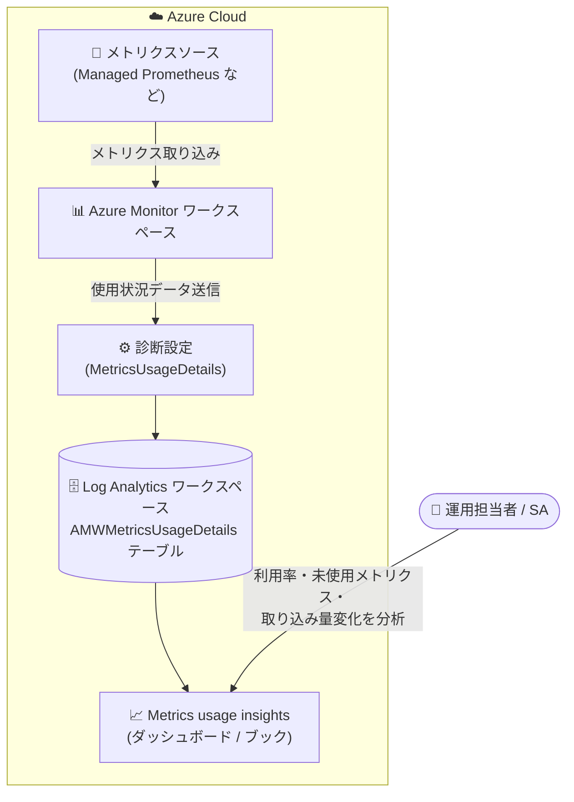

# Azure Monitor: Azure Monitor ワークスペース向け Metrics usage insights の一般提供開始

**リリース日**: 2026-10-19

**サービス**: Azure Monitor

**機能**: Metrics usage insights for Azure Monitor workspace

**ステータス**: Launched (GA)

[このアップデートのインフォグラフィックを見る](https://takech9203.github.io/azure-news-summary/20261019-azure-monitor-metrics-usage-insights.html)

## 概要

Azure Monitor ワークスペース向けの Metrics usage insights が一般提供 (GA) となりました。この機能は、Azure Monitor ワークスペース (Prometheus メトリクスなどの格納先) におけるメトリクス使用量の内訳を可視化し、「何がメトリクス使用量を押し上げているのか」を把握できるようにするものです。

ワークスペースの利用率 (アクティブな時系列数やイベント取り込みレートとスロットリング上限との比較)、未使用メトリクスの特定、使用量トレンドの把握、取り込み量の変化の調査が可能になり、コスト最適化とキャパシティプランニングに役立ちます。利用には診断設定 (Diagnostic Setting) を作成し、使用状況データを Log Analytics ワークスペースに送信します。この使用状況データの送信・クエリ・保存に追加料金はかかりません。

**アップデート前の課題**

- Azure Monitor ワークスペースでどのメトリクスが時系列数や取り込み量を消費しているかを把握する標準的な手段が乏しく、コスト増加の原因調査が困難だった
- クエリで一度も参照されていない「未使用メトリクス」を特定できず、不要な取り込み・保存コストが発生しがちだった
- アクティブ時系列数やイベント取り込みレートがスロットリング上限にどの程度近づいているかを継続的に監視しにくかった

**アップデート後の改善**

- Limits & Usage ダッシュボードで、時系列数・イベント取り込みレートの上限に対する利用率を一目で確認できる
- Unused Metrics ダッシュボードで未使用メトリクスを特定し、Prometheus のスクレイプ設定から除外することで取り込み・保存コストを削減できる
- Ingestion Volume Change ダッシュボードで 2 時点間の取り込み量を比較し、急増・急減の原因調査やキャパシティプランニングが可能になった
- サブスクリプション内の複数の Azure Monitor ワークスペースを Insights Hub から横断的に確認できる

## アーキテクチャ図



Azure Monitor ワークスペースの使用状況データを診断設定経由で Log Analytics ワークスペースに送信し、Insights ダッシュボードやブック (Workbook) で分析する構成です。

## サービスアップデートの詳細

### 主要機能

1. **Limits & Usage (上限と使用量)**
   - ワークスペースの現在の使用量とスロットリング上限の概要を表示
   - アクティブ時系列数とイベント取り込みレートを上限と比較し、利用率 (%) を確認可能

2. **Workspace Exploration (ワークスペース探索)**
   - 個々のメトリクスについて時系列数、取り込み量、クエリ実行回数、最終クエリからの経過日数を分析
   - 「直近 7 日間 vs 28 日間平均」の時系列増加トップ 10、時系列数トップ 10 のデイリートレンドを表示
   - データはメトリクスごとに 1 日 1 回計算され、前日時点の情報が表示される

3. **Unused Metrics (未使用メトリクス)**
   - 指定した期間 (Days Since Last Query) にクエリで使用されなかったメトリクスを一覧表示
   - 未使用メトリクスを取り込み対象から除外することで、取り込み・保存コストを削減可能

4. **Ingestion Volume Change (取り込み量の変化)**
   - 2 時点間で時系列数・イベントレート・日次イベント数を比較し、急増・急減を検出
   - 名前空間やメトリクスでフィルタリング可能。長期トレンドには 60〜90 日などの広い範囲を推奨

5. **高度な分析 (カスタマイズ)**
   - 「Metrics Usage Insights」ブックの基になるクエリを編集し、カスタマイズ版を保存可能
   - Log Analytics の `AMWMetricsUsageDetails` テーブルを直接クエリして、Insights ページの範囲を超えた履歴データを分析可能

## 技術仕様

| 項目 | 詳細 |
|------|------|
| 対象リソース | Azure Monitor ワークスペース (`microsoft.monitor/accounts`) |
| 有効化方法 | 診断設定でログカテゴリ `MetricsUsageDetails` を Log Analytics ワークスペースに送信 |
| データ格納先 | Log Analytics ワークスペースの `AMWMetricsUsageDetails` テーブル |
| データ反映 | 診断設定の作成後、データ流入まで約 24 時間かかる |
| 表示単位 | 単一ワークスペース (Insights メニュー) / サブスクリプション内全ワークスペース (Monitor メニューの Insights Hub) |
| カスタマイズ | Azure Monitor ブック (Workbook) としてクエリを編集・保存可能 |

## 設定方法

### 前提条件

1. Azure Monitor ワークスペースが作成済みであること (新規作成時に同時有効化も可能)
2. 使用状況データの送信先となる Log Analytics ワークスペース

### Azure Portal

**新規ワークスペース作成時:**

1. 「Azure Monitor ワークスペースの作成」ページの **Monitoring** タブで **Enable insights** を選択
2. 送信先の Log Analytics ワークスペースを指定 (必要な診断設定が自動作成される)

**既存ワークスペースの場合:**

1. Azure Monitor ワークスペースのメニューの **Monitoring** セクションで **Diagnostic settings** → **Add diagnostic setting** を選択
2. 診断設定名を入力し、**Send to Log Analytics workspace** で送信先ワークスペースを選択
3. ログカテゴリ **Metrics Usage Details** を選択して保存

### ARM テンプレート / Bicep

既存の Azure Monitor ワークスペースに対して、`Microsoft.Insights/diagnosticSettings` リソースで有効化できます。

```bicep
resource myDiag 'Microsoft.Insights/diagnosticSettings@2021-05-01-preview' = {
    name: 'MyDiagnosticSetting'
    scope: amAccount  // 既存の Microsoft.Monitor/accounts リソース
    properties: {
        workspaceId: '<Log Analytics ワークスペースのリソース ID>'
        logs: [
            {
                category: 'MetricsUsageDetails'
                enabled: true
            }
        ]
    }
}
```

**確認方法**: 診断設定の作成から約 24 時間後、「Active Time Series (Max)」の値がゼロでないことを確認します。ゼロの場合は Azure Monitor ワークスペースにデータが取り込まれておらず、インサイトが利用できません。

## メリット

### ビジネス面

- 未使用メトリクスの削除候補と潜在的な節約額 (未使用サンプル数 × メーター単価) を把握でき、監視コストを最適化できる
- 取り込み量の変化を 2 時点間で比較できるため、コスト変動の原因調査と説明責任を果たしやすくなる

### 技術面

- アクティブ時系列数・イベント取り込みレートのスロットリング上限に対する利用率を可視化し、スロットリング発生前にキャパシティプランニングできる
- 複数の Azure Monitor ワークスペースの使用状況データを 1 つの Log Analytics ワークスペースに集約し、統合ビューで横断分析できる
- ブックのクエリをカスタマイズでき、`AMWMetricsUsageDetails` テーブルへの直接クエリで独自分析やアラート連携も可能

## デメリット・制約事項

- 診断設定の作成後、データが Log Analytics ワークスペースに流入するまで約 24 時間待つ必要がある
- Workspace Exploration のデータはメトリクスごとに 1 日 1 回の計算で、前日時点のデータが表示される (リアルタイムではない)
- 利用には Log Analytics ワークスペースが別途必要

## ユースケース

### ユースケース 1: 未使用メトリクスの削減によるコスト最適化

**シナリオ**: Managed Prometheus で大量のメトリクスを収集しているが、実際にクエリやダッシュボードで使われているメトリクスは一部のみで、取り込みコストが増加している。

**実装例**: Unused Metrics ダッシュボードで「Days Since Last Query」を指定して未使用メトリクスを特定し、Prometheus のスクレイプジョブ設定 (relabeling) を調整して該当メトリクスの収集を停止する。

**効果**: 未使用の取り込みサンプル数にメーター単価を掛けることで削減額を見積もれ、取り込み・保存コストを削減できる。

### ユースケース 2: スロットリング予兆の検知とキャパシティプランニング

**シナリオ**: AKS クラスターの拡大に伴いアクティブ時系列数が増加しており、ワークスペースのスロットリング上限に達するリスクがある。

**実装例**: Limits & Usage ダッシュボードで時系列数・イベントレートの利用率 (%) を定期確認し、「Top 10 metrics by timeseries growth (7 日 vs 28 日平均)」で急増しているメトリクスを特定。必要に応じてサンプリング・スクレイプ頻度を見直す。

**効果**: スロットリングによるメトリクス欠損を未然に防ぎ、上限引き上げやワークスペース分割の計画を事前に立てられる。

## 料金

Metrics usage insights 自体は追加料金なしで利用できます。使用状況データの Log Analytics ワークスペースへの送信、クエリ、保存に追加料金はかかりません。

| 項目 | 料金 |
|------|------|
| 使用状況データの Log Analytics への送信・クエリ・保存 | 追加料金なし |

Azure Monitor 本体 (メトリクス取り込みなど) の料金は [Azure Monitor の料金ページ](https://azure.microsoft.com/pricing/details/monitor/) を参照してください。

## 利用可能リージョン

Azure Monitor ワークスペースが GA しているすべてのパブリックリージョンで利用可能です。最新のリージョン一覧は [Azure Monitor ワークスペースのリージョン可用性](https://learn.microsoft.com/azure/azure-monitor/metrics/azure-monitor-workspace-overview#regional-availability) を参照してください。

## 関連サービス・機能

- **Azure Monitor ワークスペース**: 本機能の対象リソース。Managed Prometheus などのメトリクスを格納する
- **Log Analytics ワークスペース**: 使用状況データの送信先。`AMWMetricsUsageDetails` テーブルに格納され、KQL で直接分析可能
- **Azure Monitor ブック (Workbooks)**: Insights ページの基になるクエリをカスタマイズして独自ビューを作成可能
- **Azure Monitor managed service for Prometheus**: 未使用メトリクスの収集停止はスクレイプジョブ設定 (relabeling) で実施する

## 参考リンク

- [インフォグラフィック](https://takech9203.github.io/azure-news-summary/20261019-azure-monitor-metrics-usage-insights.html)
- [公式アップデート情報](https://azure.microsoft.com/updates?id=577165)
- [Microsoft Learn: Metrics usage insights in Azure Monitor](https://learn.microsoft.com/azure/azure-monitor/metrics/metrics-usage-insights)
- [Microsoft Learn: Azure Monitor ワークスペースの概要](https://learn.microsoft.com/azure/azure-monitor/metrics/azure-monitor-workspace-overview)
- [料金ページ (Azure Monitor)](https://azure.microsoft.com/pricing/details/monitor/)

## まとめ

Azure Monitor ワークスペースのメトリクス使用量を可視化する Metrics usage insights が GA となりました。追加料金なしで、スロットリング上限に対する利用率の監視、未使用メトリクスの特定、取り込み量変化の調査が可能になります。Managed Prometheus を利用している環境では、診断設定 (`MetricsUsageDetails`) を有効化して定期的に Unused Metrics と Ingestion Volume Change を確認し、スクレイプ設定の見直しによるコスト最適化とキャパシティプランニングに活用することを推奨します。

---

**タグ**: Azure Monitor, Metrics Usage Insights, Managed Prometheus, Log Analytics, DevOps, Management and governance, コスト最適化, GA
