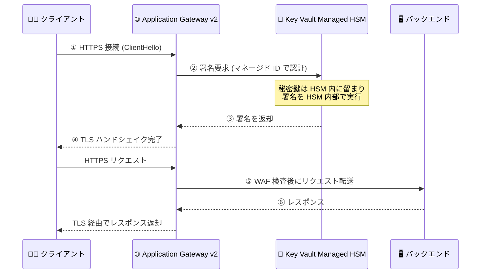

# Azure Application Gateway: Azure Key Vault Managed HSM によるキーレス TLS が一般提供開始

**リリース日**: 2026-10-20

**サービス**: Azure Application Gateway

**機能**: Azure Key Vault Managed HSM を利用したキーレス TLS 終端 (Keyless TLS Termination)

**ステータス**: Launched (GA)

[このアップデートのインフォグラフィックを見る](https://takech9203.github.io/azure-news-summary/20261020-application-gateway-keyless-tls-managed-hsm.html)

## 概要

Azure Application Gateway において、秘密鍵を Azure Key Vault Managed HSM 内に保持したまま TLS 終端を行う「キーレス TLS」が一般提供 (GA) となった。証明書の公開部分のみを Application Gateway に提供し、TLS ハンドシェイク時の署名処理は毎回 Managed HSM 内部で実行される。秘密鍵がゲートウェイにエクスポートされることは一切ない。

従来の Application Gateway と Key Vault の統合では、証明書 (PFX) の秘密鍵がエクスポート可能であることが必須であり、ゲートウェイのインスタンスが証明書を取得してローカルにインストールする方式だった。本アップデートにより、FIPS 140-3 Level 3 検証済みの HSM 境界内に秘密鍵のカスタディ (管理権) を維持しながら、Application Gateway で TLS オフロードとバックエンドへの再暗号化を実現できる。金融や公共など、秘密鍵の管理境界に厳格な要件を持つ組織にとって重要なアップデートである。

**アップデート前の課題**

- Application Gateway の Key Vault 統合では、証明書の秘密鍵がエクスポート可能である必要があり、ゲートウェイインスタンスに秘密鍵がローカルインストールされていた
- HSM 検証済み証明書はサポートされておらず、秘密鍵を HSM 境界内に留めたまま TLS 終端を行う手段がなかった
- ネットワークアプライアンス上に機微な鍵マテリアルが展開されるため、鍵の露出リスクと監査要件への対応が課題だった

**アップデート後の改善**

- 秘密鍵が Managed HSM から一切エクスポートされず、TLS ハンドシェイクごとの署名が HSM 内部で実行されるようになった
- マネージド ID と Azure RBAC (Managed HSM Crypto User ロール) による最小権限での鍵アクセス制御が可能になった
- Managed HSM の診断ログ (AuditEvent / KeySign 操作) で署名オペレーションを監視・監査できるようになった
- TLS 鍵が FIPS 140-3 Level 3 検証済み HSM 内で生成・保管されていることの暗号学的証拠を取得できるようになった
- 職務分掌 (Separation of Duties) と鍵の一元管理を実現できるようになった

## アーキテクチャ図



TLS ハンドシェイクで必要となる署名処理は、Application Gateway が Managed HSM を呼び出して HSM 内部で実行する。秘密鍵は Managed HSM の外に出ることなく、ゲートウェイは証明書の公開部分のみを保持する。

## サービスアップデートの詳細

### 主要機能

1. **キーレス TLS 終端**
   - エクスポート不可 (non-exportable) の HSM キーを使用した TLS 終端
   - TLS ハンドシェイクごとの署名を Managed HSM 内部で実行し、秘密鍵はゲートウェイに渡らない
   - TLS オフロード後のバックエンドへの再暗号化 (End-to-End TLS) にも対応

2. **マネージド ID と RBAC による鍵アクセス制御**
   - Application Gateway のユーザー割り当てマネージド ID で Managed HSM に認証
   - 「Managed HSM Crypto User」ロールを割り当て、必要に応じて `/keys/<key-name>` スコープで特定キーのみに権限を限定可能

3. **署名オペレーションの監査**
   - Managed HSM の診断設定 (AuditEvent カテゴリ) を Log Analytics に送信し、`KeySign` 操作を KQL で追跡可能
   - TLS ハンドシェイク時に Application Gateway が HSM を呼び出していることをログで確認できる

4. **FIPS 140-3 Level 3 準拠の鍵管理**
   - TLS 鍵が FIPS 140-3 Level 3 検証済み HSM 内で生成・保管されていることの暗号学的証拠を取得可能
   - 鍵のカスタディを専用 HSM 境界内に維持し、職務分掌と鍵の一元管理を支援

## 技術仕様

| 項目 | 詳細 |
|------|------|
| 対応 SKU | Application Gateway v2 |
| 鍵の種類 | RSA-HSM (例: 2048 ビット、鍵操作: wrapKey / unwrapKey / sign)。EC キーは非サポート |
| TLS バージョン | リスナーは TLS 1.2 以降が必須 |
| 対応 SSL ポリシー | `AppGwSslPolicy20220101`、`AppGwSslPolicy20220101S`、`CustomV2` のみ |
| 認証方式 | ユーザー割り当てマネージド ID + Azure RBAC (Managed HSM Crypto User) |
| 証明書生成環境 | OpenSSL 3.0.13 (Ubuntu 24.04 LTS 推奨) + Azure Key Vault Managed HSM TLS オフロードライブラリ (appgw_ekv.so) |
| 証明書の設定方法 | `az network application-gateway ssl-cert create` で `--hsm keyId=... publicCertData=...` を指定 |
| 監査ログ | Managed HSM 診断ログ (AuditEvent) の `KeySign` 操作 |

## 設定方法

### 前提条件

1. Application Gateway v2 のデプロイ
2. Azure Key Vault Managed HSM インスタンス (セキュリティドメイン初期化済み)
3. Application Gateway 用のユーザー割り当てマネージド ID
4. マネージド ID に対する Managed HSM キーへの RBAC 権限 (Managed HSM Crypto User)
5. 証明書生成用の Linux マシン (OpenSSL 3.0.13 + Managed HSM TLS オフロードライブラリ `appgw_ekv.so`)
6. セットアップ時のロール: Managed HSM Crypto Officer (HSM 初期設定)、Managed HSM Crypto User (証明書操作)、Owner または User Access Administrator (ロール割り当て)

### Azure CLI

```bash
# HSM キーの作成 (エクスポート不可の RSA-HSM キー)
az keyvault key create --hsm-name $MHSM_NAME --name $PRIVATE_KEY \
  --ops wrapKey unwrapKey sign --kty RSA-HSM --size 2048

# HSM 秘密鍵を使った証明書の生成 (OpenSSL + TLS オフロードエンジン)
openssl req -new -x509 -engine e_akv -keyform engine \
  -key managedHsm:$MHSM_NAME:$PRIVATE_KEY \
  -out cert_rsa.pem -subj /CN=contoso.com -days 365
base64 -w0 cert_rsa.pem > base64.txt

# マネージド ID の作成と Managed HSM Crypto User ロールの割り当て
az identity create --name $MI_NAME --resource-group $RESOURCE_GROUP --location $LOCATION
export mioid=$(az identity show --name $MI_NAME --resource-group $RESOURCE_GROUP --query principalId -o tsv)
az keyvault role assignment create --hsm-name $MHSM_NAME \
  --role "Managed HSM Crypto User" --assignee-object-id $mioid \
  --assignee-principal-type MSI --scope /keys

# マネージド ID を Application Gateway に関連付け
export identityId=$(az identity show --name $MI_NAME --resource-group $RESOURCE_GROUP --query id -o tsv)
az network application-gateway update --name $APPGW_NAME --resource-group $RESOURCE_GROUP \
  --set identity='{"type":"UserAssigned","userAssignedIdentities":{"'"$identityId"'":{}}}'

# Managed HSM キーと公開証明書を参照する SSL 証明書を作成
az network application-gateway ssl-cert create \
  --resource-group $RESOURCE_GROUP \
  --gateway-name $APPGW_NAME \
  --name mHSM-Key001 \
  --hsm keyId="https://<HSM NAME>.managedhsm.azure.net/keys/<key-name>" publicCertData="<base64 証明書>"

# HSM 参照証明書を使用する HTTPS リスナーを作成
az network application-gateway http-listener create \
  --resource-group $RESOURCE_GROUP \
  --gateway-name $APPGW_NAME \
  --name mhsm-listener \
  --frontend-ip appGwPublicFrontendIpIPv4 \
  --frontend-port port_443 \
  --ssl-cert mHSM-Key001 \
  --host-name contoso.com
```

## メリット

### ビジネス面

- 秘密鍵のカスタディを FIPS 140-3 Level 3 検証済みの専用 HSM 境界内に維持でき、金融・公共などの厳格なコンプライアンス要件に対応できる
- 鍵の生成・保管場所に関する暗号学的証拠を取得できるため、監査対応が容易になる
- 職務分掌 (セキュリティチームによる鍵管理とアプリケーションチームによるゲートウェイ運用の分離) と鍵の一元管理を実現できる

### 技術面

- 秘密鍵がネットワークアプライアンス (ゲートウェイインスタンス) 上に展開されないため、鍵マテリアルの露出リスクが低減する
- マネージド ID + Azure RBAC により、特定キーへのスコープ限定を含む最小権限アクセスを構成できる
- Managed HSM 診断ログの `KeySign` 操作により、TLS 署名オペレーションを可視化・監査できる
- 従来の Key Vault 統合 (エクスポート可能な秘密鍵が必須) では実現できなかった HSM 内での署名が可能になる

## デメリット・制約事項

- Application Gateway v2 SKU が前提となる
- リスナーは TLS 1.2 以降が必須で、サポートされる SSL ポリシーは `AppGwSslPolicy20220101`、`AppGwSslPolicy20220101S`、`CustomV2` に限定される
- EC キーはサポートされない (RSA-HSM キーを使用)
- 以下のシナリオはサポート対象外: Application Gateway Ingress Controller (AGIC)、WebSocket、L4 TCP/TLS プロキシ、FIPS モード
- 証明書生成には OpenSSL 3.0.13 と専用の TLS オフロードライブラリ (appgw_ekv.so) を備えた Linux 環境が必要 (バージョンが異なるとエンジンが正しくロードされない可能性がある)
- Managed HSM 上の証明書を差し替えた場合、初回の更新では反映されないことがある (タグ更新などの小さな変更を加えるか、HSM 参照を削除・再追加する回避策が案内されている)
- RBAC 権限の誤設定や参照先キーの削除により、ゲートウェイが HSM に認証できない場合はリスナーが無効化 (disabled) 状態になる
- スループットとキャパシティ計画には Managed HSM のスケーリングガイダンスとサービス制限の確認が必要

## ユースケース

### ユースケース 1: 金融機関における規制準拠の TLS 終端

**シナリオ**: 金融機関が公開 Web アプリケーションの TLS 終端を Application Gateway (WAF 付き) で行いつつ、規制要件により TLS 秘密鍵を FIPS 140-3 Level 3 検証済み HSM の外に出せない。

**実装例**:

```bash
# 鍵アクセスを特定キーのみにスコープ限定し、最小権限を徹底
az keyvault role assignment create --hsm-name $MHSM_NAME \
  --role "Managed HSM Crypto User" --assignee-object-id $mioid \
  --assignee-principal-type MSI --scope /keys/<key-name>
```

**効果**: 秘密鍵を HSM 境界内に維持したまま WAF による検査と TLS オフロードを実現し、規制監査に必要な鍵保管の暗号学的証拠と署名操作の監査ログを提供できる。

### ユースケース 2: 署名オペレーションの監査・監視

**シナリオ**: セキュリティ運用チームが、TLS 鍵の使用状況 (誰が・いつ・どこから署名操作を行ったか) を継続的に監視したい。

**実装例**:

```kql
AzureDiagnostics
| where ResourceProvider == "MICROSOFT.KEYVAULT"
| where Category == "AuditEvent"
| where OperationName == "KeySign"
| project TimeGenerated, OperationName, CallerIPAddress, identity_claim_appid_g, properties_s
| order by TimeGenerated desc
```

**効果**: Application Gateway による TLS ハンドシェイクごとの HSM 署名呼び出しを Log Analytics で追跡でき、鍵の不正使用の検知や監査証跡の整備に活用できる。

## 料金

本アップデートに固有の追加料金は公式情報で確認できなかった。Application Gateway v2 と Azure Key Vault Managed HSM それぞれの料金が適用される。詳細は以下の料金ページを参照。

- [Application Gateway の料金](https://azure.microsoft.com/pricing/details/application-gateway/)
- [Azure Key Vault (Managed HSM) の料金](https://azure.microsoft.com/pricing/details/key-vault/)

## 関連サービス・機能

- **Azure Key Vault Managed HSM**: 秘密鍵を保管し TLS 署名を実行する、シングルテナントで FIPS 140-3 Level 3 検証済みの HSM サービス。本機能の中核となる
- **Azure Key Vault (標準の証明書統合)**: 従来からの Application Gateway との統合方式。エクスポート可能な秘密鍵を持つ証明書をゲートウェイが取得してローカルで TLS 終端する (キーレス TLS とは鍵の保管場所が異なる)
- **Microsoft Entra マネージド ID**: Application Gateway が Managed HSM に認証するためのユーザー割り当てマネージド ID を提供
- **Azure RBAC (Managed HSM ローカル RBAC)**: Managed HSM Crypto User ロールによるキー単位の最小権限アクセス制御
- **Azure Monitor / Log Analytics**: Managed HSM の AuditEvent 診断ログを収集し、KeySign 操作を KQL で分析
- **Azure Web Application Firewall (WAF)**: TLS 終端後のリクエスト検査。キーレス TLS と組み合わせてセキュアな公開エンドポイントを構成

## 参考リンク

- [インフォグラフィック](https://takech9203.github.io/azure-news-summary/20261020-application-gateway-keyless-tls-managed-hsm.html)
- [公式アップデート情報](https://azure.microsoft.com/updates?id=577130)
- [What is keyless TLS for Azure Application Gateway and Azure Key Vault Managed HSM? (Microsoft Learn)](https://learn.microsoft.com/azure/application-gateway/keyless-tls-overview)
- [Tutorial: Configure keyless TLS termination with Azure Key Vault Managed HSM (Microsoft Learn)](https://learn.microsoft.com/azure/application-gateway/keyless-tls)
- [What is Azure Key Vault Managed HSM? (Microsoft Learn)](https://learn.microsoft.com/azure/key-vault/managed-hsm/overview)
- [TLS termination with Azure Key Vault certificates (Microsoft Learn)](https://learn.microsoft.com/azure/application-gateway/key-vault-certs)
- [Application Gateway の料金](https://azure.microsoft.com/pricing/details/application-gateway/)
- [Azure Key Vault の料金](https://azure.microsoft.com/pricing/details/key-vault/)

## まとめ

Application Gateway のキーレス TLS の GA により、TLS 秘密鍵を Azure Key Vault Managed HSM の外に一切出すことなく、ゲートウェイでの TLS 終端・WAF 検査・バックエンドへの再暗号化が可能になった。従来の Key Vault 統合ではエクスポート可能な秘密鍵が必須だったため、FIPS 140-3 Level 3 の HSM 境界内での鍵カスタディを求める規制業種では採用の障壁となっていたが、本機能でこのギャップが解消される。

導入を検討する場合は、(1) Application Gateway v2 と対応 SSL ポリシー (TLS 1.2 以降) の確認、(2) RSA-HSM キーのみ対応 (EC キー不可) である点、(3) AGIC・WebSocket・L4 プロキシが非サポートである点、(4) Managed HSM のコストとスループット制限、の 4 点を評価したうえで、マネージド ID の鍵スコープ限定と診断ログの有効化をセットで構成することを推奨する。

---

**タグ**: Application Gateway, Key Vault Managed HSM, Keyless TLS, Networking, Security, TLS 終端, FIPS 140-3, GA
