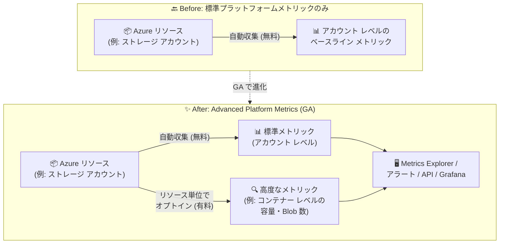

# Azure Monitor: Advanced Platform Metrics の一般提供開始 (GA)

**リリース日**: 2026-10-20

**サービス**: Azure Monitor

**機能**: Advanced Platform Metrics (高度なプラットフォームメトリック)

**ステータス**: Launched (GA)

[このアップデートのインフォグラフィックを見る](https://takech9203.github.io/azure-news-summary/20261020-azure-monitor-advanced-platform-metrics.html)

## 概要

Azure Monitor の Advanced Platform Metrics (高度なプラットフォームメトリック) が一般提供 (GA) となりました。Advanced Platform Metrics は、標準のプラットフォームメトリックを拡張する有料のプレミアム ティアで、よりきめ細かい (finer-grained) シグナルを提供します。これにより、リソース内の変化やトレンドをより迅速かつ正確に特定できるようになります。2026 年 7 月のパブリック プレビューを経て、2026 年 10 月に GA となりました。

今回のリリースでは、Azure Portal から直接 Advanced Platform Metrics を有効化できるようになり、機能が未有効のサブスクリプションに対しては、有効化を促すバナーが製品内に表示されます。また、提供範囲がパブリック クラウドを超えて拡大され、Fairfax (Azure Government) および Mooncake (Azure China) でも利用可能になりました。

具体例として Azure Storage では、従来のアカウント レベルのメトリックに加えて、コンテナー レベルの Blob 容量 (Container Blob Capacity) とコンテナー レベルの Blob 数 (Container Blob Count) が取得可能となり、標準のプラットフォームメトリックでは得られない詳細度でリソースの挙動を可視化できます。

**アップデート前の課題**

- 標準のプラットフォームメトリックはベースラインの正常性・パフォーマンス監視を対象としており、例えば Azure Storage ではアカウント レベルの容量メトリックしか取得できず、コンテナー単位の容量・オブジェクト数を把握できなかった
- プレビュー期間中は有効化の導線が限定的で、提供もパブリック クラウドのみだった

**アップデート後の改善**

- リソース単位でオプトインするだけで、より深く詳細なメトリック (例: コンテナー レベルの容量・Blob 数) を標準メトリックと同じツール (Metrics Explorer、API、アラート) で利用可能
- Azure Portal から直接有効化が可能になり、未有効のサブスクリプションには製品内バナーで有効化が案内される
- Fairfax (Azure Government) と Mooncake (Azure China) にも提供範囲が拡大

## アーキテクチャ図



標準メトリックが無料で提供するアカウント レベルのベースライン監視に対し、Advanced Platform Metrics はオプトインにより、コンテナー レベルなどのきめ細かいシグナルを同じ分析ツール群で利用可能にします。

## サービスアップデートの詳細

### 主要機能

1. **よりきめ細かいメトリック シグナル**
   - リソースが生成する、より深く詳細なメトリックを提供し、変化やトレンドの迅速・正確な特定を支援
   - 例 (Azure Storage): Container Blob Capacity (コンテナーごとの使用容量、単位: Bytes)、Container Blob Count (コンテナーごとの Blob オブジェクト数、単位: Count)。いずれも **ContainerName** ディメンションで分割・フィルタリング可能

2. **リソース レベルのオプトイン**
   - 必要なリソースに対してのみ有効化でき、全アカウント・全リソースへの一括有効化は不要
   - Azure Storage の場合はルール ベースで対象コンテナーを指定 (全コンテナー / コンテナー リスト / プレフィックス)

3. **Azure Portal からの直接有効化 (GA での新要素)**
   - Portal 上で有効化操作が可能になり、未有効のサブスクリプションには製品内バナーで有効化を案内

4. **ソブリン クラウドへの拡大 (GA での新要素)**
   - Fairfax (Azure Government) と Mooncake (Azure China) で利用可能に

5. **既存の監視ツールとの完全な互換性**
   - 標準プラットフォームメトリックと同じ Microsoft 管理のテレメトリ ストアに保存され、Metrics Explorer、メトリック アラート ルール、Workbooks、Azure ダッシュボード、Grafana、Azure Monitor REST API / CLI / PowerShell / 各言語 SDK でそのまま利用可能

## 技術仕様

### 標準プラットフォームメトリックとの比較

| 項目 | プラットフォームメトリック | Advanced Platform Metrics |
|------|---------------------------|---------------------------|
| 構成 | 不要 (自動収集) | リソース レベルでオプトイン |
| コスト | 無料 (取り込み・保存とも) | 有料 (データポイント課金) |
| 粒度 | ベースラインの正常性・パフォーマンス | より深く詳細なリソースの可観測性 |
| 対象 | すべての Azure リソース | 対応リソース プロバイダーのみ |
| クエリ・可視化 | Metrics Explorer、Azure Monitor API、REST API | 同左 (共通) |
| 保存先 | Microsoft 管理のテレメトリ ストア | 同左 (共通) |
| アラート | メトリック アラート ルール | 同左 (共通) |

### 対応リソース プロバイダー

| リソース プロバイダー | 提供される高度なメトリック |
|----------------------|---------------------------|
| Azure Storage | Container Blob Capacity、Container Blob Count (ContainerName ディメンション対応。現行バージョン、以前のバージョン、論理削除された Blob を含む) |

Microsoft Learn によると、対応リソース プロバイダーは今後のリリースで拡大予定です。

## 設定方法

### 前提条件 (Azure Storage の場合)

1. Blob Storage をサポートするストレージ アカウント (Premium Azure Files アカウント、Premium Page Blob アカウントは非対応)
2. サブスクリプションで **Microsoft.Insights** リソース プロバイダーが登録済みであること (`az provider register -n Microsoft.Insights`)
3. CLI / PowerShell で操作する場合: Azure CLI、または Az.Storage プレビュー モジュール (9.6.3-preview)

### Azure CLI (Azure Storage の例)

```bash
# 全コンテナーを対象にコンテナー レベル容量メトリックを有効化
az storage advanced-platform-metric create \
  -g <resource_group_name> \
  --account-name <storage_account_name> \
  --enabled \
  --rule-config-filter-type AllContainersFilter

# 特定のコンテナーのみを対象にする場合
az storage advanced-platform-metric create \
  -g <resource_group_name> \
  --account-name <storage_account_name> \
  --enabled \
  --rule-config-filter-type ContainerListFilter \
  --rule-config-filter-values container1 container2

# プレフィックスで対象コンテナーを指定する場合
az storage advanced-platform-metric create \
  -g <resource_group_name> \
  --account-name <storage_account_name> \
  --enabled \
  --rule-config-filter-type ContainerPrefixFilter \
  --rule-config-filter-values "logs-" "data-"

# 有効化済みルールの確認
az storage advanced-platform-metric list \
  -g <resource_group_name> \
  --account-name <storage_account_name>

# メトリックのクエリ (コンテナー別の Blob 数)
az monitor metrics list \
  --resource <storage-account-resource-id> \
  --metric ContainerBlobCount \
  --dimension ContainerName \
  --interval PT1H \
  -o table
```

### Azure Portal

1. Azure Portal で対象の **ストレージ アカウント** に移動
2. **[監視]** > **[Advanced platform metrics]** を選択
3. **[Add rule]** でルールを作成し、フィルター タイプとフィルター値を構成して保存
4. メトリックの参照は **[監視]** > **[メトリック]** から **Container Blob Capacity** / **Container Blob Count** を選択し、**ContainerName** で分割表示

## メリット

### ビジネス面

- **コスト管理の精緻化**: 容量を最も消費しているコンテナーを特定でき、コスト配賦や削減施策の判断材料になる
- **運用計画の高度化**: コンテナー レベルの詳細な容量データに基づくキャパシティ プランニングが可能
- **政府・規制業界での利用**: Azure Government / Azure China でも利用可能になり、規制要件のある環境でも採用できる

### 技術面

- **迅速な異常検知**: きめ細かいシグナルにより、リソース内の変化やトレンドをより早く正確に特定できる
- **学習コスト不要**: 標準メトリックと同じ Metrics Explorer・アラート・API・ダッシュボードがそのまま使える (新しいストレージやクエリ言語の管理は不要)
- **柔軟なスコープ制御**: リソース単位・ルール単位 (コンテナー リスト / プレフィックス) で必要な範囲だけ有効化でき、不要な課金を回避できる

## デメリット・制約事項

- **有料機能**: 標準のプラットフォームメトリックと異なり、データポイント数に基づく課金が発生する (ディメンションの組み合わせ数 × メトリック数 × コンテナー数に比例して増加するため、有効化スコープの設計が重要)
- **対応リソース プロバイダーが限定的**: Microsoft Learn のドキュメント上、現時点で明記されている対応プロバイダーは Azure Storage のみ (今後拡大予定)
- **設定反映の遅延**: 有効化・更新・無効化の反映に最大 6 時間かかる
- **Azure Storage での制限**: ストレージ アカウントあたり最大 10,000 コンテナーまで。Premium Azure Files アカウント、Premium Page Blob アカウントは非対応
- **ドキュメントの更新状況**: GA 発表時点で、Microsoft Learn の一部ドキュメント (Azure Monitor メトリック概要、Blob Storage の有効化手順) にはプレビュー表記が残っている

## ユースケース

### ユースケース 1: マルチテナント SaaS でのテナント別ストレージ消費の可視化

**シナリオ**: テナントごとにコンテナーを分けている SaaS で、テナント別のストレージ消費量と増加トレンドを把握し、課金やクォータ管理に活用したい。

**実装例**:

```bash
# テナント用コンテナー (prefix: tenant-) のみ有効化
az storage advanced-platform-metric create \
  -g rg-saas-prod \
  --account-name stsaasprod \
  --enabled \
  --rule-config-filter-type ContainerPrefixFilter \
  --rule-config-filter-values "tenant-"
```

**効果**: Metrics Explorer で ContainerName ディメンションにより分割表示することで、テナント別の容量・オブジェクト数の推移を一目で把握でき、急増したテナントへのアラート設定も可能。

### ユースケース 2: ログ・データ保管コンテナーの容量アラート

**シナリオ**: ログやバックアップを保管するコンテナーの肥大化を早期に検知し、ライフサイクル管理ポリシーの見直しにつなげたい。

**実装例**: Container Blob Capacity に対して標準のメトリック アラート ルールを作成し、しきい値超過時に通知する (アラートの仕組みは標準メトリックと共通)。

**効果**: アカウント合計ではなくコンテナー単位での監視により、問題のあるデータ領域をピンポイントで特定できる。

## 料金

Advanced Platform Metrics は有料機能で、データポイント数に基づいて課金されます。具体的な単価は [Azure Monitor 料金ページ](https://azure.microsoft.com/pricing/details/monitor/) のメトリック セクションを参照してください。

**課金データポイントの計算例 (Azure Storage、公式ドキュメントより):**

| 項目 | 値 |
|------|------|
| Blob アクセス層 | 5 (Hot / Cool / Cold / Smart / Archive) |
| Blob の種類 | 2 (Block blob / Append blob) |
| コンテナーあたりのデータポイント/時 | 5 層 × 2 種類 × 2 メトリック = 20 |
| 50 コンテナーでの月間 (30 日) 課金データポイント | 50 × 20 × 24 時間 × 30 日 = 720,000 |

実際のデータポイント数は、コンテナー数、有効化したメトリック、使用している Blob の種類・アクセス層に依存します。なお、標準のプラットフォームメトリックは引き続き無料です。

## 利用可能リージョン

- Azure パブリック クラウドに加え、**Fairfax (Azure Government)** および **Mooncake (Azure China)** で利用可能 (GA での拡大ポイント)

## 関連サービス・機能

- **Azure Monitor Metrics (プラットフォームメトリック)**: 本機能の基盤。Advanced Platform Metrics は同じテレメトリ ストア・ツール群を共有するプレミアム ティア
- **Azure Monitor メトリック アラート**: 高度なメトリックに対しても標準メトリックと同じアラート ルールを適用可能
- **Metrics Explorer / Workbooks / Azure ダッシュボード / Grafana**: 高度なメトリックの分析・可視化に利用可能
- **Azure Blob Storage**: 現時点で対応が明記されているリソース プロバイダー。コンテナー レベルの容量・Blob 数メトリックを提供
- **Azure Monitor Metrics Batch REST API**: 大量のメトリック クエリ向け API。高度なメトリックも標準のデータプレーン API で取得可能

## 参考リンク

- [インフォグラフィック](https://takech9203.github.io/azure-news-summary/20261020-azure-monitor-advanced-platform-metrics.html)
- [公式アップデート情報](https://azure.microsoft.com/updates?id=575329)
- [Microsoft Learn: Advanced platform metrics - Azure Monitor](https://learn.microsoft.com/azure/azure-monitor/metrics/metrics-advanced-platform)
- [Microsoft Learn: Metrics in Azure Monitor](https://learn.microsoft.com/azure/azure-monitor/metrics/data-platform-metrics)
- [Microsoft Learn: Advanced platform metrics for Azure Blob Storage](https://learn.microsoft.com/azure/storage/blobs/blob-storage-advanced-platform-metrics)
- [料金ページ: Azure Monitor](https://azure.microsoft.com/pricing/details/monitor/)

## まとめ

Azure Monitor の Advanced Platform Metrics が GA となり、標準メトリックでは得られないきめ細かいシグナル (例: Azure Storage のコンテナー レベル容量・Blob 数) を、使い慣れた Metrics Explorer・アラート・API でそのまま利用できるようになりました。GA に伴い Azure Portal からの直接有効化と製品内バナーによる案内が追加され、Azure Government / Azure China にも提供が拡大されています。有料機能でありデータポイント数に比例して課金されるため、Solutions Architect としては、ContainerPrefixFilter などで有効化スコープを必要最小限に絞る設計と、料金ページでの単価確認を推奨します。まずはコスト配賦やキャパシティ管理の課題があるストレージ アカウントから試験導入するとよいでしょう。

---

**タグ**: Azure Monitor, Advanced Platform Metrics, Metrics, Observability, Management and governance, DevOps, GA
