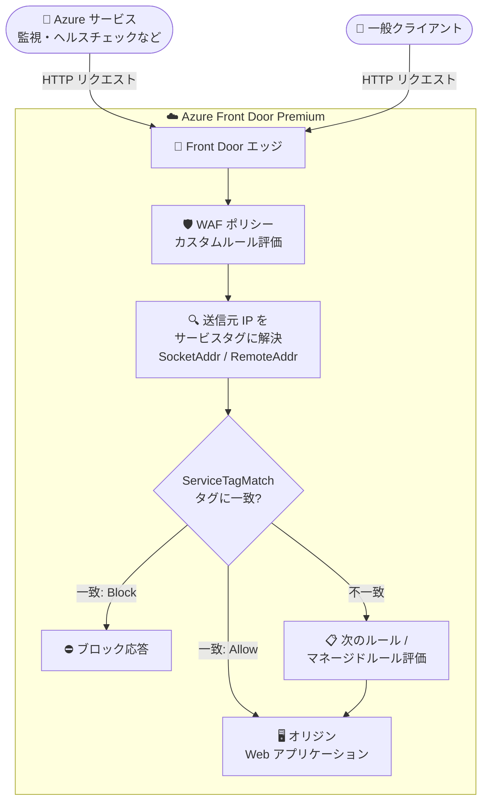

# Azure Front Door Premium WAF: サービスタグ一致条件の一般提供開始 (GA)

**リリース日**: 2026-10-20

**サービス**: Azure Front Door / Azure Web Application Firewall (WAF)

**機能**: WAF カスタムルールにおけるサービスタグ一致条件 (Service tag match condition)

**ステータス**: Launched (GA)

[このアップデートのインフォグラフィックを見る](https://takech9203.github.io/azure-news-summary/20261020-front-door-waf-service-tag-match.html)

## 概要

Azure Front Door Premium 上の Azure Web Application Firewall (WAF) カスタムルールで、サービスタグ一致条件 (Service tag match condition) が一般提供 (GA) となりました。

サービスタグは、Azure サービスが使用する IP アドレスプレフィックスのグループを表すもので、アドレスの変更に応じて Microsoft が自動的に更新します。今回の GA により、カスタムルールで HTTP リクエストの送信元 IP アドレスをサービスタグと照合できるようになり、IP アドレスのリストを自分で作成・保守することなく、Azure サービスからのトラフィックを制御できます。

カスタムルールでは、一致変数 (match variable) に `SocketAddr` または `RemoteAddr` を指定し、演算子 (operator) に `ServiceTagMatch` を指定することでサービスタグ一致を利用します。許可 (Allow)・ブロック (Block)・ログ (Log)・リダイレクト (Redirect) の各アクションに加え、レート制限ルールでも使用できます。

**アップデート前の課題**

- Azure サービス (監視・ヘルスチェックなど) からのトラフィックを WAF で制御するには、対象サービスの IP アドレスプレフィックスのリストを自分で作成・保守する必要があった
- Azure サービスの IP アドレス範囲は追加・廃止により変化するため、ルールの継続的なメンテナンスが必要だった
- Front Door はクライアント接続を終端してオリジンへ転送するため、オリジン側の NSG (ネットワークセキュリティグループ) で評価されるのは Front Door のアドレスであり、元のクライアントに対してサービスタグベースの制御ができなかった。また Azure 外部にホストされたオリジンには NSG 自体が存在しない

**アップデート後の改善**

- カスタムルールの一致条件にサービスタグ名を指定するだけで、Azure サービスからのトラフィックを許可・ブロック・レート制限できる
- サービスタグ配下のプレフィックスは Microsoft が自動更新するため、アドレス変更時にルールを更新する必要がない
- 元のクライアント接続が到達する WAF (エッジ) でサービスタグを評価できるため、NSG では実現できなかったクライアント寄りの制御が可能になった

## アーキテクチャ図



リクエストが Front Door に到達すると、WAF が送信元 IP アドレスを包含するサービスタグに解決し、カスタムルールで指定したタグと照合します。一致した場合はルールのアクション (Allow / Block / Log / Redirect / レート制限) が適用されます。

## サービスアップデートの詳細

### 主要機能

1. **サービスタグによる送信元 IP 照合**
   - 一致変数 `SocketAddr` または `RemoteAddr` と演算子 `ServiceTagMatch` を組み合わせて、リクエストの送信元 IP アドレスがサービスタグの IP プレフィックス群に含まれるかを評価する
   - 1 つの条件に複数のサービスタグを指定でき、いずれかに該当すれば一致となる

2. **プレフィックスの自動追従**
   - サービスタグ配下の IP プレフィックスは Microsoft が公開・管理し、サービスのアドレス追加・廃止に応じて自動更新される
   - サービスタグに対して書いたルールは、背後のアドレスが変わっても機能し続け、ルールの更新は不要

3. **否定条件 (Negate) のサポート**
   - `negateCondition` を `true` に設定することで、「指定したタグに含まれないすべてのアドレス」に一致させることが可能

4. **他の一致条件・レート制限との組み合わせ**
   - URI、ホスト、リクエストメソッドなどの条件と組み合わせて、管理用パス (`/admin` など) へのアクセスを特定サービスのみに制限できる
   - レート制限ルール (`RateLimitRule`) の一致条件としても使用でき、Azure サービスからのトラフィックをブロックせずに流量制御できる

## 技術仕様

| 項目 | 詳細 |
|------|------|
| 対象 SKU | Azure Front Door Premium (サービスタグ一致条件は Premium のみ) |
| 一致変数 | `SocketAddr` (Front Door に到達した TCP 接続の IP) / `RemoteAddr` (`X-Forwarded-For` ヘッダーがある場合は元のクライアント IP)。他の一致変数は `ServiceTagMatch` と併用不可 |
| 演算子 | `ServiceTagMatch` |
| 一致値 | 1 つ以上のサービスタグ名 (完全一致。ワイルドカード・部分一致・正規表現は非サポート) |
| 否定条件 | `negateCondition: true` で反転可能 (省略可) |
| ルールタイプ | `MatchRule` および `RateLimitRule` の両方で使用可能 |
| アクション | Allow / Block / Log / Redirect |
| Azure Portal での指定 | 一致値は自由入力ではなく、利用可能なサービスタグの検索可能リストから選択 |

**一致変数の選択指針** (Microsoft Learn より):

- `SocketAddr`: 実際に Front Door へ接続したサービスを評価する場合に使用。サービスタグルールの一般的なケース
- `RemoteAddr`: 中継を経由するトラフィックで、転送元のクライアントを評価する場合に使用。ただし `X-Forwarded-For` は呼び出し側が設定できるため、`SocketAddr` ベースのルールよりスプーフィングされやすい点に注意

## 設定方法

### 前提条件

1. Azure Front Door Premium プロファイル
2. Front Door に関連付けられた WAF ポリシー (カスタムルールを構成可能なもの)

### 構成例 (ルール定義 JSON)

**例 1: 信頼する Azure サービスからのトラフィックを許可**

```json
{
  "name": "AllowAzureMonitor",
  "priority": 10,
  "ruleType": "MatchRule",
  "matchConditions": [
    {
      "matchVariable": "SocketAddr",
      "operator": "ServiceTagMatch",
      "negateCondition": false,
      "matchValue": ["AzureMonitor"]
    }
  ],
  "action": "Allow"
}
```

**例 2: 管理用パスを特定のアドレス範囲のみに制限 (サービスタグ条件を否定して併用)**

```json
{
  "name": "RestrictAdminPath",
  "priority": 20,
  "ruleType": "MatchRule",
  "matchConditions": [
    {
      "matchVariable": "RequestUri",
      "operator": "Contains",
      "negateCondition": false,
      "matchValue": ["/admin"]
    },
    {
      "matchVariable": "SocketAddr",
      "operator": "ServiceTagMatch",
      "negateCondition": true,
      "matchValue": ["AzureCloud.eastus"]
    }
  ],
  "action": "Block"
}
```

**例 3: サービスタグに一致するトラフィックをレート制限**

```json
{
  "name": "RateLimitServiceTraffic",
  "priority": 50,
  "ruleType": "RateLimitRule",
  "rateLimitDurationInMinutes": 5,
  "rateLimitThreshold": 1000,
  "matchConditions": [
    {
      "matchVariable": "SocketAddr",
      "operator": "ServiceTagMatch",
      "negateCondition": false,
      "matchValue": ["AzureCloud"]
    }
  ],
  "action": "Block"
}
```

### Azure Portal

Azure Portal では、WAF ポリシーのカスタムルール作成時に一致条件の演算子としてサービスタグ一致を選択し、検索可能なサービスタグ一覧から対象タグを選択します。1 つの条件で複数タグを選択できます。

## メリット

### ビジネス面

- IP アドレスリストの作成・保守という運用負荷が不要になり、セキュリティルールの運用コストを削減できる
- Azure サービスのアドレス変更に起因する「ルールの陳腐化によるトラフィック断・保護漏れ」のリスクを低減できる

### 技術面

- Microsoft 管理のサービスタグに追従するため、アドレス変更時のルール更新が不要で耐久性の高いルールを記述できる
- クライアント接続が到達するエッジ (WAF) で評価するため、Front Door 配下のオリジンや Azure 外部のオリジンでも、NSG 相当のサービスタグベース制御を実現できる
- URI・ホスト・メソッド条件やレート制限との組み合わせで、きめ細かいアクセス制御を表現できる

## デメリット・制約事項

- **Front Door Premium 限定**: サービスタグ一致条件は Front Door Premium の WAF でのみ利用可能
- **サービスタグはテナントではなくサービスを識別する**: タグは当該 Azure サービスの全顧客が使用する IP アドレスを包含するため、タグの許可は「そのサービス経由でトラフィックを送れるすべての主体」の許可を意味する。ID 検証ではなく粗いフィルターとして扱う必要がある
- **広いタグの影響範囲**: `AzureCloud` のような広範なタグは他の顧客が使用するアドレスも含むため、意図したサービスよりはるかに広いトラフィックに影響する。意図を表現できる最も狭いタグを使用することが推奨される
- **1 つの IP が複数タグに属する**: 広いタグ (例: `AzureCloud`) は狭いタグの範囲を包含するため、リクエストは特定サービスのタグと包含する広いタグの両方に一致し得る
- **タグ名は完全一致のみ**: ワイルドカード・部分一致・正規表現は `ServiceTagMatch` 演算子でサポートされない
- **Allow アクションの副作用**: Allow に一致するとそのリクエストに対する Default Rule Set および Bot Protection ルールセットの評価が停止するため、許可ルールはできるだけ狭くスコープする必要がある
- **検出モードからの開始を推奨**: 新しいサービスタグルールはまず Log アクションまたは Detection モードで展開し、ログを確認してから Block に切り替えることが推奨される (特に許可ルールは誤りが保護の弱体化として現れるため)

## ユースケース

### ユースケース 1: 監視・ヘルスチェックサービスの許可

**シナリオ**: 監視やヘルスチェックを行う Azure サービスが、WAF で本来ブロックされてしまうエンドポイントへ到達する必要がある。

**実装例**: `SocketAddr` + `ServiceTagMatch` + 対象サービスのタグ (例: `AzureMonitor`) を指定した Allow ルールを、低い priority 値 (高優先) で配置する。

**効果**: IP リストの保守なしで監視トラフィックを確実に通し、ブロック・レート制限ルールより先に評価させることができる。

### ユースケース 2: 想定外の Azure サービスからのトラフィック遮断

**シナリオ**: アプリケーションが特定の Azure サービスからリクエストを受け取ることが正当にあり得ない場合、そのサービスからのトラフィックを遮断したい。

**実装例**: 対象サービスタグに対する Block ルールを作成する。

**効果**: 攻撃面を縮小しつつ、アドレス変更への追従は Microsoft 側で自動的に行われる。

### ユースケース 3: 管理エンドポイントの保護

**シナリオ**: `/admin` などの機密パスへのアクセスを、想定したアドレス範囲からのみに制限したい。

**実装例**: `RequestUri Contains /admin` 条件と、否定したサービスタグ条件 (`negateCondition: true`) を AND で組み合わせた Block ルールを作成する (上記 JSON 例 2 参照)。

**効果**: 想定範囲外からの管理パスアクセスのみをブロックし、ルールの影響範囲 (blast radius) を限定できる。

### ユースケース 4: Azure サービスからのトラフィックのレート制限

**シナリオ**: Azure サービスからのトラフィックを完全に遮断するのではなく、流量を制御したい。

**実装例**: `RateLimitRule` でサービスタグ条件を使用し、期間としきい値を設定する (上記 JSON 例 3 参照)。

**効果**: 正当なトラフィックを通しつつ、過剰なリクエストから保護できる。

## 料金

本アップデート固有の料金情報はアナウンスに記載されていません。Azure Front Door (Premium) および WAF の料金体系は公式料金ページを参照してください。

- [Azure Front Door 料金](https://azure.microsoft.com/pricing/details/frontdoor/)

## 関連サービス・機能

- **Azure Front Door Premium**: 本機能が動作する前提となるグローバルエッジ/CDN サービス。WAF ポリシーを関連付けて利用する
- **Azure Web Application Firewall (WAF)**: カスタムルール (一致ルール/レート制限ルール) の枠組みを提供。今回サービスタグが一致条件に追加された
- **サービスタグ (Virtual Network)**: Azure サービスの IP プレフィックスグループ。NSG や Azure Firewall でも使用される概念で、タグの一覧と内容は Azure service tags overview を参照
- **ネットワークセキュリティグループ (NSG)**: オリジン側でのサービスタグ制御手段。ただし Front Door 配下では元クライアントのアドレスを評価できないため、WAF でのサービスタグ評価が補完する

## 参考リンク

- [インフォグラフィック](https://takech9203.github.io/azure-news-summary/20261020-front-door-waf-service-tag-match.html)
- [公式アップデート情報](https://azure.microsoft.com/updates?id=577156)
- [Service Tag Match Condition for Azure Front Door (Microsoft Learn)](https://learn.microsoft.com/en-us/azure/web-application-firewall/afds/service-tag-match-condition)
- [WAF Custom Rule for Azure Front Door (Microsoft Learn)](https://learn.microsoft.com/en-us/azure/web-application-firewall/afds/waf-front-door-custom-rules)
- [Azure service tags overview (Microsoft Learn)](https://learn.microsoft.com/en-us/azure/virtual-network/service-tags-overview)
- [Azure Front Door 料金](https://azure.microsoft.com/pricing/details/frontdoor/)

## まとめ

Azure Front Door Premium の WAF カスタムルールにサービスタグ一致条件が GA しました。Azure サービス由来のトラフィック制御を、IP リストの保守なしに Microsoft 管理のサービスタグで宣言的に記述できるようになり、エッジでのアクセス制御の運用性と耐久性が大きく向上します。

Front Door Premium + WAF を利用中で、監視サービスの許可・想定外サービスの遮断・管理パスの保護などを IP リストで運用しているチームは、サービスタグ条件への置き換えを検討する価値があります。導入時は最も狭いタグを選び、まず Log アクション (または Detection モード) でログを確認してから Block/Allow へ切り替えることが推奨されます。

---

**タグ**: Azure Front Door, Web Application Firewall, WAF, サービスタグ, Networking, Security, GA
