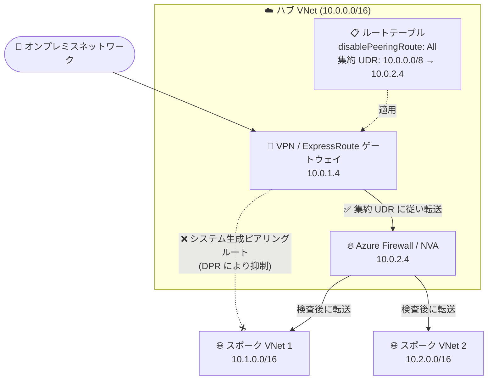

# Azure Virtual Network: VNet ピアリングルートの無効化 (Disable VNet Peering Route) パブリックプレビュー

**リリース日**: 2026-10-20

**サービス**: Azure Virtual Network

**機能**: Disable VNet peering route (DPR) - ピアリングルート伝播の無効化

**ステータス**: In preview

[このアップデートのインフォグラフィックを見る](https://takech9203.github.io/azure-news-summary/20261020-vnet-peering-disable-peering-route.html)

## 概要

Azure Virtual Network のピアリングルート無効化機能 (Disable VNet Peering Route、DPR) がパブリックプレビューとして発表された。DPR はルートテーブルの新しいプロパティ (`disablePeeringRoute`) として提供され、ルートテーブルが関連付けられたサブネット上で、システムが自動生成する IPv4 / IPv6 のピアリングルートを抑制する。重要な点として、ピアリング接続そのものは維持されたまま、ルートのみが抑制される。

Azure はルート選択に最長プレフィックス一致 (longest prefix match) を使用するため、従来はシステム生成のピアリングルート (例: 10.1.0.0/16) が集約 UDR (例: 10.0.0.0/8) より優先され、トラフィックが Azure Firewall や NVA (ネットワーク仮想アプライアンス) をバイパスしてしまう問題があった。DPR によりピアリングルートを抑制すれば、集約 UDR が選択されるようになり、大規模なハブ & スポーク構成でもスポークごとのルートオーバーライドを維持することなく、集中検査パス (インスペクションパス) を強制できる。

**アップデート前の課題**

- システム生成のピアリングルートは集約 UDR より具体的 (より長いプレフィックス) であるため、最長プレフィックス一致によりピアリングルートが選択され、トラフィックがファイアウォール / NVA をバイパスしてしまう
- 大規模なハブ & スポーク構成では、スポークを追加するたびにスポークごとのルートオーバーライド (UDR) を作成・維持する必要があり、ルートテーブルの容量を消費し運用負荷が増大していた

**アップデート後の改善**

- ルートテーブル単位の設定 1 つで、関連サブネットのシステム生成ピアリングルート (IPv4 / IPv6) を抑制可能になった。個々のピアリングリソースの変更は不要
- アドレスプランが許せば、スポークごとのルートオーバーライドを集約 UDR 1 本に置き換えられ、UDR クォータを増やさずに継続的なルートメンテナンスを削減できる
- Advertised Gateway Prefixes (集約ゲートウェイプレフィックス) と組み合わせることで、大規模ハブ & スポークの経路管理をさらに簡素化できる

## アーキテクチャ図



ゲートウェイサブネットのルートテーブルで DPR を有効化 (`All`) すると、スポークへのシステム生成ピアリングルートが抑制され、集約 UDR に従ってオンプレミスからのトラフィックが必ず Azure Firewall / NVA を経由するようになる。ピアリング接続自体は維持される。

## サービスアップデートの詳細

### 主要機能

1. **システム生成ピアリングルートの抑制**
   - ルートテーブルの `disablePeeringRoute` プロパティを `All` に設定すると、そのルートテーブルが関連付けられたサブネット上で、サポート対象ワークロードの IPv4 / IPv6 システム生成ピアリングルートが抑制される
   - VNet ピアリング接続そのものは構成されたまま維持される (削除・切断は不要)

2. **サブネットスコープでの適用**
   - ルート抑制はルートテーブルを介してサブネット単位で適用され、他のサブネットには影響しない
   - 個々のピアリングリソースを変更する必要がない

3. **集約 UDR による集中検査パスの実現**
   - スポークごとのルートオーバーライドの代わりに、NVA を next hop とする集約 UDR (例: 10.0.0.0/8) を使用可能
   - Advertised Gateway Prefixes と組み合わせて、大規模ハブ & スポークの経路広告・経路制御を集約できる

## 技術仕様

| 項目 | 詳細 |
|------|------|
| 設定対象 | ルートテーブル (`Microsoft.Network/routeTables`) のプロパティ `disablePeeringRoute` |
| 設定値 | `None` (既定: システム生成ピアリングルートを追加) / `All` (IPv4・IPv6 のシステム生成ピアリングルートを抑制) |
| 抑制対象 | ルートテーブル関連付けサブネット上のサポート対象ワークロードの IPv4 / IPv6 ピアリングルート |
| ピアリング接続 | 維持される (ルートのみ抑制) |
| 必要な API バージョン | REST / ARM テンプレート / Bicep では `2025-07-01` 以降 |
| プレビュー機能登録 | `Microsoft.Network/AllowDisablePeeringRoutes` のサブスクリプション登録が必要 |
| PowerShell 要件 | Az.Network モジュール 8.1.0 以降 |
| 管理方法 (プレビュー期間中) | ルートテーブル経由で管理 (Azure Virtual Network Manager のルーティングルールコレクション経由は不可) |

## 設定方法

### 前提条件

1. アクティブなサブスクリプションを持つ Azure アカウント
2. ピアリングルートを抑制したいサブネットに関連付け済みのルートテーブル
3. 必要な UDR と、ソースワークロードのネットワークインターフェイスと**同一 VNet 内**にある Azure Firewall / NVA の next hop
4. サブスクリプションでプレビュー機能 `Microsoft.Network/AllowDisablePeeringRoutes` を登録済みであること

### Azure CLI

```bash
# プレビュー機能を登録
az feature register \
  --namespace Microsoft.Network \
  --name AllowDisablePeeringRoutes

# 登録状態を確認 (Registered になるまで待機)
az feature show \
  --namespace Microsoft.Network \
  --name AllowDisablePeeringRoutes \
  --query properties.state \
  --output tsv

# リソースプロバイダーの登録を更新
az provider register --namespace Microsoft.Network

# ルートテーブルでピアリングルート伝播を無効化
az network route-table update \
  --resource-group "<resource-group>" \
  --name "<route-table-name>" \
  --disable-peering-route All

# 元に戻す場合は --disable-peering-route None を指定
```

### Azure PowerShell

```powershell
$routeTable = Get-AzRouteTable `
  -ResourceGroupName "<resource-group>" `
  -Name "<route-table-name>"

$routeTable.DisablePeeringRoute = "All"

Set-AzRouteTable -RouteTable $routeTable
```

### Azure Portal

1. Azure Portal 上部の検索ボックスに **Route tables** と入力し、検索結果から **ルートテーブル** を選択
2. ピアリングルートを抑制したいサブネットに関連付けられたルートテーブルを選択
3. **設定** の **構成 (Configuration)** を選択
4. **Enable peering routes (Preview)** のチェックを外す
5. **保存** を選択

設定後は、対象サブネット内のネットワークインターフェイスの有効なルート (effective routes) を確認し、next hop type が **Virtual network peering** のルートが抑制され、意図した UDR にトラフィックが向かうことを検証する。

## メリット

### ビジネス面

- 大規模ハブ & スポークネットワークの経路管理の運用負荷を削減し、ネットワーク拡大時のスポーク追加に伴う反復的なルート設定作業を解消できる
- 集中検査パス (ファイアウォール経由) を確実に強制できるため、トラフィックが検査をバイパスするリスクを低減し、セキュリティガバナンスを強化できる

### 技術面

- スポークごとのルートオーバーライドを集約 UDR 1 本に置き換えられ、ルートテーブル容量 (UDR クォータ) の消費を抑制できる
- ピアリング接続を維持したままルートのみ抑制するため、ピアリングの削除・再作成が不要
- サブネットスコープで適用でき、他のサブネットに影響を与えずに段階的に導入可能
- Advertised Gateway Prefixes (`summarizedGatewayPrefixes`) と組み合わせて、オンプレミスへの経路広告の集約と合わせた大規模設計が可能

## デメリット・制約事項

- **パブリックプレビュー段階** であり、GA 時期は未発表
- プレビュー期間中、Azure Firewall / NVA の next hop は**ソースワークロードのネットワークインターフェイスと同一 VNet 内**にある必要がある (ピアリングされた VNet 内の next hop は未サポート)
- DPR は代替ルートや検査パスを**自動作成しない**。有効化する前に、必要な UDR を構成し、指定した next hop が宛先へトラフィックを転送できることを確認する必要がある。構成を誤るとピアリング先への通信が失われる
- Azure BareMetal Infrastructure ワークロードにはルート抑制が適用されない (同じサブネット内でも BareMetal は従来の最長プレフィックス一致のルーティングを継続)
- Terraform では AzAPI プロバイダーを使用する必要がある (AzureRM プロバイダーは現時点で未対応)
- プレビュー期間中は Azure Virtual Network Manager のルーティングルールコレクション経由ではなく、ルートテーブル経由で管理する

## ユースケース

### ユースケース 1: 大規模ハブ & スポークでの集中トラフィック検査

**シナリオ**: ハブ VNet (10.0.0.0/16) に VPN/ExpressRoute ゲートウェイと Azure Firewall を配置し、多数のスポーク VNet (10.1.0.0/16、10.2.0.0/16、...) をピアリングしている。オンプレミスからスポークへのトラフィックをすべて Azure Firewall で検査したいが、システム生成のピアリングルートが集約 UDR より優先されるため、従来はスポークごとに UDR オーバーライドを維持する必要があった。

**実装例**:

```bash
# ゲートウェイサブネット用ルートテーブルに集約 UDR を作成
az network route-table route create \
  --resource-group "rg-hub" \
  --route-table-name "rt-gateway" \
  --name "to-firewall" \
  --address-prefix 10.0.0.0/8 \
  --next-hop-type VirtualAppliance \
  --next-hop-ip-address 10.0.2.4

# ピアリングルート伝播を無効化
az network route-table update \
  --resource-group "rg-hub" \
  --name "rt-gateway" \
  --disable-peering-route All
```

**効果**: システム生成のピアリングルートが抑制され、オンプレミスからスポークへのトラフィックが集約 UDR に従って必ず Azure Firewall を経由する。スポーク追加時にルートオーバーライドを追加する必要がなくなり、運用がシンプルになる。

## 料金

本アップデートの発表およびドキュメントに、この機能固有の追加料金に関する記載はない。VNet ピアリング接続を経由するイングレス / エグレストラフィックには従来どおり所定の料金が発生する。詳細は料金ページを参照。

- [Virtual Network 料金ページ](https://azure.microsoft.com/pricing/details/virtual-network/)

## 利用可能リージョン

公式ドキュメントに対象リージョンの明記はない。最新情報は公式ドキュメントを参照。

- [Disable peering route propagation (preview)](https://learn.microsoft.com/azure/virtual-network/virtual-network-peering-overview#disable-peering-route-propagation-preview)

## 関連サービス・機能

- **Azure Firewall / ネットワーク仮想アプライアンス (NVA)**: DPR と集約 UDR を組み合わせた集中検査パスの next hop として使用する。プレビュー期間中はソースワークロードと同一 VNet 内に配置する必要がある
- **Advertised Gateway Prefixes (`summarizedGatewayPrefixes`)**: ゲートウェイがオンプレミスへ広告するプレフィックスを集約する機能。DPR と組み合わせることで大規模ハブ & スポークの経路管理を双方向で簡素化できる
- **Azure Virtual Network Manager**: 大規模なハブ & スポーク / メッシュ接続構成の管理に使用。ただしプレビュー期間中、DPR の設定はルートテーブル経由で行う (ルーティングルールコレクション経由は不可)
- **Azure Network Watcher**: 有効なルートの確認や接続のトラブルシューティングに使用し、ルート抑制と UDR の動作を検証できる

## 参考リンク

- [インフォグラフィック](https://takech9203.github.io/azure-news-summary/20261020-vnet-peering-disable-peering-route.html)
- [公式アップデート情報](https://azure.microsoft.com/updates?id=576242)
- [Microsoft Learn: Virtual Network ピアリングの概要 - Disable peering route propagation (preview)](https://learn.microsoft.com/azure/virtual-network/virtual-network-peering-overview#disable-peering-route-propagation-preview)
- [Microsoft Learn: Configure disable peering route propagation](https://learn.microsoft.com/azure/virtual-network/configure-disable-peering-route-propagation)
- [料金ページ](https://azure.microsoft.com/pricing/details/virtual-network/)

## まとめ

Disable VNet Peering Route (DPR) は、大規模なハブ & スポーク構成における経路管理の長年の課題 ── システム生成ピアリングルートが集約 UDR より優先されて検査パスをバイパスする問題 ── をルートテーブルの設定 1 つで解決するパブリックプレビュー機能である。スポークごとのルートオーバーライド維持が不要になり、UDR クォータの節約と運用負荷の削減、セキュリティガバナンスの強化を同時に実現できる。

ただし、DPR は代替ルートを自動作成しないため、有効化前に集約 UDR と next hop (同一 VNet 内の Azure Firewall / NVA) を必ず構成しておく必要がある。大規模ハブ & スポークを運用する Solutions Architect は、プレビュー機能 `Microsoft.Network/AllowDisablePeeringRoutes` を登録のうえ、非本番環境で有効なルートの挙動を検証し、GA に向けた設計簡素化の計画を始めることを推奨する。

---

**タグ**: Azure Virtual Network, VNet Peering, Route Table, UDR, Networking, Hub-and-Spoke, Azure Firewall, NVA, Public Preview
