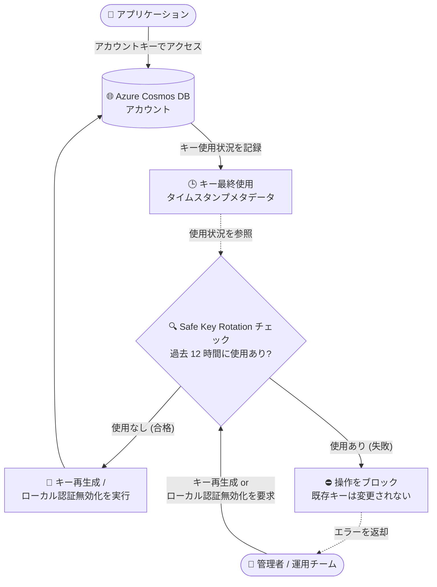

# Azure Cosmos DB: Safe Key Rotation (安全なキーローテーション)

**リリース日**: 2026-10-21

**サービス**: Azure Cosmos DB

**機能**: Safe Key Rotation

**ステータス**: Launched (GA)

[このアップデートのインフォグラフィックを見る](https://takech9203.github.io/azure-news-summary/20261021-cosmosdb-safe-key-rotation.html)

## 概要

Azure Cosmos DB の Safe Key Rotation (安全なキーローテーション) が一般提供 (GA) となった。この機能により、各アカウントキー (プライマリキー / セカンダリキー) が最後に使用された日時を示すタイムスタンプのメタデータを確認できるようになり、キーのローテーションや廃止の前に、どのキーがアクティブに使用されているかを特定できる。

Safe Key Rotation を有効化すると、キーの再生成 (ローテーション) またはローカル認証の無効化の操作を実行する前に、対象キーの使用状況チェックが自動的に実行される。キーが過去 12 時間以内に使用されていた場合、操作はブロックされ、既存のキーは変更されずに有効なまま維持される。これにより、使用中のキーを誤って無効化してしまうことによるアプリケーションの停止リスクを回避できる。

この機能は、キーベース認証から Microsoft Entra ID 認証への完全移行を計画している組織、月次・年次ジョブなどで低頻度にキーを使用しているワークロード、複数チームでキーを共有しており使用状況の可視性が限られている環境で特に有用である。

**アップデート前の課題**

- アカウントキーが実際にアプリケーションから使用されているかどうかを確認する手段がなく、キーのローテーションやローカル認証の無効化が「使用中のキーを止めてしまうかもしれない」というリスクを伴う操作だった
- 月次・年次ジョブなど低頻度でキーを使用するワークロードや、複数チームでキーを共有している環境では、キーの使用状況の把握が特に困難だった
- Microsoft Entra ID 認証への移行時に、キーが完全に未使用になったことを確認できず、ローカル認証を無効化する判断がしづらかった

**アップデート後の改善**

- 各アカウントキーの最終使用日時 (タイムスタンプメタデータ) を確認できるようになり、ローテーションや廃止の前にアクティブなキーを特定できる
- キー再生成・ローカル認証無効化の前に使用状況チェックが自動実行され、過去 12 時間以内に使用されたキーに対する操作はブロックされるため、誤操作による障害を防止できる
- チェックに失敗しても既存キーは変更されず、アプリケーションは従来どおり動作を継続する
- キーが未使用であることを確認したうえでローカル認証を無効化できるため、Microsoft Entra ID への移行を安全に進められる

## アーキテクチャ図



Safe Key Rotation を有効化すると、キー再生成やローカル認証無効化の実行前に、キーの最終使用タイムスタンプに基づく使用状況チェックが実行される。過去 12 時間以内に使用されたキーへの操作はブロックされ、既存キーは変更されないため、アプリケーションへの影響を防げる。

## サービスアップデートの詳細

### 主要機能

1. **キー使用状況のタイムスタンプメタデータ**
   - 各アカウントキーが最後に使用された日時を確認できる
   - Azure Cosmos DB はすべてのアカウントでキー使用状況を既に追跡しており、機能を有効化しても既存キーの変更・ローテーション・無効化は発生しない

2. **キー再生成前の使用状況チェック**
   - キーの再生成リクエスト時に、対象キーが過去 12 時間以内に使用されていないかを事前チェックする
   - チェックに失敗した場合は操作がブロックされ、キーがまだ使用中であることを示すエラーが返される。既存キーは有効なまま変更されない

3. **ローカル認証無効化前の使用状況チェック**
   - ローカル認証 (キーベース認証) を無効化する前に、キーが使用されていないことを確認できる
   - Microsoft Entra ID 認証への移行を安全に完了させるための確認手段として機能する

4. **チェックのバイパスオプション**
   - キーが安全にローテーション可能であると確信できる場合は、リクエストボディで `SkipAccountKeysLastUsageCheck` を `true` に設定することでチェックをスキップし、即時に再生成できる

## 技術仕様

| 項目 | 詳細 |
|------|------|
| 機能名 | Safe Key Rotation |
| ステータス | 一般提供 (GA、2026 年 10 月) |
| 対象サービス | Azure Cosmos DB |
| チェック対象の操作 | アカウントキーの再生成、ローカル認証の無効化 |
| 使用状況チェックの判定基準 | 対象キーが過去 12 時間以内に使用されていないこと |
| チェック失敗時の動作 | 操作をブロックしエラーを返却 (既存キーは変更されない) |
| 有効化方法 (CLI) | capabilities に `EnableAccountKeysLastUsageCheckInDisableLocalAuth` および `EnableKeyCheckBeforeRegenerationPreview` を設定 |
| 有効化方法 (Portal) | Cosmos DB アカウントの「Features」セクションのトグルで有効化 |
| チェックのバイパス | リクエストボディで `SkipAccountKeysLastUsageCheck: true` を指定 |
| 既存キーへの影響 | 有効化による既存キーの変更・無効化なし |

## 設定方法

### 前提条件

1. 既存の Azure Cosmos DB アカウント
2. アプリケーションがプライマリキーまたはセカンダリキーのいずれかを一貫して使用していること

### Azure CLI

```bash
# Safe Key Rotation を有効化する
az cosmosdb update \
     --resource-group <resource-group-name> \
     --name <account-name> \
     --capabilities EnableAccountKeysLastUsageCheckInDisableLocalAuth EnableKeyCheckBeforeRegenerationPreview

# 有効化を確認する
# 出力に EnableAccountKeysLastUsageCheckInDisableLocalAuth と
# EnableKeyCheckBeforeRegenerationPreview が含まれていれば有効
az cosmosdb show \
     --resource-group <resource-group-name> \
     --name <account-name> \
     --query capabilities
```

### Azure Portal

1. Azure Portal にサインインする
2. 対象の Azure Cosmos DB アカウントに移動する
3. ナビゲーションメニューから「Features」を選択する
4. 「Features」セクションで Safe Key Rotation 機能を見つける
5. トグルを選択して Safe Key Rotation を有効化する
6. トグルがオンになり機能が有効化されたことを確認する

### キーローテーションの手順 (プライマリキー使用中の場合)

1. Azure Portal で Cosmos DB アカウントの「Keys」セクションに移動する
2. セカンダリキーの省略記号メニューから「Regenerate Secondary Key」を選択する
3. 新しいセカンダリキーがアカウントに対して一貫して機能することを検証する
4. アプリケーションをプライマリキーからセカンダリキーに切り替える
5. 「Keys」セクションに戻り、プライマリキーの省略記号メニューから「Regenerate Primary Key」を選択する

## メリット

### ビジネス面

- **サービス停止リスクの軽減**: 使用中のキーを誤って無効化してしまうことによるアプリケーション停止・業務中断を防止できる
- **セキュリティハイジーンの向上**: キーローテーションを「リスクのある操作」から「安全で計画的な操作」に変え、定期的なローテーションの実施を促進する
- **コンプライアンス対応**: 最新のセキュリティ・コンプライアンス慣行 (資格情報の定期ローテーション) への準拠を支援する

### 技術面

- **キー使用状況の可視化**: 各キーの最終使用タイムスタンプにより、資格情報管理に関する実用的なインサイトが得られる
- **自動ガードレール**: キー再生成・ローカル認証無効化の前にチェックが自動実行され、人為的ミスを機械的に防止する
- **Entra ID 移行の安全性向上**: キーが完全に未使用であることを確認してからローカル認証を無効化できるため、キーレス構成への移行を確実に進められる
- **既存運用への非破壊性**: 機能を有効化しても既存キーは一切変更されず、従来の手動ローテーション手順も引き続き利用できる

## デメリット・制約事項

- キーが過去 12 時間以内に使用されている場合、再生成リクエストはブロックされる。即時ローテーションが必要な場合 (キー漏洩時など) は `SkipAccountKeysLastUsageCheck` を `true` に設定してチェックをバイパスする必要がある
- チェックを通過させるには、アプリケーションを別のキー (または Microsoft Entra ID) に移行したうえで 12 時間の未使用期間を待つ必要がある
- キーの再生成自体は、アカウントのサイズによって 1 分から数時間かかる場合がある (この点は従来からの動作)
- 機能の利用には capabilities の設定 (または Portal の Features トグル) による明示的な有効化が必要

## ユースケース

### ユースケース 1: Microsoft Entra ID 認証への安全な移行

**シナリオ**: キーベース認証を使用している企業が、Microsoft Entra ID 認証 (RBAC) への完全移行を計画している。すべてのアプリケーションの移行が完了したことを確認してからローカル認証を無効化したい。

**実装例**:

```bash
# Safe Key Rotation を有効化
az cosmosdb update \
  --resource-group myRG \
  --name mycosmosaccount \
  --capabilities EnableAccountKeysLastUsageCheckInDisableLocalAuth EnableKeyCheckBeforeRegenerationPreview

# アプリケーションを Entra ID 認証に移行後、
# キーの最終使用タイムスタンプで未使用を確認してから
# ローカル認証を無効化 (使用中のキーがあればブロックされる)
```

**効果**: キーがまだ使用されている状態でローカル認証を無効化してしまう事故を防ぎ、移行漏れのアプリケーションを事前に検出できる。

### ユースケース 2: 低頻度ジョブが残る環境での定期キーローテーション

**シナリオ**: 月次バッチジョブがアカウントキーを使用している環境で、セキュリティポリシーに基づく定期的なキーローテーションを実施したい。どのキーがジョブに使用されているか可視性が低い。

**実装例**:

```bash
# キー使用状況チェックを有効化した状態でキー再生成を実行
# 過去 12 時間以内に使用されたキーはブロックされるため、
# 誤って使用中のキーを無効化することがない
az cosmosdb keys regenerate \
  --resource-group myRG \
  --name mycosmosaccount \
  --key-kind secondary
```

**効果**: 最終使用タイムスタンプにより低頻度ジョブが依存しているキーを特定でき、使用中キーへの再生成はチェックで自動的にブロックされるため、安全にローテーションを進められる。

## 料金

本機能に関する追加料金の情報は、公式アップデートおよびドキュメントでは確認できなかった。Azure Cosmos DB の料金詳細は以下の料金ページを参照。

- [Azure Cosmos DB の料金](https://azure.microsoft.com/pricing/details/cosmos-db/)

## 関連サービス・機能

- **Microsoft Entra ID / RBAC**: Cosmos DB の推奨認証方式。Safe Key Rotation はキーの未使用を確認したうえでローカル認証を無効化し、Entra ID へ完全移行するための確認手段を提供する
- **ローカル認証の無効化 (disableLocalAuth)**: キーベース認証を無効化しキーレス構成にする機能。Safe Key Rotation のチェック対象操作の 1 つ
- **Azure Key Vault**: アプリケーション側でアカウントキーを保管・管理する際に使用されるシークレット管理サービス。キーローテーション時の配布管理と組み合わせて利用される
- **ネットワークセキュリティ (Private Endpoint / NSP)**: キー管理と併せて Cosmos DB アカウントを保護するための補完的なセキュリティ対策

## 参考リンク

- [インフォグラフィック](https://takech9203.github.io/azure-news-summary/20261021-cosmosdb-safe-key-rotation.html)
- [公式アップデート情報](https://azure.microsoft.com/updates?id=576716)
- [Microsoft Learn - Rotate keys (Azure Cosmos DB)](https://learn.microsoft.com/azure/cosmos-db/how-to-rotate-keys)
- [Microsoft Learn - Secure your account (Azure Cosmos DB)](https://learn.microsoft.com/azure/cosmos-db/security)
- [Microsoft Learn - Role-based access control (Azure Cosmos DB)](https://learn.microsoft.com/azure/cosmos-db/how-to-connect-role-based-access-control)
- [Azure Cosmos DB の料金](https://azure.microsoft.com/pricing/details/cosmos-db/)

## まとめ

Azure Cosmos DB の Safe Key Rotation の一般提供は、これまで「使用中のキーを止めてしまうかもしれない」というリスクを伴っていたキーローテーションとローカル認証の無効化を、キーの最終使用タイムスタンプに基づく事前チェックによって安全な操作に変えるアップデートである。チェックに失敗した場合は操作がブロックされ既存キーは変更されないため、アプリケーションの継続性が維持される。

Solutions Architect への推奨アクション:

1. **機能の有効化**: キーベース認証を使用している Cosmos DB アカウントで Safe Key Rotation を有効化し、キーローテーション時のガードレールとして活用する
2. **キー使用状況の棚卸し**: 最終使用タイムスタンプを確認し、実際に使用されているキー・未使用のキーを特定して資格情報管理を見直す
3. **Entra ID 移行計画への組み込み**: Microsoft Entra ID 認証への移行プロジェクトにおいて、ローカル認証無効化前の確認ステップとして本機能を組み込む
4. **緊急時手順の整備**: キー漏洩時など即時ローテーションが必要なケースに備え、`SkipAccountKeysLastUsageCheck` によるバイパス手順を運用手順書に明記する

キー管理の可視性向上と誤操作防止を両立する機能であり、キーベース認証が残る環境では有効化を推奨できる実用的なセキュリティ改善である。

---

**タグ**: #AzureCosmosDB #SafeKeyRotation #KeyRotation #Security #MicrosoftEntraID #CredentialManagement #GA
