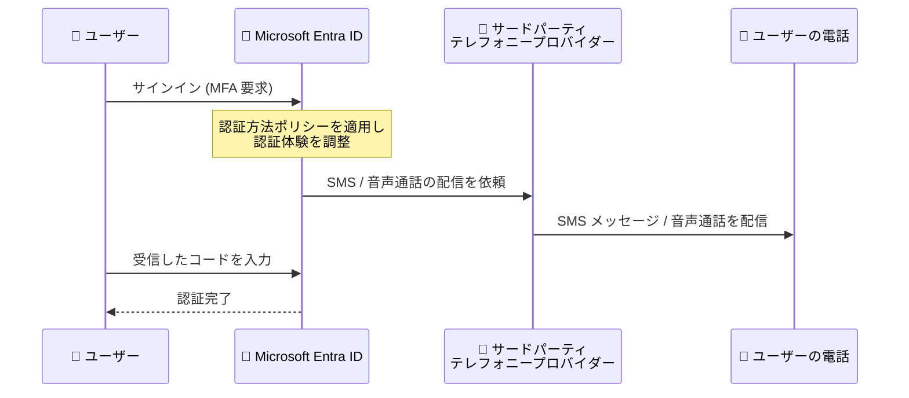

# Microsoft Entra ID: Choose Your Own Telephony (CYOT) の発表

**リリース日**: 2026-10-21

**サービス**: Microsoft Entra ID (旧 Azure AD)

**機能**: Choose Your Own Telephony (CYOT) - サードパーティ テレフォニープロバイダーによる SMS・音声認証

**ステータス**: Announcement (2026 年 10 月 30 日より構成可能)

[このアップデートのインフォグラフィックを見る](https://takech9203.github.io/azure-news-summary/20261021-entra-choose-your-own-telephony.html)

## 概要

2026 年 10 月 30 日より、Microsoft Entra ID で「Choose Your Own Telephony Provider (CYOT)」が利用可能になります。この機能により、組織は SMS および音声 (Voice) 認証の配信に、サポート対象のサードパーティ通信プロバイダーを利用できるようになります。プロバイダーは Microsoft Security Store を通じて選択し、商業上の契約関係は組織がプロバイダーと直接管理します。

この発表の背景には、Microsoft 提供のテレフォニー配信の廃止計画があります。2026 年 9 月 1 日からパスキーが既定のサインイン体験となり、2027 年 2 月 1 日には Microsoft 提供の SMS・音声認証がグローバル管理者と外部ユーザーを除くすべてのユーザーで廃止されます (グローバル管理者と外部ユーザーは 2027 年 7 月 1 日に廃止。内部ゲストユーザーは 2027 年 2 月 1 日の廃止対象)。CYOT は、規制要件や業務要件により電話ベースの認証を継続する必要がある組織向けの移行パスとして提供されます。

Microsoft は、SMS や音声認証ではなく、パスキーなどのフィッシング耐性のある認証方法を推奨しています。テレフォニープロバイダーの利用は、ビジネス上・規制上・技術上の要件がある特定のユーザー層に限定すべきとされています。

**アップデート前の課題**

- Entra ID の SMS・音声認証のテレフォニー配信は Microsoft 提供のものに限定されており、組織がプロバイダーを選択できなかった
- Microsoft 提供の SMS・音声認証の廃止 (2027 年 2 月 1 日開始) 後、規制・業務上の要件で電話ベースの認証が必須の組織に継続手段がなかった

**アップデート後の改善**

- Microsoft Security Store を通じてサポート対象のサードパーティ テレフォニープロバイダーを選択し、SMS・音声認証を継続できるようになる
- 組織は地理的カバレッジ、配信チャネル、価格、サポート、セキュリティ、コンプライアンス機能に基づいてプロバイダーを比較・選定できる
- Entra ID は引き続き認証方法ポリシーを適用し、認証体験全体を調整する (ポリシー管理は従来どおり Entra ID 側で一元化)

## アーキテクチャ図

CYOT では、SMS メッセージや音声通話の配信を組織が選択したサードパーティ プロバイダーが担い、Microsoft Entra ID は従来どおり認証方法ポリシーの適用と認証体験の調整を行います。

## サービスアップデートの詳細

### 主要機能

1. **サードパーティ テレフォニープロバイダーの選択**
   - Microsoft Security Store を通じてプロバイダーを選択・購入する
   - プライベートプレビュー期間の初期プロバイダーは Soprano と Telesign の 2 社。GA までにさらにプロバイダーが追加される予定
   - Soprano はユーザー単位課金とトランザクション単位課金の 2 種類のオファー、Telesign は「Telesign Verify for Microsoft Entra」を提供

2. **Entra ID による認証ポリシーの一元管理**
   - SMS・音声の配信はプロバイダーが担当するが、認証方法ポリシーの適用と認証フローの調整は Entra ID が継続して実施
   - 組織側の責任範囲は、プロバイダーの選定、リージョンカバレッジ・契約条件の確認、プロバイダー契約の締結、Entra ID への構成、サービスの監視

3. **Microsoft 提供 SMS・音声認証の廃止への移行パス**
   - 2026 年 10 月 30 日から CYOT の構成が可能になり、廃止 (2027 年 2 月 1 日開始) までに移行できる

## 技術仕様

| 項目 | 詳細 |
|------|------|
| 構成可能開始日 | 2026 年 10 月 30 日 |
| プロバイダー選択チャネル | Microsoft Security Store (Azure Marketplace の購入フロー) |
| 初期プロバイダー (プライベートプレビュー) | Soprano、Telesign (GA までに追加予定) |
| 対応認証方法 | SMS 認証、音声 (Voice) 認証 |
| ポリシー適用 | Microsoft Entra ID が認証方法ポリシーを継続して適用 |
| Microsoft 提供テレフォニーの廃止 | 2027 年 2 月 1 日 (一般ユーザー・内部ゲスト) / 2027 年 7 月 1 日 (グローバル管理者・外部ユーザー) |
| 必要な環境 | 適格な Azure サブスクリプション、Azure Marketplace / Security Store での購入許可 |

## 設定方法

### 前提条件

1. 適格な Azure サブスクリプションを保有していること
2. 組織で Azure Marketplace または Microsoft Security Store 経由のソリューション購入が許可されていること
3. SMS または音声認証が必要なユーザーと、その文書化された要件 (規制・業務・技術要件) を特定済みであること
4. 該当ユーザーにフィッシング耐性のある認証方法 (パスキーなど) が適用できないことを確認済みであること

### 導入の流れ (GA 前の準備事項)

Microsoft は、CYOT の採用を予定する組織に対し、GA 日 (2026 年 10 月 30 日) 前に以下の準備を推奨しています。

1. SMS・音声認証が必要なユーザーセグメントと要件 (適用される規制やシナリオ) を文書化する
2. サポート対象プロバイダーを地理的カバレッジ、配信チャネル、価格、サポート、セキュリティ、コンプライアンス機能で比較する
3. 調達・プライバシー・規制要件を社内の関係チームとレビューする
4. Azure サブスクリプションの適格性と Marketplace / Security Store での購入可否を検証する
5. プロバイダー価格と Azure インフラストラクチャ費用のコストを見積もる
6. Marketplace フローでプロバイダー契約を締結し、パイロットグループでテストしてから本展開する

## メリット

### ビジネス面

- 規制業界など電話ベースの認証が業務上必須の組織が、Microsoft 提供テレフォニーの廃止後も SMS・音声認証を継続できる
- 価格、サポート、コンプライアンス機能に基づいてプロバイダーを選択でき、調達の柔軟性が向上する
- Microsoft Security Store / Azure Marketplace の購入フローを利用でき、調達プロセスを既存の Azure 契約に統合できる

### 技術面

- 認証方法ポリシーの管理は Entra ID 側に残るため、認証ガバナンスのアーキテクチャを変更せずにテレフォニー配信だけを切り替えられる
- 地理的カバレッジや配信チャネルを要件に合わせてプロバイダー単位で選択できる

## デメリット・制約事項

- 2026 年 10 月 30 日までは CYOT の構成はできない (プライベートプレビュー参加プロバイダーの情報のみ公開)
- プロバイダーとの商業上の契約関係 (契約締結、条件確認、監視) は組織側の責任となる
- プロバイダー利用料に加えて Azure インフラストラクチャ費用が別途発生する
- Microsoft はフィッシング耐性のある認証方法 (パスキーなど) を推奨しており、SMS・音声はフィッシング、SIM スワップ、リプレイ攻撃に対して脆弱な認証方法と位置付けられている。CYOT は要件のあるユーザー層に限定して使用すべき
- 2027 年 2 月 1 日以降、SMS・音声しか MFA 手段がない対象ユーザーにはサインイン時にパスキー登録を求めるブロッキングプロンプトが表示される (オプトアウト不可)。CYOT を利用する場合も廃止日前の構成完了が必要

## ユースケース

### ユースケース 1: 規制業界での SMS 認証の継続

**シナリオ**: 金融機関などの規制業界で、特定のコンプライアンス規制によりアウトオブバンドの SMS 認証が要求されている。Microsoft 提供のテレフォニー廃止 (2027 年 2 月 1 日) 後も該当ユーザーの SMS 認証を継続する必要がある。

**実装の流れ**:

1. PowerShell スクリプト ([entra-sms-voice-usage-analyzer](https://github.com/microsoft/entra-sms-voice-usage-analyzer)) で SMS・音声認証が有効なユーザーを特定する
2. 規制要件のあるユーザーセグメントを文書化し、それ以外のユーザーはパスキーに移行する
3. Microsoft Security Store で Soprano または Telesign のオファーを比較・購入し、Entra ID に構成する
4. パイロットグループでテスト後、2027 年 2 月 1 日までに本展開を完了する

**効果**: 規制要件を満たしつつ、認証ポリシー管理は Entra ID に一元化したまま SMS 認証を継続できる。

### ユースケース 2: パスキー移行を主軸とした段階的な SMS 廃止

**シナリオ**: 大多数のユーザーをパスキーへ移行し、どうしても電話ベースの認証が必要な一部ユーザーのみ CYOT を利用する。

**実装の流れ**:

1. Entra ID の登録キャンペーン (Entra ID > Authentication methods > Registration campaign) で SMS・音声ユーザーをパスキー登録に誘導する
2. 移行期間の調整が必要な場合は、Microsoft Graph で `passkeyDynamicMigration` を `true` に設定し、2026 年 9 月 1 日からの自動パスキー有効化を一時的にオプトアウトする (2027 年 2 月 1 日以降は対象ユーザーに標準の移行・強制スケジュールが適用)
3. 残存する要件保有ユーザーのみ CYOT プロバイダーを構成する

**効果**: フィッシング耐性のある認証を組織の既定としつつ、例外ユーザーの業務継続性を確保できる。

## 料金

CYOT 自体の料金は、選択するプロバイダーのオファー (例: Soprano のユーザー単位 / トランザクション単位課金) に依存し、Microsoft Security Store 上の各オファーで確認できます。プロバイダー料金に加えて、Azure インフラストラクチャ費用が別途発生します。

- [Soprano: ユーザー単位オファー (Microsoft Security Store)](https://securitystore.microsoft.com/solutions/sopranodesignlimited1620113206416.soprano_entraid_per_user)
- [Soprano: トランザクション単位オファー (Microsoft Security Store)](https://securitystore.microsoft.com/solutions/sopranodesignlimited1620113206416.soprano_entraid_per_transaction)
- [Telesign Verify for Microsoft Entra (Microsoft Security Store)](https://securitystore.microsoft.com/solutions/telesigncorporation1779799505747.telesign-verify-cyot-azure)
- [Azure リソース要件とコスト見積もりガイダンス (GitHub)](https://github.com/Azure-Samples/ExternalPhoneProvider-AzureFunction-Sample/blob/main/docs/COST-CALCULATOR.md)

## 関連サービス・機能

- **パスキー (FIDO2)**: Microsoft が推奨するフィッシング耐性のある認証方法。2026 年 9 月 1 日から既定のサインイン体験となり、SMS・音声からの主要な移行先
- **Microsoft Security Store / Azure Marketplace**: CYOT プロバイダーの選択・購入チャネル
- **Entra ID 認証方法ポリシー (Authentication Methods Policy)**: CYOT 利用時も認証方法の有効化・対象ユーザー管理は本ポリシーで継続
- **登録キャンペーン (Registration Campaign)**: SMS・音声ユーザーをパスキー登録へ誘導する機能

## 参考リンク

- [インフォグラフィック](https://takech9203.github.io/azure-news-summary/20261021-entra-choose-your-own-telephony.html)
- [公式アップデート情報](https://azure.microsoft.com/updates?id=577273)
- [Choose a telephony provider for SMS and voice authentication (Microsoft Learn)](https://learn.microsoft.com/en-us/entra/identity/authentication/concept-phone-providers)
- [Passkeys by default and retirement of Microsoft-provided SMS and voice authentication (Microsoft Learn)](https://learn.microsoft.com/en-us/entra/identity/authentication/concept-sms-voice-retirement)
- [SaaS ソリューションの購入とデプロイ手順 (Microsoft Learn)](https://learn.microsoft.com/en-us/security/store/customers/how-to-purchase-a-saas-solution-and-deploy-a-linked-solution)
- [パスキー展開ガイド (Microsoft Learn)](https://learn.microsoft.com/en-us/entra/identity/authentication/how-to-deploy-phishing-resistant-passwordless-authentication)

## まとめ

CYOT は、Microsoft 提供の SMS・音声認証の廃止 (2027 年 2 月 1 日開始) に伴い、電話ベースの認証を継続する必要がある組織向けに提供される移行パスです。2026 年 10 月 30 日から Microsoft Security Store 経由でサードパーティ プロバイダー (初期は Soprano と Telesign) を構成できるようになります。

Solutions Architect としては、まず PowerShell スクリプトで SMS・音声認証に依存しているユーザーを特定し、原則としてパスキーへの移行を計画すべきです。そのうえで、規制・業務上の要件により電話ベースの認証が不可欠なユーザーセグメントを文書化し、プロバイダーの比較評価・調達レビュー・コスト見積もりを GA 日前に完了させておくことを推奨します。廃止日以降はブロッキングプロンプトが適用されオプトアウトできないため、移行計画の早期着手が重要です。

---

**タグ**: Microsoft Entra ID, Identity, MFA, SMS 認証, 音声認証, CYOT, パスキー, Announcement
