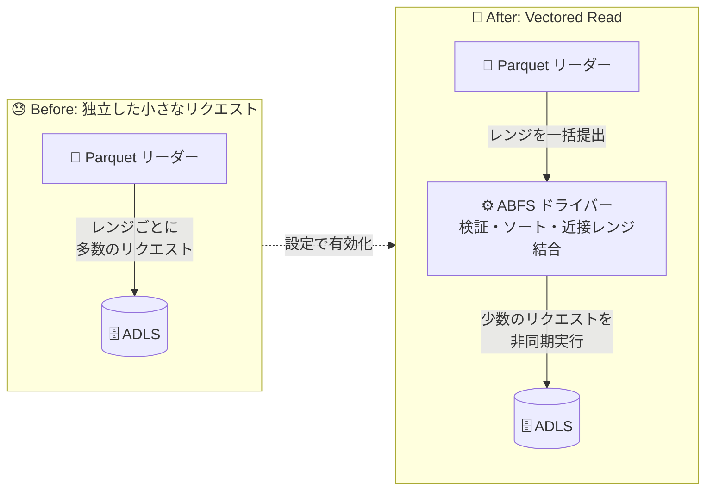

# Azure Data Lake Storage: ABFS Vectored Read の一般提供開始 (GA)

**リリース日**: 2026-10-22

**サービス**: Azure Data Lake Storage / Azure Blob Storage

**機能**: ABFS Vectored Read

**ステータス**: Launched (GA)

[このアップデートのインフォグラフィックを見る](https://takech9203.github.io/azure-news-summary/20261022-adls-abfs-vectored-read.html)

## 概要

Azure Data Lake Storage の Hadoop 向けドライバーである ABFS (Azure Blob File System) ドライバーにおいて、**Vectored Read** が一般提供 (GA) となった。Vectored Read は、Parquet などの列指向ファイルから必要な部分だけを選択的に読み取るワークロードにおいて、ストレージへのリクエストオーバーヘッドを削減するクライアントサイドの最適化機能である。

従来、列の選択や行グループのフィルタリングを行う選択的クエリでは、必要なデータがファイル内の複数の非連続な箇所に分散しているため、レンジごとに独立した小さなストレージリクエストが多数発生していた。Vectored Read では、互換性のあるリーダーが必要なファイルレンジをまとめて ABFS ドライバーに渡すことで、ドライバーがレンジを検証・ソートし、近接するレンジを結合して少数のストレージリクエストにまとめ、非同期に実行する。これによりネットワークラウンドトリップを削減できる。

ファイルフォーマットの変更や保存済みデータの書き換えは不要で、互換性のある Spark ワークロードであれば、クエリの書き換えやデータ移行なしに設定のみで有効化できる。

**アップデート前の課題**

- 選択的な Parquet クエリでは、必要なデータがファイル内に分散しているため、レンジごとに独立した多数の小さなストレージリクエストが発生していた
- 各リクエストにネットワークと処理のオーバーヘッドが伴うため、読み取るデータ量を減らしても、読み取りを調整するコストは解消されなかった

**アップデート後の改善**

- 互換性のあるリーダーが必要なレンジを一括で渡すことで、ABFS ドライバーが I/O をグループとして計画できるようになった
- 近接するレンジが結合され、ストレージリクエスト数とネットワークラウンドトリップが削減される
- 読み取りが非同期に実行され、各レンジを独立した操作として扱わずに複数レンジを並行処理できる
- Spark 設定 (`parquet.hadoop.vectored.io.enabled=true`) のみで有効化でき、クエリ書き換えやデータ移行は不要

## アーキテクチャ図



従来はリーダーが必要なレンジごとに個別のストレージリクエストを発行していたが、Vectored Read では ABFS ドライバーがレンジ群を受け取り、近接レンジを結合した少数のリクエストを非同期に実行することでラウンドトリップを削減する。

## サービスアップデートの詳細

### 主要機能

1. **近接レンジの結合 (coalescing)**
   - 互換性のあるリーダーが必要なファイルレンジをまとめて提出すると、ABFS ドライバーがレンジを検証・ソートし、近接するレンジを適宜結合して、読み取りバッファーに収まるよう作業を分割する

2. **非同期読み取り**
   - 結合後のストレージリクエストを非同期にキューイングして実行し、要求された各レンジのバッファーにデータを返す。各レンジを独立した操作として扱わないため、調整された I/O が可能になる

3. **設定ベースの導入**
   - Hadoop の Parquet + ABFS パスを使用する互換性のある Spark ワークロードは、クエリの書き換え、アプリケーションロジックの変更、データ移行なしに、設定のみで機能を利用できる

4. **クライアントサイド最適化**
   - ファイルフォーマットの変更や保存データの書き換えは行わない。エンジンは要求したレンジのデータをそのまま受け取る

## 技術仕様

| 項目 | 詳細 |
|------|------|
| 対象サービス | Azure Data Lake Storage / Azure Blob Storage (ABFS ドライバー経由のアクセス) |
| 必要な Hadoop バージョン | Apache Hadoop 3.3.5 以降 (hadoop-azure モジュールを含む) |
| 必要な Parquet ライブラリ | parquet-hadoop 1.12.3 以降 |
| 対象 URI スキーム | `abfs://` / `abfss://` |
| 有効化設定 (Spark) | `spark.hadoop.parquet.hadoop.vectored.io.enabled=true` |
| 最適化の種類 | クライアントサイド (ファイルフォーマット・保存データの変更なし) |
| 効果が高いワークロード | 選択的な Parquet 読み取り (列選択・行グループフィルタリング) |
| 効果が低いワークロード | フルシーケンシャルスキャン、Hadoop/ABFS パスを経由しないエンジン |

## 設定方法

### 前提条件

1. ランタイムに Apache Hadoop 3.3.5 以降 (hadoop-azure モジュールを含む) が含まれていること
2. parquet-hadoop 1.12.3 以降が含まれていること
3. サポートは Spark のバージョンだけでなく、ランタイムに含まれる Hadoop / hadoop-azure / parquet-hadoop ライブラリのバージョンに依存する。ABFS URI が使えることだけでは、最適化された実装がインストールされていることの確認にはならない

### Spark での有効化

アプリケーション起動前に、`spark.hadoop.` プレフィックスを付けて Parquet 設定を有効化する。

```bash
spark-submit \
  --conf spark.hadoop.parquet.hadoop.vectored.io.enabled=true \
  <other-options> \
  <application>
```

- パッケージされている Parquet バージョンによってデフォルト値が異なる場合があるため、デフォルトに依存せず明示的にプロパティを設定することが推奨されている
- マネージドサービスの場合は、各サービスがサポートするクラスターまたはセッション構成の仕組みを使用する

## メリット

### ビジネス面

- 既存のクエリやデータを変更せずに、設定のみで選択的読み取りワークロードの効率化を図れる
- ストレージリクエスト数の削減により、トランザクション数の削減につながる可能性がある (ワークロード依存のため、ベースラインとの比較検証が推奨されている)

### 技術面

- 近接レンジの結合により、独立したストレージリクエスト数とネットワークラウンドトリップを削減できる
- 非同期読み取りにより、複数のレンジ要求を調整された I/O として並行処理できる
- クライアントサイドの最適化のため、ファイルフォーマットの変更や保存データの書き換えが不要

## デメリット・制約事項

- **Azure Databricks は現時点で非対応**: Databricks ランタイムに含まれる ABFS バージョンがこの機能を含んでいない。また、Photon は `abfs://` / `abfss://` URI を使用していても ABFS ドライバーをデータアクセスに使用しないため、ABFS URI の存在だけでは Vectored Read が利用可能とは判断できない
- フルシーケンシャルスキャンでは効果が小さい場合がある
- Hadoop/ABFS パスを経由しないエンジンではこの機能は使用されない
- レンジ結合により、非連続な要求レンジの間にある余分なバイトを読み取る場合がある
- 効果は、要求レンジの数・サイズ・間隔、結合 (coalescing) の構成、ストレージとネットワークのレイテンシ、同時実行性、キャッシュに依存する。代表的なデータと同時実行性を用いて、クエリ実行時間・ストレージトランザクション数・読み取りバイト数・リソース使用率をベースラインと比較することが推奨されている

## ユースケース

### ユースケース 1: 選択的な Parquet クエリの効率化

**シナリオ**: ADLS 上の Parquet データセットに対し、少数の列を選択し大半の行グループをフィルタリングするクエリを Spark で実行している。リーダーは不要なデータをスキップできるが、必要なデータがファイル内の複数箇所に分散しており、多数の小さなレンジリクエストが発生している。

**実装例**:

```bash
# Hadoop 3.3.5+ / parquet-hadoop 1.12.3+ を含むランタイムで実行
spark-submit \
  --conf spark.hadoop.parquet.hadoop.vectored.io.enabled=true \
  my_selective_query_app.py
```

**効果**: 近接レンジの結合と非同期実行により、ストレージリクエスト数とネットワークラウンドトリップが削減される。まず代表的な選択的読み取りワークロード 1 つから開始し、ベースラインと比較することが推奨されている。

## 料金

本機能自体の追加料金に関する公式情報は確認できなかった。ストレージリクエスト数の削減はトランザクション課金に影響し得る一方、レンジ結合により読み取りバイト数が増える場合もあるため、ストレージトランザクション数と読み取りバイト数をベースラインと比較して評価することが公式ブログで推奨されている。

料金の詳細は以下を参照:

- [Azure Data Lake Storage の料金](https://azure.microsoft.com/pricing/details/storage/data-lake/)

## 関連サービス・機能

- **ABFS (Azure Blob File System) ドライバー**: Apache Hadoop に含まれる ADLS 向けドライバー。本機能はこのドライバーのクライアントサイド最適化として提供される
- **Apache Spark / Apache Hadoop**: Hadoop の Parquet リーダー (parquet-hadoop) と ABFS パスを使用するワークロードが本機能の対象
- **Azure Blob Storage (階層型名前空間)**: ADLS は階層型名前空間を有効化した Blob Storage 上に構築されており、ABFS ドライバーは ADLS REST API のクライアントシムとして動作する

## 参考リンク

- [インフォグラフィック](https://takech9203.github.io/azure-news-summary/20261022-adls-abfs-vectored-read.html)
- [公式アップデート情報](https://azure.microsoft.com/updates?id=577618)
- [Tech Community ブログ: Optimize selective analytics reads in Azure Data Lake Storage with ABFS Vectored Read](https://techcommunity.microsoft.com/blog/analyticsonazure/optimize-selective-analytics-reads-in-azure-data-lake-storage-with-abfs-vectored/4564592)
- [Microsoft Learn: ABFS ドライバーの概要](https://learn.microsoft.com/azure/storage/blobs/data-lake-storage-abfs-driver)
- [料金ページ (Azure Data Lake Storage)](https://azure.microsoft.com/pricing/details/storage/data-lake/)

## まとめ

ABFS Vectored Read の GA により、ADLS 上の選択的な Parquet 読み取りワークロードにおいて、近接レンジの結合と非同期読み取りによるリクエストオーバーヘッド削減が、設定のみで利用可能になった。クエリ書き換えやデータ移行が不要な点が導入のハードルを大きく下げている。

導入にあたっては、ランタイムが Apache Hadoop 3.3.5 以降 (hadoop-azure 含む) と parquet-hadoop 1.12.3 以降を含むことを確認し、`parquet.hadoop.vectored.io.enabled=true` を明示的に設定する。Azure Databricks は現時点で非対応である点、効果はワークロード特性に依存する点に注意し、まず代表的な選択的読み取りワークロード 1 つでクエリ実行時間・トランザクション数・読み取りバイト数をベースラインと比較検証することを推奨する。

---

**タグ**: Azure Data Lake Storage, Azure Blob Storage, ABFS, Vectored Read, Parquet, Apache Spark, Apache Hadoop, Storage, Analytics, GA
