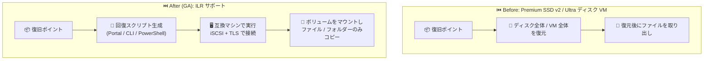

# Azure Backup: Premium SSD v2 / Ultra ディスク搭載 Azure VM のアイテムレベル回復 (ILR) が一般提供開始

**リリース日**: 2026-10-23

**サービス**: Azure Backup

**機能**: Item-Level Recovery (ILR) for Azure VMs with Premium SSD v2 and Ultra Disks

**ステータス**: Launched (GA)

[このアップデートのインフォグラフィックを見る](https://takech9203.github.io/azure-news-summary/20261023-azure-backup-ilr-premium-ssdv2-ultra-disks.html)

## 概要

Azure Backup が、Premium SSD v2 および Ultra ディスクを使用する Azure 仮想マシンに対するアイテムレベル回復 (Item-Level Recovery、ILR) の一般提供 (GA) を開始しました。論理セクターサイズは 512 バイトと 4KB の両方がサポートされ、これらの高性能ディスクを使用する VM からも、個々のファイルやフォルダーを選択して復元できるようになります。

ILR では、Azure Portal、Azure CLI、または PowerShell からファイル回復用の実行ファイル (Windows) もしくは Python スクリプト (Linux) を生成し、互換性のあるマシン上で実行することで、復旧ポイントに iSCSI 経由で接続します。ボリュームがローカルにマウントされるため、ディスク全体や VM 全体を復元することなく、必要なファイル・フォルダーだけを参照してコピーできます。これは Standard HDD / Standard SSD / Premium SSD v1 で提供されてきた既存の ILR と同等 (parity) の動作であり、今回の GA によりすべての Azure Managed Disk SKU で ILR が利用可能になりました。

また、複数のディスク種別が混在する VM (mixed disk types) の復旧ポイントもサポートされ、対象となるすべてのディスクが公開されるため、ディスク構成を意識せずにファイル単位の回復が行えます。

**アップデート前の課題**

- ILR は Standard HDD / Standard SSD / Premium SSD v1 のみ対応しており、Premium SSD v2 / Ultra ディスクを使用する VM では個別ファイルの回復ができなかった
- Premium SSD v2 / Ultra ディスク搭載 VM で特定のファイルだけが必要な場合でも、ディスク全体または VM 全体の復元が必要だった

**アップデート後の改善**

- Premium SSD v2 / Ultra ディスク (512 バイト / 4KB 論理セクターサイズ) を使用する VM からファイル・フォルダー単位で直接回復できるようになった
- ディスク全体・VM 全体の復元が不要になり、特定ファイルのみが必要なシナリオでの復旧時間 (RTO) が改善された
- すべての Azure Managed Disk SKU で ILR の動作が統一された

## アーキテクチャ図

従来は Premium SSD v2 / Ultra ディスクの VM からファイルを取り出すにはディスクや VM 全体の復元が必要でしたが、GA 後は回復スクリプトで復旧ポイントに直接接続し、必要なファイルだけを選択してコピーできます。

## サービスアップデートの詳細

### 主要機能

1. **Premium SSD v2 / Ultra ディスクの ILR サポート (GA)**
   - 512 バイトおよび 4KB の両方の論理セクターサイズに対応
   - ディスク種別が混在する VM の復旧ポイントもサポートし、対象ディスクをすべて公開

2. **既存 ILR ワークフローとの完全な互換性 (parity)**
   - Azure Portal、CLI、PowerShell からファイル回復用の実行ファイル (Windows) / Python スクリプト (Linux) を生成
   - 復旧ポイントを iSCSI ターゲットとしてマウントし、ボリュームを参照して必要なファイルのみコピー
   - フルディスク復元や VM 復元は不要

3. **セキュリティ設計**
   - スクリプトの生成には VM 復元と同等の Azure RBAC 権限が必要
   - スクリプトは Microsoft の公式証明書で署名されており、改ざんすると署名が無効化される
   - 実行には生成時に表示されるパスワードが必要で、管理者による昇格モードでの実行のみ許可
   - iSCSI 接続は相互 CHAP 認証、データフローは TLS 1.2 によるセキュアトンネルで保護
   - 復旧ポイントへのアクセスは読み取り専用で、既定で 12 時間後に自動切断 (スクリプトも失効)

## 技術仕様

| 項目 | 詳細 |
|------|------|
| 対象ディスク | Standard HDD / Standard SSD / Premium SSD v1 / Premium SSD v2 / Ultra ディスク |
| 論理セクターサイズ | 512 バイトおよび 4KB (Premium SSD v2 / Ultra) |
| 対象 VM | Resource Manager モデルでデプロイされ、Recovery Services コンテナーで保護された Azure VM |
| 対応 OS (Premium SSD v2 / Ultra の ILR) | Windows、Linux (Ubuntu、RHEL、Debian、Oracle Linux、SLES、openSUSE) |
| スクリプト実行マシンの要件 (Windows) | .NET 4.6.2 以上、TLS 1.2 サポート、バックアップ元と互換性のある OS バージョン |
| スクリプト実行マシンの要件 (Linux) | bash 4 以上、Python 2.6.6 以上、open-iscsi / lshw、TLS 1.2 サポート |
| ネットワーク要件 | `download.microsoft.com` (443/outbound)、Recovery Service URL (3260/outbound、`AzureBackup` サービスタグ)、DNS (53/outbound) |
| 接続方式 | iSCSI (相互 CHAP 認証) + TLS 1.2 セキュアトンネル |
| アクセス権 | 読み取り専用、既定 12 時間で自動切断・スクリプト失効 |
| 推奨回復サイズ | 合計 10 GB 以下 (転送速度は約 1 GB/時) |

## 設定方法

### 前提条件

1. Azure VM が Resource Manager モデルでデプロイされ、Recovery Services コンテナーにバックアップされていること
2. スクリプト生成には VM 復元と同等の Azure RBAC 権限を持つユーザーであること
3. スクリプト実行マシンが OS 要件 (上表)、コンポーネント要件、ネットワークアクセス要件を満たすこと
4. プロキシ経由ではなく、ポート 3260 (iSCSI) への直接アクセスが可能なマシンで実行すること

### Azure Portal

1. Azure Portal で対象の仮想マシンを開き、メニューから **[バックアップ]** を選択
2. バックアップダッシュボードで **[ファイルの回復]** (File Recovery) を選択
3. **[復元ポイントの選択]** で、回復したいファイルを含む復元ポイントを選択
4. **[実行可能ファイルのダウンロード]** (Windows VM) または **[スクリプトのダウンロード]** (Linux VM、Python スクリプト) を実行
5. ポータルに表示されるパスワードをコピーし、互換マシン上で管理者権限でスクリプトを実行してパスワードを入力
6. マウントされたボリューム (Windows はドライブレター、Linux はスクリプト実行フォルダー配下) から必要なファイルをコピー
7. 完了後、ポータルの **[ディスクのマウント解除]** (Unmount Disks) で接続を閉じる

## メリット

### ビジネス面

- 特定ファイルのみの復旧シナリオで復旧時間 (RTO) が短縮され、業務影響を最小化できる
- ディスク全体の復元用リソース (一時的なディスク・VM) が不要になり、復旧作業のコストと手間を削減できる
- 高性能ディスク (Premium SSD v2 / Ultra) 採用の障壁が 1 つ減り、ミッションクリティカルなワークロードのモダナイズを後押しする

### 技術面

- すべての Managed Disk SKU で ILR の運用手順が統一され、ディスク SKU ごとの復旧手順の作り分けが不要になる
- ディスク種別が混在する VM でも、すべての対象ディスクからファイル回復が可能
- RBAC、署名付きスクリプト、相互 CHAP、TLS 1.2、12 時間自動切断など、既存 ILR と同じセキュリティ統制が適用される

## デメリット・制約事項

- 暗号化された VM バックアップからのファイル回復はサポートされない
- 回復合計サイズは 10 GB 以下での利用が推奨され、データ転送速度は約 1 GB/時と性能上の制限がある
- スパン/ストライプボリューム、ミラー/RAID-5 のダイナミックディスク、Windows 記憶域スペースを持つマシン上ではスクリプトを実行できない (別マシンが必要)
- バックアップ元 VM のディスク数が多い (16 超) または大きい (4 TB 超) 場合、同一マシンでの実行は非推奨 (ファイル回復専用の別 VM を推奨)
- Linux の LVM / ソフトウェア RAID 構成では、保護対象 VM と同じマシン上でスクリプトを実行できず、ボリュームのオンライン化に追加手順が必要
- Windows は OS バージョンの互換性制約があり、過去・将来の OS バージョンへのファイル復元はできない
- スクリプトは英語のみで生成され、ローカライズされていない (実行にはシステムロケールが英語である必要がある場合がある)
- プロキシが iSCSI (ポート 3260) をサポートしない場合があるため、直接アクセス可能なマシンでの実行が強く推奨される

## ユースケース

### ユースケース 1: 高性能 DB サーバーからの誤削除ファイルの復旧

**シナリオ**: Premium SSD v2 を使用する Linux (RHEL) 上のアプリケーションサーバーで、設定ファイルやログファイルを誤って削除してしまった。VM 全体を復元するとダウンタイムと作業コストが大きい。

**実装例** (Azure Portal):

1. 対象 VM の [バックアップ] → [ファイルの回復] から復元ポイントを選択し、Python スクリプトをダウンロード
2. 互換性のある別の Linux マシンに転送し、`chmod +x` 後に実行、パスワードを入力
3. マウントされたボリュームから対象ファイルのみをコピー
4. 完了後にポータルから [ディスクのマウント解除] を実行

**効果**: VM・ディスク全体の復元を行わずに数ファイルのみを回復でき、本番 VM への影響なしに短時間で復旧が完了する。

### ユースケース 2: 監査・調査目的での過去時点のファイル参照

**シナリオ**: Ultra ディスクを使用するミッションクリティカル VM について、過去の復旧ポイント時点の特定ファイルの内容を監査・調査のために確認したい。

**効果**: 復旧ポイントを読み取り専用でマウントして必要なファイルだけを参照・取得でき、12 時間で自動的にアクセスが失効するため、安全に調査を実施できる。

## 料金

Azure Updates および料金ページ上で、ILR 自体に対する追加料金の記載はありません。Azure Backup の料金ページでは、Backup Storage の Standard 層からの復元は無料 (トランザクション料・エグレス料なし) と記載されています。

Azure VM バックアップの基本的な料金体系は以下のとおりです (金額はリージョンにより異なるため料金ページを参照)。

| 項目 | 内容 |
|------|------|
| 保護インスタンス料金 | 保護対象データサイズに応じた階層制の月額固定料金 (50 GB 以下 / 50〜500 GB / 500 GB 超は 500 GB 増分ごと) |
| バックアップストレージ料金 | 消費量に応じた GB 単価 (LRS / ZRS / GRS / RA-GRS を選択可能) |
| Standard 層からの復元 | 無料 (トランザクション料・エグレス料なし) |
| Archive 層からの復元 | リハイドレート (データ取得) 料金が別途発生 |

詳細は [Azure Backup 料金ページ](https://azure.microsoft.com/pricing/details/backup/) を参照してください。

## 利用可能リージョン

リージョンごとの提供状況は公式ドキュメントで確認してください: [Azure VM バックアップのサポートマトリックス](https://learn.microsoft.com/azure/backup/backup-support-matrix-iaas)

## 関連サービス・機能

- **Azure Managed Disks (Premium SSD v2 / Ultra ディスク)**: 今回の ILR 対象となる高性能ブロックストレージ。サブミリ秒レイテンシと高 IOPS / スループットを提供
- **Recovery Services コンテナー**: Azure VM バックアップの保存先。ILR の前提条件として VM がこのコンテナーで保護されている必要がある
- **GRS / クロスリージョンリストア (CRR)**: Premium SSD v2 / Ultra ディスク VM では 2024 年 10 月に GA 済み。今回の ILR GA と合わせて、同ディスク SKU のバックアップ機能の parity が進展
- **Enhanced バックアップポリシー**: Premium SSD v2 / Ultra ディスクを使用する VM のバックアップに利用されるポリシー。Standard ポリシーからの移行もサポート

## 参考リンク

- [インフォグラフィック](https://takech9203.github.io/azure-news-summary/20261023-azure-backup-ilr-premium-ssdv2-ultra-disks.html)
- [公式アップデート情報](https://azure.microsoft.com/updates?id=577963)
- [What's new in Azure Backup - Item-level recovery support for Premium SSD v2 and Ultra disks](https://learn.microsoft.com/azure/backup/whats-new#item-level-recovery-support-for-premium-ssd-v2-and-ultra-disks)
- [Azure VM バックアップからのファイルとフォルダーの回復 (Microsoft Learn)](https://learn.microsoft.com/azure/backup/backup-azure-restore-files-from-vm)
- [Azure Backup 料金ページ](https://azure.microsoft.com/pricing/details/backup/)

## まとめ

Premium SSD v2 / Ultra ディスクを使用する Azure VM でも、ファイル・フォルダー単位の回復 (ILR) が GA となり、すべての Managed Disk SKU で ILR が利用可能になりました。これまでこれらの高性能ディスクでは特定ファイルの回復にもディスク全体・VM 全体の復元が必要でしたが、今後は既存の ILR と同じワークフロー (Portal / CLI / PowerShell でのスクリプト生成 → 互換マシンでの実行 → 必要ファイルのみコピー) で迅速に復旧できます。

Premium SSD v2 / Ultra ディスクを採用済み、または採用を検討している環境では、復旧手順書 (Runbook) に ILR の手順を追加し、回復サイズ 10 GB 以下の推奨値や実行マシンの要件 (OS / ネットワーク / iSCSI 直接アクセス) を踏まえた復旧演習を実施することを推奨します。

---

**タグ**: Azure Backup, Item-Level Recovery, Premium SSD v2, Ultra Disk, Managed Disks, GA, Storage, Management and governance
