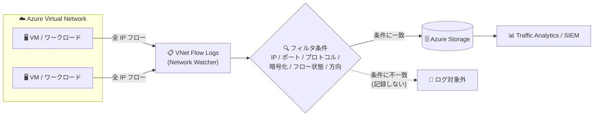

# Azure Network Watcher: VNet フローログのフィルタリング機能が一般提供 (GA)

**リリース日**: 2026-10-26

**サービス**: Azure Network Watcher

**機能**: VNet flow logs filtering (仮想ネットワーク フローログのフィルタリング)

**ステータス**: Launched (GA)

[このアップデートのインフォグラフィックを見る](https://takech9203.github.io/azure-news-summary/20261026-network-watcher-vnet-flow-logs-filtering.html)

## 概要

Azure Network Watcher の仮想ネットワーク (VNet) フローログにおけるフィルタリング機能が一般提供 (GA) になりました。IP アドレス、ポート、プロトコル、暗号化状態、フロー状態、トラフィックの方向といった条件に基づいて、記録対象のネットワークトラフィックフローを制御できます。

VNet フローログは、仮想ネットワークを流れる IP トラフィックの情報を記録し Azure Storage に送信する機能です。従来はログ記録の対象を絞る手段がなく、VNet 内のすべてのフローが記録されていました。本フィルタリング機能により、監視・トラブルシューティング・セキュリティ・コンプライアンス・ネットワーク最適化において重要なトラフィックのみにログを絞り込めるようになり、ログ量の削減によるストレージコストの抑制と、分析時のノイズ低減が期待できます。

また、本アップデートで、従来の PowerShell に加えて Azure ポータルからもフィルタリングを直接設定・管理できるようになりました。

**アップデート前の課題**

- VNet フローログは VNet レベルで動作し、VNet を通過するすべての IP フローが記録されるため、ログ量が大きくなりがちだった (ゲートウェイを通過するトラフィックなども既定で記録対象となり、ログデータ量の増大につながっていた)
- 不要なフローも含めてすべて記録されるため、ストレージコストが増加し、分析時に目的のフローを見つけにくかった

**アップデート後の改善**

- IP アドレス / ポート / プロトコル / 暗号化状態 / フロー状態 / トラフィック方向の条件で、記録するフローを絞り込めるようになった ("Filtering helps reduce log volume by capturing only relevant flows")
- 関連するフローのみを記録することで、ストレージコストの削減と分析時のノイズ低減が可能になった
- Azure ポータルからもフィルタリングの設定・管理が可能になった

## アーキテクチャ図



VNet を流れるトラフィックフローのうち、フィルタ条件に一致したフローのみがログとして Azure Storage に保存され、Traffic Analytics や SIEM での分析に利用できます。条件に一致しないフローは記録されないため、ログ量を削減できます。

## サービスアップデートの詳細

### 主要機能

1. **条件ベースのフロー記録制御 (EnabledFilteringCriteria)**
   - IP アドレス、ポート、プロトコル、暗号化状態、トラフィック方向などの条件式で、記録対象のフローを指定できる
   - VNet 内トラフィック (intra-VNet)、複数 VNet 間トラフィック (inter-VNet)、CIDR 範囲ベースのトラフィック、インバウンド / アウトバウンド、インターネットトラフィック、許可 / 拒否トラフィックの識別に活用できる

2. **フロー状態 (RecordTypes) によるフィルタリング**
   - フローのライフサイクル状態 (開始 B / 継続 C / 終了 E / 拒否 D) を指定して、必要なレコードタイプのみを収集できる
   - 例: 拒否されたトラフィックのみ記録 (`"D"`)、フローの作成・終了イベントのみ記録 (`"B,E"`)

3. **既存フローログのフィルタ条件更新**
   - フローログを再作成することなく、`Set-AzNetworkWatcherFlowLog` でフィルタ条件を変更・削除できる

4. **Azure ポータルでの設定・管理に対応**
   - 従来の PowerShell に加えて、Azure ポータルからフィルタリングを直接設定・管理できるようになった

## 技術仕様

### フィルタ対象フィールド

| フィールド | フィルタ対象 | 例 |
|------|------|------|
| Direction | トラフィックの方向 | Inbound, Outbound |
| SrcIP | 送信元 IP アドレス / CIDR 範囲 | 192.168.1.1, 2001:db8::1/64 |
| SrcPort | 送信元ポートの範囲・値 | 1024-65535, 80, 443 |
| DstIP | 宛先 IP アドレス / CIDR 範囲 | 192.168.2.1, 2001:db8::2/64 |
| DstPort | 宛先ポートの範囲・値 | 22, 8080-8090 |
| Protocol | プロトコル種別 | TCP, UDP |
| Encryption | 暗号化状態 | サポートされる全暗号化状態の値、および `NX_ALL` (理由を問わず非暗号化) |

### フィルタ式の構文

| 項目 | 詳細 |
|------|------|
| 比較演算子 | すべてのフィールドで `=` と `!=` をサポート |
| 論理演算子 | 任意の 2 フィールド間で `&&` (AND) と `\|\|` (OR) をサポート |
| 評価順序 | 論理演算子の優先順位 (AND が OR より優先) に従い左から右に評価。括弧は現時点で未サポート |
| 複数値の指定 | すべてのフィールドでカンマ区切りの値を指定可能。大文字小文字は区別しない |
| フィルタ文字列の最大長 | 1,000 文字 |
| RecordTypes | `B` (開始) / `C` (継続、5 分間隔で統計) / `E` (終了、統計あり) / `D` (拒否) をカンマ区切りで指定 |

## 設定方法

### 前提条件

1. Network Watcher が有効なサブスクリプションと、対象の仮想ネットワーク
2. ログ保存先のストレージアカウント (仮想ネットワークと同一リージョン、Standard パフォーマンスレベル。Premium は未サポート)

### Azure PowerShell

```powershell
# 仮想ネットワークとストレージアカウントの構成を変数に格納
$vnet = Get-AzVirtualNetwork -Name 'myVNet' -ResourceGroupName 'myResourceGroup'
$storageAccount = Get-AzStorageAccount -Name 'myStorageAccount' -ResourceGroupName 'myResourceGroup'

# フィルタ条件付き (dstip=20.252.145.59 || DstPort=54300-54400) で VNet フローログを作成
New-AzNetworkWatcherFlowLog -Enabled $true -Name 'myVNetFlowLog' `
    -NetworkWatcherName 'NetworkWatcher_eastus' -ResourceGroupName 'NetworkWatcherRG' `
    -StorageId $storageAccount.Id -TargetResourceId $vnet.Id `
    -FormatVersion 2 -EnabledFilteringCriteria 'dstip=20.252.145.59 || DstPort=54300-54400' `
    -EnableRetention $true -RetentionPolicyDays 15
```

```powershell
# 既存のフローログのフィルタ条件を更新 (再作成は不要)
Set-AzNetworkWatcherFlowLog -Enabled $true -Name 'myVNetFlowLog' `
    -NetworkWatcherName 'NetworkWatcher_eastus' -ResourceGroupName 'NetworkWatcherRG' `
    -StorageId $storageAccount.Id -TargetResourceId $vnet.Id `
    -FormatVersion 2 -EnabledFilteringCriteria 'dstip=20.252.145.59 || DstPort=443'
```

```powershell
# フロー状態 (RecordTypes) によるフィルタリング: 拒否されたトラフィックのみ記録
New-AzNetworkWatcherFlowLog -Enabled $true -Name 'myVNetFlowLog' `
    -NetworkWatcherName 'NetworkWatcher_eastus' -ResourceGroupName 'NetworkWatcherRG' `
    -StorageId $storageAccount.Id -TargetResourceId $vnet.Id `
    -RecordTypes "D"
```

### Azure Portal

本 GA により、Azure ポータルからもフィルタリングを直接設定・管理できるようになりました (公式アップデートに記載)。

## メリット

### ビジネス面

- 必要なフローのみを記録することで、フローログの収集量 (GB 単位課金) とストレージコストを削減できる
- 監査・コンプライアンス対応で必要なトラフィック (例: 拒否されたトラフィック、非暗号化トラフィック) に絞った証跡を効率的に収集できる

### 技術面

- 分析対象のログからノイズが減り、トラブルシューティングやセキュリティ分析の効率が向上する
- CIDR 範囲・ポート・方向などの条件で、調査対象のトラフィック (インターネットトラフィック、特定アプリケーションの通信など) を事前に絞り込める
- フローログの再作成なしにフィルタ条件を変更できるため、運用中の調整が容易

## デメリット・制約事項

- フィルタ式で括弧 (ブラケット) は現時点で未サポート。評価は AND 優先・左から右の固定ルールに従う
- フィルタ文字列の最大長は 1,000 文字
- フィルタで除外したフローは記録されないため、条件設定を誤ると必要な証跡が欠落するリスクがある (フィルタ条件の設計には注意が必要)
- VNet フローログ自体の制約が引き続き適用される: ストレージアカウントは VNet と同一リージョン・Standard レベルが必要、Azure Container Instances / Azure Functions / App Service など一部サービスは未サポート
- なお、Microsoft Learn のフィルタリングドキュメント (2026-10-13 更新時点) にはプレビューの注記が残っているが、公式アップデート (2026-10-26) で GA が発表されている

## ユースケース

### ユースケース 1: 拒否されたトラフィックのみを記録してセキュリティ監視を効率化

**シナリオ**: NSG や Azure Virtual Network Manager のセキュリティ管理ルールで拒否されたトラフィックのみを記録し、不正アクセスの試行を効率的に監視する。

**実装例**:

```powershell
New-AzNetworkWatcherFlowLog -Enabled $true -Name 'myDeniedFlowLog' `
    -NetworkWatcherName 'NetworkWatcher_eastus' -ResourceGroupName 'NetworkWatcherRG' `
    -StorageId $storageAccount.Id -TargetResourceId $vnet.Id `
    -RecordTypes "D"
```

**効果**: 許可された正常トラフィックを記録対象から除外することで、ログ量を抑えつつ、セキュリティ分析に必要な拒否イベントに集中できる。

### ユースケース 2: 特定の宛先・ポートへの通信のみを記録してログコストを削減

**シナリオ**: 重要なワークロードへの通信 (特定の宛先 IP や HTTPS ポート) のみを記録し、フローログの収集量とストレージコストを削減する。

**実装例**:

```powershell
New-AzNetworkWatcherFlowLog -Enabled $true -Name 'myFilteredFlowLog' `
    -NetworkWatcherName 'NetworkWatcher_eastus' -ResourceGroupName 'NetworkWatcherRG' `
    -StorageId $storageAccount.Id -TargetResourceId $vnet.Id `
    -FormatVersion 2 -EnabledFilteringCriteria 'dstip=20.252.145.59 || DstPort=443'
```

**効果**: 監視対象外のフローを記録しないことで、GB 単位で課金されるフローログ収集量を削減できる。

## 料金

フィルタリング機能自体の追加料金に関する記載はなく、VNet フローログの既存の料金体系が適用されます。

| 項目 | 料金 |
|------|------|
| VNet フローログ収集 | 収集されたログ 1 GB あたりの従量課金 (具体的な単価は料金ページでリージョン・通貨を指定して確認) |
| Traffic Analytics (有効化した場合) | 処理されたログ 1 GB あたりの従量課金 (高速処理: 10 分間隔 / 標準処理: 60 分間隔の 2 レベル。無料枠なし) |
| ログの保存 | Azure Blob Storage の料金が別途適用 |

無料枠: VNet フローログ収集はサブスクリプションあたり月 5 GB の無料枠あり。

フィルタリングにより収集されるログ量が減るため、フローログ収集・Traffic Analytics 処理・ストレージの各コスト削減につながります。詳細は [Network Watcher 料金ページ](https://azure.microsoft.com/pricing/details/network-watcher/) を参照してください。

## 利用可能リージョン

フィルタリング機能固有のリージョン情報は公式アップデートに記載されていません。VNet フローログ自体は主要なリージョン (Japan East / Japan West を含む) で利用可能です。最新のリージョン対応状況は [VNet フローログ概要ドキュメントの Availability セクション](https://learn.microsoft.com/azure/network-watcher/vnet-flow-logs-overview#availability) を参照してください。

## 関連サービス・機能

- **Azure Storage**: フローログの保存先。ログは 1 分間隔でブロック BLOB に取り込まれる
- **Traffic Analytics / Log Analytics**: フローログを処理・可視化し、トラフィックの分析インサイトを提供する
- **Azure Virtual Network Manager**: VNet フローログはセキュリティ管理ルールによる許可 / 拒否トラフィックの識別に対応
- **仮想ネットワーク暗号化 (Virtual network encryption)**: フローの暗号化状態 (`X` / `NX` など) が記録され、フィルタ条件 (Encryption フィールド、`NX_ALL` など) としても利用可能
- **NSG フローログ**: VNet フローログの前身にあたる機能。同一ワークロードで両方を有効化すると重複記録・追加コストが発生するため、NSG フローログの無効化が推奨される

## 参考リンク

- [インフォグラフィック](https://takech9203.github.io/azure-news-summary/20261026-network-watcher-vnet-flow-logs-filtering.html)
- [公式アップデート情報](https://azure.microsoft.com/updates?id=577782)
- [Microsoft Learn: VNet フローログのフィルタリング](https://learn.microsoft.com/azure/network-watcher/vnet-flow-logs-filtering)
- [Microsoft Learn: VNet フローログの概要](https://learn.microsoft.com/azure/network-watcher/vnet-flow-logs-overview)
- [料金ページ](https://azure.microsoft.com/pricing/details/network-watcher/)

## まとめ

VNet フローログのフィルタリング機能が GA になり、IP アドレス・ポート・プロトコル・暗号化状態・フロー状態・トラフィック方向の条件で記録対象フローを絞り込めるようになりました。全フロー記録によるログ量・コスト増という従来の課題に対する直接的な解決策であり、PowerShell に加えて Azure ポータルからも設定できます。VNet フローログを利用中、または NSG フローログからの移行を検討している環境では、拒否トラフィックのみの記録や重要ワークロードへの絞り込みなど、監視要件に応じたフィルタ設計によるコスト最適化を検討することを推奨します。フィルタで除外したフローは記録されないため、監査要件を満たす条件設計には注意してください。

---

**タグ**: Network Watcher, VNet Flow Logs, Networking, Management and governance, GA, フィルタリング, コスト最適化
