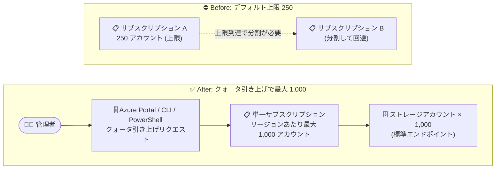

# Azure Blob Storage: リージョン・サブスクリプションあたりのストレージアカウント数上限引き上げが一般提供開始 (GA)

**リリース日**: 2026-10-27

**サービス**: Azure Blob Storage (Azure Storage)

**機能**: リージョン・サブスクリプションあたりのストレージアカウント数上限の引き上げ (最大 1,000 アカウント)

**ステータス**: Launched (GA)

[このアップデートのインフォグラフィックを見る](https://takech9203.github.io/azure-news-summary/20261027-blob-storage-higher-account-limit.html)

## 概要

Azure Storage アカウントのリソースクォータ引き上げが一般提供 (GA) されました。これにより、1 サブスクリプション・1 リージョンあたりに作成できる標準エンドポイントを持つストレージアカウント数を、デフォルトの 250 からクォータリクエストにより最大 1,000 まで引き上げられるようになりました。

この上限は標準エンドポイントを持つストレージアカウントに適用され、Standard・Premium の両方のアカウントタイプが対象です。クォータの引き上げは Azure Portal の「クォータ」ページから数分で申請でき、Azure PowerShell や Azure CLI からも実行できます。

多数のストレージアカウントを運用する大規模環境 (マルチテナント SaaS、部門ごとのアカウント分離、ワークロードごとの分離など) では、これまでサブスクリプションを分割して上限を回避する必要がありましたが、単一サブスクリプション内でより多くのアカウントを管理できるようになり、サブスクリプション分割に伴う管理負荷を軽減できます。

**アップデート前の課題**

- 標準エンドポイントのストレージアカウントは 1 サブスクリプション・1 リージョンあたりデフォルト 250 個が上限で、大規模環境では上限に到達しやすかった
- 上限を超える数のアカウントが必要な場合、サブスクリプションを分割して運用する必要があり、ガバナンス・課金・アクセス管理が複雑化していた

**アップデート後の改善**

- クォータリクエストにより、1 サブスクリプション・1 リージョンあたり最大 1,000 アカウント (標準エンドポイント) まで作成可能になった
- Azure Portal の「クォータ」ページ、Azure PowerShell、Azure CLI からセルフサービスで引き上げを申請でき、処理は数分で完了する
- 単一サブスクリプションでより多くのアカウントを管理でき、サブスクリプション分割による運用負荷を削減できる

## アーキテクチャ図



従来はリージョンあたり 250 アカウントに達するとサブスクリプションの分割が必要でしたが、クォータリクエストにより単一サブスクリプションで最大 1,000 アカウントまで管理できるようになります。

## サービスアップデートの詳細

### 主要機能

1. **ストレージアカウント数クォータの上限引き上げ (GA)**
   - 標準エンドポイントを持つストレージアカウントの上限を、デフォルトの 250 からリクエストにより最大 1,000 まで引き上げ可能
   - Standard・Premium 両方のストレージアカウントが対象

2. **セルフサービスでのクォータ管理**
   - Azure Portal の「クォータ」ページから利用状況の確認とリクエスト調整が可能
   - Azure PowerShell (`Update-AzQuota`) および Azure CLI (`az quota update`) によるプログラマティックな引き上げにも対応
   - リクエストの処理は数分で完了

## 技術仕様

| 項目 | 詳細 |
|------|------|
| デフォルト上限 | 250 ストレージアカウント / リージョン / サブスクリプション |
| 引き上げ後の最大値 | 1,000 ストレージアカウント / リージョン / サブスクリプション |
| 対象 | 標準エンドポイントを持つストレージアカウント (Standard・Premium 両タイプを含む) |
| 参考: Azure DNS ゾーンエンドポイント | 5,000 アカウント / リージョン / サブスクリプション (プレビュー) |
| 申請方法 | Azure Portal (クォータページ)、Azure PowerShell、Azure CLI、REST API |
| 必要なロール | Contributor ロール (または Contributor アクセスを含むロール) |

## 設定方法

### 前提条件

1. クォータ引き上げをリクエストするには、対象サブスクリプションに対して Contributor ロール (または Contributor アクセスを含むロール) が必要

### Azure CLI

```bash
# 現在のストレージアカウント利用状況を確認
az storage account show-usage --location <region>

# クォータを 500 に引き上げる例
az quota update \
  --resource-name StorageAccounts \
  --scope /subscriptions/<subscriptionId>/providers/Microsoft.Storage/locations/<region> \
  --limit-object value=500
```

Azure PowerShell の場合:

```powershell
# 現在の利用状況を確認
Get-AzStorageUsage -Location <region>

# クォータを 500 に引き上げる例
Update-AzQuota -ResourceName 'StorageAccounts' -Name 'StorageAccounts' `
  -Scope '/subscriptions/<subscriptionId>/providers/Microsoft.Storage/locations/<region>' `
  -Limit (New-AzQuotaLimitObject -Value 500 -LimitType 'Independent')
```

### Azure Portal

1. [Azure Portal](https://portal.azure.com) で「クォータ (Quotas)」を選択し、「Storage」を選択する
2. クォータを引き上げたいサブスクリプションを選択する
3. 対象リージョンの「Request adjustment」列の鉛筆アイコンを選択する
4. 「New Quota Request」ペインで 1,000 までの数値を入力する
5. 「Submit」を選択する (処理には数分かかる場合がある)

## メリット

### ビジネス面

- サブスクリプション分割による回避策が不要になり、ガバナンス・課金管理をシンプルに保てる
- マルチテナント SaaS や大規模な部門別環境で、テナント/ワークロードごとのアカウント分離を単一サブスクリプション内でスケールできる

### 技術面

- 上限が従来比 4 倍の最大 1,000 アカウントに拡大
- Portal / PowerShell / CLI / REST API によるセルフサービスのクォータ管理で、申請が数分で完了
- アカウント単位の分離設計 (アクセス制御・スループット上限・ライフサイクル管理の分離) を採用しやすくなる

## デメリット・制約事項

- 最大 1,000 アカウントへの引き上げは標準エンドポイントを持つストレージアカウントが対象
- デフォルトの上限は引き続き 250 であり、1,000 まで利用するにはクォータリクエストが必要
- クォータリクエストには Contributor 相当の権限が必要
- さらに多くのアカウントが必要な場合は、Azure DNS ゾーンエンドポイント (リージョンあたり 5,000 アカウント) がプレビューとして提供されている

## ユースケース

### ユースケース 1: マルチテナント SaaS でのテナント単位アカウント分離

**シナリオ**: テナントごとに専用ストレージアカウントを割り当てて、データ分離・アクセス制御・スループット制限を個別に管理する SaaS プロバイダー。テナント数が 250 を超えると従来はサブスクリプション分割が必要だった。

**実装例**:

```bash
# クォータを 1,000 に引き上げてから、テナント用アカウントを追加作成
az quota update \
  --resource-name StorageAccounts \
  --scope /subscriptions/<subscriptionId>/providers/Microsoft.Storage/locations/japaneast \
  --limit-object value=1000

az storage account create \
  --name sttenant0251 \
  --resource-group rg-tenants \
  --location japaneast \
  --sku Standard_LRS
```

**効果**: 単一サブスクリプション内で最大 1,000 テナント分のアカウントを管理でき、サブスクリプション分割に伴うポリシー・課金・RBAC の重複管理を回避できる。

## 料金

クォータ引き上げ自体の料金に関する情報は、今回のアップデート情報では確認できませんでした。ストレージアカウントの利用料金は、アカウントの種類・冗長性・使用量に基づく通常の Azure Storage 料金が適用されます。詳細は公式の料金ページを参照してください。

- [Azure Blob Storage の料金](https://azure.microsoft.com/pricing/details/storage/blobs/)

## 利用可能リージョン

リージョンごとの提供状況の詳細は公式情報では個別に確認できませんでした。最新の情報は以下を参照してください。

- [標準ストレージアカウントのスケーラビリティとパフォーマンスのターゲット](https://learn.microsoft.com/azure/storage/common/scalability-targets-standard-account)

## 関連サービス・機能

- **Azure Quotas (クォータ管理)**: Azure Portal の「クォータ」ページ、`az quota` / `Az.Quota` モジュールを通じてストレージアカウントクォータの確認・引き上げを行う
- **Azure DNS ゾーンエンドポイント (プレビュー)**: リージョン・サブスクリプションあたり最大 5,000 ストレージアカウントを作成可能なエンドポイント方式。1,000 を超えるスケールが必要な場合の選択肢
- **Azure Resource Manager / RBAC**: クォータリクエストには Contributor 相当のロールが必要。アカウント数増加に伴うアクセス制御設計にも関連

## 参考リンク

- [インフォグラフィック](https://takech9203.github.io/azure-news-summary/20261027-blob-storage-higher-account-limit.html)
- [公式アップデート情報](https://azure.microsoft.com/updates?id=578358)
- [標準ストレージアカウントのスケーラビリティとパフォーマンスのターゲット (Microsoft Learn)](https://learn.microsoft.com/azure/storage/common/scalability-targets-standard-account)
- [Azure Storage アカウントのクォータ引き上げ手順 (Microsoft Learn)](https://learn.microsoft.com/azure/quotas/storage-account-quota-requests)
- [Azure Blob Storage の料金](https://azure.microsoft.com/pricing/details/storage/blobs/)

## まとめ

標準エンドポイントを持つストレージアカウントの上限が、クォータリクエストによりリージョン・サブスクリプションあたり最大 1,000 (デフォルト 250 の 4 倍) まで引き上げ可能になり、一般提供が開始されました。多数のストレージアカウントを運用する組織は、サブスクリプション分割による回避策を見直し、単一サブスクリプションへの集約を検討する価値があります。まずは Azure Portal の「クォータ」ページで現在の利用状況を確認し、上限到達が見込まれるリージョンについてセルフサービスで引き上げを申請することを推奨します。

---

**タグ**: Azure Blob Storage, Azure Storage, Storage, Management, クォータ, GA
