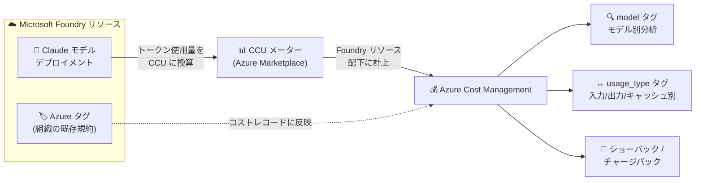

# Microsoft Foundry: Claude モデルのコスト管理とタグ付けが一般提供開始 (GA)

**リリース日**: 2026-10-27

**サービス**: Microsoft Foundry

**機能**: Claude モデルのコスト管理とタグ付け (Cost management and tagging for Claude models)

**ステータス**: Launched (GA)

[このアップデートのインフォグラフィックを見る](https://takech9203.github.io/azure-news-summary/20261027-foundry-claude-cost-management.html)

## 概要

Microsoft Foundry において、Anthropic の Claude モデルのコストが Azure Cost Management 上でその他の Foundry 支出と並んで管理できるようになり、一般提供 (GA) が開始された。これまで Claude の課金は、デプロイに使用した Foundry リソースではなく「SaaS」として計上されており、Claude デプロイメントにはエンタープライズがショーバック / チャージバックに利用するタグも付与できなかったため、財務チームやプラットフォームチームは手作業でコストを突合する必要があった。

本リリースにより、Claude のコストは関連付けられた Foundry リソース配下に表示されるようになり、Claude デプロイメントおよび Foundry リソースは組織の既存の規約に沿ったタグをサポートする。さらに、Claude のコストレコードには `model` タグと `usage_type` タグが付与されるため、Claude モデル別に支出をフィルタリング・グループ化したり、入力トークンと出力トークンのコストを分離して分析したりできる。

利用を開始するには、Azure Cost Management の「コスト分析 (Cost analysis)」を開き、リソースまたはタグでグループ化すればよい。なお、この新しいコスト可視化は CCU (Claude Consumption Unit) 課金の Claude 消費に適用される。

**アップデート前の課題**

- Claude の課金が、デプロイに使用した Foundry リソースではなく SaaS として計上され、リソース単位でのコスト把握ができなかった
- Claude デプロイメントに、エンタープライズがショーバック / チャージバックで利用するタグを付与できなかった
- 財務チーム・プラットフォームチームが別プロセスで手作業のコスト突合 (reconciliation) を行う必要があった

**アップデート後の改善**

- Claude のコストが関連付けられた Foundry リソース (`Microsoft.CognitiveServices/accounts`) 配下に表示され、リソースレベルで一貫したビューが得られる
- Claude デプロイメントと Foundry リソースが組織の既存規約に沿ったタグをサポートし、Foundry リソースに付与した Azure タグが Claude の消費コストレコードに反映される
- コストレコードに `model` / `usage_type` タグが付与され、モデル別の支出分析や入力 / 出力トークンコストの分離が可能になり、担当チーム・ワークロードへのコスト配賦を追加の突合プロセスなしで実現できる

## アーキテクチャ図



Claude デプロイメントのトークン使用量は CCU として計上され、Azure Cost Management 上で Foundry リソース配下に表示される。リソースに付与したタグと `model` / `usage_type` タグにより、モデル別・使用タイプ別の分析とチーム単位のコスト配賦が可能になる。

## サービスアップデートの詳細

### 主要機能

1. **Foundry リソース配下へのコスト計上**
   - CCU 課金の Claude 消費チャージが、Foundry リソース (`Microsoft.CognitiveServices/accounts`) に関連付けて計上される
   - 従来は SaaS として表示されていた Claude 費用が、その他の Foundry 支出と同じリソースレベルの一貫したビューで確認できる

2. **タグによるコスト配賦**
   - Foundry リソースに付与した Azure タグが Claude の消費コストレコードに反映される
   - タグを使ってコストをフィルタリング・グループ化・配賦でき、組織の既存のタグ規約をそのまま利用できる

3. **`model` / `usage_type` タグによる詳細分析**
   - コストレコードに `model` タグが付与され、Claude モデル別に支出をフィルタリング・グループ化できる
   - `usage_type` タグにより、入力トークン・出力トークン・キャッシュ使用のコストを分離して分析できる

4. **`ResourceId` ベースのレポート・チャージバックとの統合**
   - 消費チャージが Foundry リソース配下に計上されるため、`ResourceId` に依存するエクスポート・レポート・チャージバックルールで扱える (この変更を反映するよう既存ルールの見直しが推奨される)

### CCU (Claude Consumption Unit) 課金との関係

Foundry における Claude モデルは **CCU (Claude Consumption Unit)** という単一の課金単位で請求される。CCU は Anthropic が他のクラウドプラットフォームでも使用している請求単位で、以下の特徴を持つ。

- トークン使用量は Anthropic の公開モデル別トークンレートで金額換算され (契約割引適用後)、固定価格の CCU に変換される
- 1 つの Marketplace メーターが従来のモデル別トークンメーターを置き換える
- 時間単位で計測され、月次後払いで Azure 請求書に計上される
- CCU メーターは **MACC (Microsoft Azure Consumption Commitment) の対象**であり、他の Azure Marketplace 消費と同様にコミットメントを消化する
- アプリケーションコード、API/SDK、トークンレート、レート制限 (TPM/RPM) は変更されない

## 技術仕様

| 項目 | 詳細 |
|------|------|
| 対象サービス | Microsoft Foundry (旧 Azure AI Foundry) |
| 対象モデル | Foundry で提供されるすべての Claude モデル (CCU 課金の消費) |
| コスト計上先 | 関連付けられた Foundry リソース (`Microsoft.CognitiveServices/accounts`) |
| 課金単位 | CCU (Claude Consumption Unit)、Azure Marketplace 経由 |
| 課金サイクル | 時間単位の計測、月次後払い (従量課金、CCU の前払いクレジットなし) |
| MACC | 対象 (CCU 支出が MACC を消化) |
| タグ | Foundry リソースの Azure タグがコストレコードに反映。コストレコードには `model` / `usage_type` タグが付与 |
| 分析の粒度 | モデル別、使用タイプ別 (入力 / 出力 / キャッシュ) |
| 既存デプロイメント | CCU GA 以前に作成したデプロイメントは既存のモデル別プランで課金継続。CCU へ移行するには新規デプロイメントを作成 |

## 設定方法

### 前提条件

1. アクティブな Azure サブスクリプションと、Foundry リソース上の Claude モデルデプロイメント
2. コスト閲覧用のロール: サブスクリプションまたはリソースグループスコープの **Cost Management Reader** (Foundry リソースの閲覧も必要な場合は **Foundry User** を併用)

### Azure Portal (コスト分析)

公式ドキュメント「Analyze Claude costs」の手順:

1. Azure Portal にサインインし、コスト分析のスコープを対象の Foundry リソースに設定する
2. Foundry リソースに割り当てた Azure タグで消費コストをフィルタリングまたはグループ化する
3. `model` / `usage_type` の内訳で、入力・出力・キャッシュのコストを分析する
4. `ResourceId` を使用するレポート・エクスポート・チャージバックルールを見直し、消費チャージが Foundry リソース配下に表示される変更を反映する

### Azure CLI (リソースへのタグ付与の例)

```bash
# Foundry リソースにコスト配賦用のタグを付与する例
az resource tag \
  --tags costCenter=ai-platform team=genai-apps \
  --resource-group <resource-group> \
  --name <foundry-resource-name> \
  --resource-type "Microsoft.CognitiveServices/accounts"
```

## メリット

### ビジネス面

- Claude 支出をリソースレベルで一貫して可視化でき、他の Foundry 支出と同じ枠組みで管理できる
- タグベースのショーバック / チャージバックにより、使用量を責任チーム・ワークロードに配賦でき、別立ての手作業突合プロセスが不要になる
- CCU 支出が MACC を消化するため、Azure コミットメントの消化計画に Claude 利用を組み込める

### 技術面

- `model` / `usage_type` タグにより、モデル別・入出力トークン別のコスト内訳を Azure Cost Management の標準機能で分析できる
- 既存の Cost Management ワークフロー (コスト分析、エクスポート、予算、アラート) をそのまま Claude 支出に適用できる
- アプリケーションコードや API の変更は不要

## デメリット・制約事項

- **プロジェクトレベルのコスト配賦は非対応**: Claude のリソースタグは Foundry のプロジェクト単位のコスト配賦 (`project` タグによる Chargeback) を提供しない。プロジェクトレベル配賦 (Preview) は現時点で Models sold by Azure (Azure OpenAI 含む) のみ対応
- **既存デプロイメントの扱い**: CCU GA 以前に作成した既存の Claude デプロイメント (モデル別トークン課金) は従来プランで課金が継続する。CCU 課金 (および本リリースのリソースレベルのコスト可視化) に移行するには新規デプロイメントの作成が必要
- **Foundry ポータルの推定コストの制限**: Foundry の Monitor タブの推定コストチャートは CCU ベースのデプロイメントのみで利用可能。また推定値はプライベートオファーの割引を反映しないため、実際の請求額は Azure Cost Management と請求書で確認する必要がある
- **既存チャージバックルールへの影響**: コスト計上先が SaaS から Foundry リソースに変わるため、`ResourceId` に依存する既存のエクスポート・レポート・チャージバックルールの見直しが必要
- **Azure Prepayment 非対応**: Marketplace 経由で課金される他プロバイダーモデルの料金は Azure Prepayment (旧 Monetary Commitment) クレジットでは支払えない

## ユースケース

### ユースケース 1: 複数チームが共有する Foundry リソースの Claude コスト配賦

**シナリオ**: 複数のアプリケーションチームが同一サブスクリプション内の Foundry リソース上で Claude モデルを利用しており、FinOps チームがチーム別に月次コストを配賦したい。

**実装例**:

```bash
# チームごとの Foundry リソースにコスト配賦タグを付与
az resource tag \
  --tags costCenter=team-a dept=marketing \
  --resource-group rg-ai-team-a \
  --name foundry-team-a \
  --resource-type "Microsoft.CognitiveServices/accounts"

# Azure Portal の Cost Management > コスト分析で
# タグ (costCenter) でグループ化して月次コストを確認
```

**効果**: Claude の消費コストレコードにリソースタグが反映されるため、タグでグループ化するだけでチーム別の Claude 支出を把握でき、手作業の突合なしでチャージバックが完了する。

### ユースケース 2: モデル別・入出力別のコスト最適化分析

**シナリオ**: 複数の Claude モデルを使い分けており、どのモデルのどの使用タイプ (入力 / 出力 / キャッシュ) がコストドライバーかを特定して最適化したい。

**実装例**: Azure Cost Management のコスト分析で、スコープを Foundry リソースに設定し、`model` タグでグループ化した後、`usage_type` タグでフィルタリングして入力トークンと出力トークンのコストを比較する。

**効果**: 出力トークンコストが支配的なモデル・ワークロードを特定し、プロンプト設計の見直しやより小さいモデルへの切り替えなどの最適化判断をデータに基づいて行える。

## 料金

本アップデート自体 (コスト管理・タグ付け機能) に追加料金は発生しない。Claude モデルの利用料金は CCU 課金に基づく。

| 項目 | 内容 |
|------|------|
| CCU 価格 | 固定。Azure Marketplace の Claude オファーで公開 |
| トークンレート | Anthropic が公開するモデル別レート ([Claude pricing](https://aka.ms/ccu-pricing)) |
| 換算 | トークン使用量 → (割引適用後) 金額 → 固定価格の CCU に換算 |
| 支払いモデル | Azure Marketplace 経由の従量課金 (時間単位計測、月次後払い) |
| 割引 | Azure Marketplace プライベートオファー経由で、トークン→CCU 換算時にモデル別割引率を適用 |

最新の料金は [Claude pricing](https://aka.ms/ccu-pricing) および Azure Marketplace の Claude オファーを参照。

## 利用可能リージョン

CCU 課金は、Foundry で Claude モデルがデプロイされているすべてのリージョンで適用される。Claude モデル自体のリージョン可用性は [Microsoft Learn のリージョンサポート情報](https://learn.microsoft.com/azure/foundry/reference/region-support) を参照。

## 関連サービス・機能

- **Azure Cost Management**: 本アップデートの中核。コスト分析、タグによるフィルタリング / グループ化、予算、アラート、コストデータのエクスポートを提供
- **Azure Marketplace**: Claude オファー (Claude Platform on Foundry) のサブスクライブと CCU メーターによる課金を担う。プライベートオファーによる割引適用もここで行われる
- **Microsoft Foundry ポータル (Monitor タブ)**: モデル別のトークン使用量・リクエスト数の運用モニタリング。CCU ベースのデプロイメントでは推定コストチャートも表示
- **MACC (Microsoft Azure Consumption Commitment)**: CCU 支出は他の Marketplace 消費と同様に MACC を消化する

## 参考リンク

- [インフォグラフィック](https://takech9203.github.io/azure-news-summary/20261027-foundry-claude-cost-management.html)
- [公式アップデート情報](https://azure.microsoft.com/updates?id=577260)
- [Microsoft Learn: Plan and manage costs for Microsoft Foundry](https://learn.microsoft.com/azure/foundry/concepts/manage-costs)
- [Microsoft Learn: Claude consumption units (CCU) billing in Microsoft Foundry](https://learn.microsoft.com/azure/foundry/foundry-models/concepts/claude-models-billing)
- [Claude pricing (Anthropic 公開レート)](https://aka.ms/ccu-pricing)

## まとめ

Claude モデルのコストが Foundry リソース配下で Azure Cost Management に統合され、タグベースのコスト配賦と `model` / `usage_type` による詳細分析が GA となった。これまで SaaS 計上により手作業での突合を強いられていた財務・プラットフォームチームにとって、FinOps プロセスを標準の Azure コスト管理に一本化できる重要なアップデートである。Claude を利用中の組織は、(1) Foundry リソースへのタグ付与規約の適用、(2) `ResourceId` に依存する既存のチャージバックルール・エクスポートの見直し、(3) 従来のトークン課金デプロイメントを使っている場合の CCU 課金への移行 (新規デプロイメント作成) を検討することを推奨する。なお、Claude ではプロジェクトレベルのコスト配賦は非対応である点に留意が必要。

---

**タグ**: Microsoft Foundry, AI + machine learning, Claude, Azure Cost Management, CCU, FinOps, タグ, GA
