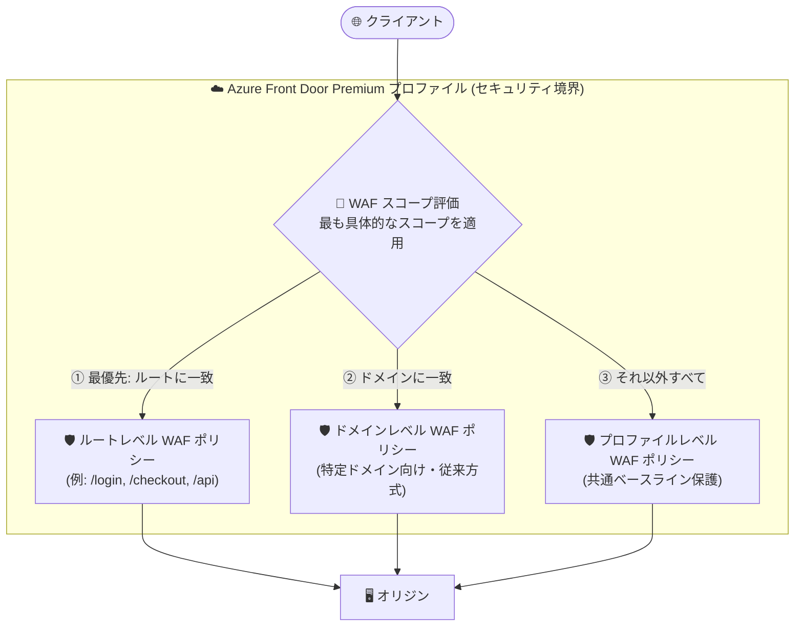

# Azure Front Door: プロファイルレベル / ルートレベル WAF ポリシーの一般提供開始 (GA)

**リリース日**: 2026-10-27

**サービス**: Azure Front Door / Azure Web Application Firewall (WAF)

**機能**: プロファイルレベルおよびルートレベルの WAF ポリシー関連付け

**ステータス**: Launched (GA)

[このアップデートのインフォグラフィックを見る](https://takech9203.github.io/azure-news-summary/20261027-front-door-waf-profile-route-policies.html)

## 概要

Azure Front Door Premium 上の Azure Web Application Firewall (WAF) において、プロファイルレベルおよびルートレベルの WAF ポリシーが一般提供 (GA) となった。2026 年 9 月のパブリックプレビューを経て、本番環境で利用可能になった。

従来、WAF ポリシーの関連付けは個別のドメイン単位に限定されていたが、今回の GA により「プロファイル」「ドメイン」「ルート」の 3 つのスコープでポリシーを関連付けられるようになった。プロファイル全体に共通のベースライン保護を一括適用しつつ、サインイン・チェックアウト・API などの機密性の高いルートには個別の厳格なポリシーを適用する、といった柔軟なセキュリティ構成が可能になる。

複数のスコープが同一リクエストに該当する場合は、最も具体的なスコープのポリシーが適用される (ルートレベル > ドメインレベル > プロファイルレベル)。既存のドメインレベルの関連付けは変更不要でそのまま動作し続ける。

**アップデート前の課題**

- WAF ポリシーは個別のドメイン単位での関連付けに限定されており、プロファイル全体への一括適用や特定ルートのみへの適用ができなかった
- 1 つのプロファイル配下で多数のアプリケーション (ドメイン) を運用するチームでは、同じベースライン保護を適用するために類似ポリシーの関連付けを繰り返す必要があり、ポリシーの重複が発生しやすかった
- サインインやチェックアウト、API など特定のパスだけに厳格なルールを適用したい場合、ルート単位での制御手段がなかった

**アップデート後の改善**

- プロファイルレベルのポリシーで、Azure Front Door プロファイル全体に共通のベースライン保護を一括適用できるようになった
- ルートレベルのポリシーで、選択したルートに対して最も具体的な保護を適用できるようになった
- スコープは単独でも組み合わせても利用でき、「最も具体的なポリシーが適用される」という明確な優先順位 (ルート > ドメイン > プロファイル) で動作する
- プレビューを卒業し GA となったことで、本番ワークロードで正式に利用できるようになった

## アーキテクチャ図

Azure Front Door Premium プロファイルがセキュリティ境界となり、エッジで受信したリクエストはルートレベル > ドメインレベル > プロファイルレベルの優先順位で評価され、最も具体的なスコープの WAF ポリシーが 1 つだけ適用される。

## サービスアップデートの詳細

### 主要機能

1. **プロファイルレベルのポリシー関連付け**
   - Azure Front Door プロファイル全体に共有のベースラインポリシーを適用する
   - プロファイル配下の全ドメイン・全トラフィックに共通の保護を一括で展開できる

2. **ルートレベルのポリシー関連付け**
   - 選択したルートに対して最も具体的なポリシーを適用する
   - サインイン、チェックアウト、API ルートなど機微なパスに対して個別の制御を実現できる

3. **ドメインレベルのポリシー関連付け (従来方式)**
   - プロファイル内の特定ドメインにポリシーを適用する従来の方式も引き続き利用可能
   - 既存のドメインレベルの関連付けは変更不要でそのまま動作する

4. **明確なポリシー優先順位 (Policy precedence)**
   - 複数スコープが 1 つのリクエストに該当する場合、最も具体的なスコープが適用される
   - 優先順位: (1) ルートレベル → (2) ドメインレベル → (3) プロファイルレベル
   - 例: プロファイルレベルとルートレベルの両方に一致するリクエストには、ルートレベルのポリシーが適用される

## 技術仕様

| 項目 | 詳細 |
|------|------|
| 対象サービス | Azure Front Door Premium (WAF のフル機能は Premium で提供) |
| 関連付けスコープ | プロファイル / ドメイン / ルートの 3 種類 (単独・組み合わせ利用可) |
| 評価の優先順位 | ルートレベル > ドメインレベル > プロファイルレベル (最も具体的なスコープが適用) |
| 既存構成への影響 | 既存のドメインレベルの関連付けは変更不要でそのまま動作 |
| 同時適用されるポリシー数 | 1 リクエストに適用される WAF ポリシーは 1 つ (最も具体的なもの) |
| 設定方法 | Azure Portal、REST API、ARM テンプレート、Azure PowerShell、Firewall Manager |

## 設定方法

### 前提条件

1. Azure Front Door Premium プロファイルを作成済みであること
2. WAF ポリシーを作成する権限 (対象サブスクリプション・リソースグループへのアクセス) があること

### Azure Portal

1. 「リソースの作成」から **Web Application Firewall (WAF)** を検索し、「作成」を選択する
2. 「基本」タブで「Policy for」に **Global WAF (Front Door)**、「Front door tier」に **Premium** を選択し、ポリシー名などを入力する
3. 「Association」タブで「Associate a Front door profile」を選択し、以下を設定する
   - **Front door profile**: 対象の Azure Front Door プロファイル
   - **Association scope**: **Profile** / **Domain** / **Route** から選択
   - **Domains**: Domain または Route を選択した場合、対象ドメインを選択
   - **Routes**: Route を選択した場合、対象ルートを選択
4. 必要に応じて関連付けの追加を繰り返し、「Review + create」→「Create」で作成する

**注意**: すでに別の WAF ポリシーに関連付けられているドメインはグレーアウト表示される。別のポリシーに関連付けるには、既存の関連付けを先に削除する必要がある。

## メリット

### ビジネス面

- 多数のアプリケーションを 1 つのプロファイルで運用する組織で、WAF ポリシーの重複を削減し、運用コスト・管理負荷を低減できる
- 組織全体のセキュリティベースラインをプロファイルレベルで一括適用でき、ガバナンスとコンプライアンス対応が容易になる
- GA により SLA のある本番環境で正式に利用可能になった

### 技術面

- 「プロファイルでベースライン、必要な箇所だけルート/ドメインで上書き」という階層的なセキュリティ設計が可能になる
- サインイン・チェックアウト・API など攻撃対象になりやすいパスに、レート制限や厳格なルールをピンポイントで適用できる
- 優先順位が明確 (ルート > ドメイン > プロファイル) で、適用されるポリシーが予測しやすい
- 既存のドメインレベル関連付けはそのまま動作するため、段階的に移行できる

## デメリット・制約事項

- 本機能のフル活用には **Azure Front Door Premium** が必要 (Azure Front Door Standard の WAF はカスタムルールのみサポートし、マネージドルールは Premium で提供)
- 1 つのリクエストに適用される WAF ポリシーは最も具体的なスコープの 1 つのみで、複数スコープのポリシーが重ねて評価されるわけではない。ルートレベルのポリシーにはベースラインで必要なルールも含める設計が必要
- すでに WAF ポリシーに関連付けられているドメインを別のポリシーに関連付けるには、既存の関連付けを先に削除する必要がある

## ユースケース

### ユースケース 1: マルチアプリケーション環境でのベースライン保護 + 重要パスの強化

**シナリオ**: 1 つの Azure Front Door Premium プロファイルで複数の Web アプリケーション (複数ドメイン) を配信している。全体には共通のマネージドルールによるベースライン保護を適用しつつ、EC サイトのチェックアウトやサインインのルートにはレート制限を含む厳格なポリシーを適用したい。

**実装例**:

1. ベースライン用 WAF ポリシー (マネージドルールセット有効) を作成し、**プロファイルレベル** で関連付ける
2. レート制限や厳格なカスタムルールを含む WAF ポリシーを作成し、`/login` や `/checkout` を処理する **ルート** に関連付ける
3. ルートに一致するリクエストにはルートレベルのポリシーが、それ以外にはプロファイルレベルのポリシーが適用される

**効果**: ポリシーの重複定義を排除しながら、攻撃対象になりやすいパスにのみ厳格な制御を適用でき、運用負荷とセキュリティリスクの両方を低減できる。

## 料金

本アップデートに固有の追加料金情報はアナウンスには記載されていない。Azure Front Door および WAF の料金の詳細は公式料金ページを参照。

- [Azure Front Door 料金ページ](https://azure.microsoft.com/pricing/details/frontdoor/)
- [Azure Web Application Firewall 料金ページ](https://azure.microsoft.com/pricing/details/web-application-firewall/)

## 利用可能リージョン

公式アナウンスにリージョン別の提供情報は記載されていない。Azure Front Door はグローバルサービスとしてエッジロケーションに展開される。詳細は公式ドキュメントを参照。

- [Azure Front Door ドキュメント](https://learn.microsoft.com/azure/frontdoor/)

## 関連サービス・機能

- **Azure Front Door Premium**: 本機能の対象 SKU。マネージドルールセットを含む WAF のフル機能が利用できる
- **Azure Web Application Firewall (WAF)**: 本アップデートの対象。カスタムルールとマネージドルールセットで Web アプリケーションを保護する
- **Azure Firewall Manager**: WAF ポリシーを大規模に一元管理する際に利用できる
- **Azure Monitor / WAF ログ**: WAF のアラート追跡とトラフィック傾向の監視に利用する
- **Azure DDoS Protection**: Web ワークロードでは WAF と併用した DDoS 対策が推奨されている

## 参考リンク

- [インフォグラフィック](https://takech9203.github.io/azure-news-summary/20261027-front-door-waf-profile-route-policies.html)
- [公式アップデート情報](https://azure.microsoft.com/updates?id=578153)
- [What is Azure Web Application Firewall on Azure Front Door? (Policy attachment scopes)](https://learn.microsoft.com/azure/web-application-firewall/afds/afds-overview#policy-attachment-scopes)
- [Tutorial: Create a WAF policy for Azure Front Door (Azure Portal)](https://learn.microsoft.com/azure/web-application-firewall/afds/waf-front-door-create-portal)
- [Azure Web Application Firewall 料金ページ](https://azure.microsoft.com/pricing/details/web-application-firewall/)

## まとめ

Azure Front Door Premium の WAF ポリシーが、従来のドメイン単位に加えてプロファイルレベル・ルートレベルで関連付けられるようになり、GA として本番利用が可能になった。「プロファイルで共通ベースライン、機微なルートには個別の厳格ポリシー」という階層的なセキュリティ設計により、ポリシーの重複を削減しつつきめ細かい制御を実現できる。多数のドメインを 1 つのプロファイルで運用している場合は、既存のドメインレベル関連付けをそのまま維持しながら、プロファイルレベルのベースラインポリシー導入を検討することを推奨する。

---

**タグ**: Azure Front Door, Web Application Firewall, WAF, Networking, Security, GA
