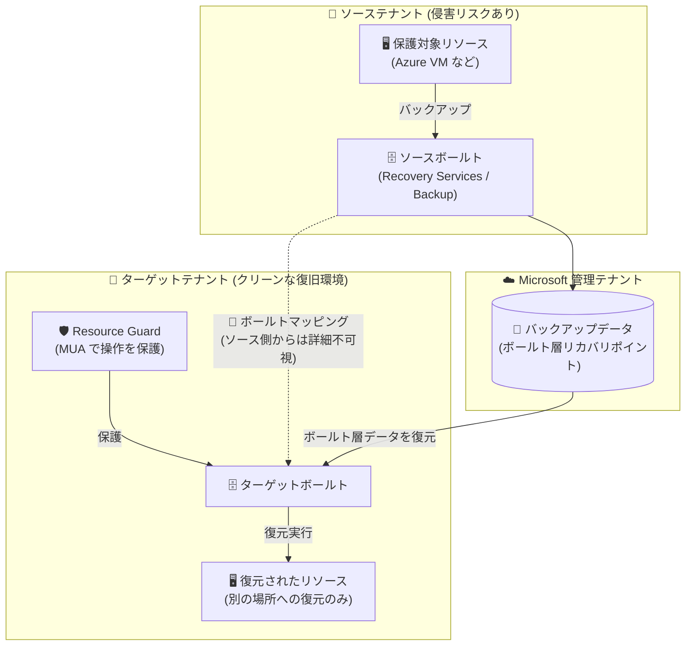

# Azure Backup: Cross Tenant Restore (クロステナント復元) パブリックプレビュー

**リリース日**: 2026-10-28

**サービス**: Azure Backup

**機能**: Cross Tenant Restore (CTR)

**ステータス**: In preview

[このアップデートのインフォグラフィックを見る](https://takech9203.github.io/azure-news-summary/20261028-backup-cross-tenant-restore.html)

## 概要

Azure Backup の Cross-Tenant Restore (CTR) がパブリックプレビューとして発表された。CTR は、ある Microsoft Entra テナント (ソーステナント) のボールト格納済みバックアップデータを、別のテナント (ターゲットテナント) に復元できる機能である。ソースボールトとターゲットボールトの間に「ボールトマッピング」を作成し、ターゲットテナント側から保護アイテムを参照・復元する仕組みで、Recovery Services ボールトと Backup ボールトの両方をサポートする。

この機能の主眼はサイバーレジリエンスの強化にある。テナントロックアウト (ソーステナントへのアクセス喪失)、ランサムウェア攻撃によるテナント侵害、テナント統合、クロステナントのディザスターリカバリーといったシナリオで、既存のバックアップコピーをそのまま利用して独立した復旧経路を確立できる。重複したバックアップインフラを構築・維持する必要はない。ターゲットボールトは Resource Guard による保護が必須であり、マッピング操作は多要素ユーザー承認 (MUA) で保護される。

**アップデート前の課題**

- Azure Backup の復元先は同一テナント内に限られていた (Cross Subscription Restore も「同一テナント内の別サブスクリプション」が対象)
- テナント自体が侵害・ロックアウトされた場合に備えるには、別テナントに重複したバックアップ基盤やデータコピーを維持する必要があった

**アップデート後の改善**

- 既存のボールト格納済みバックアップコピーを、ボールトマッピング経由で別テナントに直接復元できるようになった
- Resource Guard + MUA、専用 RBAC ロール (CTR Creator / CTR Contributor) により、クロステナント操作がセキュリティ境界で保護される
- ソーステナント側からはマッピングやターゲットボールトの詳細が見えない設計で、ソースボールトへの不正アクセス者によるターゲットの探索を防止する

## アーキテクチャ図

ソースボールトとターゲットボールト間にマッピングを作成し、ターゲットテナント側からボールト層リカバリポイントを別の場所 (Alternate Location) へ復元する。ターゲットボールトは Resource Guard による MUA 保護が必須で、マッピング詳細はソーステナントから参照できない。

## サービスアップデートの詳細

### 主要機能

1. **ボールトマッピングによるクロステナント復元**
   - ソースボールトとターゲットボールトのマッピングを作成すると、ターゲットテナント側にソースボールトの保護アイテムが表示され、リカバリポイントを選択して復元できる
   - バックアップデータ自体は Microsoft 管理テナントのストレージに保存されており、既存のバックアップコピーをそのまま利用する

2. **Resource Guard / 多要素ユーザー承認 (MUA) による保護**
   - ターゲットボールトは、ターゲットテナント内の Resource Guard に関連付けられている必要がある
   - Resource Guard で「cross-tenant restore」クリティカル操作を有効化し、マッピング作成などの操作を MUA で保護する

3. **専用 RBAC ロールによる職務分離**
   - マッピング作成者 (Mapping creator): ソースボールトに Backup Contributor、ターゲットボールトに CTR Creator、Resource Guard に Backup MUA Operator 以上
   - マッピング/復元オペレーター (Mapping and restore operator): ターゲットボールトに CTR Contributor + Backup Contributor、Resource Guard に Backup MUA Operator 以上
   - ソーステナントのゲストユーザーを一時的なロール割り当てでマッピング作成者にすることも可能 (作成後はロールを削除する運用が推奨)

4. **セキュリティを考慮した可視性設計**
   - クロステナントマッピングとマッピング済みアイテムの詳細は、ソーステナント / ソースボールト側からは意図的に参照できない
   - ソースボールトへの不正アクセス者がターゲットボールトやマッピングの詳細を発見することを防ぐ

5. **一括復元 (Bulk Restore、プレビュー)**
   - Azure VM を大規模に復元する場合、ターゲットボールトの保護アイテム一覧で複数アイテムを選択し「Bulk Restore (Preview)」で一括復元できる

### サポート対象ワークロード

| ボールト種別 | ワークロード | 制限事項 |
|------|------|------|
| Recovery Services ボールト | Azure Virtual Machines | Confidential VM、ADE 暗号化 VM、アーカイブ層リカバリポイントは非サポート |
| Recovery Services ボールト | Azure Files | なし |
| Recovery Services ボールト | SQL Server in Azure VM | SQL インスタンス復元、アーカイブ層リカバリポイントは非サポート |
| Recovery Services ボールト | SAP HANA in Azure VM | HANA インスタンス復元は非サポート |
| Recovery Services ボールト | SAP ASE in Azure VM | なし |
| Backup ボールト | Azure Database for PostgreSQL - Flexible Server | なし |
| Backup ボールト | Azure Blobs | なし |
| Backup ボールト | Azure Cosmos DB | なし |
| Backup ボールト | Azure Data Lake Storage | なし |
| Backup ボールト | Azure Kubernetes Service (AKS) | なし |

## 技術仕様

| 項目 | 詳細 |
|------|------|
| 復元方式 | 別の場所への復元 (Alternate Location Restore) のみ。元の場所への復元 (OLR) は非サポート |
| 対象リカバリポイント | ボールト層 (vaulted) リカバリポイントのみ。スナップショット層のみのリカバリポイントは対象外 |
| ボールトの配置 | ソースボールトとターゲットボールトは同一リージョンに存在する必要がある |
| ターゲットボールト要件 | ターゲットテナント内の Resource Guard との関連付けが必須 (MUA 保護) |
| マッピング中の削除制限 | マッピングが存在する間は、ソースボールト・ターゲットボールト・ソースボールト内の保護アイテムを削除できない (先にマッピングを削除する) |
| 復元の前提 | 復元時点でソースボールトと保護アイテムが存在している (削除されていない) こと |
| CTR Creator ロール | `backupCrossTenantVaultMappings/write` などマッピング作成に必要なアクションを含む組み込みロール |
| CTR Contributor ロール | マッピングの参照・検証・削除、保護アイテム/リカバリポイントの参照、復元実行 (`recoveryPoints/restore/action`) などを含む組み込みロール |

## 設定方法

### 前提条件

1. ソースボールトに、サポート対象ワークロードのボールト層リカバリポイントが存在すること (ソースとターゲットのボールトは同一リージョン)
2. ターゲットテナントに Resource Guard を作成し、ターゲットボールトに関連付けたうえで、Resource Guard 上で cross-tenant restore クリティカル操作を有効化しておくこと
3. 両テナントでロール割り当てを行う権限を持っていること

### Azure Portal

**ボールトマッピングの作成 (ソーステナント側):**

1. ソーステナントでソースボールトを開き、**Properties** を選択
2. **Cyber recovery settings** の **Cross Tenant Restore (Preview)** 行で **View details** を選択し、**Configure** を選択
3. マッピング名を入力し、ターゲットテナントとターゲットボールトを選択
4. 構成を検証し、**Review + configure** → **Configure Mapping** を選択 (Resource Guard による承認を求められた場合は、Resource Guard に対する Backup MUA Operator 以上のロールが必要)

**マッピングの確認と復元 (ターゲットテナント側):**

1. ターゲットテナントでターゲットボールトを開き、**Properties** → **Cross Tenant Restore** → **View details** → **View Mapped Items** でマッピングのステータスが **Configured** であることを確認
2. **Backup items** → コマンドバーの **Cross Tenant mapped vaults** からマッピング済みボールトを選択
3. 復元したいアイテムの **Restore** を選択し、リカバリポイントを選択してターゲットテナント向けの復元設定を構成
4. 復元を開始し、ターゲットボールトの **Backup jobs** でジョブを監視

**マッピングの削除:**

1. ターゲットボールトで **Cross Tenant Restore** → **View Mapped Items** を開き、対象マッピングを選択して **Delete** (ターゲットボールトに CTR Contributor、Resource Guard に Backup MUA Operator 以上のロールが必要)

## メリット

### ビジネス面

- テナント全体の侵害・ロックアウトという最悪ケースに対する独立した復旧経路を確保でき、サイバーレジリエンスが向上する
- 別テナントに重複したバックアップデータ・インフラを維持する必要がなく、既存のバックアップコピーを活用できるためコストと運用負荷を抑えられる
- テナント統合 (M&A など) やクロステナント DR といった組織再編シナリオにも対応できる

### 技術面

- Resource Guard + MUA により、クロステナント復元という高リスク操作を多要素承認で保護できる
- CTR Creator / CTR Contributor という専用の組み込みロールにより、最小権限と職務分離を実現できる
- ソーステナント側からマッピング詳細を不可視にする設計により、攻撃者によるターゲット環境の偵察を防げる

## デメリット・制約事項

- プレビュー機能であり、Azure プレビューの追加利用条件が適用される
- 別の場所への復元 (ALR) のみサポート。元の場所への復元 (OLR) は不可
- ボールト層リカバリポイントのみ対象。スナップショット層のみのリカバリポイントは復元できない
- Azure VM では Confidential VM、ADE 暗号化 VM、アーカイブ層リカバリポイントは非サポート。SQL Server in Azure VM では SQL インスタンス復元とアーカイブ層が非サポート、SAP HANA では HANA インスタンス復元が非サポート
- ソースとターゲットのボールトは同一リージョンである必要がある
- マッピングが存在する間はソース/ターゲットボールトおよびソースボールトの保護アイテムを削除できない
- 復元時にソースボールトと保護アイテムが存在している必要があるため、ソーステナントのリソースが削除されてしまった場合は利用できない
- Backup ボールトは利用可能リージョンが限定されている (下記参照)

## ユースケース

### ユースケース 1: ランサムウェア攻撃からの隔離復旧

**シナリオ**: ソーステナントがランサムウェアに侵害された。クリーンな隔離テナントに Azure VM のバックアップを復元し、業務を再開したい。

**実装例**: 事前にクリーンなターゲットテナントに Recovery Services ボールトと Resource Guard を用意し、ソースボールトとのマッピングを構成しておく。インシデント発生時はターゲットテナント側から「Cross Tenant mapped vaults」経由でボールト層リカバリポイントを選択し、別の場所への復元を実行する。VM が多数ある場合は Bulk Restore (Preview) で一括復元する。

**効果**: 侵害されたテナントに依存しない独立した復旧経路により、重複バックアップ基盤なしで迅速な復旧が可能になる。

### ユースケース 2: テナント統合に伴うデータ移行

**シナリオ**: 企業合併により複数の Microsoft Entra テナントを統合し、旧テナントで保護していたワークロードのデータを統合先テナントへ移したい。

**実装例**: 旧テナントのソースボールトと統合先テナントのターゲットボールトをマッピングし、統合先テナント側から Azure VM、Azure Files、PostgreSQL Flexible Server、AKS などの保護アイテムを統合先のリソースグループへ復元する。

**効果**: バックアップデータのエクスポート/インポートや再バックアップなしに、既存のリカバリポイントを使ってテナント間のデータ移行を実現できる。

## 料金

Cross Tenant Restore 固有の追加料金に関する公式情報は、現時点の Azure Updates および Microsoft Learn ドキュメントでは確認できなかった。Azure Backup の一般的な料金体系は以下のとおり。

| 項目 | 内容 |
|------|------|
| 保護インスタンス料金 | バックアップ対象データのサイズ (50 GB 以下 / 50〜500 GB / 500 GB 超は 500 GB 増分ごと) に応じた月額固定料金 |
| バックアップストレージ料金 | 消費量ベースの GB 単価 (LRS / ZRS / GRS で単価が異なる)。既定は Standard 層で、長期保持データはアーカイブ層へ移動可能 |
| Standard 層からの復元 | 無料 (トランザクション料金・エグレス料金なし) |
| アーカイブ層からの復元 | リハイドレートに伴うデータ取得料金が発生 (Azure Blob Storage のデータ取得料金と同等)。180 日の早期削除期間あり |

正確な金額はリージョン・通貨により異なるため、[Azure Backup 料金ページ](https://azure.microsoft.com/pricing/details/backup/) を参照。

## 利用可能リージョン

| ボールト種別 | 利用可能リージョン |
|------|------|
| Recovery Services ボールト | すべての Azure パブリックリージョン |
| Backup ボールト | West Europe、North Europe、East US、UK South、Australia East、Australia Southeast、Brazil South |

## 関連サービス・機能

- **Resource Guard / 多要素ユーザー承認 (MUA)**: CTR の前提となる保護機構。ターゲットボールトを Resource Guard に関連付け、クロステナント復元操作を多要素承認で保護する
- **Cross Subscription Restore (CSR)**: 同一テナント内の別サブスクリプションへの復元機能。CTR はこれをテナント境界を越える形に拡張した位置づけ
- **Cross Region Restore (CRR)**: セカンダリリージョンへの復元機能。リージョン障害対策には CRR、テナント侵害対策には CTR と使い分ける
- **Microsoft Entra ID**: テナント境界の基盤。ゲストユーザーへの一時的なロール割り当てによるマッピング作成にも関係する

## 参考リンク

- [インフォグラフィック](https://takech9203.github.io/azure-news-summary/20261028-backup-cross-tenant-restore.html)
- [公式アップデート情報](https://azure.microsoft.com/updates?id=577117)
- [Cross-tenant restore の概要 (Microsoft Learn)](https://learn.microsoft.com/en-us/azure/backup/cross-tenant-restore-overview)
- [チュートリアル: Cross-tenant restore の構成と復元 (Microsoft Learn)](https://learn.microsoft.com/en-us/azure/backup/tutorial-cross-tenant-restore)
- [Azure VM の復元 (Microsoft Learn)](https://learn.microsoft.com/en-us/azure/backup/backup-azure-arm-restore-vms)
- [料金ページ](https://azure.microsoft.com/pricing/details/backup/)

## まとめ

Cross Tenant Restore は、Azure Backup の復元境界をテナントレベルまで拡張するパブリックプレビュー機能である。これまでテナント全体の侵害やロックアウトに備えるには別テナントへの重複バックアップが必要だったが、CTR により既存のボールト層バックアップをそのまま使った独立復旧経路を確立できる。Resource Guard + MUA、専用 RBAC ロール、ソース側からの不可視設計など、セキュリティを前提とした設計になっている点も特徴である。ランサムウェア対策・サイバーレジリエンス強化を検討している組織は、ターゲットテナント側の Resource Guard 構成とロール設計を含めた復旧手順の検証をプレビュー期間中に始めることを推奨する。別の場所への復元のみ・ボールト層リカバリポイントのみ・同一リージョン要件などの制約は事前に確認しておきたい。

---

**タグ**: Azure Backup, Cross Tenant Restore, Management and governance, Storage, Security, Microsoft Ignite, In preview
