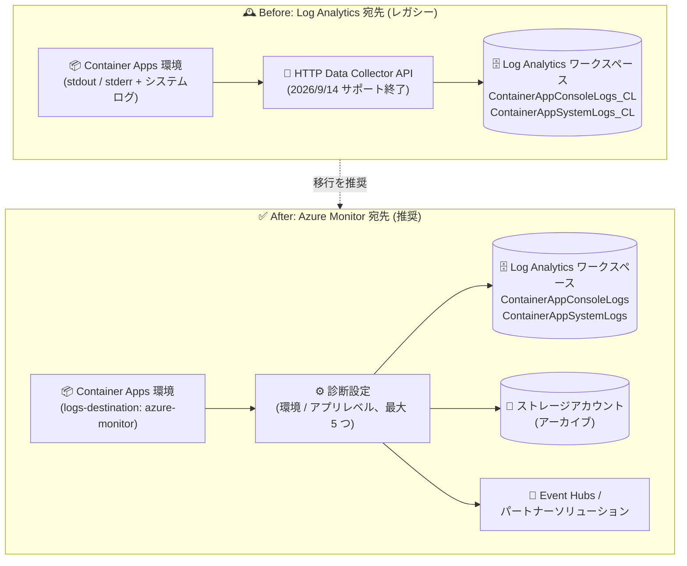

# Azure Container Apps: ログ宛先を Log Analytics から Azure Monitor へ移行するアナウンス

**リリース日**: 2026-10-28

**サービス**: Azure Container Apps

**機能**: ログ宛先の Azure Monitor への移行 (Log Analytics 宛先のレガシー化)

**ステータス**: Announcement

[このアップデートのインフォグラフィックを見る](https://takech9203.github.io/azure-news-summary/20261028-container-apps-logging-azure-monitor-migration.html)

## 概要

Azure Container Apps の「Log Analytics」ログ宛先 (logging destination) がレガシーなログオプションになったことが発表されました。Log Analytics 宛先を構成済みの既存環境は引き続き正常に動作しますが、Microsoft は「Azure Monitor」ログ宛先への移行計画を立てることを推奨しています。

この推奨の背景には、Log Analytics ログ宛先が内部で使用している HTTP Data Collector API の非推奨化があります。レガシーな HTTP Data Collector API のサポートは 2026 年 9 月 14 日に終了しており、以降は重大なセキュリティ更新のみが提供されます。TLS 準拠クライアントからの既存のインジェストは継続されますが、中断を避けるため環境のログ宛先を Azure Monitor へ変更することが求められています。

なお、アプリケーションが HTTP Data Collector API を直接呼び出している場合は、別途 [Logs Ingestion API への移行](https://learn.microsoft.com/azure/azure-monitor/logs/custom-logs-migrate?tabs=cli)が必要です。Container Apps の Log Analytics ログ宛先と HTTP Data Collector API 直接インジェストの両方を使用している場合は、両方の移行を計画する必要があります。

**アップデート前の課題**

- Log Analytics ログ宛先は、非推奨化が進む HTTP Data Collector API に依存しており、2026 年 9 月 14 日のサポート終了後は重大なセキュリティ修正のみの提供となる
- ログはカスタムテーブル (`ContainerAppConsoleLogs_CL`、`ContainerAppSystemLogs_CL`) に書き込まれ、宛先は Log Analytics ワークスペース 1 つに限定される
- Private Link 経由で Log Analytics ワークスペースへ直接ログを送信することはサポートされない

**アップデート後の改善**

- Azure Monitor 宛先は診断設定 (Diagnostic settings) ベースとなり、Log Analytics ワークスペースに加えてストレージアカウント (アーカイブ)、Event Hubs、パートナーソリューション (Datadog、Elastic など) へのルーティングが可能
- ログはリソース固有テーブル (`ContainerAppConsoleLogs`、`ContainerAppSystemLogs`) に標準スキーマで格納される
- 環境レベルとコンテナーアプリレベルの両方で診断設定を構成でき、カテゴリごとに異なる宛先を設定できる (環境あたり最大 5 つの診断設定)
- Azure Monitor 経由であれば、同じ Log Analytics ワークスペースへの送信を Private Link 環境でも利用できる

## アーキテクチャ図



従来は HTTP Data Collector API 経由でカスタムテーブルに直接送信していたログを、今後は Azure Monitor の診断設定経由でリソース固有テーブルや複数の宛先にルーティングする構成へ移行します。

## サービスアップデートの詳細

### 主要なポイント

1. **Log Analytics ログ宛先のレガシー化**
   - 既存環境は引き続き正常に動作するが、新規・既存環境ともに Azure Monitor 宛先への移行が推奨される
   - 基盤の HTTP Data Collector API は 2026 年 9 月 14 日にサポートが終了し、以降は重大なセキュリティ更新のみ

2. **影響範囲の確認方法**
   - 監視ソリューション (ログクエリ、ダッシュボード、アラート、ブック) が `ContainerAppConsoleLogs_CL` または `ContainerAppSystemLogs_CL` テーブルを参照している場合、その環境は Log Analytics ログ宛先を使用している
   - テキスト検索だけでは不十分で、ワークスペース関数・エイリアス、生成クエリ、IaC テンプレート、デプロイパイプライン、SIEM ルール、外部監視統合も確認が必要

3. **テーブルとスキーマの変更**
   - 移行後、ログはカスタムテーブルではなくリソース固有テーブルに書き込まれる
   - 列名も型サフィックス付き (`_s`、`_g`、`_d`) から標準の Azure Monitor 列名に変わる

4. **履歴データは移動されない**
   - 既存の `_CL` テーブルのレコードはワークスペースの保持期間中は参照可能
   - 履歴と新規レコードを横断して検索する場合は、`union` を使ったワークスペース関数 (互換関数) の作成が案内されている

### 移行時の注意点 (Microsoft Learn より)

- ログ宛先の切り替えは即座にルーティングを変更するが、診断設定を作成するまでリソースログは送信されない。診断設定の有効化には最大 90 分かかる場合がある
- 切り替え直後に診断設定を作成すれば、作成前に生成されたコンソールログはバッファリングされバックフィルされる (ただし保証範囲には制限あり。システムログのバックフィルは保証されない)
- `_CL` テーブルを参照するアラートは、宛先切り替えと同時に新規データを受信しなくなるため、メンテナンスウィンドウの設定、カナリアログによる検証、代替アラートの事前準備が推奨される
- Azure Monitor 宛先は `dynamicJsonColumns` をサポートしておらず、移行時に無効化される。動的 JSON 列に依存するクエリは `parse_json()` で明示的にパースするよう更新が必要
- **Express 環境モードの Container Apps 環境では Azure Monitor をログ宛先として利用できないため、この移行は適用されない**
- ロールバック (Log Analytics 宛先への戻し) は可能だが、短期的な緊急措置と位置づけられており、リソース固有テーブルのデータはコピー・バックフィルされない

## 技術仕様

| 項目 | Before (Log Analytics 宛先) | After (Azure Monitor 宛先) |
|------|------|------|
| 送信経路 | HTTP Data Collector API (レガシー) | Azure Monitor 診断設定 |
| コンソールログのテーブル | `ContainerAppConsoleLogs_CL` | `ContainerAppConsoleLogs` |
| システムログのテーブル | `ContainerAppSystemLogs_CL` | `ContainerAppSystemLogs` |
| 列名の例 | `ContainerAppName_s`, `Log_s`, `Stream_s` | `ContainerAppName`, `Log`, `Stream` |
| 対応宛先 | Log Analytics ワークスペースのみ | Log Analytics / ストレージアカウント / Event Hubs / パートナーソリューション |
| 診断設定数 | - | 環境あたり最大 5 つ |
| ログカテゴリ | - | `ContainerAppConsoleLogs`, `ContainerAppSystemLogs` (カテゴリグループ: `allLogs`, `audit`) |
| メトリック | - | `AllMetrics` (環境・アプリレベル) |
| ワークスペースの関連付け | 環境設定で指定 | 診断設定で明示的に選択 (自動では引き継がれない) |

## 設定方法

### 前提条件

1. Log Analytics ログ宛先を使用している既存の Container Apps 環境
2. `ContainerAppConsoleLogs_CL` / `ContainerAppSystemLogs_CL` を含む Log Analytics ワークスペース
3. 環境の更新権限、および環境スコープでの診断設定の作成・更新権限
4. サブスクリプションに `Microsoft.Insights` リソースプロバイダーが登録済み (または登録権限があること)
5. Azure CLI を使用する場合は最新の Azure CLI と Container Apps 拡張機能 (`az extension add --name containerapp --upgrade`)

### Azure CLI

```bash
# Microsoft.Insights リソースプロバイダーを登録
az provider register --namespace Microsoft.Insights --wait

# 環境のログ宛先を Azure Monitor に切り替え
az containerapp env update \
  --name <ENVIRONMENT_NAME> \
  --resource-group <RESOURCE_GROUP_NAME> \
  --logs-destination azure-monitor

# 切り替え直後に診断設定を作成 (既存の _CL テーブルと同じワークスペースを指定)
az monitor diagnostic-settings create \
  --name <NEW_UNIQUE_DIAGNOSTIC_SETTING_NAME> \
  --resource <ENVIRONMENT_RESOURCE_ID> \
  --logs '[{"category":"ContainerAppConsoleLogs","enabled":true},{"category":"ContainerAppSystemLogs","enabled":true}]' \
  --workspace <LOG_ANALYTICS_WORKSPACE_RESOURCE_ID>
```

移行後、以下のクエリで新テーブルへのログ到達を検証します (診断設定の有効化には最大 90 分かかる場合があります)。

```kusto
ContainerAppConsoleLogs
| where TimeGenerated > ago(2h)
| where _ResourceId contains "<ENVIRONMENT_NAME>"
| order by TimeGenerated desc
| take 20
```

### Azure Portal

1. Container Apps 環境を開き、**[監視] > [ログオプション]** を選択する
2. **[ログの宛先]** で **[Azure Monitor]** を選択し、**[保存]** する
3. 更新完了後にページを更新し、**[監視] > [診断設定]** を選択する
4. **[診断設定の追加]** で名前を入力し、少なくとも **Container App console logs** と **Container App system logs** のカテゴリ (または `allLogs` カテゴリグループ) を選択する
5. **[宛先の詳細]** で **[Log Analytics ワークスペースへの送信]** を選び、既存の `_CL` テーブルがあるワークスペースを選択して保存する

## メリット

### ビジネス面

- 非推奨 API への依存を解消し、サポート終了 (2026 年 9 月 14 日) 後のリスクを低減できる
- ストレージアカウントへのアーカイブや Event Hubs 経由の SIEM 連携など、コンプライアンス・監査要件に対応しやすくなる

### 技術面

- 診断設定により複数宛先 (Log Analytics / Storage / Event Hubs / パートナーソリューション) へ柔軟にログをルーティングできる
- リソース固有テーブルの標準スキーマ (型サフィックスなしの列名) によりクエリが簡潔になる
- カテゴリ単位 (コンソールログ / システムログ) で異なる宛先を設定でき、環境・アプリの両レベルでメトリック送信も構成できる
- Private Link 構成でも Azure Monitor 経由で Log Analytics ワークスペースへログを送信できる

## デメリット・制約事項

- ログ宛先の切り替えだけではログは送信されず、診断設定の作成が必須 (ワークスペースの関連付けは自動で引き継がれない)
- 診断設定の有効化に最大 90 分かかる場合があり、移行中の監視ギャップ対策 (カナリアログ、代替アラートの事前準備など) が必要
- 履歴データは `_CL` テーブルから移動されないため、横断検索には `union` を使った互換関数の作成が必要
- テーブル名・列名が変わるため、`_CL` テーブルを参照するクエリ、アラート、ブック、ダッシュボード、自動化をすべて更新する必要がある
- Azure Monitor 宛先は `dynamicJsonColumns` をサポートせず、移行時に無効化される (ロールバックしても自動では再有効化されない)
- Express 環境モードでは Azure Monitor 宛先が利用できない
- ログインジェストと宛先ごとの課金が発生し得るため、必要なカテゴリと宛先のみを選択することが推奨される

## ユースケース

### ユースケース 1: 既存ワークスペースを維持したままの移行

**シナリオ**: 既存の Log Analytics ワークスペースに蓄積した `_CL` テーブルの履歴ログを保持しつつ、新規ログを同じワークスペースのリソース固有テーブルへ送信する。

**実装例**: 上記「設定方法」の CLI 手順で同じワークスペースを診断設定に指定した後、履歴と新規レコードを横断検索する互換関数をワークスペース関数として保存する。

```kusto
union
(
    ContainerAppConsoleLogs_CL
    | project TimeGenerated, ContainerAppName = ContainerAppName_s,
        RevisionName = RevisionName_s, Stream = Stream_s, Log = Log_s,
        _ResourceId, SourceTable = "ContainerAppConsoleLogs_CL"
),
(
    ContainerAppConsoleLogs
    | project TimeGenerated, ContainerAppName, RevisionName, Stream, Log,
        _ResourceId, SourceTable = "ContainerAppConsoleLogs"
)
```

**効果**: 既存の保持期間内の履歴ログと新規ログを単一クエリで参照でき、移行に伴うクエリ・アラート更新を段階的に進められる。

### ユースケース 2: ログの長期アーカイブと SIEM 連携

**シナリオ**: 監査要件によりコンテナーログの長期保管と外部 SIEM への転送が必要。

**実装例**: 診断設定でコンソールログ・システムログを Log Analytics ワークスペースに送信しつつ、同じ診断設定 (または別の診断設定) でストレージアカウントへのアーカイブと Event Hubs へのストリーミングを追加する。

**効果**: Log Analytics 宛先では不可能だった複数宛先への同時ルーティングが実現し、分析・アーカイブ・SIEM 連携を 1 つの構成で満たせる。

## 料金

このアナウンス自体に料金の変更は含まれていません。Azure Monitor 宛先ではログのインジェストと宛先ごとの課金が発生し得るため、必要なカテゴリと宛先のみを選択することが公式ドキュメントで推奨されています。詳細は以下を参照してください。

- [Azure Monitor の料金](https://azure.microsoft.com/pricing/details/monitor/)
- [Azure Container Apps の料金](https://azure.microsoft.com/pricing/details/container-apps/)

## 関連サービス・機能

- **Azure Monitor (診断設定)**: 移行後のログルーティングの中核。環境・アプリレベルで最大 5 つの診断設定を構成し、ログカテゴリとメトリックを宛先に送信する
- **Log Analytics ワークスペース**: 移行後もログの保存・分析先として利用可能。テーブルがカスタムテーブル (`_CL`) からリソース固有テーブルに変わる
- **Azure Event Hubs / Azure Storage**: Azure Monitor 宛先で新たに利用できるストリーミング・アーカイブ先
- **Azure Monitor パートナーソリューション**: Datadog、Elastic、Logz.io などへのログ送信が可能
- **Logs Ingestion API**: HTTP Data Collector API を直接利用しているアプリケーションの移行先 (本件とは別の移行ガイダンスに従う)

## 参考リンク

- [インフォグラフィック](https://takech9203.github.io/azure-news-summary/20261028-container-apps-logging-azure-monitor-migration.html)
- [公式アップデート情報](https://azure.microsoft.com/updates?id=577689)
- [移行手順: Change Container Apps logging from Log Analytics to Azure Monitor](https://learn.microsoft.com/azure/container-apps/migrate-logs-azure-monitor)
- [ログオプション: Log storage and monitoring options in Azure Container Apps](https://learn.microsoft.com/azure/container-apps/log-options)
- [HTTP Data Collector API から Logs Ingestion API への移行](https://learn.microsoft.com/azure/azure-monitor/logs/custom-logs-migrate?tabs=cli)
- [Azure Monitor の診断設定](https://learn.microsoft.com/azure/azure-monitor/essentials/diagnostic-settings)
- [Azure Monitor の料金](https://azure.microsoft.com/pricing/details/monitor/)

## まとめ

Azure Container Apps の Log Analytics ログ宛先がレガシー化され、Azure Monitor ログ宛先への移行が公式に推奨されるアナウンスです。既存環境は当面動作し続けるものの、基盤の HTTP Data Collector API は 2026 年 9 月 14 日にサポートが終了しており、以降は重大なセキュリティ更新のみの提供となるため、計画的な移行が必要です。

Solutions Architect としては、まず `ContainerAppConsoleLogs_CL` / `ContainerAppSystemLogs_CL` テーブルを参照するクエリ、アラート、ブック、ダッシュボード、IaC、SIEM ルールの棚卸しを行い、テーブル名・列名の変更に対応した代替クエリとアラートを準備した上で、メンテナンスウィンドウを設けて「宛先切り替え + 診断設定作成」を一連の作業として実施することを推奨します。履歴データは移動されないため、必要に応じて `union` ベースの互換関数で移行期間の横断検索を確保してください。

---

**タグ**: Azure Container Apps, Azure Monitor, Log Analytics, Containers, 診断設定, ログ移行, Announcement
