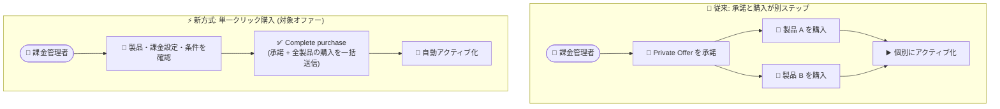

# Microsoft Marketplace: Private Offer の購入エクスペリエンス強化 (単一ステップ購入)

**リリース日**: 2026-10-28

**サービス**: Microsoft Marketplace (Azure portal)

**機能**: Private Offer Enhancements (Single-Click Purchase)

**ステータス**: Launched (GA)

[このアップデートのインフォグラフィックを見る](https://takech9203.github.io/azure-news-summary/20261028-marketplace-private-offer-enhancements.html)

## 概要

Microsoft Marketplace の Private Offer (プライベートオファー) は、柔軟な請求スケジュールやカスタム契約期間など、組織のニーズに合わせた価格・条件で ISV ソリューションを購入できる仕組みです。今回のアップデートで、対象となる Private Offer の購入エクスペリエンスが簡素化され、一般提供 (GA) になりました。

従来、顧客は Private Offer をまず「承諾 (accept)」し、その後オファーに含まれる各製品を個別に「購入 (purchase)」する 2 段階のプロセスが必要でした。今回の強化により、対象の Private Offer では含まれるすべての製品を 1 つのステップでまとめて購入できる「単一クリック購入 (single-click purchase)」が利用可能になります。購入ガバナンスは引き続き Azure のロールベースアクセス制御 (課金管理者ロール) と整合しており、統制を維持したまま購入プロセスを短縮できます。

本機能は 2026 年 7 月にプライベートプレビューが開始され、2026 年 10 月に GA となりました。現時点では SaaS および Professional Services のオファータイプで有効化が進められています。

**アップデート前の課題**

- Private Offer の購入には「オファーの承諾」→「含まれる製品ごとの個別購入」という複数ステップが必要だった
- 複数製品 (最大 10 製品のバンドルが可能) を含むオファーでは、製品ごとに購入操作を繰り返す必要があり、調達プロセスに時間がかかっていた
- 承諾後にブラウザーの更新や購入画面への再遷移など、ユーザー側の追加操作が発生していた

**アップデート後の改善**

- 対象の Private Offer では、含まれる製品・課金/リソース設定・法的条件を確認したうえで「Complete purchase」を選択するだけで、承諾と購入を一括で送信できる
- 単一クリック購入で購入した製品は自動アクティブ化 (automatic activation) に対応し、即時開始の製品は購入成功後に、将来開始日の製品は開始日に自動でアクティブ化される
- 購入ガバナンスは Azure RBAC (課金管理者ロール) と引き続き整合しており、権限分離を維持できる

## アーキテクチャ図

従来は承諾後に製品ごとの購入操作が必要でしたが、対象オファーでは確認後に 1 回の操作で全製品の承諾・購入が完了し、アクティブ化も自動で行われます。

## サービスアップデートの詳細

### 主要機能

1. **単一クリック購入 (Single-Click Purchase)**
   - 対象の Private Offer では、含まれる製品、課金・リソース設定、法的条件を確認し、「Complete purchase」を選択することで承諾と購入を一括送信できる
   - オファーに含まれる全製品がまとめて購入処理される

2. **購入時の課金・サブスクリプション設定**
   - チェックアウト時に課金アカウント (MCA の場合は課金プロファイルと請求書セクション、EA の場合は登録アカウント) と Azure サブスクリプションを確認・変更できる
   - 必要な権限があれば、チェックアウト中に新しいサブスクリプションを作成することも可能 (「Create new」が利用可能な場合)

3. **製品ごとのリソース設定とタグ付け**
   - 各製品のプラン、価格、数量、サブスクリプション開始日を確認できる
   - リソース名、リソースグループ、リソースグループの場所、タグを購入時に編集できる (コントロールが利用可能な場合)

4. **自動アクティブ化**
   - 即時開始の製品は購入成功後に、将来開始日が設定された製品はその開始日に自動的にアクティブ化される
   - アクティブ化のためだけに Portal に戻る必要がない。課金は製品のアクティブ化時に (合意済みの請求スケジュールに従って) 開始される

5. **購入結果の追跡と未完了購入のリカバリー**
   - 購入結果は「Processing」「Purchased」「Purchase incomplete」「Awaiting activation」のステータスで製品ごとに確認できる
   - 一部の製品のみ失敗した場合は、Private Offer Management から未完了分のみ再購入できる (成功済み製品の再購入は不要)

### 既存フローとの関係

単一クリック購入は、従来の「承諾と購入を分離した」エクスペリエンスを置き換えるものではありません。利用できるエクスペリエンスはオファーごとに決まり、対象外のオファーは引き続き従来のフロー (承諾 → 購入) を使用します。

## 技術仕様

| 項目 | 詳細 |
|------|------|
| 対象オファータイプ | SaaS および Professional Services (Azure portal で購入可能な新規 Private Offer) |
| 対象外 | 既存 SaaS サブスクリプションの更新・プラン変更、その他の製品タイプやカスタム購入エクスペリエンス |
| 承諾に必要なロール (MCA) | 課金アカウントの所有者または共同作成者 |
| 承諾に必要なロール (EA) | Enterprise Administrator |
| 購入 (サブスクライブ) に必要なロール | サブスクリプションの所有者または共同作成者 |
| MOSP (Legacy Web Direct) | 既存の対象サブスクリプションのみ選択可。サブスクリプション作成と購入時の権限昇格は非対応 |
| プライベートプレビュー開始 | 2026 年 7 月 |
| 一般提供 (GA) | 2026 年 10 月 |

## 設定方法

### 前提条件

1. 組織の条件承諾・購入を行う権限 (上記ロール) があることを確認する
2. 組織の調達承認プロセスを購入前に完了しておく
3. Private Offer に使用される課金アカウントに関連付けられた Azure ディレクトリにサインインする
4. 使用する Azure サブスクリプションとリソース設定をあらかじめ特定しておく

### Azure Portal

1. 受け取った Private Offer のリンクを開くか、Azure portal で **Marketplace > Private Offer Management** に移動する
2. 対象の Private Offer を見つけ、オファーレベルの **Purchase** アクションを選択する
3. 含まれる製品と購入詳細を確認する
4. 課金アカウントと事前選択された Azure サブスクリプションを確認し、必要に応じて **Edit** で変更する
5. 各製品のプラン、価格、数量、開始日、リソース名、リソースグループ、タグを確認・編集する
6. 条件、添付文書、付属文書、リンクされた法的文書を確認し、必要に応じて **Download PDF** で控えを取得する
7. 条件への同意を選択し、**Complete purchase** を選択する
8. 購入結果 (全体と製品ごとのステータス) を確認する。一部未完了の場合は Private Offer Management から残りの購入を完了する

## メリット

### ビジネス面

- 調達プロセスの短縮: 承諾と購入が 1 ステップに統合され、複数製品を含むオファーでも一括で購入が完了する
- ガバナンスの維持: 課金管理者ロールによる購入統制が維持され、権限のない担当者による誤購入を防止できる
- Azure 消費コミットメント (MACC) との整合: Private Offer の対象購入は引き続き MACC へのカウント対象となり、クラウド投資の価値を最大化できる

### 技術面

- 自動アクティブ化により、購入後にアクティブ化のためだけに Portal へ戻る操作が不要になる
- 購入時にリソースグループ、リソース名、タグを設定でき、組織の命名規則・タグ付けポリシーに準拠した状態で購入できる
- 製品ごとの購入ステータス表示と未完了購入のリカバリー機能により、部分的な失敗時も安全に残りの購入を完了できる

## デメリット・制約事項

- 単一クリック購入が利用できるかどうかはオファーごとに決まる。複数製品を含むオファーであっても単一クリック購入に対応しているとは限らない
- 現時点の対象は新規の SaaS および Professional Services オファーのみ。既存 SaaS サブスクリプションの更新やプラン変更は対象外
- MOSP (Legacy Web Direct) では、サブスクリプション作成や購入時の権限昇格はサポートされない
- 購入送信の受理 (acknowledgment) はすべての製品の購入成功を意味しない。全体結果と製品ごとのステータス確認が必要
- 自動アクティブ化はアカウント設定やソフトウェアへのアクセスまでを保証しない。プロバイダーのオンボーディング手順に従う必要がある (Professional Services はサービスプロバイダーと納品を調整する)
- タグはチェックアウトで選択したターゲットに適用される。サブスクリプションやリソースグループのタグが購入済みリソースへ自動コピーされるわけではない

## ユースケース

### ユースケース 1: MACC 消化のための複数製品バンドル購入

**シナリオ**: Microsoft Azure Consumption Commitment (MACC) を持つ企業が、ISV と交渉した SaaS 製品と導入支援の Professional Services を 1 つの Private Offer として受領し、調達部門の承認済み条件で購入する。

**フロー**:

1. ISV が SaaS 製品と Professional Services をバンドルした Private Offer を作成し、顧客の課金アカウント ID に紐づけて送付
2. 課金アカウント所有者が Azure portal の Private Offer Management でオファーを開き、製品・価格・開始日・リソース設定・法的条件を確認
3. 「Complete purchase」で全製品を一括購入。即時開始の SaaS は自動アクティブ化され、将来開始日の製品は開始日に自動でアクティブ化される

**効果**: 従来の「承諾 → 製品ごとの個別購入 → 手動アクティブ化」と比べて操作ステップが大幅に減り、対象購入は MACC へのカウント対象となるためコミットメント消化にも寄与する。

## 関連サービス・機能

- **Azure portal (Private Offer Management)**: Private Offer の確認・購入・購入結果の追跡を行う管理画面
- **Azure ロールベースアクセス制御 (RBAC) / 課金ロール**: 承諾には MCA の課金アカウント所有者/共同作成者または EA の Enterprise Administrator が必要で、購入統制の基盤となる
- **Azure Consumption Commitment (MACC)**: 対象となる Marketplace 購入は 100% が MACC へのカウント対象となる
- **Multiparty Private Offers (MPO)**: チャネルパートナー/リセラー経由で Private Offer を購入する仕組み。ISV 直販の Private Offer と同様に利用できる

## 参考リンク

- [インフォグラフィック](https://takech9203.github.io/azure-news-summary/20261028-marketplace-private-offer-enhancements.html)
- [公式アップデート情報](https://azure.microsoft.com/updates?id=576547)
- [Private offers overview (Microsoft Learn)](https://learn.microsoft.com/en-us/marketplace/private-offers-overview)
- [Purchase a private offer with single-click purchase (Microsoft Learn)](https://learn.microsoft.com/en-us/marketplace/private-offers-single-click-purchase)

## まとめ

Microsoft Marketplace の Private Offer における単一クリック購入が GA となり、対象の SaaS / Professional Services オファーでは「承諾 → 製品ごとの個別購入」という従来の 2 段階プロセスが 1 ステップに統合されました。自動アクティブ化や購入時のリソース/タグ設定にも対応し、ガバナンス (課金管理者ロールによる統制) を維持したまま調達リードタイムを短縮できます。Marketplace 経由で ISV ソリューションを調達している組織、特に MACC を運用している組織は、受領した Private Offer が単一クリック購入の対象かどうかを Private Offer Management で確認し、購入手順書を新フローに合わせて更新することを推奨します。

---

**タグ**: Microsoft Marketplace, Private Offer, Azure portal, Management and governance, SaaS, Professional Services, MACC, GA
