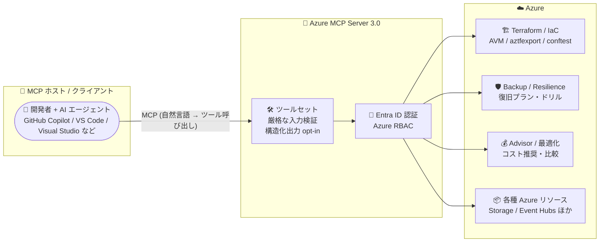

# Azure MCP Server: バージョン 3.0 が一般提供 (GA) 開始

**リリース日**: 2026-10-29

**サービス**: Azure MCP Server

**機能**: Azure MCP Server 3.0 (Terraform ツール、Backup/Resilience ツール、コスト最適化ツール、構造化出力など)

**ステータス**: Launched (GA)

[このアップデートのインフォグラフィックを見る](https://takech9203.github.io/azure-news-summary/20261029-azure-mcp-server-3-0.html)

## 概要

Azure MCP Server 3.0 が一般提供 (GA) となりました。Azure MCP Server は、オープンな Model Context Protocol (MCP) を実装し、AI エージェントや開発者ツールが自然言語で Azure リソースと対話できるようにするサーバーです。3.0 は 50 回のベータイテレーションを経た 3 番目のメジャーリリースで、2.0 で導入されたセルフホスト型リモートサーバー対応を基盤に機能を大幅に拡張しています。

このリリースでは、Infrastructure as Code (Azure Terraform ツール)、保護と復旧 (Azure Backup / Azure Resilience Management ツール)、コスト最適化 (Azure Advisor の機能拡張と最適化ツールセット) という新しい領域のツール群が追加されました。また、明確なツールコントラクト、厳格な入力・エンドポイント検証、オプトイン方式の構造化出力により、AI エージェントとの統合の予測可能性が向上しています。

さらに、Storage アカウント、Event Hubs 名前空間、NFS ファイル共有、Recovery Services コンテナーを新規作成する際のセキュリティデフォルトが強化されました。なお、本リリースには破壊的変更が含まれるため、既存の統合や共有デプロイを更新する前にアップグレードガイダンスの確認が推奨されています。

**アップデート前の課題**

- Terraform による IaC 作業 (プロバイダードキュメント参照、Azure Verified Modules 探索、既存リソースのエクスポート、ポリシー検証) を MCP ツールとして AI エージェントから直接実行できなかった
- Azure Backup やレジリエンス管理 (復旧プラン、レディネスチェック、ドリル) を対象とした MCP ツールがなかった
- レスポンス形式が非構造化テキスト中心で、HTTP ステータスコードも一貫していなかった (リソース未存在時に 500/400 が混在)
- MCP サーバー経由で新規作成したリソースのセキュリティ設定が、Azure のベストプラクティスに沿った安全なデフォルトになっていなかった

**アップデート後の改善**

- Azure Terraform ツールにより、プロバイダードキュメント取得、Azure Verified Modules 探索、`aztfexport` による既存リソースのエクスポート、`conftest` によるプラン検証が可能に
- Azure Backup / Azure Resilience Management ツールにより、バックアップ保護、復旧プラン、レディネスチェック、ドリルを AI エージェントから操作可能に
- Azure Advisor の機能拡張と最適化ツールセットにより、推奨事項のレビュー、リソースオプションの比較、使用率の把握が可能に
- オプトイン方式の構造化出力 (`outputSchema` / `structuredContent`)、厳格な入力検証、適切な HTTP ステータス (未存在は 404、不正入力は 400) により統合の予測可能性が向上
- 新規作成する Storage アカウント (共有キー認証無効)、Event Hubs 名前空間 (ローカル認証無効)、Recovery Services コンテナー (パブリックネットワーク無効)、NFS ファイル共有 (RootSquash と転送時暗号化) に安全なデフォルトを適用

## アーキテクチャ図



AI エージェント (MCP クライアント) が Azure MCP Server 3.0 を経由して Azure サービス群と対話する構成です。3.0 では IaC、保護・復旧、コスト最適化の 3 領域のツールが新たに追加され、すべてのアクセスは Entra ID 認証と Azure RBAC で制御されます。

## サービスアップデートの詳細

### 主要機能

1. **Infrastructure as Code: Azure Terraform ツール**
   - AzureRM / AzAPI プロバイダーのドキュメント取得
   - Azure Verified Modules (パターンモジュールを含む) の探索
   - `aztfexport` による既存リソースの Terraform コードへのエクスポート
   - `conftest` によるワークスペース / プランのポリシー検証

2. **保護と復旧: Azure Backup / Azure Resilience Management ツール**
   - Backup: コンテナー、ポリシー、保護可能アイテム、保護済みアイテム、ジョブ、復旧ポイントの検査。ソフト削除、イミュータビリティ、Multi-User Authorization 用 Resource Guards、CMK 暗号化、クロスリージョン復元に対応
   - Resilience Management: 復旧プラン・ジョブ、レディネスチェック、フェールオーバー検証、ドリルのライフサイクル管理 (フェールオーバー / 再保護アクションは実行前のレビュー推奨)

3. **コスト最適化: Azure Advisor 拡張と最適化ツールセット**
   - 推奨事項のサマリー、メタデータ、修復ガイダンスの取得
   - コスト推奨を影響度・年間推定削減額でランク付け、VM / VMSS オプションの比較、使用率予測の説明
   - `advisor recommendation apply` はライブリソースを変更せず、IaC 変更の準備用ルールを返す安全な設計

4. **より予測可能な統合**
   - 明確なツールコントラクトと仕様準拠の入力スキーマ (未知パラメーターはエラー)
   - オプトイン構造化出力: `--structured-output-mode duplicated | compact` で `outputSchema` / `structuredContent` を有効化
   - HTTP ステータス修正 (リソース未存在は 404、不正入力は 400)、ログ / 例外は stderr へ分離
   - `--learn` フラグで操作を実行せずにコマンド / パラメーターを探索可能
   - 起動が約 39% 高速化 (対象 CLI コマンド呼び出しのみ)

5. **セキュリティデフォルトの強化 (新規作成リソースのみ適用)**
   - 新規 Storage アカウント: 共有キー認証無効
   - 新規 Event Hubs 名前空間: ローカル認証無効
   - 新規 Recovery Services コンテナー: パブリックネットワーク無効
   - 新規 NFS ファイル共有: `RootSquash` と転送時暗号化を有効化

6. **その他の新ツール**
   - Azure SRE Agent (調査、インシデント、修復プランなど 55 コマンド)、Monitor (リソース横断メトリクス)、Cosmos DB (スキーマ推論、全文・ベクトル検索)、IoT Hub / IoT Operations、Compute / App Service / Managed Lustre など

### 破壊的変更 (2.x → 3.0)

本リリースには以下の破壊的変更が含まれます。既存の統合や共有デプロイを更新する前に 3.x チェンジログの確認が必要です。

- 廃止パラメーターの削除 (未使用の subscription / resource-group / tenant / auth-method など)、`azmcp resilience` → `azmcp resiliency` へのリネーム
- レスポンス形式の変更 (Advisor は ARM 形式の `properties`、Monitor ログ / AI Search 検索は `results` ラッパーなど)
- MySQL / PostgreSQL クエリツールは破壊的・非冪等・非読み取り専用に分類変更 (最小権限が推奨)
- 設定の `MicrosoftMcp` 配下への移動、名前空間 `Azure.Mcp.Core.*` → `Microsoft.Mcp.Core.*`
- VM / VMSS 作成に明示的な `--image` が必須に、デフォルトサイズは `Standard_D2s_v5`
- ステートレス MCP プロトコル `2026-07-28` 使用時は全 POST に `Mcp-Method` / `Mcp-Name` ヘッダーが必須

## 技術仕様

| 項目 | 詳細 |
|------|------|
| プロトコル | Model Context Protocol (MCP、オープンプロトコル) |
| 認証 | Entra ID (Azure Identity ライブラリ経由)、Azure RBAC によるアクセス制御 |
| 対応クライアント | GitHub Copilot agent mode、OpenAI Agents SDK、Semantic Kernel など MCP 互換クライアント |
| 対応エディター | Visual Studio Code、Visual Studio (17.14.30+ は Azure 開発ワークロードに同梱)、IntelliJ、Eclipse、Cursor、Windsurf、Cline など |
| デプロイ形態 | スタンドアロンのローカルサーバー、またはチーム共有用のセルフホスト型リモートサーバー |
| CI/CD 対応 | `AzurePipelinesCredential` による Azure Pipelines ワークロードアイデンティティフェデレーション |
| パッケージ | npm: `@azure/mcp@3.0.0` |

## 設定方法

### 前提条件

1. GitHub Copilot サブスクリプション (サポートされるホストで利用する場合)
2. 適切なサブスクリプション権限 (RBAC) を持つ Azure アカウント
3. Node.js LTS、Azure CLI (ローカル実行時)

### Azure CLI + VS Code での開始例 (読み取り専用)

```bash
# Azure にサインインし、サブスクリプションを設定
az login
az account set --subscription "<subscription-id>"
```

`.vscode/mcp.json` に以下を追加します。

```json
{
  "servers": {
    "azure-mcp": {
      "type": "stdio",
      "command": "npx",
      "args": ["-y", "@azure/mcp@3.0.0", "server", "start", "--read-only"]
    }
  }
}
```

まずは読み取り専用モード (`--read-only`) と開発用サブスクリプション、最小権限のアイデンティティでの利用が推奨されています。

## メリット

### ビジネス面

- AI エージェント経由で Advisor のコスト推奨事項をレビュー・比較でき、クラウドコスト最適化の取り組みを加速できる
- バックアップ・復旧体制のレディネスチェックやドリルを自然言語で実行でき、事業継続性 (BCP) 対応の運用負荷を軽減できる
- 新規作成リソースに安全なデフォルトが適用されるため、AI エージェント活用時のセキュリティリスクを低減できる

### 技術面

- Terraform ドキュメント参照から既存リソースのエクスポート、ポリシー検証までの IaC ワークフローを AI エージェントで完結できる
- 構造化出力 (`outputSchema` / `structuredContent`) と厳格な入力検証により、エージェントのツール呼び出しの信頼性が向上する
- HTTP ステータスの一貫性 (404 / 400) と stdout / stderr の分離により、プログラムからの統合やデバッグが容易になる
- 起動の高速化 (対象コマンドで約 39%) により開発体験が向上する

## デメリット・制約事項

- 2.x からの破壊的変更が多数あり、既存の統合・共有デプロイはアップグレード前に 3.x チェンジログの確認とクライアントでのテストが必要
- セキュリティデフォルトの強化は新規作成リソースのみに適用され、既存リソースには影響しない
- Backup のプライベートエンドポイントツールは Recovery Services コンテナーのみ対応 (Data Protection コンテナーは非対応)
- MySQL / PostgreSQL クエリツールは読み取り専用扱いではなくなったため、最小権限での運用が必要
- ローカル MCP サーバーは組織内の開発者用途が想定されており、外部アプリケーションや承認された開発環境外での利用は非推奨
- 自然言語プロンプトはアクセス制御の代替にはならない (RBAC による権限設計が引き続き必須)

## ユースケース

### ユースケース 1: AI エージェントによる Terraform IaC ワークフローの効率化

**シナリオ**: 既存の Azure 環境を Terraform 管理に移行する際、リソースのエクスポート、Azure Verified Modules の選定、ポリシー検証を AI エージェントに依頼する。

**実装例**:

```text
# GitHub Copilot agent mode でのプロンプト例
「このリソースグループのリソースを aztfexport で Terraform コードにエクスポートし、
 該当する Azure Verified Modules があれば提案して。
 プランは conftest でポリシー検証して」
```

**効果**: プロバイダードキュメントの手動検索やエクスポートツールの個別実行が不要になり、IaC 移行作業を会話ベースで進められる。

### ユースケース 2: コスト最適化レビューの自動化

**シナリオ**: 開発用サブスクリプションの Advisor 推奨事項を定期的にレビューし、影響度の高いコスト削減機会を特定する。

**実装例**:

```text
# 読み取り専用モードでの最初のプロンプト例 (公式ブログ推奨)
「このサブスクリプションの Advisor 推奨事項を一覧し、
 コスト推奨を 1 件選んで内容を説明して。変更は適用しないで」
```

**効果**: 推奨事項が影響度・年間推定削減額でランク付けされるため、優先順位付けされたコスト最適化のアクションプランを短時間で得られる。

## 料金

Azure MCP Server 自体の料金情報は公式アップデートに記載されていません。前提条件として GitHub Copilot サブスクリプションが必要です (サポートされるホストで利用する場合)。MCP ツール経由で操作する各 Azure サービス (Storage、Backup など) には、それぞれのサービスの料金が適用されます。

## 関連サービス・機能

- **GitHub Copilot (agent mode)**: Azure MCP Server に接続する代表的な MCP クライアント。VS Code / Visual Studio / CLI から利用
- **Azure Terraform (aztfexport / Azure Verified Modules)**: 3.0 で追加された IaC ツール群が連携するエコシステム
- **Azure Backup / Azure Business Continuity (Resilience Management)**: 3.0 で新たにツール対応した保護・復旧サービス
- **Azure Advisor**: コスト・パフォーマンス等の推奨事項を提供。3.0 で MCP ツールとしての機能が拡張
- **Azure Skills Plugin**: azure-prepare、azure-validate、azure-deploy など 26 以上の再利用可能スキルを提供し、Azure MCP Server と組み合わせて構造化ワークフローを実現
- **Microsoft Entra ID / Azure RBAC**: MCP サーバーの認証・認可の基盤

## 参考リンク

- [インフォグラフィック](https://takech9203.github.io/azure-news-summary/20261029-azure-mcp-server-3-0.html)
- [公式アップデート情報](https://azure.microsoft.com/updates?id=578662)
- [Azure SDK Blog: Azure MCP Server 3.0 stable release](https://devblogs.microsoft.com/azure-sdk/azure-mcp-server-3-0-stable-release/)
- [Microsoft Learn: What is the Azure MCP Server?](https://learn.microsoft.com/azure/developer/azure-mcp-server/overview)
- [Microsoft Learn: Azure MCP Server ツールリファレンス](https://learn.microsoft.com/azure/developer/azure-mcp-server/tools/)

## まとめ

Azure MCP Server 3.0 の GA により、AI エージェントから Azure を操作できる範囲が IaC (Terraform)、保護・復旧 (Backup / Resilience)、コスト最適化 (Advisor) へと大きく広がりました。構造化出力や厳格な検証により統合の信頼性も向上しており、AI エージェントを開発・運用ワークフローに組み込む企業にとって重要なマイルストーンです。一方で 2.x からの破壊的変更が多数含まれるため、既存利用者はアップグレード前に 3.x チェンジログを確認し、共有デプロイの更新前にクライアントでテストすることを推奨します。新規に試す場合は、読み取り専用モード + 開発用サブスクリプション + 最小権限アイデンティティから始めるのが安全です。

---

**タグ**: Azure MCP Server, Model Context Protocol, AI エージェント, Terraform, Azure Backup, Azure Advisor, Developer Tools, SDK, GA
