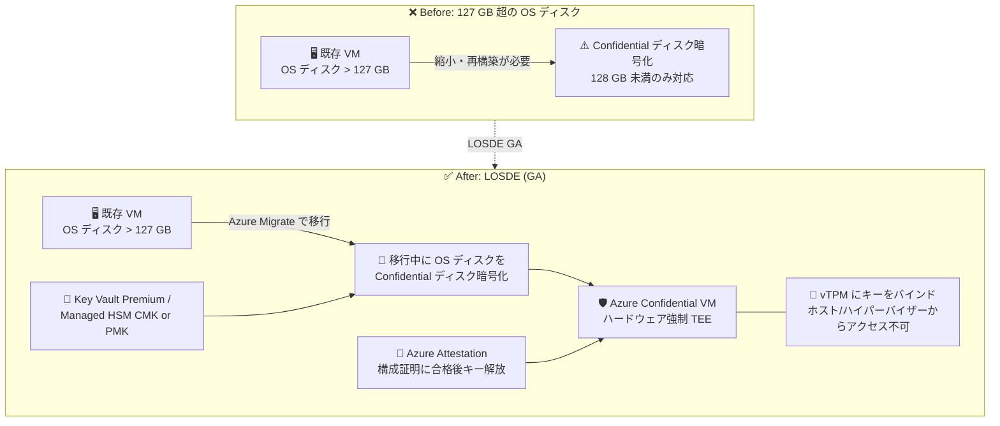

# Azure Confidential VM: Large OS Disk Encryption (LOSDE) for Confidential VM Migrations

**リリース日**: 2026-10-29

**サービス**: Azure Confidential VM (Azure Confidential Computing)

**機能**: Large OS Disk Encryption (LOSDE) for Azure Confidential VM migrations

**ステータス**: Launched (GA)

[このアップデートのインフォグラフィックを見る](https://takech9203.github.io/azure-news-summary/20261029-confidential-vm-large-os-disk-encryption.html)

## 概要

Azure Confidential VM への移行シナリオ向けの Large OS Disk Encryption (LOSDE) が一般提供 (GA) になりました。これにより、127 GB を超える OS ディスクを持つ VM でも、Confidential ディスク暗号化を適用したまま Azure Confidential VM へ移行できるようになります。

従来、Confidential ディスク暗号化は 128 GB 未満のディスクのみをサポートしており、大きな OS ディスクを持つ本番規模のワークロードを機密コンピューティング環境に移行する際の大きな障壁となっていました。LOSDE では移行プロセスの一部として OS ディスクが Confidential ディスク暗号化で保護されるため、大きなシステムイメージの縮小・再構築・再暗号化が不要になり、コード変更なしでハードウェア強制のトラステッド実行環境 (TEE) にワークロードを移行できます。

暗号化キーは VM の仮想 TPM (vTPM) にバインドされ、ディスク内容はその VM からのみアクセス可能で、ホストやハイパーバイザーからはアクセスできません。キーはプラットフォームが構成証明 (Attestation) に合格した後にのみ解放されます。キー管理はプラットフォーム マネージド キー (PMK) と、Azure Key Vault Premium または Managed HSM を利用した顧客管理キー (CMK) の両方に対応します。

**アップデート前の課題**

- Confidential ディスク暗号化は 128 GB 未満のディスクのみサポートしており、127 GB を超える OS ディスクを持つワークロードは機密性の保証を維持したまま Confidential VM へ移行できなかった
- 大きな OS ディスクを持つ業務クリティカルなアプリケーションを移行するには、ディスクの縮小やイメージの再構築・再暗号化といった追加作業が必要で、規制の厳しい環境での Confidential Computing 採用の障壁となっていた

**アップデート後の改善**

- 移行ワークフローにおいて 127 GB を超える OS ディスクへの Confidential ディスク暗号化が可能になり、本番規模のワークロードをそのまま Confidential VM へ移行できるようになった
- 暗号化は移行処理の一部として実行されるため、ディスクの縮小・再構築・再暗号化が不要で、コード変更なしで TEE 上に移行できる
- Azure Migrate との自動化された統合により、Windows / Ubuntu / RHEL / Rocky Linux のワークロードを CMK 対応のまま移行できる

## アーキテクチャ図

従来は 128 GB 未満のディスクに限定されていた Confidential ディスク暗号化が、LOSDE により移行シナリオで 127 GB 超の OS ディスクにも適用可能になりました。暗号化キーは vTPM にバインドされ、構成証明の合格後にのみ解放されます。

## サービスアップデートの詳細

### 主要機能

1. **127 GB 超の OS ディスクに対する Confidential ディスク暗号化**
   - 移行ワークフローにおいて、従来の制限 (128 GB 未満) を超える大容量 OS ディスクを暗号化したまま Confidential VM へ移行可能

2. **移行プロセスに統合された暗号化**
   - 暗号化は移行処理の一部として実行されるため、大きなシステムイメージの縮小・再構築・再暗号化が不要
   - アプリケーションのコード変更なしでハードウェア強制の TEE に移行できる

3. **vTPM へのキーバインドと構成証明ベースのキー解放**
   - ディスク暗号化キーは VM の vTPM にバインドされ、ディスク内容はその VM のみがアクセス可能 (ホスト・ハイパーバイザーからはアクセス不可)
   - キーはプラットフォームが構成証明 (Attestation) に合格した後にのみ解放される

4. **柔軟なキー管理 (PMK / CMK)**
   - プラットフォーム マネージド キー (PMK)、または Azure Key Vault Premium / Managed HSM を利用した顧客管理キー (CMK) を選択可能

5. **Azure Migrate による自動化**
   - Azure Migrate との統合により、既存 VM の Confidential VM へのアップグレードを移行プロセスを通じて実現
   - Windows、Ubuntu、Red Hat Enterprise Linux、Rocky Linux の移行シナリオをサポート (サポート対象の詳細は Azure Migrate のドキュメントを参照)

## 技術仕様

| 項目 | 詳細 |
|------|------|
| 対象シナリオ | Azure Confidential VM への移行 (migration) |
| 対象ディスク | 127 GB を超える OS ディスク (従来は 128 GB 未満のみ対応) |
| 暗号化方式 | Confidential ディスク暗号化 (全クリティカル パーティションを保護) |
| キーのバインド | VM の仮想 TPM (vTPM、TPM 2.0 準拠) にバインド |
| キー解放条件 | プラットフォームの構成証明 (Azure Attestation) 合格後のみ |
| キー管理 | PMK、または Azure Key Vault Premium / Managed HSM による CMK |
| 対応 OS (移行) | Windows、Ubuntu、RHEL、Rocky Linux |
| 移行ツール | Azure Migrate (自動化対応) |
| コード変更 | 不要 (ハードウェア強制 TEE へそのまま移行) |

## 設定方法

### 前提条件

1. 移行先が Azure Confidential VM 対応の VM サイズであること (例: DCasv5/DCasv6/DCesv6、ECasv5/ECasv6/ECesv6 シリーズなど)
2. 移行対象の OS が Confidential VM / Azure Migrate のサポート対象であること (Windows、Ubuntu、RHEL、Rocky Linux。詳細は Azure Migrate のドキュメントを参照)
3. CMK を使用する場合、Azure Key Vault Premium または Managed HSM が必要

具体的な移行手順は [Azure Migrate のドキュメント](https://learn.microsoft.com/azure/migrate/) を参照してください。

## メリット

### ビジネス面

- 規制の厳しい業界 (金融・医療・公共など) の本番規模ワークロードを、ディスクサイズの制約に妨げられずに Confidential Computing へ移行できる
- ディスク縮小やイメージ再構築などの移行前作業が不要になり、移行プロジェクトの工数・リスクを削減できる
- CMK によるキー管理を維持したまま移行でき、コンプライアンス要件に対応しやすい

### 技術面

- 暗号化が移行処理に組み込まれているため、再暗号化の追加ステップが不要
- ディスク暗号化キーが vTPM にバインドされ、ホストやハイパーバイザーからディスク内容にアクセスできないハードウェアレベルの保護を得られる
- 構成証明に合格した場合のみキーが解放されるため、プラットフォームの健全性が検証された環境でのみワークロードが起動する

## デメリット・制約事項

- 本 GA の対象は移行 (migration) シナリオ。Confidential VM 一般の制限事項 (Azure Site Recovery 非対応、Accelerated Networking 非対応、ライブ マイグレーション非対応、キーの自動ローテーション非対応など) は引き続き適用される
- Confidential OS ディスク暗号化の設定はデプロイ後に変更できない
- Confidential VM は特定リージョンの専用ハードウェア上でのみ実行可能
- Confidential OS ディスク暗号化を有効にすると、VM の初期作成 (移行) 時間が長くなる場合がある

## ユースケース

### ユースケース 1: 大容量 OS ディスクを持つオンプレミス基幹システムの Confidential VM への移行

**シナリオ**: 金融機関が、127 GB を超える OS ディスクを持つ既存の基幹系 Windows Server / RHEL ワークロードを、データ処理中の機密性 (data in use の保護) を確保するため Azure Confidential VM へ移行したい。

**実装アプローチ**:

1. Azure Migrate で移行対象 VM を評価し、移行先として Confidential VM 対応サイズを選択
2. 移行プロセスの中で OS ディスクに Confidential ディスク暗号化を適用 (LOSDE)
3. キー管理要件に応じて PMK、または Key Vault Premium / Managed HSM の CMK を選択

**効果**: ディスクの縮小・再構築なしで、コード変更も不要なまま、ハードウェア強制の TEE 上で基幹ワークロードを稼働できる。キーは vTPM にバインドされ、構成証明合格後にのみ解放されるため、ホスト管理者からもデータが保護される。

## 料金

LOSDE 自体の追加料金に関する公式情報は、本アップデートでは確認できませんでした。関連する料金として以下が公式ドキュメントに記載されています。

- Confidential VM の料金は VM サイズに依存 ([料金計算ツール](https://azure.microsoft.com/pricing/calculator/) を参照)
- Confidential VM は OS ディスクに加えて小容量の暗号化された VMGS (VM Guest State) ディスクを使用し、月額ストレージコストが発生する場合がある
- 2026 年 3 月 30 日以降、暗号化された OS ディスクはコストが高くなる (詳細は [Managed Disks の料金ページ](https://azure.microsoft.com/pricing/details/managed-disks/) を参照)

## 利用可能リージョン

Confidential VM は特定リージョンの専用ハードウェア上で実行されます。利用可能なリージョンは [リージョン別提供状況ページ](https://azure.microsoft.com/global-infrastructure/services/?products=virtual-machines) を参照してください。

## 関連サービス・機能

- **Azure Migrate**: LOSDE の自動化に対応した移行ツール。既存 VM の Confidential VM へのアップグレードを移行プロセスで実現
- **Azure Key Vault Premium / Managed HSM**: CMK を使用する場合のキー保管先
- **Azure Attestation**: プラットフォームの健全性を検証する構成証明サービス。合格後にのみディスク暗号化キーが解放される
- **仮想 TPM (vTPM)**: TPM 2.0 準拠の仮想 TPM。ディスク暗号化キーのバインド先として機能

## 参考リンク

- [インフォグラフィック](https://takech9203.github.io/azure-news-summary/20261029-confidential-vm-large-os-disk-encryption.html)
- [公式アップデート情報](https://azure.microsoft.com/updates?id=578850)
- [GA 発表ブログ (Microsoft Tech Community)](https://techcommunity.microsoft.com/blog/microsoft-security-blog/large-os-disk-encryption-is-now-generally-available-for-azure-confidential-vm-mi/4564613)
- [Azure Confidential VM の概要 (Microsoft Learn)](https://learn.microsoft.com/azure/confidential-computing/confidential-vm-overview)
- [Azure Migrate ドキュメント (Microsoft Learn)](https://learn.microsoft.com/azure/migrate/)
- [Managed Disks 料金ページ](https://azure.microsoft.com/pricing/details/managed-disks/)

## まとめ

Large OS Disk Encryption (LOSDE) の GA により、これまで Confidential Computing 採用の障壁となっていた「OS ディスク 128 GB 未満」という制限が移行シナリオで解消されました。127 GB を超える OS ディスクを持つ本番規模のワークロードを、ディスク縮小や再構築なし・コード変更なしで Azure Confidential VM へ移行できます。暗号化キーは vTPM にバインドされ構成証明合格後にのみ解放されるため、ホストやハイパーバイザーからもデータが保護されます。大容量 OS ディスクを理由に Confidential VM への移行を見送っていた組織は、Azure Migrate のサポート対象 OS (Windows / Ubuntu / RHEL / Rocky Linux) を確認のうえ、移行計画の再評価をお勧めします。

---

**タグ**: Azure Confidential Computing, Confidential VM, Large OS Disk Encryption, LOSDE, Azure Migrate, ディスク暗号化, CMK, vTPM, Attestation, GA
