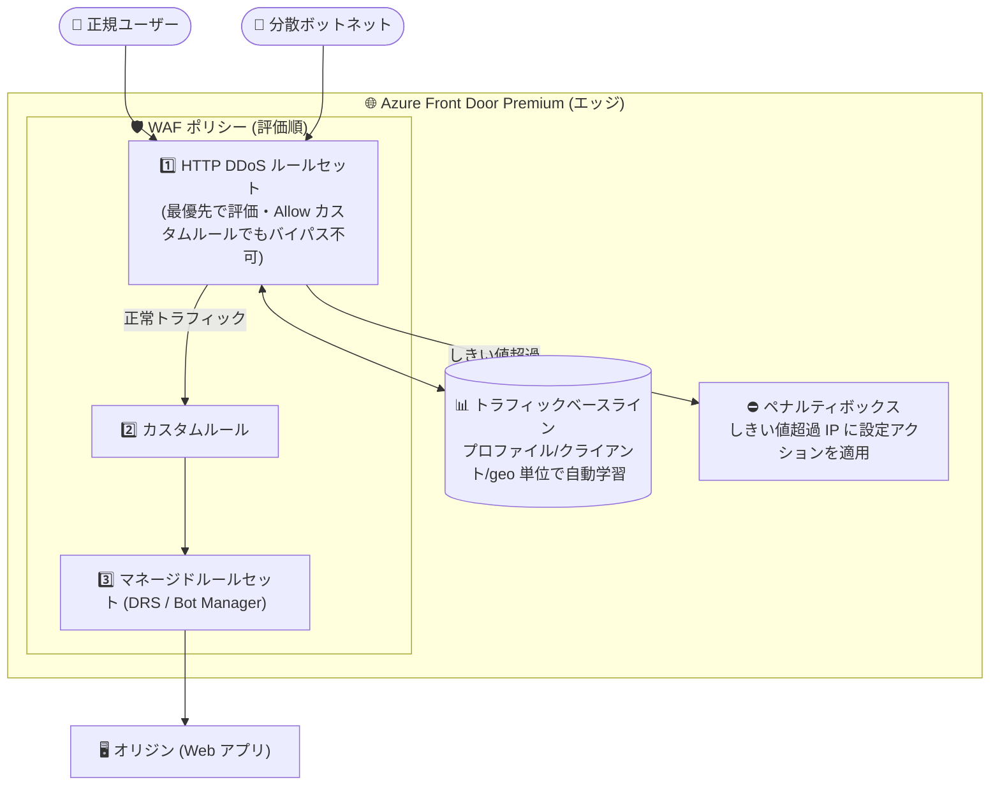

# Azure Front Door: Premium WAF 向け HTTP DDoS ルールセットの一般提供開始

**リリース日**: 2026-10-29

**サービス**: Azure Front Door / Azure Web Application Firewall (WAF)

**機能**: HTTP DDoS ルールセット (Microsoft_HTTPDDoSRuleSet_1.0)

**ステータス**: Launched (GA)

[このアップデートのインフォグラフィックを見る](https://takech9203.github.io/azure-news-summary/20261029-front-door-waf-http-ddos-ruleset.html)

## 概要

Azure Front Door Premium の Azure Web Application Firewall (WAF) における HTTP DDoS ルールセットの一般提供 (GA) が発表されました。HTTP レイヤー (レイヤー 7) の DDoS 攻撃はアプリケーションのダウンタイムを引き起こす主要な原因であり続けていますが、IP フィルタや固定レート制限といった静的なコントロールでは、分散型ボットネットによる攻撃に追従できないケースが多くありました。

HTTP DDoS ルールセットは、最小限の設定で「学習・検知・防御」を行う自動適応型のレイヤー 7 保護です。WAF ポリシーに割り当てると、Azure Front Door プロファイルごとに通常トラフィックのベースラインを継続的に学習し、攻撃を示すトラフィック急増を検知した際には、緊急のチューニング作業なしで問題のあるクライアントのみを選択的に緩和します。

GA 時点では、クライアント単位の異常な高リクエストレートを検知するルールと、Microsoft Threat Intelligence が疑わしいボットと分類した送信元を対象とするルールの 2 つが一般提供され、さらに国/地域単位でしきい値を学習する 2 つの geo ルールがプレビューとして追加されています。すべてのルールは既定で Log アクションのため、適用前にマッチ状況をログで確認できます。

**アップデート前の課題**

- IP フィルタや geo フィルタ、固定レート制限などの静的コントロールは、多数の IP アドレスに分散したボットネットからの攻撃に追従できなかった
- レート制限のしきい値は管理者が手動で設計・調整する必要があり、攻撃発生時には緊急のチューニング作業が求められた
- 各 IP が個別のしきい値を下回るように薄く分散された攻撃は、IP 単位のレート制限では検知が困難だった

**アップデート後の改善**

- プロファイル単位・クライアント単位のトラフィックベースラインを自動学習し、しきい値の手動設計が不要になった (各ルールに 3 段階の感度レベルを用意)
- Microsoft Threat Intelligence と連携し、疑わしいボットにはより厳格な既定しきい値を適用できるようになった
- WAF 例外 (exceptions) に対応し、ヘルスプローブや負荷テストなどの信頼済みトラフィックをルールセットから除外できるようになった
- プレビューの geo ルールにより、IP 単位のしきい値をすり抜ける高分散型攻撃を国/地域単位のしきい値で緩和できるようになった

## アーキテクチャ図

HTTP DDoS ルールセットは WAF 内で最初に評価され、学習済みベースラインを超過した送信元をペナルティボックスに入れて選択的に緩和します。正常なトラフィックは従来どおりカスタムルール、マネージドルールセットの順で評価されオリジンへ転送されます。

## サービスアップデートの詳細

### 主要機能

1. **トラフィックベースラインの自動学習**
   - ローリングウィンドウでプロファイル単位・クライアント IP 単位のベースラインを自動計算する
   - 過去 7 日間のうち 50% 以上の期間トラフィックを受信しているプロファイルでは、24〜36 時間以内にベースラインを確立し急増の検知を開始する
   - 1 つの WAF ポリシーを複数の Front Door プロファイルに割り当てた場合、しきい値はプロファイルごとに個別に計算される

2. **2 段階の検知設計**
   - グローバルなプロファイル単位のしきい値と、より狭いクライアント IP 単位 (geo ルールでは国/地域単位) のしきい値を学習する
   - プロファイル全体のしきい値を超過するまで、個別クライアントのしきい値は適用されない。これにより、少数クライアントの一時的なスパイクへの過剰反応を防ぐ

3. **GA ルール 2 種**
   - **ルール 500100** (クライアントの高レートリクエスト異常検知): クライアント IP ごとのリクエストをベースライン化し、しきい値超過時に設定アクションを適用
   - **ルール 500110** (疑わしいボットの高レートリクエスト): Microsoft Threat Intelligence がボットと分類した IP に対し、他の IP より厳格な既定しきい値を適用。高リスクに分類されたボットはプロファイルしきい値の超過時に即時ブロックされる

4. **geo ルール 2 種 (プレビュー)**
   - **ルール 500310**: トラフィック量の多い国/地域ごとに個別のしきい値を学習
   - **ルール 500320**: それ以外のすべての国/地域の合算トラフィックに対して 1 つのしきい値を学習し、高分散型攻撃を緩和
   - 約 7 日間のトラフィックからベースラインを学習し、ピークを基準に定期的に再計算する

5. **3 段階の感度レベルと既定の Log アクション**
   - 各ルールに高・中・低の感度レベル (高いほど低いしきい値) を設定可能。既定かつ推奨は中 (medium)
   - ルールセット割り当て時は全ルールが Log アクション・中感度で有効化されるため、ログを確認してから各ルールのアクションを変更できる

6. **ペナルティボックス**
   - プロファイルしきい値の超過後、ルール 500100/500110 の個別しきい値を超えたクライアント IP はペナルティボックスに入り、期間中はルールに設定したアクションが適用される
   - 期間終了後は通常評価に戻り、再度超過すれば再びペナルティボックスに入る

7. **WAF 例外 (exceptions) によるバイパス**
   - Allow アクションのカスタムルールでは HTTP DDoS ルールセットをバイパスできない (他の WAF 検査はバイパスされる)
   - ヘルスプローブ、合成監視、負荷テスト、パートナー連携などの信頼済みトラフィックは WAF 例外で除外する。例外はルール単位またはルールセット全体にスコープ可能で、リモート IP アドレス・リクエスト URI・リクエストヘッダーでマッチングできる

## 技術仕様

| 項目 | 詳細 |
|------|------|
| ルールセット名 | Microsoft_HTTPDDoSRuleSet_1.0 (WAF ポリシーのマネージドルールとして表示) |
| 対象 SKU | Azure Front Door Premium のみ |
| ルール数 | 4 (GA: 500100, 500110 / プレビュー: 500310, 500320) |
| 評価順序 | WAF 内で最初に評価 (カスタムルールより前) |
| 既定アクション | Log (全ルール) |
| 感度レベル | 3 段階 (既定・推奨は medium) |
| ベースライン確立 | 過去 7 日間の 50% 以上トラフィック受信で 24〜36 時間以内に検知開始 |
| しきい値の学習単位 | プロファイル全体 + クライアント IP 単位 (geo ルールは国/地域単位) |
| 国/地域不明の IP | Unknown country or region (ZZ) としてグループ化しベースライン化 |
| 信頼済みトラフィックの除外 | WAF 例外 (リモート IP / リクエスト URI / リクエストヘッダーでマッチ) |

## 設定方法

### 前提条件

1. Azure Front Door Premium プロファイル
2. プロファイルに関連付けられた WAF ポリシー
3. ベースライン学習のための十分なトラフィック履歴 (過去 7 日間の 50% 以上の期間でトラフィックを受信していること。不足している場合、ベースライン確立まで検知・緩和は行われない)

### 設定の流れ

1. WAF ポリシーのマネージドルールに **Microsoft_HTTPDDoSRuleSet_1.0** を割り当てる
2. 割り当て直後は全ルールが **Log アクション・中感度** で有効化される
3. WAF ログでマッチ状況を確認し、アプリケーションに合わせて各ルールのアクション (Block など) と感度を調整する
4. ヘルスプローブや負荷テストなどの信頼済みトラフィックには WAF 例外を設定する (スコープは可能な限り狭くする)

### 監視

- ルール 500100/500110 のしきい値を IP が最初に超過した際にログエントリが記録され、WAF managed rule Match メトリックが増加する
- **Web Application Firewall Request count** メトリックをルール名でフィルタしてマッチを監視できる (geo ルールは 500310/500320 で記録)
- **Web Application Firewall HTTPDDoSRuleset Is Active** メトリックが `1` になると、学習が完了し防御可能な状態であることを示す

## メリット

### ビジネス面

- HTTP レイヤー DDoS によるアプリケーションダウンタイムのリスクを低減し、可用性を維持できる
- 攻撃発生時の緊急チューニング作業が不要になり、運用負荷とインシデント対応コストを削減できる
- Front Door Premium に WAF が追加費用なしで含まれるため、追加コストなしで利用を開始できる

### 技術面

- しきい値の手動設計が不要で、トラフィックパターンの変化にもベースラインの定期再計算で追従する
- 2 段階設計により、正常なトラフィックスパイクへの誤検知を抑えつつ攻撃時のみ選択的に緩和する
- Microsoft Threat Intelligence のボット分類を活用し、疑わしい送信元により厳格なしきい値を適用できる
- 既定が Log アクションのため、Block 適用前に影響範囲をログで検証できる

## デメリット・制約事項

- Azure Front Door **Premium** 専用であり、Standard や Front Door (classic) では利用できない
- トラフィック履歴が不足しているプロファイル (過去 7 日間の 50% 未満) では、ベースラインが確立されるまで検知・緩和が行われない
- geo ルール (500310/500320) はプレビューであり、プレビューの追加利用条件が適用される
- geo ルールは国/地域単位でアクションを適用するため、Block に設定するとその国/地域の正規ユーザーにも影響する。公式ドキュメントでは Log から開始し、Block より JavaScript チャレンジを優先することが推奨されている
- Allow アクションのカスタムルールではこのルールセットをバイパスできないため、信頼済みトラフィックの除外には WAF 例外の設定が別途必要

## ユースケース

### ユースケース 1: 分散ボットネットによる HTTP フラッドからの EC サイト保護

**シナリオ**: セール期間中の EC サイトが、多数の IP に分散したボットネットから HTTP フラッド攻撃を受ける。固定レート制限では正規のトラフィック急増と攻撃の区別が難しい。

**実装**: Front Door Premium の WAF ポリシーに HTTP DDoS ルールセットを割り当て、ログで検証後にルール 500100/500110 を Block に変更する。正規のピークはベースラインに反映されるため、攻撃による異常な急増のみが緩和される。

**効果**: 緊急チューニングなしで攻撃クライアントのみを選択的に遮断し、セール期間中の可用性を維持できる。

### ユースケース 2: 高分散型攻撃への geo ルール活用 (プレビュー)

**シナリオ**: 各 IP が個別しきい値を下回るよう広範囲の国/地域に薄く分散された攻撃を受けており、IP 単位のルールでは検知できない。

**実装**: プレビューの geo ルール (500310/500320) を Log アクションで有効化してマッチ状況を確認し、必要に応じて JavaScript チャレンジを設定する。地域キャンペーンなどで正規のスパイクが見込まれる場合は、事前に該当ルールの感度を下げる。

**効果**: 国/地域単位のしきい値により、IP 単位では検知できない高分散型攻撃を緩和しつつ、正規ブラウザーのユーザーはチャレンジを通過できる。

## 料金

HTTP DDoS ルールセットは Azure Front Door Premium の WAF 機能として提供されます。料金ページには、Premium には WAF と Private Link が追加費用なしで含まれると記載されており、本ルールセットに対する個別課金の記載はありません。

| 項目 | 料金 (確認できた範囲) |
|------|------|
| Azure Front Door Premium 基本料金 | $330/月 (参考: Standard は $35/月) |
| リクエスト料金 (Premium、最初の 2.5 億リクエスト) | $0.015/1 万リクエスト (Zone 1 北米 / Zone 6 欧州) ほかゾーン別単価 |
| WAF / Private Link | Premium に追加費用なしで含まれる |
| WAF アドオン (CAPTCHA) | $0.4/1,000 CAPTCHA セッション |

このほかエッジからクライアントへのデータ転送料金などが発生します。最新の詳細は [Azure Front Door 料金ページ](https://azure.microsoft.com/pricing/details/frontdoor/) を参照してください。

## 利用可能リージョン

Azure Front Door はグローバルサービスであり、WAF ポリシーは世界中の Microsoft エッジロケーションにレプリケートされます。GA の提供時期は 2026 年 10 月です。

## 関連サービス・機能

- **Azure Web Application Firewall (Front Door)**: 本ルールセットが追加された WAF 本体。カスタムルール、Default Rule Set (DRS)、Bot Manager ルールセットと組み合わせて多層防御を構成する
- **Microsoft Threat Intelligence**: ルール 500110 のボット分類に利用される脅威インテリジェンスフィード
- **WAF 例外 (exceptions)**: 信頼済みトラフィックを本ルールセットから除外する仕組み。Allow カスタムルールでは代替できない
- **JavaScript チャレンジ**: geo ルールのアクションとして推奨される緩和手段。正規ブラウザーを通過させつつスクリプト化されたクライアントを遮断する
- **Azure DDoS Protection**: ネットワークレイヤー (L3/L4) の DDoS 保護。本ルールセット (L7) と組み合わせた多層的な DDoS 対策が推奨されている
- **WAF ポリシーのプロファイル/ルートレベル割り当て**: 2026-10-27 に GA が発表された機能。プロファイルレベルのベースラインポリシーに本ルールセットを含め、ルートレベルで個別制御を重ねる構成が可能 (既存レポート: [Azure Front Door: profile and route level WAF policies](./2026-10-27-front-door-waf-profile-route-policies.md))

## 参考リンク

- [インフォグラフィック](https://takech9203.github.io/azure-news-summary/20261029-front-door-waf-http-ddos-ruleset.html)
- [公式アップデート情報](https://azure.microsoft.com/updates?id=578681)
- [HTTP DDoS ruleset - Microsoft Learn](https://learn.microsoft.com/azure/web-application-firewall/afds/http-ddos-ruleset)
- [Azure Web Application Firewall on Azure Front Door - Microsoft Learn](https://learn.microsoft.com/azure/web-application-firewall/afds/afds-overview)
- [料金ページ](https://azure.microsoft.com/pricing/details/frontdoor/)

## まとめ

Azure Front Door Premium の WAF に、自動適応型のレイヤー 7 DDoS 保護である HTTP DDoS ルールセットが GA しました。トラフィックベースラインの自動学習と 2 段階の検知設計により、静的なレート制限では対応が難しかった分散ボットネット攻撃を、緊急チューニングなしで選択的に緩和できます。Front Door Premium を利用中であれば追加費用なしで有効化できるため、まずは既定の Log アクションでルールセットを割り当ててマッチ状況を検証し、信頼済みトラフィックへの WAF 例外設定を整えたうえで Block への切り替えを検討することを推奨します。高分散型攻撃が懸念される場合は、プレビューの geo ルールの評価も視野に入れると良いでしょう。

---

**タグ**: Azure Front Door, Web Application Firewall, Networking, Security, DDoS, GA
