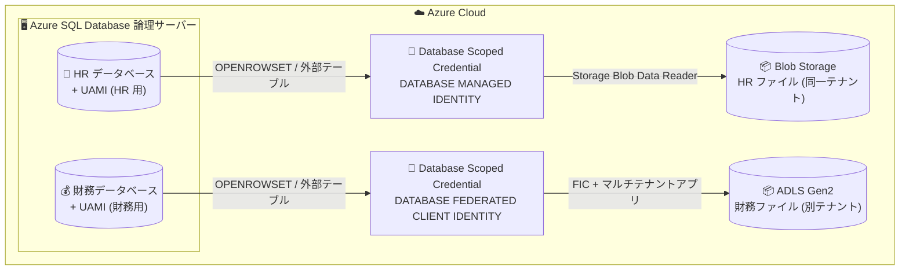

# Azure SQL Database: データベースレベル マネージド ID (FIC 対応) の Database Scoped Credential サポート (Public Preview)

**リリース日**: 2026-10-30

**サービス**: Azure SQL Database

**機能**: Public Preview: Support database-level managed identity (including FIC) in Create Database Scoped Credential T-SQL

**ステータス**: In preview (Public Preview)

[このアップデートのインフォグラフィックを見る](https://takech9203.github.io/azure-news-summary/20261030-sql-database-database-level-managed-identity.html)

## 概要

Azure SQL Database で、データベース単位のユーザー割り当てマネージド ID (UAMI) を `CREATE DATABASE SCOPED CREDENTIAL` T-SQL で利用できる機能が Public Preview になりました。各データベースに個別の UAMI を割り当て、外部テーブル (external table) や `OPENROWSET` を通じて Azure Blob Storage / Azure Data Lake Storage (ADLS) Gen2 上のファイル (Parquet、CSV、Delta) をクエリする際の認証に使用できます。SAS トークンの保存や、サーバーレベルの共有 ID への依存が不要になります。

さらに、Federated Identity Credential (FIC) にも対応しており、データベースとは異なる Microsoft Entra テナントにあるストレージアカウントへも、マルチテナントアプリケーション登録を介したフェデレーション認証でアクセスできます。

データベースごとに個別の ID とストレージ権限を割り当てることで、「人事データベースには人事ファイルのみ、財務データベースには財務ファイルのみ」といった形で、同一論理サーバー上のデータベース間でアクセスを分離できます。シークレット管理の負担を減らしつつ、使い慣れた T-SQL による外部データクエリをそのまま利用できます。

**アップデート前の課題**

- マネージド ID は論理サーバー単位 (`IDENTITY = 'MANAGED IDENTITY'`) でしか使えず、同一論理サーバー上のすべてのデータベースが同じ ID・同じストレージアクセス権を共有していた
- データベースごとにストレージアクセスを分離するには SAS トークンを使う必要があり、シークレットの保存・ローテーションなどの管理負担が発生していた
- サーバーレベルのマネージド ID では、別テナントのストレージアカウントへのアクセスはサポートされておらず、SAS で代替する必要があった

**アップデート後の改善**

- `IDENTITY = 'DATABASE MANAGED IDENTITY'` により、データベース単位の UAMI でストレージに認証でき、各データベースを必要最小限のデータアクセスに限定できる
- `IDENTITY = 'DATABASE FEDERATED CLIENT IDENTITY'` により、FIC を介したクロステナントのストレージアクセスが可能になった
- 資格情報にシークレットが不要で、データベースマスターキーも不要。侵害時の影響範囲 (blast radius) が単一データベースに限定される

## アーキテクチャ図



各データベースが自身に割り当てられた UAMI を Database Scoped Credential 経由で使用し、外部テーブル / OPENROWSET でストレージ上のファイルにアクセスする構成。HR データベースは HR ファイルのみ、財務データベースは財務ファイルのみと、同一論理サーバー上でもアクセスを分離できます。

## サービスアップデートの詳細

### 主要機能

1. **データベースレベルのマネージド ID (`DATABASE MANAGED IDENTITY`)**
   - データベース (論理サーバーではなく) に UAMI を割り当て、そのデータベース自身の ID としてストレージに認証する
   - ストレージアカウントがデータベースと同一の Microsoft Entra テナントにある場合に使用する

2. **フェデレーションクライアント ID (`DATABASE FEDERATED CLIENT IDENTITY`)**
   - ストレージアカウントが別テナントにある場合に、Federated Identity Credential (FIC) を介してアクセスする
   - マルチテナントアプリケーション登録に FIC を追加し、データベースの UAMI を信頼させ、ストレージ側テナントでアプリのサービスプリンシパルに権限を付与する。クロステナントの TDE カスタマーマネージドキー (CMK) と同じパターン

3. **シークレットレス認証**
   - 資格情報にシークレットは不要で、データベースマスターキーも不要。エンジンがクエリ実行時にデータベースに割り当てられた ID を解決する

4. **データ仮想化との統合**
   - `CREATE EXTERNAL TABLE` および `DATA_SOURCE` を指定した `OPENROWSET` で、Blob Storage (`abs://`) / ADLS Gen2 (`adls://`) 上の Parquet、CSV、Delta ファイルをクエリできる

## 技術仕様

| 項目 | 詳細 |
|------|------|
| 対象サービス | Azure SQL Database のみ (SQL Managed Instance、SQL Server、Azure Synapse Analytics は非対応) |
| ID の種類 | ユーザー割り当てマネージド ID (UAMI) のみ。システム割り当て ID は論理サーバーにスコープされるため不可 |
| ID の数 | 1 データベースにつき 1 つの UAMI (論理サーバーは複数割り当て可能だが、データベースレベルは 1 つのみ) |
| 資格情報の構文 | `IDENTITY = 'DATABASE MANAGED IDENTITY'` (同一テナント) / `IDENTITY = 'DATABASE FEDERATED CLIENT IDENTITY'` (クロステナント) |
| 対象機能 | データ仮想化のみ (`CREATE EXTERNAL TABLE`、`OPENROWSET` + `DATA_SOURCE`)。`sp_invoke_external_rest_endpoint` などは対象外 |
| 対象ストレージ | Azure Blob Storage、ADLS Gen2 |
| マスターキー | 不要 (シークレットを持たないため) |
| 作成場所 | ユーザーデータベースのみ (`master` データベースでは非サポート) |
| サーバーレベル資格情報との共存 | 同一論理サーバー・同一データベース内で共存可能 |

### サーバーレベル ID との比較

| 特性 | サーバーレベル マネージド ID | データベースレベル マネージド ID |
|------|------------------------------|----------------------------------|
| ID のスコープ | 論理サーバー | 単一データベース |
| 資格情報の構文 | `IDENTITY = 'MANAGED IDENTITY'` | `IDENTITY = 'DATABASE MANAGED IDENTITY'` |
| クロステナントアクセス | 非サポート (SAS で代替) | FIC + `DATABASE FEDERATED CLIENT IDENTITY` でサポート |
| ストレージ RBAC の粒度 | サーバー上の全データベースで 1 つの ID | データベースごとに 1 つの ID |
| 公開範囲 | サーバー上の全データベースがアクセスを共有 | 当該データベースのみに限定 |
| ID の種類 | システム割り当て / ユーザー割り当て | ユーザー割り当てのみ |

## 設定方法

### 前提条件

1. 論理サーバー上の Azure SQL Database (すべてのサービスレベル・すべてのリージョンで利用可能)
2. 同一サブスクリプション内のユーザー割り当てマネージド ID
3. 対象ストレージアカウントでロールを割り当てる権限 (Owner または User Access Administrator など)
4. クエリ対象のファイルを保持する Azure Blob Storage または ADLS Gen2 アカウント

**注意**: データベースレベルのカスタマーマネージドキー (CMK) を使用している場合、そのデータベースには既にデータベースレベル ID (クロステナントキーの場合は Federated Client ID も) が設定されています。本機能は同じ設定を使用するため、新しい ID を割り当てるのではなく、既存の ID にストレージアクセスを付与してください。異なる ID を割り当てると、暗号化キーへのアクセスが失われる可能性があります。

### Azure CLI + T-SQL (同一テナント)

```bash
# 1. ユーザー割り当てマネージド ID を作成
az identity create \
    --name <identity-name> \
    --resource-group <resource-group> \
    --location <region>

# 2. ID をデータベースに割り当てる (論理サーバーではなくデータベースに対して)
az sql db update \
    --resource-group <resource-group> \
    --server <server-name> \
    --name <database-name> \
    --assign-identity \
    --user-assigned-identity-id <identity-resource-id>

# 3. ストレージアカウントで ID に Storage Blob Data Reader ロールを付与 (Portal / CLI)
```

```sql
-- 4. ユーザーデータベースに接続して資格情報を作成 (シークレット・マスターキー不要)
CREATE DATABASE SCOPED CREDENTIAL MyDBIdentityCred
WITH IDENTITY = 'DATABASE MANAGED IDENTITY';

-- 5. 外部データソースを作成 (Blob Storage は abs://、ADLS Gen2 は adls://)
CREATE EXTERNAL DATA SOURCE MyExternalStorage
WITH (
    LOCATION = 'abs://<container>@<storage-account>.blob.core.windows.net',
    CREDENTIAL = MyDBIdentityCred
);

-- 6. OPENROWSET でアドホックにクエリ
SELECT TOP 100 *
FROM OPENROWSET(
    BULK 'sales/2026/*.parquet',
    DATA_SOURCE = 'MyExternalStorage',
    FORMAT = 'parquet'
) AS externalData;
```

### クロステナント (FIC) の場合

1. データベース側テナントでマルチテナントアプリケーションを登録し、Application (client) ID を控える
2. アプリ登録に Federated Credential を追加し、データベースの UAMI を信頼させる (Subject は UAMI の Object (principal) ID、Audience は `api://AzureADTokenExchange`)
3. ストレージ側テナントで管理者がアプリに同意し、作成されたサービスプリンシパルに Storage Blob Data Reader を付与
4. データベースに UAMI を割り当て、Federated Client ID を設定

```bash
az sql db update \
    --resource-group <resource-group> \
    --server <server-name> \
    --name <database-name> \
    --assign-identity \
    --user-assigned-identity-id <identity-resource-id> \
    --federated-client-id <application-client-id>
```

```sql
CREATE DATABASE SCOPED CREDENTIAL MyCrossTenantCred
WITH IDENTITY = 'DATABASE FEDERATED CLIENT IDENTITY';
```

### Azure Portal

1. SQL データベースの **Security** > **Identity** を開く
2. **User-Assigned Managed Identity** で **Add** を選択し、作成した ID を追加して **Save**
3. クロステナントの場合は **Federated client identity** でアプリケーションを選択して **Save**

## メリット

### ビジネス面

- 同一論理サーバー上のデータベース間でデータアクセスを分離でき、部門別・テナント別のデータガバナンス要件 (最小権限の原則) を満たしやすくなる
- SAS トークンの発行・保存・ローテーションといったシークレット管理の運用負担とリスクを削減できる
- ID が侵害された場合の影響範囲が単一データベースに限定される

### 技術面

- 資格情報にシークレットもデータベースマスターキーも不要で、構成がシンプル
- 既存の T-SQL (external table / OPENROWSET) をそのまま使用でき、アプリケーション変更が最小限
- サーバーレベルではできなかったクロステナントのストレージアクセスに FIC で対応
- サーバーレベル資格情報と同一データベース内で共存できるため、段階的な移行が可能
- データベースレベル CMK と同じ ID 割り当て機構を使うため、既に利用している場合は設定パターンが共通

## デメリット・制約事項

- Public Preview であり、[Microsoft Azure プレビューの追加利用条件](https://azure.microsoft.com/support/legal/preview-supplemental-terms/) が適用される
- Azure SQL Database のみ対応。SQL Managed Instance、SQL Server、Azure Synapse Analytics では使用不可
- ユーザー割り当てマネージド ID のみ対応 (システム割り当て ID は不可)
- 1 データベースにつき 1 つの UAMI しか割り当てられない
- アウトバウンド認証 (データベースからストレージへの認証) 専用。ユーザーやアプリケーションからデータベースへの認証方法は変わらない
- このプレビューの対象はデータ仮想化 (`CREATE EXTERNAL TABLE`、`OPENROWSET` + `DATA_SOURCE`) のみ。`sp_invoke_external_rest_endpoint` などの他のアウトバウンド機能は対象外
- `master` データベースでは資格情報を作成できない
- geo レプリケーション / フェールオーバーグループ利用時は、セカンダリ側のデータベースにも同じ UAMI の割り当てとストレージ権限の付与が事前に必要 (未設定の場合、フェールオーバー後にクエリが失敗する)

## ユースケース

### ユースケース 1: 同一論理サーバー上の部門別データベースのアクセス分離

**シナリオ**: 1 つの論理サーバー上に人事 (HR) データベースと財務データベースをホストしており、それぞれが Blob Storage 上の部門別ファイル (Parquet) を外部テーブルで参照する。従来のサーバーレベル ID では両データベースが同じストレージアクセス権を共有してしまうため、部門間のデータ分離要件を満たせなかった。

**実装例**:

```bash
# HR データベース用の UAMI を作成して割り当て
az identity create --name hr-db-identity --resource-group rg-data --location japaneast
az sql db update --resource-group rg-data --server sql-corp --name hr-db \
    --assign-identity --user-assigned-identity-id <hr-identity-resource-id>
# HR 用ストレージコンテナーにのみ Storage Blob Data Reader を付与
```

```sql
-- hr-db 内で実行
CREATE DATABASE SCOPED CREDENTIAL HRStorageCred
WITH IDENTITY = 'DATABASE MANAGED IDENTITY';
```

**効果**: HR データベースは HR ファイルのみ、財務データベースは財務ファイルのみにアクセス可能となり、SAS トークンなしで最小権限のデータ分離を実現できる。

### ユースケース 2: 別テナントのパートナーデータを FIC 経由でクエリ

**シナリオ**: パートナー企業の Entra テナントにある ADLS Gen2 上のデータを、自社テナントの Azure SQL Database から外部テーブルで参照したい。従来、クロステナントアクセスはマネージド ID では不可能で SAS トークンが必要だった。

**実装例**:

```sql
CREATE DATABASE SCOPED CREDENTIAL MyCrossTenantCred
WITH IDENTITY = 'DATABASE FEDERATED CLIENT IDENTITY';

CREATE EXTERNAL DATA SOURCE PartnerStorage
WITH (
    LOCATION = 'adls://<container>@<storage-account>.dfs.core.windows.net',
    CREDENTIAL = MyCrossTenantCred
);
```

**効果**: マルチテナントアプリ + FIC によるフェデレーション認証で、シークレットレスにクロステナントのデータ共有を実現できる。

## 料金

本機能自体に追加料金に関する記載はありません。Azure SQL Database およびストレージの料金は以下を参照してください。

- [Azure SQL Database の料金](https://azure.microsoft.com/pricing/details/azure-sql-database/)

## 利用可能リージョン

すべての Azure リージョン・すべての Azure SQL Database サービスレベルでプレビューを利用できます。

## 関連サービス・機能

- **Azure Blob Storage / Azure Data Lake Storage Gen2**: 外部テーブル / OPENROWSET のクエリ対象となるストレージ。ID には Storage Blob Data Reader ロール (ADLS Gen2 ではディレクトリ単位の ACL も利用可) を付与する
- **Microsoft Entra ID (マネージド ID / Workload Identity Federation)**: UAMI の作成と、クロステナント時のマルチテナントアプリ登録 + Federated Identity Credential の構成に使用する
- **データベースレベル CMK (TDE)**: 同じデータベースレベル ID / Federated Client ID の割り当て機構を使用する。既に利用中の場合は既存 ID にストレージ権限を付与する
- **データ仮想化 (Data Virtualization)**: 本機能が対象とする、external table / OPENROWSET による Parquet・CSV・Delta ファイルのクエリ機能
- **フェールオーバーグループ / アクティブ geo レプリケーション**: セカンダリ側にも同一の ID 割り当てとストレージ権限が必要

## 参考リンク

- [インフォグラフィック](https://takech9203.github.io/azure-news-summary/20261030-sql-database-database-level-managed-identity.html)
- [公式アップデート情報](https://azure.microsoft.com/updates?id=577491)
- [Use database-level managed identity with Azure SQL Database (Microsoft Learn)](https://learn.microsoft.com/azure/azure-sql/database/database-level-managed-identity)
- [CREATE DATABASE SCOPED CREDENTIAL (T-SQL)](https://learn.microsoft.com/sql/t-sql/statements/create-database-scoped-credential-transact-sql)
- [Data virtualization with Azure SQL Database](https://learn.microsoft.com/azure/azure-sql/database/data-virtualization-overview)
- [Managed identities in Microsoft Entra for Azure SQL](https://learn.microsoft.com/azure/azure-sql/database/authentication-azure-ad-user-assigned-managed-identity)
- [Azure SQL Database の料金](https://azure.microsoft.com/pricing/details/azure-sql-database/)

## まとめ

Azure SQL Database のデータベースレベル マネージド ID が Database Scoped Credential T-SQL でサポートされ (Public Preview)、データベース単位の UAMI で Blob Storage / ADLS Gen2 上の外部データにシークレットレスで認証できるようになりました。従来のサーバーレベル ID では同一論理サーバー上の全データベースがストレージアクセスを共有していましたが、本機能によりデータベースごとの最小権限のアクセス分離と、FIC によるクロステナントアクセスが可能になります。マルチテナント SaaS や部門別データベースで SAS トークンによる外部データアクセスを運用している場合は、プレビューでの検証を推奨します。なお、現時点の対象はデータ仮想化のみで、geo レプリケーション構成ではセカンダリ側への ID 設定が別途必要な点に注意してください。

---

**タグ**: Azure SQL Database, Managed Identity, Database Scoped Credential, Federated Identity Credential, Data Virtualization, OPENROWSET, External Table, Blob Storage, ADLS Gen2, Security, Public Preview
