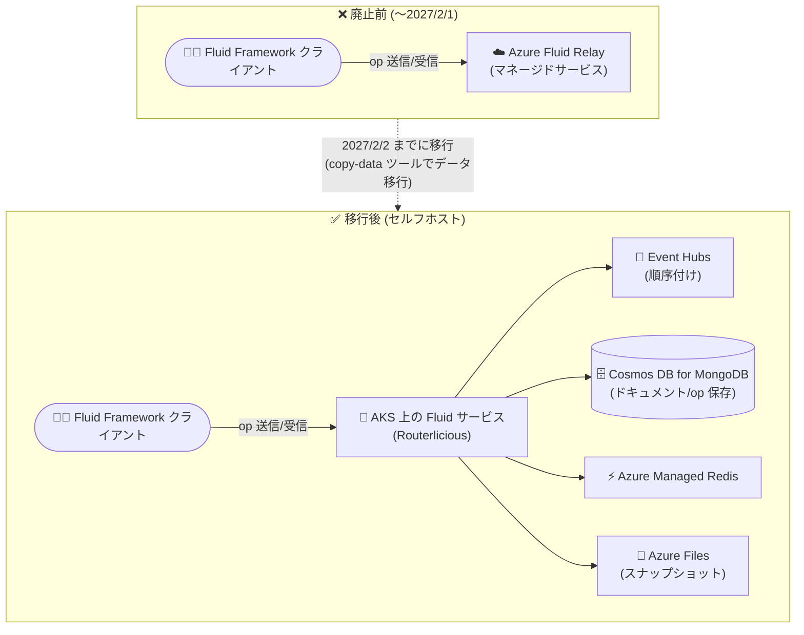

# Azure Fluid Relay: サービス廃止 (2027 年 2 月 2 日)

**リリース日**: 2026-11-02

**サービス**: Azure Fluid Relay

**機能**: サービス廃止 (Retirement)

**ステータス**: Retirement

[このアップデートのインフォグラフィックを見る](https://takech9203.github.io/azure-news-summary/20261102-azure-fluid-relay-retirement.html)

## 概要

Microsoft は、リアルタイム共同編集アプリケーション向けのマネージドサービスである **Azure Fluid Relay** を **2027 年 2 月 2 日に廃止**すると発表しました。この日以降、Azure Fluid Relay は提供終了 (end of availability) となり、サービスに依存し続けるワークロードは中断 (disruption) が発生する可能性があります。移行期間として、**2027 年 2 月 1 日までは Azure Fluid Relay を継続利用**できます。

Azure Fluid Relay は、オープンソースの Fluid Framework クライアントを支えるマネージドのバックエンドサービスで、複数クライアント間の操作 (op) の順序付けとブロードキャスト、データ永続化を担ってきました。サービス廃止後も **Fluid Framework 自体はオープンソースとして引き続き利用可能**であり、後継として **セルフホスト型 Fluid サービスソリューション** (Fluid Framework GitHub リポジトリの `tools/selfhost`) が移行先・代替として提供されています。

セルフホスト型ソリューションへ移行すると、Fluid サービスのホスティングと運用はユーザー自身の責任となります。運用コスト・インフラコストは、デプロイアーキテクチャ、規模、運用要件に依存します。

**アップデート前 (現状)**

- Azure Fluid Relay がマネージドサービスとして、Fluid サービスの順序付け・永続化・スケーリングを提供
- ユーザーはサーバー側の運用を意識せず、クライアント開発に集中できた

**アップデート後 (廃止後)**

- 2027 年 2 月 2 日以降、Azure Fluid Relay は利用不可となり、依存するアプリケーションはサービス中断の可能性
- 代替はセルフホスト型 Fluid サービス (Routerlicious) を自身の Azure サブスクリプションで運用する構成
- ホスティング・運用・コスト管理の責任がユーザー側に移る

## アーキテクチャ図



マネージドな Azure Fluid Relay から、自身の Azure サブスクリプション上で AKS・Event Hubs・Cosmos DB などを使って Fluid サービス (Routerlicious) を運用するセルフホスト構成への移行パスを示しています。

## サービスアップデートの詳細

### 廃止スケジュール

| 日付 | 内容 |
|------|------|
| 2026-11-02 | 廃止の発表 |
| 2027-02-01 | Azure Fluid Relay を利用できる最終日 (この日まで移行期間として継続利用可能) |
| 2027-02-02 | Azure Fluid Relay の廃止 (end of availability)。以降、依存するワークロードは中断の可能性 |

### 影響

- 2027 年 2 月 2 日以降も Azure Fluid Relay を使用し続けるアプリケーションは、サービス中断が発生する可能性がある
- セルフホストソリューションへの移行後は、Fluid サービスのホスティングと運用をユーザー自身の環境で担う必要がある
- 運用・インフラコストは、デプロイアーキテクチャ、規模、運用要件に依存する

### 必要なアクション

1. **影響範囲の特定**: Azure サブスクリプションを確認し、Azure Fluid Relay を使用しているアプリケーションを特定する
2. **移行計画の策定と実施**: 2027 年 2 月 2 日までに、セルフホスト型 Fluid サービスソリューションへの移行を計画・完了する
3. **移行リソースの活用**: Fluid Framework GitHub リポジトリの [セルフホスト型 Fluid サービスソリューション](https://github.com/microsoft/FluidFramework/tree/main/tools/selfhost) を移行・代替のリソースとして利用する

## 移行先: セルフホスト型 Fluid サービスソリューション

Fluid Framework リポジトリの `tools/selfhost` は、Fluid サービス (Routerlicious) を自身の Azure サブスクリプションで運用するためのリファレンスデプロイメント (MIT ライセンス) です。

### 構成されるインフラ (Azure サービス)

| コンポーネント | 役割 |
|------|------|
| Azure Kubernetes Service (AKS) | Fluid サービス本体の実行基盤 |
| Azure Event Hubs | 操作 (op) の順序付け |
| Azure Cosmos DB for MongoDB | ドキュメントデータと操作の保存 |
| Azure Managed Redis | キャッシュ (リージョンで利用不可の場合は Azure Cache for Redis にフォールバック可、移行スクリプトあり) |
| Azure Files | スナップショット保存 |
| その他 | リソースグループ、ネットワーク、Azure Container Registry、Key Vault、Front Door |

### 主なツール

1. **release/**: ソースリビジョンとイメージダイジェストを固定した不変のリリースバンドルを作成
2. **azure/**: JSON パラメータファイル 1 つで設定を管理し、`deploy.sh` で全リソースをデプロイ (フェーズ単位の実行・失敗後の再実行に対応)
3. **deploy-validate/**: 実クライアント 2 つを接続してドキュメント作成・リアルタイム操作交換などを動作検証
4. **tenant-admin/**: テナントの作成・一覧・キーローテーション・削除を行う CLI
5. **token-service/**: Microsoft Entra ID でユーザー認証し短期有効な Fluid トークンを発行する参照実装 (オプション)
6. **copy-data/**: **Azure Fluid Relay から既存ドキュメントを移行**するツール

### デプロイ手順の概要

```bash
# リリースバンドルのビルドとデプロイをまとめて実行
./release/create-and-deploy-release.sh <tag-or-sha> <release-id>
# 例: レビュー済みタグ server_v7.0.1 または完全なコミット SHA を指定
```

1. `azure/deploy.parameters.example.json` をコピーして設定ファイルを作成
2. リリースバンドルをビルドし Azure へデプロイ
3. `deploy-validate` で動作検証
4. (任意) テナント作成、トークン発行設定
5. `copy-data` で Azure Fluid Relay から既存データを移行

**本番利用前の注意**: これはリファレンス実装であり、ID/認可、高可用性、バックアップ・リストア、実負荷でのキャパシティ検証などは、ARCHITECTURE.md を確認の上で各自の判断・設計が必要とされています。

## デメリット・制約事項

- マネージドサービスがなくなるため、AKS クラスターや Event Hubs、Cosmos DB などのインフラ運用 (パッチ適用、スケーリング、監視、障害対応) をユーザー自身が担う必要がある
- セルフホスト構成のインフラリソースは作成時点から課金される
- セルフホストソリューションはリファレンス実装であり、本番運用には高可用性・バックアップなどの追加設計が必要
- 移行期限 (2027 年 2 月 1 日) までに移行を完了しない場合、サービス中断のリスクがある

## 料金

Azure Fluid Relay の廃止自体に料金は発生しませんが、セルフホスト構成の運用・インフラコストは、デプロイアーキテクチャ、規模、運用要件に依存します。AKS、Event Hubs、Cosmos DB、Redis、Azure Files などの各サービスの料金が発生します。

- [Azure 料金計算ツール](https://azure.microsoft.com/pricing/calculator/)

## 関連サービス・機能

- **Fluid Framework (オープンソース)**: 分散リアルタイム共同編集 Web アプリケーションを構築するクライアントライブラリ群。サービス廃止後も引き続き利用可能
- **Azure Kubernetes Service (AKS)**: セルフホスト型 Fluid サービス (Routerlicious) の実行基盤
- **Azure Event Hubs / Azure Cosmos DB for MongoDB / Azure Managed Redis / Azure Files**: セルフホスト構成で順序付け・永続化・キャッシュ・スナップショット保存を担うサービス群

## 参考リンク

- [インフォグラフィック](https://takech9203.github.io/azure-news-summary/20261102-azure-fluid-relay-retirement.html)
- [公式アップデート情報](https://azure.microsoft.com/updates?id=570498)
- [Microsoft Learn: Azure Fluid Relay ドキュメント](https://learn.microsoft.com/azure/azure-fluid-relay/)
- [セルフホスト型 Fluid サービスソリューション (GitHub)](https://github.com/microsoft/FluidFramework/tree/main/tools/selfhost)
- [Fluid Framework 公式サイト](https://fluidframework.com/)

## まとめ

Azure Fluid Relay は 2027 年 2 月 2 日に廃止されます。Fluid Framework を使ったリアルタイム共同編集アプリケーションを運用している場合、まず Azure サブスクリプション内で Azure Fluid Relay への依存を棚卸しし、GitHub で提供されているセルフホスト型 Fluid サービスソリューションへの移行計画を早期に策定することを推奨します。移行後は AKS ベースのインフラ運用責任がユーザー側に移るため、移行期間 (約 15 か月) を活用して、運用体制・コスト見積もり・高可用性設計を含めた検証を進めてください。既存ドキュメントの移行には同リポジトリの `copy-data` ツールが利用できます。

---

**タグ**: Azure Fluid Relay, Retirement, Fluid Framework, Web, 移行, セルフホスト
