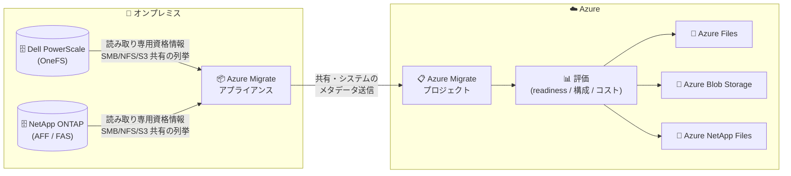

# Azure Migrate: オンプレミス NAS 共有のディスカバリと評価 (Public Preview)

**リリース日**: 2026-11-02

**サービス**: Azure Migrate

**機能**: オンプレミス NAS 共有のディスカバリと評価 (On-prem NAS share discovery and assessment)

**ステータス**: In preview

[このアップデートのインフォグラフィックを見る](https://takech9203.github.io/azure-news-summary/20261102-azure-migrate-nas-discovery.html)

## 概要

Azure Migrate が、ネットワーク接続ストレージ (NAS) のディスカバリ (検出) と評価 (アセスメント) をパブリックプレビューとしてサポートした。これにより、Dell PowerScale (OneFS) および NetApp ONTAP ストレージの Azure への移行計画を Azure Migrate 上で立案できるようになる。

Azure Migrate アプライアンスが読み取り専用の資格情報を使用して NAS クラスターに直接接続し、SMB / NFS / S3 のすべての共有をインベントリ化する。各共有は Azure Files、Azure Blob Storage、Azure NetApp Files を移行先候補として評価され、移行準備状況 (readiness)、適切にサイジングされた Azure ターゲット構成、月額コスト見積もりが提示される。さらに、オンプレミスコストと Azure ストレージサービスを比較するビジネスケースの生成や、ウェーブプランによる移行順序の計画にも対応する。

NAS はオンプレミス資産の中で最も規模が大きく、かつ把握が難しい領域であることが多い。NAS のディスカバリと評価が Azure Migrate に統合されたことで、ストレージをサーバー・アプリケーションと同じプロジェクト、同じビジネスケースの中で計画できるようになった。

**アップデート前の課題**

- Azure Migrate は NAS 共有のディスカバリ・評価に対応しておらず、NAS の移行計画はスプレッドシートを使った手作業に依存していた
- 大規模またはマルチプロトコルのストレージ資産では、共有単位の正確なインベントリやコスト根拠の把握が困難だった
- ストレージの移行計画が、依存するサーバー・アプリケーションの計画と分断されていた

**アップデート後の改善**

- アプライアンスが NAS クラスターに接続し、SMB / NFS / S3 共有を自動的にインベントリ化。検証済みの共有単位インベントリと説明可能なコスト根拠が得られる
- 各共有を Azure Files / Azure Blob Storage / Azure NetApp Files に対して評価し、準備状況・推奨構成・月額コスト見積もりを提示
- NAS 共有を既存のサーバー・アプリケーション・データベースのインベントリと並べてグループ化・タグ付け・フィルタリングでき、同一プロジェクト内で一元的に移行計画を立てられる

## アーキテクチャ図

Azure Migrate アプライアンスが読み取り専用資格情報で NAS クラスターから共有メタデータを収集し、Azure Migrate プロジェクト上で Azure Files / Blob Storage / Azure NetApp Files を移行先候補とした評価を行う。

## サービスアップデートの詳細

### 主要機能

1. **NAS クラスターと共有のディスカバリ**
   - Dell PowerScale / Isilon (OneFS)、NetApp ONTAP / FAS クラスターと、それらがホストする SMB / NFS / S3 共有を検出
   - 複数プロトコル (例: SMB + S3、NFS + S3) で公開されている共有はマルチプロトコル共有として識別される
   - 検出された NAS クラスターと共有は、アプライアンスが従来から検出する Windows / Linux ファイルサーバーと並んでプロジェクトのインベントリに表示される

2. **既存インベントリとの統合管理**
   - NAS 共有を既存のサーバー・アプリケーション・データベースのインベントリと並べてグループ化・タグ付け・フィルタリングが可能

3. **共有単位の評価**
   - 各共有について、移行準備状況 (readiness)、適切にサイジングされた Azure ターゲット構成、月額コスト見積もりを提示
   - 評価対象の移行先は Azure Files、Azure Blob Storage、Azure NetApp Files

4. **ビジネスケースとウェーブプラン**
   - Azure ストレージサービスとオンプレミスコストを比較するビジネスケースを生成
   - ウェーブプランを使用して移行の実施順序を計画

## 技術仕様

| 項目 | 詳細 |
|------|------|
| 対応 NAS プラットフォーム | Dell Technologies: PowerScale (OneFS)、Dell EMC Isilon (OneFS) (レガシー) / NetApp: ONTAP AFF、FAS (レガシー) |
| 検出対象プロトコル | SMB、NFS、S3、マルチプロトコル共有 |
| 評価対象の移行先 | Azure Files、Azure Blob Storage、Azure NetApp Files |
| 接続方式 | Azure Migrate アプライアンスが NAS クラスターの管理エンドポイント (既定ポート 443) に接続 |
| 必要な資格情報 | クラスターレベルの読み取り専用権限以上を持つ NAS クラスターアカウント (NAS システムへの書き込みは行わない) |
| 収集する情報 | 共有とシステムのメタデータのみ (ファイル内容のクロール、ACL の分析、個人情報のスキャンは行わない) |
| 非対応 | SAN / LUN のディスカバリ、iSCSI などの非ファイルプロトコル |
| アプライアンス構成 | サーバー検出と同じアプライアンスで構成可能。vCenter Server や NSX Manager のソースと NAS ソースを 1 台のアプライアンスに混在可能 |

## 設定方法

### 前提条件

1. Azure Migrate プロジェクトと Azure Migrate アプライアンスがセットアップ済みであること (アプライアンスは最新版に更新する)
2. クラスターレベルの読み取り専用権限以上を持つ NAS クラスターアカウントを用意すること (共有・ボリューム単位ではなくクラスターレベルで権限を付与する。クォータを含むすべての共有メタデータを列挙するために必要)
3. アプライアンスから NAS クラスターの管理エンドポイント (既定: ポート 443) に到達できること

### アプライアンス構成マネージャーでの設定手順

**NAS 資格情報の追加:**

1. アプライアンス構成マネージャーで「Manage credentials and discovery sources」に移動
2. 「Provide infrastructure credentials」で「Add credentials」を選択
3. 「Source type」で「NAS Server」を選択
4. フレンドリ名 (クラスター名など)、クラスターレベルの読み取り専用権限以上を持つアカウントのユーザー名とパスワードを入力
5. 「Save」を選択。異なるアカウントを使用するクラスターごとに繰り返す (同一アカウントを共有するクラスターは 1 つの資格情報エントリを再利用可能)

**NAS ディスカバリソースの追加:**

1. 「Provide infrastructure server details」で「Add discovery source」を選択
2. 「Discovery source」で「NAS Server」を選択
3. NAS クラスター管理エンドポイントの IP アドレスまたは FQDN を入力
4. ポートを入力 (既定: 443)
5. 「Map credentials」で作成した NAS 資格情報を選択
6. 「Save」を選択。対象のすべての NAS クラスターについて繰り返す

すべての資格情報とディスカバリソースを追加したら、ページ末尾の「Start discovery」を選択してディスカバリを開始する。評価は Azure ポータルから直接実行できる。

## メリット

### ビジネス面

- スプレッドシートによる手作業の NAS 移行計画を、検証済みの共有単位インベントリと説明可能なコスト根拠に置き換えられる
- オンプレミスコストと Azure ストレージサービスを比較するビジネスケースを生成でき、移行の投資判断を支援する
- ストレージを、依存するサーバー・アプリケーションと同じプロジェクト・同じビジネスケースの中で計画できる

### 技術面

- SMB / NFS / S3 のすべての共有を自動でインベントリ化し、マルチプロトコル共有も識別できる
- 共有ごとに Azure Files / Azure Blob Storage / Azure NetApp Files への準備状況、推奨構成、月額コスト見積もりが得られる
- 読み取り専用資格情報で動作し、NAS システムへの書き込みは行わない。メタデータのみを収集し、ファイル内容には触れない
- 既存のサーバー検出用アプライアンスに NAS ソースを追加でき、新たなインフラの追加が不要

## デメリット・制約事項

- パブリックプレビュー段階であり、本番運用前提の利用は想定されていない
- 対応プラットフォームは Dell PowerScale / Isilon (OneFS) と NetApp ONTAP / FAS に限定される
- SAN / LUN のディスカバリは非対応。iSCSI や SAN マッピングなどの非ファイルプロトコルは対象外
- ACL (アクセス制御リスト) の分析や個人情報のスキャンは行わない (メタデータ収集のみ)
- NAS ソースに有効な資格情報を提供しないと、そのソースのインベントリは生成されない (NAS インベントリが空になる最も一般的な原因は資格情報の問題)
- ベンダーごとに権限モデルが異なり、共有の一覧取得とクォータの列挙で必要な権限が異なる場合がある。共有メタデータの一部が欠落する場合は、クラスターレベルの読み取り専用権限を確認する必要がある
- NAS クラスターのパスワードを変更した場合は、アプライアンス側で資格情報を更新し「Revalidate credentials」を実行する必要がある

## ユースケース

### ユースケース 1: 大規模ファイルサーバー資産の Azure 移行計画

**シナリオ**: 数百〜数千の SMB / NFS 共有を Dell PowerScale や NetApp ONTAP でホストしている企業が、データセンター撤退に向けて Azure への移行を計画する。

**実装例**: 既存の Azure Migrate アプライアンスを更新し、NAS クラスターを資格情報とディスカバリソースとして追加。ディスカバリ実行後、Azure ポータルから共有ごとの評価を実行し、Azure Files / Blob Storage / Azure NetApp Files への準備状況とコスト見積もりを取得する。

**効果**: 手作業の棚卸しなしで共有単位の正確なインベントリが得られ、移行先サービスの選定とコスト試算を迅速化できる。

### ユースケース 2: サーバーとストレージを統合したビジネスケース作成

**シナリオ**: サーバー・データベース・アプリケーションの移行計画は Azure Migrate で進めているが、ファイルストレージの計画が別管理になっており、全体のコスト比較ができていない。

**実装例**: 同一の Azure Migrate プロジェクトに NAS ディスカバリソースを追加し、NAS 共有をサーバー・アプリケーションのインベントリと並べてグループ化・タグ付けする。オンプレミスコストと Azure ストレージサービスを比較するビジネスケースを生成し、ウェーブプランで移行順序を決める。

**効果**: ストレージを含む移行対象全体を単一のプロジェクト・ビジネスケースで管理でき、依存関係を踏まえた移行の順序付けが可能になる。

## 料金

Azure Migrate のディスカバリと評価機能は追加料金なしで利用できる (Azure Migrate 本体および Microsoft 提供のツールは無料)。

詳細は [Azure Migrate の料金ページ](https://azure.microsoft.com/pricing/details/azure-migrate/) を参照。

## 関連サービス・機能

- **Azure Files**: NAS 共有の評価における移行先候補の 1 つ。SMB / NFS 対応のフルマネージドファイル共有サービス
- **Azure Blob Storage**: 移行先候補の 1 つ。オブジェクトストレージ (S3 互換ワークロードや大容量データの移行先)
- **Azure NetApp Files**: 移行先候補の 1 つ。NetApp ONTAP ベースの高性能ファイルストレージサービス
- **Azure Migrate アプライアンス**: NAS クラスターへの接続とメタデータ収集を行う軽量アプライアンス。サーバー検出 (vCenter Server、NSX 等) と同一アプライアンスで NAS ディスカバリを構成可能

## 参考リンク

- [インフォグラフィック](https://takech9203.github.io/azure-news-summary/20261102-azure-migrate-nas-discovery.html)
- [公式アップデート情報](https://azure.microsoft.com/updates?id=577975)
- [Microsoft Learn: インフラストラクチャ資格情報の提供 (NAS ファイル共有のディスカバリ)](https://learn.microsoft.com/en-us/azure/migrate/add-server-credentials?view=migrate)
- [Microsoft Learn: Azure Migrate アプライアンス](https://learn.microsoft.com/en-us/azure/migrate/migrate-appliance)
- [料金ページ](https://azure.microsoft.com/pricing/details/azure-migrate/)

## まとめ

Azure Migrate に NAS (Dell PowerScale / NetApp ONTAP) のディスカバリと評価機能がパブリックプレビューとして追加された。オンプレミス資産の中で最も把握が難しいことが多い NAS を、サーバー・アプリケーションと同じプロジェクト・ビジネスケースで計画できるようになる点が大きな価値である。ディスカバリと評価は無料で利用できるため、対象の NAS プラットフォームを運用している組織は、アプライアンスを更新して NAS ディスカバリソースを追加し、共有単位のインベントリとコスト見積もりの取得を試行することを推奨する。評価にあたっては、クラスターレベルの読み取り専用アカウントの準備と、SAN / LUN が対象外である点に留意すること。

---

**タグ**: Azure Migrate, NAS, Dell PowerScale, NetApp ONTAP, Azure Files, Azure Blob Storage, Azure NetApp Files, Migration, In preview
