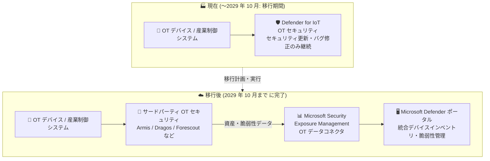

# Microsoft Defender for IoT: OT セキュリティ機能の提供終了 (Retirement) を発表

**リリース日**: 2026-11-02

**サービス**: Microsoft Defender for IoT

**機能**: OT (Operational Technology) セキュリティコンポーネントの提供終了

**ステータス**: Retirement

[このアップデートのインフォグラフィックを見る](https://takech9203.github.io/azure-news-summary/20261102-defender-iot-ot-security-retirement.html)

## 概要

Microsoft は、Microsoft Defender for IoT の OT (Operational Technology) セキュリティコンポーネントを非推奨化 (deprecate) する正式な通知を発表しました。3 年間の移行期間を経て、**2029 年 10 月にサービスが完全に非推奨化 (fully deprecated)** されます。

移行期間中、既存のデプロイメントは引き続きサポートされ、定期的なセキュリティ更新とバグ修正は提供されますが、OT 固有の新機能追加や投資は行われません。既存の顧客契約と更新は 2029 年 10 月まで履行されます。

なお、**Microsoft Defender for Endpoint の Enterprise IoT 機能 (デバイス検出、脆弱性評価を含む) は今回の提供終了の対象外**であり、引き続き利用可能です。

**アップデート前の状況**

- Microsoft Defender for IoT の OT セキュリティコンポーネントが、OT ネットワークの脅威検出・資産可視化の Microsoft ファーストパーティソリューションとして提供されていた

**アップデート後の変化**

- OT セキュリティコンポーネントは 2029 年 10 月に完全非推奨化されるため、顧客は移行期間 (3 年間) 内に代替の OT セキュリティソリューションへの移行が必要
- Microsoft は特定の代替製品を指定しないが、Microsoft Security Exposure Management の OT データコネクタ (Armis、Dragos、Forescout) により、サードパーティ OT プラットフォームの資産・脆弱性データを Defender ポータルに取り込む統合パスを提供

## アーキテクチャ図

Defender for IoT の OT セキュリティから、サードパーティ OT セキュリティソリューションへの移行パスを示しています。Armis、Dragos、Forescout は Exposure Management の OT データコネクタ経由で Defender ポータルに資産・脆弱性データを連携できます。

## サービスアップデートの詳細

### 提供終了の内容

1. **対象**: Microsoft Defender for IoT の OT セキュリティコンポーネント
   - OT ネットワークの脅威検出・監視機能が非推奨化の対象

2. **対象外**: Microsoft Defender for Endpoint の Enterprise IoT 機能
   - デバイス検出、脆弱性評価は引き続き利用可能

### タイムライン

| 時期 | 内容 |
|------|------|
| 2026 年 11 月 (通知発表) | 移行期間の開始。デプロイメントの利用を直ちに停止する必要はない |
| 移行期間中 (〜2029 年 10 月) | 定期的なセキュリティ更新とバグ修正は継続。OT 固有の新機能追加・投資は行われない |
| 〜2029 年 10 月 | 既存の顧客契約と更新は履行される |
| 2029 年 10 月 | 完全非推奨化。この日までに移行を完了する必要がある |

### 移行先の選択肢

Microsoft は特定の代替製品を義務付けていませんが、以下の 3 つのサードパーティプロバイダー向けに OT データコネクタを提供しています。

| プロバイダー | 統合方法 |
|------|------|
| **Armis** | Microsoft Security Exposure Management の OT データコネクタ |
| **Dragos** | 同上 |
| **Forescout** | 同上 |

これらの OT データコネクタにより、サードパーティ OT プラットフォームから以下のデータを Defender ポータルに取り込めます。

- OT デバイス・資産情報 (ホスト名、IP/MAC アドレス、シリアル番号などの識別子)
- デバイスタイプ、ベンダー、モデル、ファームウェア、OS の詳細
- ロケーション、ゾーン、サイト、センサー、ネットワーク関連情報
- 資産のクリティカリティ (重要度)
- OT デバイスに関連する脆弱性の検出結果

これにより、IT / IoT / OT デバイスを単一のインベントリで可視化し、CVE 検索や影響範囲の調査を Defender ポータル上で横断的に行えます。

なお、**サードパーティソリューションには別途ライセンス契約とデプロイメントが必要**です。また、コネクタが提供されている 3 社以外の OT セキュリティプロバイダーを選択することも可能です。

## Solutions Architect が取るべきアクション

1. **環境の評価**: OT デプロイメント、センサー、インテグレーション、ライセンス、契約、セキュリティ要件の棚卸しを行う
2. **移行先の検討**: 要件に合う OT セキュリティソリューションを選定する (コネクタ対応の 3 社に限定されない)
3. **Microsoft 統合の理解**: サポートされるサードパーティコネクタが Exposure Management / Defender ポータルに OT データをどのように取り込むかを把握する
4. **移行計画の策定**: 調達、テスト、運用検証、事業継続、データエクスポート、センサーの廃止 (デコミッション) を 2029 年 10 月までに完了する計画を立てる
5. **早期の着手**: OT プロバイダーに直接コンタクトするか、Microsoft アカウントチームに紹介を依頼する

## デメリット・制約事項

- 移行期間中、Defender for IoT の OT セキュリティには新機能が追加されない (セキュリティ更新・バグ修正のみ)
- サードパーティソリューションへの移行には、別途のライセンス費用とデプロイメント作業が発生する
- センサーの再デプロイ、データエクスポート、運用プロセスの再構築など、移行には相応のプロジェクト工数が必要

## 関連サービス・機能

- **Microsoft Security Exposure Management**: サードパーティ OT プラットフォーム (Armis / Dragos / Forescout) の資産・脆弱性データを取り込む OT データコネクタを提供
- **Microsoft Defender for Endpoint (Enterprise IoT)**: Enterprise IoT デバイスの検出・脆弱性評価は本提供終了の対象外で、引き続き利用可能
- **Microsoft Defender ポータル**: OT データコネクタ経由で取り込んだ OT デバイスを IT / IoT デバイスと統合インベントリで管理

## 参考リンク

- [インフォグラフィック](https://takech9203.github.io/azure-news-summary/20261102-defender-iot-ot-security-retirement.html)
- [公式アップデート情報](https://azure.microsoft.com/updates?id=576255)
- [OT データコネクタ (Microsoft Security Exposure Management)](https://learn.microsoft.com/security-exposure-management/ot-data-connectors)
- [Microsoft Defender for IoT ドキュメント](https://learn.microsoft.com/azure/defender-for-iot/)
- [Enterprise IoT セキュリティ (Defender for Endpoint)](https://learn.microsoft.com/azure/defender-for-iot/organizations/concept-enterprise)

## まとめ

Microsoft Defender for IoT の OT セキュリティコンポーネントが 2029 年 10 月に完全非推奨化されることが正式に発表されました。3 年間という比較的長い移行期間が設けられており、期間中はセキュリティ更新とバグ修正が継続されますが、新機能の追加はありません。OT セキュリティを Defender for IoT で運用している組織は、早期に環境の棚卸しと移行先の選定に着手すべきです。Microsoft は Armis、Dragos、Forescout との統合コネクタを Exposure Management で提供しており、移行後も Defender ポータルでの IT / OT 横断の可視化を維持できます。Enterprise IoT 機能 (Defender for Endpoint) は対象外である点にも留意してください。

---

**タグ**: #DefenderForIoT #OTSecurity #Retirement #ExposureManagement #Security
