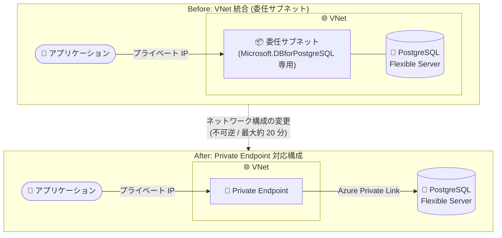

# Azure Database for PostgreSQL flexible server: VNet 統合から Private Endpoint 対応ネットワーク構成への変更が一般提供 (GA)

**リリース日**: 2026-11-02

**サービス**: Azure Database for PostgreSQL flexible server

**機能**: VNet 統合 (委任サブネット) から Private Endpoint 対応ネットワーク構成への変更

**ステータス**: Launched (GA)

[このアップデートのインフォグラフィックを見る](https://takech9203.github.io/azure-news-summary/20261102-postgresql-vnet-to-private-endpoint.html)

## 概要

Azure Database for PostgreSQL flexible server において、既存の VNet 統合 (virtual network injection による委任サブネット配置) サーバーを、Private Endpoint 対応のネットワーク構成へ変更する機能が一般提供 (GA) となりました。変更後は Azure Private Link を通じたプライベート IP アドレス経由のセキュアなアクセスが可能になります。

従来、flexible server はサーバー作成時に「プライベートアクセス (VNet 統合)」または「パブリックアクセス + Private Endpoint」のいずれかのネットワークオプションを選択する必要があり、VNet 統合でデプロイしたサーバーを別の VNet やサブネットへ移動したり、Private Link 構成へ切り替えたりすることはできませんでした。今回の GA により、既存の VNet 統合サーバーをサーバー再作成なしで Private Endpoint 対応構成へ移行できるようになり、ネットワーク設計の柔軟性が大きく向上します。

移行では既存のバックアップ (geo 冗長バックアップを含む) が保持されます。ただし、一時的な接続中断が発生するため計画的な実施が必要であり、移行後は Private Endpoint の追加またはファイアウォール規則の構成を行うまでサーバーにはアクセスできません。

**アップデート前の課題**

- ネットワーク構成はサーバー作成時にのみ選択可能で、VNet 統合でデプロイしたサーバーを後から別の VNet / サブネットへ移動することや、Private Endpoint 構成へ変更することができなかった
- VNet 統合 (VNet 注入) されたリソースは既定で Private Link と連携できず、Private Link を利用したい場合はサーバーの作り直しとデータ移行が必要だった
- 委任サブネットは `Microsoft.DBforPostgreSQL/flexibleServers` 専用となり他のリソースを配置できないため、IP アドレス空間やサブネット設計上の制約があった

**アップデート後の改善**

- 既存の VNet 統合サーバーを、Portal または Azure CLI の操作で Private Endpoint 対応構成へ変更可能になった
- Azure Private Link を通じ、プライベート IP アドレス経由のセキュアなアクセスを既存サーバーで利用できるようになった
- 移行前に取得したバックアップ (geo 冗長バックアップを含む) は移行後もそのまま利用可能

## アーキテクチャ図



委任サブネットに注入されていたサーバーが、変更後は Private Endpoint (Azure Private Link) 経由でアクセス可能な構成になります。変更は不可逆で、完了後に Private Endpoint またはファイアウォール規則の設定が必要です。

## サービスアップデートの詳細

### 主要機能

1. **既存 VNet 統合サーバーのネットワーク構成変更**
   - 委任サブネットに配置された既存サーバーを、Private Endpoint をサポートするネットワーク構成 (パブリックアクセス + Private Endpoint 方式) へ変更できる
   - Azure Portal の「Networking」設定、または Azure CLI の `az postgres flexible-server migrate-network` コマンドで実行

2. **バックアップの保持**
   - 変更前に取得されたすべてのバックアップ (geo 冗長バックアップを含む) は、変更後も引き続き利用可能

3. **変更後のアクセス制御**
   - 変更後、パブリックアクセスは既定で無効。必要に応じてパブリックアクセスの有効化とファイアウォール規則の追加が可能
   - Private Endpoint を追加することで、Private Link 経由のプライベート接続を構成

## 技術仕様

| 項目 | 詳細 |
|------|------|
| 対象 | VNet 統合 (委任サブネット) でデプロイされた既存の flexible server |
| 変更先の構成 | パブリックアクセス (許可 IP アドレス) + Private Endpoint 対応構成 |
| 所要時間 | 通常最大 20 分程度 (この間サーバーは **Updating** 状態) |
| 接続中断 | 通常最大 10 分程度アクセス不可。既存接続は切断され、新規接続は拒否される |
| 可逆性 | **不可逆**。変更後に VNet 統合 (委任サブネット) へ戻すことはできない |
| バックアップ | 変更前のバックアップ (geo 冗長含む) は変更後も利用可能 |
| 変更直後のパブリックアクセス | 既定で無効 |
| 変更後の接続 | Private Endpoint の追加、またはパブリックアクセス有効化 + ファイアウォール規則の構成が必要 |

## 設定方法

### 前提条件

1. VNet 統合 (プライベートアクセス) でデプロイされた Azure Database for PostgreSQL flexible server が存在すること
2. 接続中断 (最大 10 分程度) を許容できるメンテナンスウィンドウを確保すること
3. 変更後の接続手段 (Private Endpoint またはファイアウォール規則) の構成計画があること

### Azure CLI

```bash
# ネットワーク構成を Private Endpoint 対応構成へ変更
az postgres flexible-server migrate-network \
  --resource-group <resource_group> \
  --name <server>

# サーバーの状態を確認 (Updating → Ready になるまで待機)
az postgres flexible-server show \
  --resource-group <resource_group> \
  --name <server> \
  --query "state"
```

### Azure Portal

1. 対象の Azure Database for PostgreSQL flexible server を選択
2. リソースメニューの「設定」セクションで「ネットワーク」を選択
3. 「ネットワーク接続」の「接続方法」で「パブリックアクセス (許可された IP アドレス) およびプライベートエンドポイント」を選択
4. 「保存」を選択
5. 確認ダイアログで影響 (不可逆であること、変更中はアクセス不可となること、変更後は Private Endpoint またはファイアウォール規則の構成までアクセス不可であること) を確認し、「保存」で変更を開始
6. サーバーの状態が「Updating」から「Ready」に変わるまで Portal で監視

### 変更後の作業

- [Private Endpoint 接続の追加](https://learn.microsoft.com/azure/postgresql/network/how-to-networking-servers-deployed-public-access-add-private-endpoint)、またはパブリックアクセスの有効化とファイアウォール規則の追加のいずれかを実施するまで、サーバーにはアクセスできない
- Terraform で管理している場合は、`azurerm_postgresql_flexible_server` リソースから `delegated_subnet_id` を削除し、`public_network_access_enabled` を実際の設定に合わせて明示する (省略すると既定値 `true` が適用される)。`terraform plan` でサーバーの再作成が計画されていないことを確認してから適用する

## メリット

### ビジネス面

- サーバーの再作成やデータ移行を行わずにネットワーク構成を近代化でき、移行プロジェクトのコストとリスクを削減
- 既存バックアップが保持されるため、バックアップ保持要件やコンプライアンス要件を維持したまま構成変更が可能

### 技術面

- Azure Private Link によるプライベート IP 経由のセキュアなアクセスを既存サーバーで利用可能
- 委任サブネット専有の制約から解放され、ネットワーク設計 (IP アドレス空間、サブネット構成) の柔軟性が向上
- Private Endpoint 方式では必要に応じてパブリックアクセス (許可 IP アドレス) との併用も選択可能

## デメリット・制約事項

- **操作は不可逆**: 変更後に VNet 統合 (委任サブネット) 構成へ戻すことはできない
- **接続中断**: 変更中は通常最大 10 分程度サーバーにアクセスできず、既存接続は切断、新規接続は拒否される。変更全体には最大 20 分程度かかる
- **変更直後はアクセス不可**: Private Endpoint の追加またはパブリックアクセス + ファイアウォール規則の構成を行うまで接続できない
- **論理レプリケーションへの影響**: サーバーが論理レプリケーションのパブリッシャーの場合、委任サブネット経由のプライベート経路が失われるためサブスクライバーの接続が切れる可能性がある。変更後、各サブスクライバーが Private Endpoint に到達できること (同一 VNet、VNet ピアリング、VPN / ExpressRoute 経由など) を確認する必要がある
- **IaC への影響**: Terraform などの構成を更新しないと、サーバーの再作成が計画される恐れがある

## ユースケース

### ユースケース 1: 既存の VNet 統合サーバーを Private Link ベースの構成へ移行

**シナリオ**: VNet 統合で運用中の flexible server を、サーバーを作り直すことなく Private Endpoint 経由のアクセス構成へ切り替え、委任サブネットの制約を解消したい。

**実装例**:

```bash
# 1. メンテナンスウィンドウ内でネットワーク構成を変更
az postgres flexible-server migrate-network \
  --resource-group my-rg \
  --name my-pgserver

# 2. 状態が Ready になったことを確認
az postgres flexible-server show \
  --resource-group my-rg \
  --name my-pgserver \
  --query "state"

# 3. Private Endpoint を追加して接続を復旧 (Portal またはドキュメントの手順に従う)
```

**効果**: サーバー再作成・データ移行なしで Private Link 経由のプライベート接続へ移行でき、既存バックアップも保持される。

## 料金

このネットワーク構成変更の操作自体に関する料金情報はアップデート発表には記載されていません。Private Endpoint (Azure Private Link) の利用には別途料金が発生します。詳細は以下の料金ページを参照してください。

- [Azure Database for PostgreSQL の料金](https://azure.microsoft.com/pricing/details/postgresql/flexible-server/)
- [Azure Private Link の料金](https://azure.microsoft.com/pricing/details/private-link/)

## 関連サービス・機能

- **Azure Private Link / Private Endpoint**: 変更後の構成で利用するプライベート接続の基盤。プライベート IP アドレス経由でサーバーへセキュアにアクセスする
- **Azure Virtual Network (VNet)**: 変更前の VNet 統合 (委任サブネットへの VNet 注入) と、変更後の Private Endpoint 配置先の両方で利用するネットワーク基盤
- **Azure Private DNS**: VNet 統合構成で必須だった名前解決の仕組み。Private Endpoint 構成でもプライベート名前解決に利用される
- **VPN Gateway / ExpressRoute**: オンプレミスや他ネットワークから Private Endpoint へ到達するための接続手段。論理レプリケーションのサブスクライバー接続の復旧にも関係する

## 参考リンク

- [インフォグラフィック](https://takech9203.github.io/azure-news-summary/20261102-postgresql-vnet-to-private-endpoint.html)
- [公式アップデート情報](https://azure.microsoft.com/updates?id=574541)
- [Microsoft Learn: ネットワーク構成の変更手順 (VNet 統合 → Private Endpoint 対応構成)](https://learn.microsoft.com/azure/postgresql/network/how-to-migrate-vnet-private-endpoint-capable-server?tabs=portal-migrate)
- [Microsoft Learn: プライベートアクセス (VNet 統合) の概念](https://learn.microsoft.com/azure/postgresql/network/concepts-networking-private)
- [料金ページ (Azure Database for PostgreSQL)](https://azure.microsoft.com/pricing/details/postgresql/flexible-server/)

## まとめ

Azure Database for PostgreSQL flexible server で、これまで作成後に変更できなかったネットワーク構成を、VNet 統合から Private Endpoint 対応構成へ変更できる機能が GA となりました。サーバーの再作成やデータ移行なしで Private Link ベースのネットワーク設計へ移行でき、既存バックアップも保持されます。一方で、操作は不可逆であり、最大 10 分程度の接続中断と、変更後の Private Endpoint またはファイアウォール規則の構成が必要です。VNet 統合サーバーを運用中で委任サブネットの制約に課題を感じている場合は、論理レプリケーションや IaC (Terraform) への影響を確認したうえで、メンテナンスウィンドウでの計画的な移行を検討することを推奨します。

---

**タグ**: Azure Database for PostgreSQL, Private Link, Private Endpoint, Virtual Network, Networking, Databases, GA
