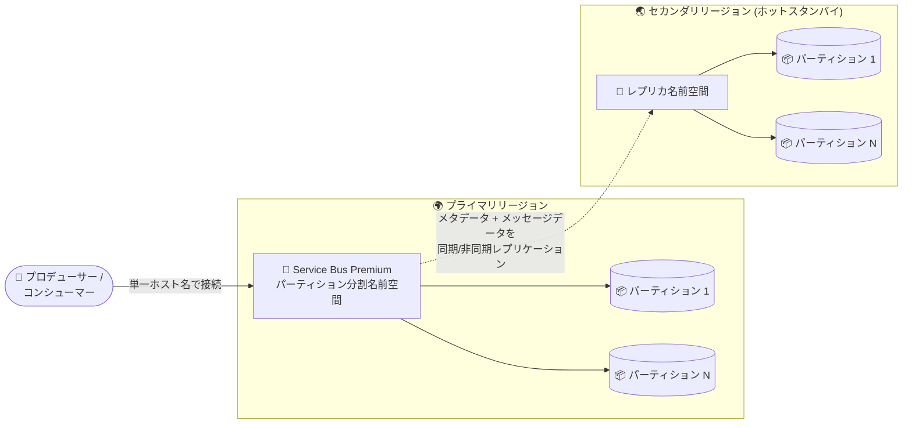

# Azure Service Bus: パーティション分割名前空間での Geo-Replication が一般提供開始 (GA)

**リリース日**: 2026-11-02

**サービス**: Azure Service Bus (Premium)

**機能**: パーティション分割名前空間での Geo-Replication

**ステータス**: Launched (GA)

[このアップデートのインフォグラフィックを見る](https://takech9203.github.io/azure-news-summary/20261102-service-bus-geo-replication-partitioned.html)

## 概要

Azure Service Bus Premium のパーティション分割名前空間 (partitioned namespaces) における Geo-Replication が一般提供 (GA) となりました。パーティショニングによるスループットのメリットと、メッセージおよびメタデータをセカンダリリージョンへレプリケートする信頼性を組み合わせて利用できるようになります。

パーティション分割名前空間は、キューやトピックをリージョン内の複数のメッセージブローカーとメッセージングストアに分散配置することで、単一ブローカーの性能限界を超えたスループットのスケールを可能にする機能です。一方、Geo-Replication は名前空間のメタデータ (エンティティ、構成、プロパティ) とデータ (メッセージ本体、メッセージの状態・プロパティ変更) をプライマリリージョンからセカンダリリージョンへ継続的にレプリケートし、任意のタイミングでセカンダリをプライマリに昇格 (promotion) できる機能です。

今回の GA により、既存のパーティション分割された Premium 名前空間で Geo-Replication を有効化することも、新規名前空間の作成時に両方の機能を同時に構成することも可能になりました。

**アップデート前の課題**

- Geo-Replication とパーティショニングは組み合わせて利用できず、高スループット (パーティショニング) とリージョン間のデータレプリケーション (Geo-Replication) のどちらかを選択する必要があった
- 大規模なメッセージングワークロードでスループットをスケールさせつつ、メッセージデータを含むリージョン間冗長性を確保する手段が限られていた (従来の Geo-Disaster Recovery はメタデータのみのレプリケーション)

**アップデート後の改善**

- パーティション分割名前空間でメタデータとメッセージデータの両方をセカンダリリージョンへレプリケートできるようになり、スループットと耐障害性を両立できる
- 既存のパーティション分割 Premium 名前空間に対して Geo-Replication を後から有効化できる
- 新規名前空間の作成時にパーティショニングと Geo-Replication の両方を同時に構成できる

## アーキテクチャ図



クライアントは単一の名前空間ホスト名で常にプライマリリージョンに接続し、パーティション分割されたメッセージデータとメタデータがセカンダリリージョンへ継続的にレプリケートされます。昇格 (promotion) 時にはホスト名の向き先が新しいプライマリへ自動的に切り替わるため、クライアント側の変更は不要です。

## サービスアップデートの詳細

### 主要機能

1. **パーティショニングと Geo-Replication の併用**
   - パーティション分割名前空間でキュー・トピック・サブスクリプション・フィルター、エンティティ内のデータ、メッセージの状態・プロパティ変更、名前空間構成をセカンダリリージョンへレプリケートできる
   - 既存のパーティション分割 Premium 名前空間での有効化と、新規名前空間での同時構成の両方に対応

2. **同期 / 非同期のレプリケーションモード**
   - 同期レプリケーション: プライマリとセカンダリの両方へのコミット完了後にクライアントへ ACK を返す。RPO 0 (昇格時のデータ損失なし) だがレイテンシーが増加し、可用性は両リージョンに依存
   - 非同期レプリケーション: プライマリへのコミット後に ACK を返し、セカンダリへは非同期に複製。最大レプリケーションラグを設定でき、ラグが上限に達するとパブリッシャーがスロットリングされる。強制昇格時はラグ分のデータ損失の可能性がある
   - モードは構成後に相互に切り替え可能

3. **顧客主導の昇格 (promotion)**
   - 昇格は常に顧客が開始する (Azure が自動で実行することはない)
   - 計画的昇格 (planned): レプリケーションラグの解消を待ってから昇格。待機中、名前空間は読み取り専用になる
   - 強制昇格 (forced): 即座に昇格を実行。未レプリケートのデータが失われる、または重複メッセージが発生する可能性がある

4. **単一ホスト名とクライアント透過性**
   - 名前空間のホスト名は常にプライマリリージョンを指すため、データプレーン SDK やクライアントアプリケーションの変更は不要
   - 昇格後、クライアントは自動的に新しいプライマリリージョンへ再接続する

5. **レプリケーションラグの監視**
   - Azure Monitor のメトリック `ReplicationLagDuration` (秒単位の時間ベースのラグ) と `ReplicationLagCount` (未処理のレプリケーションログ操作数) をエンティティ単位 (`EntityName` ディメンション) で監視でき、アラートや昇格の自動化に利用可能

## 技術仕様

| 項目 | 詳細 |
|------|------|
| 対象ティア | Service Bus Premium のみ (パーティション分割名前空間を含む) |
| レプリケーション対象 | キュー、トピック、サブスクリプション、フィルター、メッセージデータ、メッセージの状態・プロパティ変更、名前空間構成 |
| セカンダリリージョン数 | 現時点で 1 リージョンのみサポート |
| レプリケーションモード | 同期 / 非同期 (非同期では最大レプリケーションラグを設定、相互に切り替え可能) |
| トップレベルエンティティ | キューとトピックは設定モードに関わらず常に同期レプリケーション (トピックサブスクリプションは選択したモードに従う) |
| 昇格 | 顧客主導のみ。計画的昇格 (ラグ解消を待機) / 強制昇格 (即時実行) |
| ホスト名 | 単一の名前空間ホスト名が常にプライマリを指す。SDK / クライアントの変更不要 |
| パーティション数 | 名前空間の作成時に設定し、後から変更不可。MU はパーティション数の倍数で、各パーティションに均等配分 (例: 16 MU / 4 パーティション → 各 4 MU) |
| セカンダリの状態 | InBuild (初期同期・再同期中、クォーラム外) / Ready (アクティブに複製中) / Deleting (削除中) |
| プライベートエンドポイント | 昇格後もクライアントは自動的に新プライマリへ接続。昇格は通常 2 分以内に完了 |

## 設定方法

### 前提条件

1. Service Bus Premium ティアの名前空間であること
2. パーティショニングは名前空間の作成時にのみ有効化できる (既存名前空間でのパーティション設定の変更は不可)
3. Geo-Disaster Recovery (Geo-DR) との併用は不可 (Geo-DR から移行する場合は先にペアリングを解除する)

### Azure CLI

```bash
# パーティション分割された Premium 名前空間を作成 (4 パーティション)
az servicebus namespace create \
    --resource-group myresourcegroup \
    --name mynamespace \
    --location westus \
    --sku Premium \
    --premium-messaging-partitions 4

# 昇格 (フェールオーバー) の実行
az servicebus namespace failover \
    --namespace-name <your-namespace-name> \
    --resource-group <your-resource-group> \
    --primary-location <new-primary-location>
```

### Bicep (Geo-Replication の構成)

```bicep
resource serviceBusNamespace 'Microsoft.ServiceBus/namespaces@2025-05-01-preview' = {
  name: serviceBusName
  location: primaryLocation
  sku: {
    name: 'Premium'
    tier: 'Premium'
    capacity: 1
  }
  properties: {
    geoDataReplication: {
      maxReplicationLagDurationInSeconds: maxReplicationLagInSeconds
      locations: [
        { locationName: primaryLocation, roleType: 'Primary' }
        { locationName: secondaryLocation, roleType: 'Secondary' }
      ]
    }
  }
}
```

### Azure Portal

1. Premium ティアの名前空間を新規作成する (パーティショニングを併用する場合は **Partitioning** を **Enabled** にしてパーティション数を選択)
2. **Enable Geo-replication** チェックボックスをオンにする
3. **Add secondary region** でセカンダリリージョンを選択する
4. **Synchronous replication** をオンにするか、**Async Replication - Max Replication lag** (分) を指定する
5. 作成後は **Geo-Replication** ブレードからレプリケーションモードの切り替え、セカンダリの削除、昇格 (Promote) を管理できる

## メリット

### ビジネス面

- リージョン障害時にセカンダリリージョンへ昇格することで、事業継続性を確保しダウンタイムを最小化できる
- メッセージデータまで含めたレプリケーションにより、同期モードでは RPO 0 を実現でき、コンプライアンス要件の厳しいワークロードにも対応しやすい
- リージョン移行 (新リージョンへのワークロード移設) や計画メンテナンス時の高可用性維持にも活用できる

### 技術面

- パーティショニングによるスループットのスケールと、リージョン間レプリケーションによる耐障害性を同一名前空間で両立できる
- 単一ホスト名で動作するため、クライアントアプリケーションや SDK の変更が不要
- レプリケーションラグメトリクス (`ReplicationLagDuration` / `ReplicationLagCount`) による監視と、昇格の自動化が可能
- セカンダリはプライマリと同一構成のホットスタンバイとして動作し、昇格後すぐにワークロードを継続できる

## デメリット・制約事項

- Premium ティア専用の機能であり、Standard / Basic ティアでは利用できない
- 現時点でセカンダリリージョンは 1 つのみサポート
- Geo-Disaster Recovery (Geo-DR) 機能との併用は不可
- 大きなメッセージ (large messages) は未サポート
- パーティション分割名前空間では JMS が未サポート。SessionId / PartitionKey が異なるメッセージのバッチ送信も不可
- パーティション数は名前空間作成時にのみ設定でき、後から変更できない
- 同期レプリケーションではレイテンシーが増加し、可用性が両リージョンに依存する。非同期レプリケーションでは強制昇格時にデータ損失・メッセージ重複の可能性がある
- 強制昇格後の旧プライマリには未レプリケートのデータや状態の不整合が残る可能性があるため、旧プライマリを削除して再作成することが推奨されている
- フェールオーバー時、auto-delete on idle が有効なエンティティのタイマーはリセットされる
- Event Grid 統合と併用する場合、Event Grid は geo-paired リージョンにレプリケートされるため、Service Bus の昇格と連動しない。初期プライマリリージョンを構成から削除すると Event Grid 統合が壊れる

## ユースケース

### ユースケース 1: 高スループットな基幹メッセージングの DR 構成

**シナリオ**: 単一ブローカーの性能限界を超えるスループットが必要な基幹システムのメッセージング基盤で、リージョン障害に備えてメッセージデータを含む DR を構成したい。

**実装例**:

```bash
# 4 パーティションの Premium 名前空間を作成し、
# ポータルまたは Bicep で Geo-Replication (セカンダリリージョン) を構成
az servicebus namespace create \
    --resource-group rg-messaging \
    --name sb-core-messaging \
    --location japaneast \
    --sku Premium \
    --premium-messaging-partitions 4
```

**効果**: パーティショニングでスループットをスケールしながら、リージョン障害時には顧客主導の昇格で業務を継続できる。同期モードを選択すれば昇格時のデータ損失をゼロ (RPO 0) にできる。

### ユースケース 2: パーティション分割名前空間のリージョン移行

**シナリオ**: 既存のパーティション分割 Premium 名前空間を、より近い新リージョンへダウンタイムを最小化して移行したい。

**実装例**: 既存名前空間に移行先リージョンをセカンダリとして追加し、同期完了後に計画的昇格 (planned promotion) を実行。昇格完了後、旧リージョン (現セカンダリ) を構成から削除する。

**効果**: 計画的昇格は仕掛かり中のメッセージをレプリケートしてから完了するため、データを失わずにリージョン移行できる。

## 料金

Service Bus Premium はメッセージングユニット (MU) 単位の課金です。Geo-Replication を有効にすると、各レプリカはプライマリと同じ MU 数で動作し、全レプリカの合計 MU に対して課金されます。加えて、セカンダリレプリカへレプリケートされたデータ量に基づく課金が発生します (データ転送レートはレプリケーション時点のプライマリリージョンのゾーンで決まります)。

総コストの計算式 (公式ドキュメントより):

```
(レプリカ数 × プライマリの MU 数 × 時間 × MU あたりの時間単価) + (レプリケートされた GB 数 × GB あたりのデータ転送レート)
```

例: プライマリに 2 MU を構成し 10 GB をレプリケートする場合 → (2 レプリカ × 2 MU × 時間 × 時間単価) + (10 GB × データ転送レート)

最新の料金 (データ転送レートを含む) は [Service Bus 料金ページ](https://azure.microsoft.com/pricing/details/service-bus/) を参照してください。

## 利用可能リージョン

パーティション分割名前空間は、Qatar Central と Austria East を除くすべてのリージョンで利用可能です (Microsoft Learn ドキュメントより)。Geo-Replication の対応リージョンの詳細は [公式ドキュメント](https://learn.microsoft.com/azure/service-bus-messaging/service-bus-geo-replication) を参照してください。

## 関連サービス・機能

- **Service Bus Geo-Disaster Recovery (Geo-DR)**: メタデータのみをレプリケートする既存の DR 機能。Geo-Replication とは併用不可で、多くの DR シナリオでは Geo-Replication が推奨される。Geo-DR からの移行はペアリング解除後に Geo-Replication を構成する
- **Azure Monitor**: `ReplicationLagDuration` / `ReplicationLagCount` メトリクスによるレプリケーションラグの監視、メトリックアラートによる RPO 監視・昇格の自動化に利用
- **Log Analytics**: Metrics ログを有効化して KQL でレプリケーションラグの履歴分析が可能
- **Azure Private Link**: プライベートエンドポイント経由の接続は昇格後も自動的に新プライマリへルーティングされる。各リージョンの VNet にプライベートエンドポイントを配置する構成が推奨
- **Azure Event Grid**: Service Bus 名前空間との統合は可能だが、Event Grid のフェールオーバーは Service Bus の昇格と連動しない点に注意
- **Azure Resource Graph**: セカンダリリージョンが構成された Premium 名前空間をクエリで棚卸し可能

## 参考リンク

- [インフォグラフィック](https://takech9203.github.io/azure-news-summary/20261102-service-bus-geo-replication-partitioned.html)
- [公式アップデート情報](https://azure.microsoft.com/updates?id=579021)
- [Azure Service Bus Geo-Replication (Microsoft Learn)](https://learn.microsoft.com/azure/service-bus-messaging/service-bus-geo-replication)
- [Premium 名前空間でのパーティショニングの有効化 (Microsoft Learn)](https://learn.microsoft.com/azure/service-bus-messaging/enable-partitions-premium)
- [料金ページ](https://azure.microsoft.com/pricing/details/service-bus/)

## まとめ

これまで二者択一だった「パーティショニングによるスループットのスケール」と「Geo-Replication によるメッセージデータを含むリージョン間レプリケーション」を、同一の Service Bus Premium 名前空間で両立できるようになった重要なアップデートです。高スループットかつミッションクリティカルなメッセージングワークロードを運用している場合は、既存のパーティション分割名前空間への Geo-Replication の追加を検討する価値があります。導入時は、同期 / 非同期レプリケーションモードの RPO・レイテンシー特性の違い、レプリカ分の MU とデータ転送に対する追加コスト、Geo-DR との併用不可などの制約を確認し、昇格手順のリハーサルとレプリケーションラグの監視体制をあわせて整備することを推奨します。

---

**タグ**: Service Bus, Integration, Geo-Replication, Partitioning, Premium, GA, Disaster Recovery
