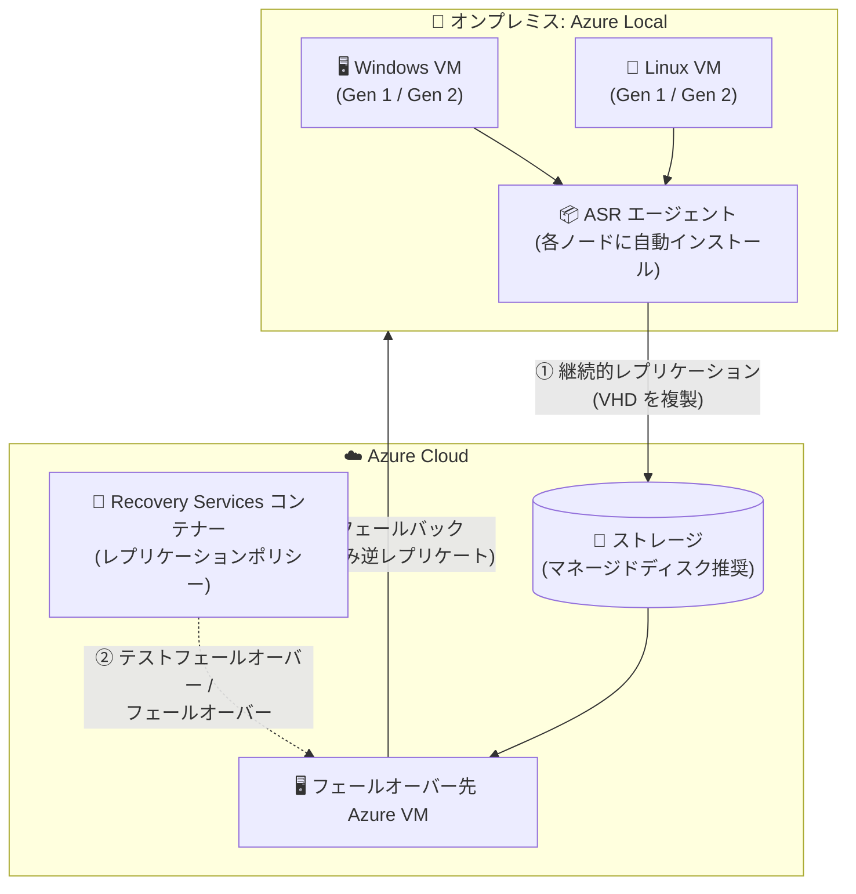

# Azure Site Recovery: Azure Local 向けサポートの一般提供開始 (GA)

**リリース日**: 2026-11-02 (GA 時期: 2026 年 10 月)

**サービス**: Azure Site Recovery / Azure Local

**機能**: Azure Site Recovery for Azure Local

**ステータス**: Launched (GA)

[このアップデートのインフォグラフィックを見る](https://takech9203.github.io/azure-news-summary/20261102-site-recovery-azure-local.html)

## 概要

Azure Site Recovery (ASR) による Azure Local のサポートが一般提供 (GA) となりました。Azure Local 上で稼働するサポート対象の Windows / Linux 仮想マシンを Azure にレプリケーションすることで、オンプレミス環境の災害対策 (DR) をクラウドに拡張できます。エンタープライズグレードの DR が、これまで以上にシンプルかつセキュアに、容易にセットアップできるようになりました。

Azure portal 上の Azure Local リソースから合理化されたセットアップを開始でき、本番のレプリケーションを中断することなくテストフェールオーバーで復旧計画を検証できます。計画的・非計画的な停止時には Azure へフェールオーバーし、オンプレミス環境が復旧したら Azure Local にワークロードを戻す (フェールバック) ことが可能です。本機能は Azure Local がサポートされるすべてのリージョンで利用できます。

**アップデート前の課題**

- Hyper-V 向け ASR の有効化は、Azure portal の複数のブレードにまたがる多段階の設定が必要で、ノードごとに繰り返し作業が発生していた
- WDAC (App Control) を強制モードで運用している環境では、エージェント導入のために一時的に監査モードへ切り替える運用上の回避策が必要だった
- プロキシ設定はメインのセットアップフロー外での手動手順が必要だった

**アップデート後の改善**

- Azure Local リソース内の単一ページのウィザードで DR 環境全体を準備可能に (Recovery Services コンテナー・Hyper-V サイトの作成、全ノードへの ASR エージェント自動インストール、レプリケーションポリシーの関連付け、ホスト登録を一括実行)
- WDAC 強制モードを維持したまま ASR エージェントをインストール可能に
- プロキシのホスト・ポート・資格情報をウィザード内で直接設定でき、クラスター全体に一貫して適用される (個別の構成ファイルやインストール後の手動手順が不要)

## アーキテクチャ図

Azure Local 上の VM の仮想ハードディスクを Azure のストレージへ継続的にレプリケートし、災害時には Azure VM としてフェールオーバー、オンプレミス復旧後はフェールバックと逆レプリケーションで保護を再開します。

## サービスアップデートの詳細

### 主要機能

1. **一元化されたデプロイウィザード**
   - Azure portal の Azure Local リソースの「Capabilities」タブにある「Disaster recovery」タイルから、1 ページのウィザードで DR インフラ全体を準備
   - Recovery Services コンテナーと Hyper-V サイトの作成、全ノードへの ASR エージェントの自動ダウンロード・インストール、レプリケーションポリシーの関連付け、ホスト登録までを一括実行
   - マネージド ID がコンテナー登録キーを取得し、エージェントのインストールを完了

2. **WDAC 強制モード対応**
   - Application Control ポリシーを無効化・緩和することなくエージェントをインストール可能

3. **組み込みプロキシ対応**
   - プロキシのホスト・ポート・資格情報をウィザード内で設定し、クラスター全体に一貫適用

4. **DR ライフサイクルのフルサポート**
   - **レプリケーション**: VM の VHD を Azure ストレージへ複製
   - **テストフェールオーバー**: 分離されたネットワークに VM を作成し、本番レプリケーションに影響なく DR 計画を検証
   - **フェールオーバー** (計画的・非計画的): 最後にレプリケートされた状態から Azure 上で VM を起動
   - **再保護・フェールバック**: Azure からオンプレミスへ VM を戻す
   - **逆レプリケーション**: フェールバック後、Azure 停止中の差分変更のみを再レプリケートして継続的な保護を回復

5. **復旧計画 (Recovery Plans)**
   - VM をグループ化し、フェールオーバー後の起動順序の定義や復旧タスクの自動化により、アプリケーションを単一ユニットとして復旧

## 技術仕様

| 項目 | 詳細 |
|------|------|
| 対象 VM | Azure Local 上の Hyper-V VM (Windows Gen 1 / Gen 2、Linux Gen 1 / Gen 2) |
| フェールオーバー | Azure へのフェールオーバー (計画的・非計画的) |
| フェールバック | フェールオーバー元と同一または代替ホストへのフェールバックに対応 (同一 Hyper-V サイトで複数の Azure Local インスタンスを準備した場合、いずれかのインスタンスのホストにフェールバック可能) |
| レプリケーション先ストレージ | Azure Storage アカウント / マネージドディスク (マネージドディスク推奨) |
| フェールオーバー後のデプロイモデル | Azure Resource Manager |
| 操作場所 | インフラ準備は Azure Local リソースから、以降の操作は Recovery Services コンテナーから (いずれも Azure portal) |

## 設定方法

### 前提条件

1. 保護対象 VM をホストする Azure Local がインターネットにアクセスできること (レプリケーションのため)
2. Azure Local が登録済みであること
3. マネージド ID へ権限を割り当てるための Recovery Services コンテナーに対する所有者権限、および Azure Local リソースとその子リソースに対する読み取り/書き込み権限
4. キャパシティプランニングツールでレプリケーションとフェールオーバーの要件を事前評価すること

### Azure Portal

1. **インフラの準備**: Azure Local システムの「Overview」→「Capabilities」タブ →「Disaster recovery」タイル →「Protect VM workloads」→「Prepare infrastructure」を選択。Recovery Services コンテナー、Hyper-V サイト、レプリケーションポリシーを新規作成または既存から選択して実行
2. **レプリケーションの有効化**: Recovery Services コンテナーで「Replicate」→「Hyper-V machines to Azure」を選択し、ソース環境 (Hyper-V サイト)、ターゲット環境 (サブスクリプション、フェールオーバー後のリソースグループ、ストレージ、仮想ネットワーク)、対象 VM、OS 種別とディスク、レプリケーションポリシーを指定
3. **テストフェールオーバー**: VM が「Protected」状態になったら、分離ネットワークでテストフェールオーバーを実行して DR 計画を検証
4. **復旧計画の作成**: Recovery Services コンテナーで VM をグループ化し、起動順序と自動化を定義
5. **フェールオーバー / フェールバック / 逆レプリケーション**: 災害時は Azure へフェールオーバーし、復旧後はフェールバックと逆レプリケーションで保護を再開

## メリット

### ビジネス面

- オンプレミス (Azure Local) 環境にエンタープライズグレードの DR をクラウドベースで追加でき、セカンダリデータセンターの構築・維持が不要
- 本番レプリケーションを中断しないテストフェールオーバーにより、DR 訓練を安全に実施可能
- フェールオーバー/テストフェールオーバー実行時のみコンピューティング料金が発生するため、平常時の DR サイト維持コストを抑制

### 技術面

- 単一ウィザードによるセットアップで、ノードごとの繰り返し作業や複数ブレードにまたがる設定が不要
- WDAC 強制モードやプロキシ環境といったセキュリティ要件の厳しい環境でもセキュリティ構成を緩めずに導入可能
- 復旧計画により、複数 VM で構成されるアプリケーションの起動順序制御と復旧タスクの自動化が可能

## デメリット・制約事項

- Arc によってインストールされた拡張機能は、フェールオーバー後の Azure VM 上では表示されず、Azure 側での管理 (インストール・アップグレード・アンインストール) ができない
- VM が Azure 上にある間、ゲスト構成ポリシー (OS のセキュリティ・構成の監査) は実行されない (オンプレミスへ戻るまで)
- ログデータ (Sentinel、Defender、Azure Monitor) は、Azure 上では Azure VM に、オンプレミスでは Arc 対応サーバーに関連付けられる。portal の UX はリソース ID でデータを検索するため、各リソースでは一部のログしか表示されない (コンピューター名での検索で全ログを確認可能)
- オンプレミスへ戻す可能性がある場合、Arc との競合を避けるため Azure VM ゲストエージェントのインストールは非推奨 (インストールする場合は拡張機能管理を無効化する)
- フェールオーバー後に Azure Local 側の VM を削除した場合、Azure Local での管理を継続するには手動の介入が必要
- 既知の問題として、Hyper-V が未セットアップのホストや、別の Hyper-V サイトに既に関連付けられたホストでは ASR エージェントのインストールが失敗する

## ユースケース

### ユースケース 1: Azure Local 上の基幹系 VM のクラウド DR

**シナリオ**: 単一拠点の Azure Local 上で稼働する基幹系の Windows / Linux VM について、拠点全体の障害 (災害・停電など) に備えたい。セカンダリ拠点を持たないため、Azure を DR サイトとして利用する。

**実装例**: Azure portal で Azure Local リソースの「Disaster recovery」タイルからインフラを準備し、対象 VM のレプリケーションを有効化。復旧計画でアプリケーションの起動順序を定義し、四半期ごとにテストフェールオーバーで DR 訓練を実施する。

**効果**: セカンダリデータセンターなしで拠点障害に備えられ、障害時は Azure 上でワークロードを継続。復旧後はフェールバックと逆レプリケーション (差分のみ) で迅速に元の環境へ復帰できる。

### ユースケース 2: WDAC 強制モード環境への DR 導入

**シナリオ**: セキュリティ要件により WDAC (App Control) を強制モードで運用している Azure Local 環境に、セキュリティポリシーを緩めることなく DR を導入したい。

**実装例**: GA 版のデプロイウィザードを使用し、WDAC 強制モードを維持したまま全ノードに ASR エージェントをインストール。プロキシ経由の通信もウィザード内で設定する。

**効果**: 従来必要だった監査モードへの一時切り替えが不要になり、セキュリティ態勢を維持したまま DR を構成できる。

## 料金

Azure Site Recovery は保護対象インスタンス単位の月額課金です。

| 項目 | 料金 |
|------|------|
| 保護対象インスタンス (最初の 31 日間) | 無料 |
| 保護対象インスタンス (32 日目以降、Azure への復旧) | 保護対象インスタンスあたり月額課金 (最新の金額は料金ページを参照) |

- 課金は月間の「平均日次保護インスタンス数」単位
- 無料期間中もレプリカストレージ、ストレージトランザクション、スナップショット (復旧ポイント、マネージドディスク料金) は課金対象
- フェールオーバー / テストフェールオーバー実行時のみ Azure VM のコンピューティング料金が発生

詳細: [Azure Site Recovery 料金ページ](https://azure.microsoft.com/pricing/details/site-recovery/)

## 利用可能リージョン

Azure Local がサポートされるすべてのリージョンで利用可能です。

## 関連サービス・機能

- **Azure Local**: 保護対象の Hyper-V VM が稼働するハイブリッドインフラ。Azure portal 上の Azure Local リソースから DR のセットアップを開始する
- **Azure Arc**: Azure Local の VM は Arc 対応で管理される。フェールオーバー中は Arc 拡張機能の管理やゲスト構成ポリシーに制約がある点に注意
- **Recovery Services コンテナー (Azure Backup / Site Recovery)**: レプリケーションポリシーや保護対象 VM の構成情報を格納し、フェールオーバー以降の操作を実施する
- **Azure Storage / マネージドディスク**: レプリケーション先のストレージ。マネージドディスクの利用が推奨される
- **Azure Monitor / Microsoft Sentinel / Microsoft Defender**: ログデータはフェールオーバー中とオンプレミス稼働中で関連付け先リソースが変わる

## 参考リンク

- [インフォグラフィック](https://takech9203.github.io/azure-news-summary/20261102-site-recovery-azure-local.html)
- [公式アップデート情報](https://azure.microsoft.com/updates?id=579111)
- [Tech Community Blog: Azure Site Recovery for Azure Local is now generally available](https://techcommunity.microsoft.com/blog/azurestackblog/azure-site-recovery-for-azure-local-is-now-generally-available/4529925)
- [Microsoft Learn: Protect your Hyper-V virtual machine workloads on Azure Local with Azure Site Recovery](https://learn.microsoft.com/en-us/azure/azure-local/manage/azure-site-recovery?view=azloc-2610)
- [Microsoft Learn: About Site Recovery](https://learn.microsoft.com/en-us/azure/site-recovery/site-recovery-overview)
- [料金ページ](https://azure.microsoft.com/pricing/details/site-recovery/)

## まとめ

Azure Site Recovery の Azure Local サポートが GA となり、Azure Local 上の Windows / Linux VM を Azure へレプリケートするエンタープライズグレードの DR が正式に利用可能になりました。GA 版では単一ページのデプロイウィザード、WDAC 強制モード対応、組み込みプロキシ対応により、Preview 時に課題だったセットアップの煩雑さとセキュリティ要件との両立が大きく改善されています。Azure Local を運用し、セカンダリ拠点を持たずに DR を実現したい組織にとって有力な選択肢です。まずは最初の 31 日間の無料期間を活用して対象 VM のレプリケーションとテストフェールオーバーを検証し、復旧計画の整備と定期的な DR 訓練への組み込みを推奨します。なお、フェールオーバー中は Arc 拡張機能の管理やゲスト構成ポリシーに制約がある点、Trusted Launch VM 対応や代替オンプレミス拠点へのフェールバックは将来リリース予定である点に留意してください。

---

**タグ**: Azure Site Recovery, Azure Local, Azure Arc, Hybrid + multicloud, Disaster Recovery, Management and governance, Migration, GA
