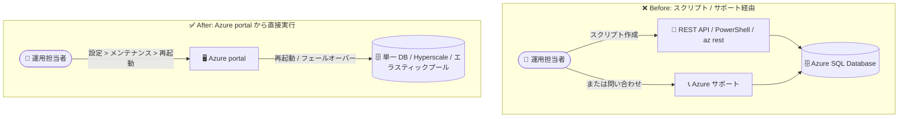

# Azure SQL Database: Azure portal からのデータベース再起動が一般提供 (GA)

**リリース日**: 2026-11-02 (GA 時期: 2026 年 10 月)

**サービス**: Azure SQL Database

**機能**: Azure portal からのデータベース再起動・フェールオーバー

**ステータス**: Launched (GA)

[このアップデートのインフォグラフィックを見る](https://takech9203.github.io/azure-news-summary/20261102-sql-database-restart-portal.html)

## 概要

Azure SQL Database のデータベースを Azure portal から直接再起動 (restart) またはフェールオーバー (failover) できる機能が一般提供 (GA) になりました。対象は単一データベース、Hyperscale データベース、およびエラスティックプール内のデータベースです。従来のように REST API に対するスクリプトを書いたり、サポートに問い合わせたりすることなく、ポータルの操作だけで再起動を実行できます。

再起動操作は、データベースの接続性やパフォーマンスに影響する一時的な問題 (transient issues) を解決することを目的として設計されています。再起動中はデータベースが一時的にオフラインになり、短時間のサービス中断が発生しますが、データベース内に保存されたデータには影響しません。この操作は、アプリケーションの障害回復性テスト (fault resiliency testing) に使われてきたものと同じ API を利用しています。

**アップデート前の課題**

- データベースの再起動 (フェールオーバー) を実行するには、REST API (Database Failover / Elastic Pool Failover)、PowerShell (`Invoke-AzSqlDatabaseFailover` / `Invoke-AzSqlElasticPoolFailover`)、または Azure CLI の `az rest` によるスクリプト作成が必要だった
- スクリプトを用意できない場合は、サポートへの問い合わせが必要になるケースがあった

**アップデート後の改善**

- Azure portal の「設定 > メンテナンス」ページから、GUI 操作のみでデータベースやエラスティックプールを再起動できるようになった
- スクリプト作成やサポート問い合わせが不要になり、一時的な問題発生時の初動対応が迅速化された

## アーキテクチャ図



従来はスクリプトやサポート問い合わせが必要だった再起動操作が、Azure portal のメンテナンスページから直接実行できるようになりました。

## サービスアップデートの詳細

### 主要機能

1. **Azure portal からのデータベース再起動**
   - データベースの「設定 > メンテナンス」ページの「Restart」セクションから再起動を実行
   - 誤操作防止のため、確認ダイアログでデータベース名を入力してから再起動を開始する

2. **エラスティックプールの再起動**
   - エラスティックプールの「設定 > メンテナンス」ページから、プール単位で再起動を実行
   - **プールを再起動すると、プール内のすべてのデータベースが再起動される**

3. **幅広いデプロイ形態に対応**
   - 単一データベース、Hyperscale データベース、エラスティックプール内のデータベースに対応

## 技術仕様

| 項目 | 詳細 |
|------|------|
| 対象 | 単一データベース、Hyperscale データベース、エラスティックプール |
| 操作の内容 | 再起動 (内部的にはフェールオーバー API と同じ仕組みを利用) |
| 実行頻度の制限 | データベース / エラスティックプールごとに 15 分に 1 回まで |
| データへの影響 | なし (保存済みデータは影響を受けない) |
| サービスへの影響 | 一時的にオフラインになり、短時間の中断が発生 |
| ゾーン冗長構成 (General Purpose) の場合 | フェールオーバーにより、クライアント接続は別の可用性ゾーンの新しいプライマリにリダイレクトされる |

## 設定方法

### Azure Portal

**データベースの再起動:**

1. [Azure SQL ハブ (aka.ms/azuresqlhub)](https://aka.ms/azuresqlhub) に移動する
2. リソースメニューで **Azure SQL Database** を展開し、**SQL databases** から対象データベースに移動する
3. **設定 (Settings)** セクションの **メンテナンス (Maintenance)** を選択する
4. **Restart** セクションで再起動のリンクを選択する
5. 確認ダイアログにデータベース名を入力し、**Restart** を選択して再起動を開始する

**エラスティックプールの再起動:**

1. Azure SQL ハブのリソースメニューで **Azure SQL Database** を展開し、**Elastic pools** から対象プールに移動する
2. **設定 > メンテナンス** の **Restart** セクションから再起動を実行する (プール名の入力による確認あり)

### PowerShell / Azure CLI (従来からの方法)

```powershell
# データベースのフェールオーバー (再起動と同じ API)
Invoke-AzSqlDatabaseFailover -ResourceGroupName "myRG" -ServerName "myServer" -DatabaseName "myDB"

# エラスティックプールのフェールオーバー
Invoke-AzSqlElasticPoolFailover -ResourceGroupName "myRG" -ServerName "myServer" -ElasticPoolName "myPool"
```

Azure CLI からは `az rest` コマンドで REST API (Databases - Failover / Elastic Pools - Failover) を呼び出せます。

## メリット

### ビジネス面

- 一時的な接続性・パフォーマンス問題への初動対応が迅速化され、復旧までの時間を短縮できる
- サポート問い合わせへの依存が減り、運用の自律性が向上する

### 技術面

- スクリプトの作成・管理が不要になり、運用手順がシンプルになる
- 障害回復性テストと同じ API を使用するため、再起動時の挙動 (フェールオーバー動作) をアプリケーションのリトライロジック検証にも活用できる

## デメリット・制約事項

- 再起動中はデータベースが一時的にオフラインになり、短時間のサービス中断が発生する
- 再起動 (フェールオーバー) 呼び出しは、データベース / エラスティックプールごとに **15 分に 1 回** に制限されている
- エラスティックプールを再起動すると、プール内のすべてのデータベースが再起動される
- 広範囲なサービス障害が発生している状況での利用は推奨されない。再起動を実行する前に [Azure Service Health](https://learn.microsoft.com/azure/service-health/overview) で進行中の問題がないか確認すること
- Hyperscale データベースの読み取り可能セカンダリレプリカに対しては、Failover コマンドは利用できない
- なお、Microsoft Learn のドキュメント (本レポート作成時点) には、ポータルの再起動機能についてプレビューである旨の記載が残っており、Azure Updates の GA 発表とは記載が一致していない点に留意

## ユースケース

### ユースケース 1: 一時的な接続・パフォーマンス問題の解消

**シナリオ**: データベースへの接続エラーや突発的なパフォーマンス低下が発生し、一時的な問題と判断された場合に、ポータルから即座に再起動して解消を試みる。

**効果**: スクリプト準備やサポート問い合わせを待たずに、運用担当者がその場で復旧アクションを実行できる。

### ユースケース 2: アプリケーションの障害回復性テスト

**シナリオ**: 本番導入前に、フェールオーバー発生時のアプリケーション挙動 (既存セッションへの影響、リトライロジックの動作、ゾーン間フェールオーバー後のネットワーク遅延変化) を検証する。

**効果**: 計画外イベント発生時の挙動を事前に確認し、アプリケーションの回復性を高められる。

## 関連サービス・機能

- **Azure Service Health**: 再起動の前に、広範囲なサービス障害が発生していないかを確認するために使用する
- **ゾーン冗長構成 (Availability Zones)**: ゾーン冗長の General Purpose データベース / エラスティックプールでは、フェールオーバーによって接続が別の可用性ゾーンの新しいプライマリにリダイレクトされる
- **Hyperscale サービスティア**: 本機能の対象。ただし読み取り可能セカンダリレプリカへの Failover コマンドは利用不可

## 参考リンク

- [インフォグラフィック](https://takech9203.github.io/azure-news-summary/20261102-sql-database-restart-portal.html)
- [公式アップデート情報](https://azure.microsoft.com/updates?id=577992)
- [Microsoft Learn: Restart a database or elastic pool](https://learn.microsoft.com/azure/azure-sql/database/restart-database)
- [Microsoft Learn: Availability through local and zone redundancy (Test application fault resiliency)](https://learn.microsoft.com/azure/azure-sql/database/high-availability-sla-local-zone-redundancy)

## まとめ

Azure SQL Database のデータベース再起動・フェールオーバーが Azure portal から直接実行できるようになり、GA に到達しました。従来必要だった REST API スクリプトやサポート問い合わせが不要になり、一時的な接続・パフォーマンス問題への初動対応が大幅に簡素化されます。15 分に 1 回という実行頻度制限や、エラスティックプール再起動時はプール内全データベースが再起動される点に注意しつつ、運用手順書 (Runbook) にポータルからの再起動手順を組み込むことを推奨します。

---

**タグ**: Azure SQL Database, Databases, Hybrid + multicloud, GA, 運用管理, 高可用性
