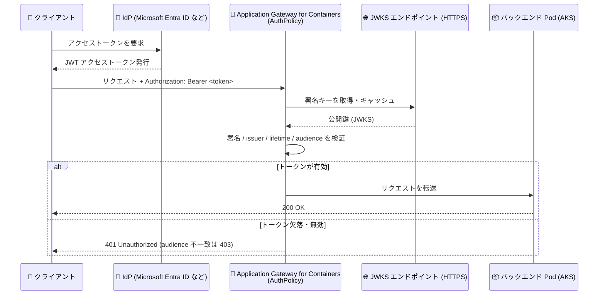

# Application Gateway for Containers: JWT validation (AuthPolicy)

**リリース日**: 2026-11-03

**サービス**: Azure Application Gateway for Containers

**機能**: JWT validation for Application Gateway for Containers

**ステータス**: In preview

[このアップデートのインフォグラフィックを見る](https://takech9203.github.io/azure-news-summary/20261103-agc-jwt-validation.html)

## 概要

Application Gateway for Containers (AGC) で、JSON Web Token (JWT) の検証をゲートウェイ層で一元的に行う機能がパブリックプレビューになりました。新しい Kubernetes カスタムリソース `AuthPolicy` を `ApplicationLoadBalancer`、`Gateway`、`HTTPRoute`、`GRPCRoute`、`MCPRoute` のいずれかにアタッチすることで、バックエンドに到達する前にベアラートークンの署名・発行者 (issuer)・有効期限 (lifetime)・オーディエンス (audience) を検証できます。

署名検証に使用する公開鍵は、信頼できる HTTPS の JWKS (JSON Web Key Set) エンドポイントから取得・キャッシュされます。Microsoft Entra ID のほか、JWT ベアラーアクセストークンを発行し HTTPS の JWKS エンドポイントを公開するサードパーティ IdP にも対応します。トークンが無効または欠落している場合、ゲートウェイはバックエンドにリクエストを転送せずに拒否します (トークン欠落・検証失敗は `401 Unauthorized`、許可されていない audience は `403 Forbidden`)。

さらに、オプションとして RFC 9728 で定義される OAuth 2.0 Protected Resource Metadata (PRM) の公開にも対応し、OAuth クライアントが認可サーバーや必要なスコープを `/.well-known/oauth-protected-resource` エンドポイント経由で発見できます。

**アップデート前の課題**

- JWT 検証をアプリケーション (Pod) ごとに個別実装する必要があり、同じ検証ロジックがサービス間で重複していた
- 検証ロジックの実装漏れや設定差異により、認証要件の一貫した適用が困難だった
- 不正なトークンを持つリクエストもバックエンドまで到達し、アプリケーション側で処理する必要があった

**アップデート後の改善**

- `AuthPolicy` カスタムリソースにより、ゲートウェイ層で JWT 検証を一元管理できるようになった
- `ApplicationLoadBalancer` / `Gateway` レベルのポリシーをルートが継承し、ルート単位でオーバーライドや明示的なオプトアウト (`jwt: {}`) が可能になった
- 未認証リクエストはゲートウェイで拒否され、バックエンドに到達しなくなった
- HTTP、gRPC、MCP (Model Context Protocol) ルートに一貫して JWT 検証を適用できるようになった

## アーキテクチャ図



クライアントが IdP から取得した JWT を AGC が JWKS エンドポイントの公開鍵で検証し、有効なリクエストのみを AKS 上のバックエンドに転送します。

## サービスアップデートの詳細

### 主要機能

1. **AuthPolicy カスタムリソースによる JWT 検証**
   - `alb.networking.azure.io/v1alpha1` の `AuthPolicy` を作成し、`targetRef` で保護対象を指定
   - リモート JWKS エンドポイント (`jwt.jwks.remote.uri`) から取得したキーでトークンの署名、issuer (`iss` クレーム)、有効期限、audience (`aud` クレーム) を検証

2. **ポリシーの継承とオーバーライド**
   - ルートレベル > Gateway レベル > ApplicationLoadBalancer レベルの優先順位で適用 (マージはされず、より具体的なポリシーが置き換える)
   - `jwt: {}` の空ブロックで、保護された親の配下にある特定ルートを明示的に公開 (オプトアウト) 可能

3. **マルチプロトコル対応**
   - HTTP (`HTTPRoute`)、gRPC (`GRPCRoute`)、MCP (`MCPRoute`) の各ルートに一貫して適用可能

4. **OAuth 2.0 Protected Resource Metadata (RFC 9728) の公開 (オプション)**
   - `oauth.protectedResourceMetadata` を設定すると、`/.well-known/oauth-protected-resource` でメタデータ文書を公開
   - `401 Unauthorized` 応答にメタデータエンドポイントを参照する `WWW-Authenticate` チャレンジを付与

5. **フェイルクローズ動作**
   - 無効なポリシーがアタッチされた場合、対象が暗黙的に公開されることはなく、リクエストは拒否される
   - `jwt` ブロックには `issuer` と `jwks` の両方が必須。JWKS URI は有効なホスト・ポートを持つ絶対 HTTPS URL であること

6. **WAF との連携**
   - WAF と `AuthPolicy` が同一リクエストに適用される場合、WAF 評価 → JWT 検証の順で処理され、両方を通過したリクエストのみバックエンドに転送

## 技術仕様

| 項目 | 詳細 |
|------|------|
| API バージョン | `alb.networking.azure.io/v1alpha1` / kind: `AuthPolicy` |
| アタッチ可能な対象 | `ApplicationLoadBalancer`、`Gateway`、`HTTPRoute`、`GRPCRoute`、`MCPRoute` |
| JWT 設定フィールド | `issuer` (iss クレームと比較)、`audiences` (aud クレームの許可リスト)、`jwks.remote.uri` (HTTPS JWKS エンドポイント) |
| 検証項目 | トークン署名、issuer、lifetime、(設定時) audience |
| 検証失敗時の応答 | トークン欠落・大半の検証失敗: `401 Unauthorized` / audience 不許可: `403 Forbidden` |
| ポリシー優先順位 | ルート > Gateway > ApplicationLoadBalancer (置き換え、マージなし) |
| 名前空間の制約 | ポリシーと対象は同一 namespace 必須。クロス namespace 参照と `ReferenceGrant` は非サポート |
| 対応 API | Gateway API のみ (Ingress API は非サポート) |
| ステータス確認 | `Accepted` / `ResolvedRefs` の status condition で有効性を判定 |

## 設定方法

### 前提条件

1. Application Gateway for Containers と ALB Controller のデプロイ (BYO または ALB managed デプロイ戦略)
2. JWT アクセストークンを発行し HTTPS の JWKS エンドポイントを公開する IdP (Microsoft Entra ID など)
3. Gateway API リソース (`Gateway`、`HTTPRoute`) の構成

### Kubernetes (kubectl)

```bash
# HTTPRoute を保護する AuthPolicy を作成 (Microsoft Entra ID の例)
kubectl apply -f - <<EOF
apiVersion: alb.networking.azure.io/v1alpha1
kind: AuthPolicy
metadata:
  name: auth-route-policy
  namespace: test-infra
spec:
  targetRef:
    group: gateway.networking.k8s.io
    kind: HTTPRoute
    name: auth-route
  jwt:
    issuer: "https://login.microsoftonline.com/<tenant-id>/v2.0"
    audiences:
    - "<api-application-client-id>"
    jwks:
      remote:
        uri: "https://login.microsoftonline.com/<tenant-id>/discovery/v2.0/keys"
EOF

# ポリシーが受理されたことを確認
kubectl wait authpolicy/auth-route-policy -n test-infra \
  --for=condition=Accepted --timeout=5m
```

Gateway 全体を保護する場合は `targetRef` を `kind: Gateway` に、ALB managed デプロイで全 Gateway・全ルートを保護する場合は `group: alb.networking.azure.io` / `kind: ApplicationLoadBalancer` に変更します。

## メリット

### ビジネス面

- 認証要件をプラットフォームチームがゲートウェイ層で一元的に適用でき、ガバナンスとコンプライアンスを強化できる
- 各アプリケーションでの JWT 検証実装・保守が不要になり、開発コストを削減できる
- フェイルクローズ設計により、設定ミスでエンドポイントが意図せず公開されるリスクを低減できる

### 技術面

- 未認証リクエストがバックエンドに到達しないため、バックエンドの負荷と攻撃面を削減できる
- 階層的なポリシー継承 (ALB → Gateway → ルート) により、全体保護と例外設定を柔軟に組み合わせられる
- HTTP / gRPC / MCP ルートへ一貫した検証を適用でき、AI エージェント向け (MCP) のワークロード保護にも利用できる
- RFC 9728 の Protected Resource Metadata により、OAuth クライアントの自動ディスカバリーに対応できる

## デメリット・制約事項

- パブリックプレビュー段階であり、プレビューの補足利用条件が適用される (本番利用は非推奨)
- Gateway API のみ対応。Ingress API では利用できない
- ポリシーと対象リソースは同一 namespace が必須。クロス namespace 参照 (`ReferenceGrant`) は非サポート
- `sectionNames` による listener / ルール単位の適用は不可 (ポリシーは対象リソース全体に適用)
- 1 つのリソースを対象にできる `AuthPolicy` は 1 つのみ (複数ターゲットは競合として拒否)
- JWT 検証は認証 (トークン検証) のみを担い、ロールや権限などの認可判断はアプリケーション側の責務。トークン発行や対話型サインイン (OIDC / SAML / WS-Federation のサインインフロー) はスコープ外
- JWKS エンドポイントは AGC データプレーンから解決・到達可能で、信頼された証明書を提示する必要がある
- ベアラートークンを暗号化するため HTTPS リスナーの使用が推奨される

## ユースケース

### ユースケース 1: マイクロサービス API の認証一元化

**シナリオ**: AKS 上の複数のマイクロサービス API に対し、Microsoft Entra ID が発行するアクセストークンの検証を各サービスで個別実装せず、ゲートウェイで一元化する。

**実装例**:

```yaml
# Gateway レベルで全ルートを保護
spec:
  targetRef:
    group: gateway.networking.k8s.io
    kind: Gateway
    name: gateway-01
  jwt:
    issuer: https://login.microsoftonline.com/<tenant-id>/v2.0
    audiences:
    - <api-application-client-id>
    jwks:
      remote:
        uri: https://login.microsoftonline.com/<tenant-id>/discovery/v2.0/keys
```

**効果**: 全ルートが既定で保護され、未認証リクエストはバックエンドに到達しない。公開が必要なルート (ヘルスチェックなど) は `jwt: {}` のルートレベルポリシーで個別にオプトアウトできる。

### ユースケース 2: 同一ホスト名で複数 IdP を使い分ける API

**シナリオ**: `https://contoso.com/pathA` と `https://contoso.com/pathB` で異なる IdP を信頼し、OAuth クライアントが認可サーバーを自動発見できるようにする。

**実装例**: 各 `HTTPRoute` に個別の `AuthPolicy` をアタッチし、それぞれに `oauth.protectedResourceMetadata` で異なる protected resource identifier を設定する。各ルートのメタデータは `/.well-known/oauth-protected-resource/pathA`、`/pathB` で公開される。

**効果**: ルートごとに信頼する IdP を分離しつつ、`WWW-Authenticate` チャレンジ経由でクライアントを適切なメタデータ文書に誘導できる。

## 料金

JWT validation 機能固有の追加料金に関する公式情報は、本レポート作成時点で確認できませんでした。Application Gateway for Containers の料金は公式の料金ページを参照してください。

- [Application Gateway の料金ページ](https://azure.microsoft.com/pricing/details/application-gateway/)

## 利用可能リージョン

JWT validation プレビューのリージョン別提供状況は個別に公開されていません。Application Gateway for Containers 自体は、East US、West Europe、Japan West、Southeast Asia など 29 リージョンで利用可能です (2026 年 11 月時点の公式ドキュメントによる)。最新のリージョン情報は [Application Gateway for Containers の概要ドキュメント](https://learn.microsoft.com/azure/application-gateway/for-containers/overview#supported-regions) を参照してください。

## 関連サービス・機能

- **Azure Kubernetes Service (AKS)**: AGC は AKS ワークロード向けのマネージド L7 ロードバランシング / Ingress サービスであり、JWT 検証は AKS 上のバックエンドを保護する
- **Microsoft Entra ID**: JWT アクセストークンの発行元として利用でき、`login.microsoftonline.com` の JWKS エンドポイントと組み合わせて検証を構成できる
- **Web Application Firewall (WAF)**: WAF と JWT 検証は補完関係にあり、WAF 評価 → JWT 検証の順で両方を通過したリクエストのみ転送される
- **Gateway API (Kubernetes)**: `AuthPolicy` は Gateway API の `Gateway` / `HTTPRoute` / `GRPCRoute` を対象にアタッチする (ALB Controller は Gateway API v1.6 を実装)
- **MCP (Model Context Protocol) ルート**: AI エージェント向けの `MCPRoute` にも JWT 検証を適用でき、MCP サーバーの保護に利用できる

## 参考リンク

- [インフォグラフィック](https://takech9203.github.io/azure-news-summary/20261103-agc-jwt-validation.html)
- [公式アップデート情報](https://azure.microsoft.com/updates?id=576382)
- [JWT validation for Application Gateway for Containers (概要)](https://learn.microsoft.com/azure/application-gateway/for-containers/jwt-validation)
- [Configure JWT validation - Gateway API (ハウツー)](https://learn.microsoft.com/azure/application-gateway/for-containers/how-to-jwt-validation-gateway-api)
- [Application Gateway for Containers の概要](https://learn.microsoft.com/azure/application-gateway/for-containers/overview)
- [料金ページ](https://azure.microsoft.com/pricing/details/application-gateway/)

## まとめ

Application Gateway for Containers の JWT validation (パブリックプレビュー) により、AKS ワークロードの JWT 検証をアプリケーション実装からゲートウェイ層の `AuthPolicy` カスタムリソースへ移行できるようになりました。階層的なポリシー継承、フェイルクローズ設計、HTTP / gRPC / MCP 対応、RFC 9728 準拠の OAuth ディスカバリーを備えており、マイクロサービスや AI エージェント向け API の認証アーキテクチャを簡素化します。AKS 上で API を公開しているチームは、まず非本番環境で Gateway API + `AuthPolicy` の構成を検証し、Ingress API 非対応や namespace 制約などのプレビュー時点の制約を確認したうえで GA に備えることを推奨します。

---

**タグ**: Networking, Security, Application Gateway, Application Gateway for Containers, JWT, AuthPolicy, Gateway API, AKS, Preview
