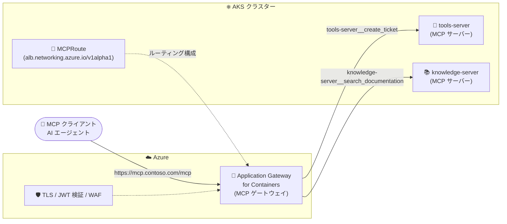

# Application Gateway for Containers: MCP ゲートウェイ (Public Preview)

**リリース日**: 2026-11-03

**サービス**: Azure Application Gateway for Containers

**機能**: MCP gateway for Application Gateway for Containers

**ステータス**: In preview

[このアップデートのインフォグラフィックを見る](https://takech9203.github.io/azure-news-summary/20261103-agc-mcp-gateway.html)

## 概要

Application Gateway for Containers が、新しいカスタムリソース `MCPRoute` を通じて Model Context Protocol (MCP) ルーティングをサポートした (Public Preview)。プラットフォームチームは、Kubernetes 上でホストされる MCP サーバーを安定したホスト名とパスの背後に公開しつつ、TLS、JWT 検証、Web Application Firewall (WAF) 保護、バックエンドヘルス監視、ルーティングポリシーをゲートウェイで一元管理できるようになった。

`MCPRoute` は、単一 MCP サーバーへの直接ルーティングと、複数の独立した MCP サーバーを 1 つの論理エンドポイントの背後に集約 (アグリゲーション) する構成の両方をサポートする。集約構成では、Application Gateway for Containers がツール・リソース・プロンプトのディスカバリー応答をマージし、名前の衝突を避けるためにケイパビリティ名に名前空間 (Service 名のプレフィックス) を付与し、呼び出しを該当ケイパビリティを所有するバックエンドにルーティングする。

AI アプリケーションやエージェントが外部システムと連携するための標準プロトコルである MCP の普及に伴い、組織内の MCP サーバーが増えると、各クライアントがすべてのサーバーアドレスを管理し、各サーバーが個別にインターネット公開・TLS・認証・ヘルス監視を実装する必要が生じる。本アップデートはこの課題に対し、ゲートウェイレベルでの統制を提供するものである。

**アップデート前の課題**

- MCP サーバーごとにクライアント側のエンドポイント設定が必要で、サーバー追加のたびにクライアント構成の変更が発生していた
- 各 MCP サーバーが個別に TLS 設定、認証の強制、ヘルス監視、スケーリング戦略を実装・運用する必要があった
- 汎用の `HTTPRoute` は各リクエストを独立に扱うため、MCP のセッションやケイパビリティディスカバリーといったアプリケーションレベルのセマンティクスを認識したルーティングができなかった
- 複数 MCP サーバーのカタログを統合するには、別途アグリゲーション用アプリケーションを構築・運用する必要があった

**アップデート後の改善**

- MCP クライアントと Kubernetes 上の MCP サーバーに対して、ガバナンスの効いた単一エンドポイントを公開できる
- 複数 MCP サーバーのケイパビリティを 1 つのエンドポイントに集約し、ディスカバリー応答の自動マージと名前空間化による衝突回避が可能
- インメモリでセッション状態を保持する MCP サーバー向けに、ベストエフォートのセッションアフィニティを提供
- JWT 検証、WAF、バックエンド TLS、ヘルスチェック、クロスネームスペース参照をゲートウェイで一元適用できる

## アーキテクチャ図



MCP クライアントは単一の安定したエンドポイントに接続し、ゲートウェイが TLS・JWT 検証・WAF を適用した上で、ディスカバリー応答の集約と、名前空間化されたツール名に基づく適切なバックエンド MCP サーバーへの振り分けを行う。

## サービスアップデートの詳細

### 主要機能

1. **MCPRoute カスタムリソースによる MCP ルーティング**
   - Gateway API の `Gateway` にアタッチする Application Gateway for Containers 固有のカスタムリソース (`alb.networking.azure.io/v1alpha1`)
   - MCP サーバーをホスト名と URL パスで公開し、1 つの公開エンドポイントを 1 つの Kubernetes Service にルーティング
   - `spec.path` を省略した場合のデフォルトは `/mcp`。`backendRefs[].path` でバックエンド側パスへの書き換えも可能 (例: 公開パス `/engineering` → バックエンド `/mcp`)

2. **複数 MCP サーバーのアグリゲーション**
   - 複数の `backendRefs` を指定すると、1 つの論理 MCP エンドポイントとして動作
   - `tools/list`、`resources/list`、`prompts/list` などのディスカバリー要求を各バックエンドに送信し、応答をマージ
   - ケイパビリティ名は Service 名で名前空間化される (例: `contoso-tools` Service の `get_order` ツール → `contoso-tools__get_order`)。呼び出し時はプレフィックスを除去して所有バックエンドにルーティング
   - 1 ルートあたり最大 64 バックエンドを参照可能

3. **セッションアフィニティ**
   - `initialize` 後にインメモリ状態を保持するステートフルな MCP サーバー向けに、`sessionAffinity: true` で初期化を処理した Pod にセッションを固定
   - ベストエフォート方式。対象 Pod が利用不能になった場合は通常のロードバランシングにフォールバック

4. **セキュリティ・ポリシー統合**
   - `AuthPolicy` による JWT 検証 (署名・発行者・有効期間・オーディエンスの検証)。`MCPRoute`、親 Gateway、`ApplicationLoadBalancer` のいずれにもアタッチ可能
   - OAuth Protected Resource Metadata の公開により、MCP 対応 OAuth クライアントが認可サーバーとサポートスコープをディスカバリー可能 (認可の強制は MCP サーバー側の責務)
   - WAF ポリシーによる悪意ある HTTP ペイロードの検査 (WAF 評価 → JWT 検証 → MCP ルーティングの順)
   - `BackendTLSPolicy` によるバックエンドへの TLS 接続、`HealthCheckPolicy` による明示的なヘルスチェック
   - `ReferenceGrant` によるクロスネームスペースのバックエンド参照

## 技術仕様

| 項目 | 詳細 |
|------|------|
| API バージョン | `alb.networking.azure.io/v1alpha1` (Preview API のため GA 前に変更の可能性あり) |
| アタッチ先 | Gateway API の `Gateway` リスナー (`allowedRoutes.kinds` で `MCPRoute` の明示的な許可が必要) |
| リスナープロトコル | HTTP / HTTPS (本番では HTTPS を推奨) |
| デフォルト公開パス | `/mcp` (`spec.path` 省略時) |
| バックエンド数上限 | 1 ルートあたり最大 64 backendRefs |
| ディスカバリー集約 | `tools/list`、`resources/list`、`prompts/list` の応答をマージ |
| ケイパビリティ名前空間化 | `{Service 名}__{ツール名}` 形式 (例: `tools-server__create_ticket`) |
| セッションアフィニティ | ベストエフォート (Pod 消失時は通常のロードバランシングへ) |
| ListenerSet | `MCPRoute` の `ListenerSet` へのアタッチは現時点で非サポート (Gateway に直接アタッチ) |
| ステータス確認 | ルートの `Accepted` / `ResolvedRefs` 条件で診断 |

## 設定方法

### 前提条件

1. Application Gateway for Containers リソースと ALB Controller のセットアップ (AKS Add-on または Helm)
2. BYO デプロイの場合は Frontend などのリソースを事前作成、ALB managed デプロイの場合は `ApplicationLoadBalancer` カスタムリソースでプロビジョニング

### 設定例 (Gateway API)

Gateway リスナーで `MCPRoute` を明示的に許可する。

```yaml
apiVersion: gateway.networking.k8s.io/v1
kind: Gateway
metadata:
  name: mcp-gateway
  namespace: mcp-demo
spec:
  gatewayClassName: azure-alb-external
  listeners:
  - name: mcp
    protocol: HTTPS
    port: 443
    hostname: mcp.contoso.com
    allowedRoutes:
      namespaces:
        from: Same
      kinds:
      - group: alb.networking.azure.io
        kind: MCPRoute
```

`MCPRoute` で公開パスとバックエンド Service をマッピングする (複数 backendRefs で集約構成)。

```yaml
apiVersion: alb.networking.azure.io/v1alpha1
kind: MCPRoute
metadata:
  name: tools
  namespace: mcp-demo
spec:
  parentRefs:
  - group: gateway.networking.k8s.io
    kind: Gateway
    name: mcp-gateway
    sectionName: mcp
  hostnames:
  - mcp.contoso.com
  path: /mcp
  backendRefs:
  - name: tools-server
    port: 8080
    path: /mcp
  - name: knowledge-server
    port: 8080
    path: /mcp
```

デプロイ後、ルートの状態を確認する。

```bash
kubectl wait mcproute/tools -n mcp-demo --for=condition=Accepted --timeout=5m
kubectl wait mcproute/tools -n mcp-demo --for=condition=ResolvedRefs --timeout=5m
```

JWT 検証を適用する場合は `AuthPolicy` を `MCPRoute` にアタッチする。

```yaml
apiVersion: alb.networking.azure.io/v1alpha1
kind: AuthPolicy
metadata:
  name: tools-auth
  namespace: mcp-demo
spec:
  targetRef:
    group: alb.networking.azure.io
    kind: MCPRoute
    name: tools
  jwt:
    issuer: https://login.microsoftonline.com/<tenant-id>/v2.0
    audiences:
    - <api-application-client-id>
    jwks:
      remote:
        uri: https://login.microsoftonline.com/<tenant-id>/discovery/v2.0/keys
```

## メリット

### ビジネス面

- MCP サーバーの追加・移動・置き換えがあってもクライアント側の設定変更が不要になり、AI エージェント活用の運用コストを削減できる
- アプリケーションチームは MCP ケイパビリティの開発に、プラットフォームチームはアクセス統制と接続性のガバナンスに専念でき、責任分界が明確になる
- 各チームが自前の MCP サーバーを所有・運用したまま、共有ゲートウェイ経由で一貫した外部アクセスを提供できる

### 技術面

- TLS、JWT 検証、WAF、バックエンドセキュリティポリシーをゲートウェイで一元適用でき、サーバーごとの重複実装を排除できる
- ディスカバリー応答の自動マージと名前空間化により、アグリゲーション専用アプリケーションの構築・運用が不要になる
- ゲートウェイのステータス、バックエンドヘルスチェック、タイムアウト、ロードバランシング、セッションアフィニティにより MCP トラフィックの運用を標準化できる
- `HTTPRoute` では扱えない MCP のアプリケーションレベルのセマンティクス (セッション、ケイパビリティディスカバリー、JSON-RPC メッセージ) を認識したルーティングが可能

## デメリット・制約事項

- Public Preview であり、`alb.networking.azure.io/v1alpha1` の Preview API は GA 前に変更される可能性がある。本番利用には [Azure Preview の補足利用条件](https://azure.microsoft.com/support/legal/preview-supplemental-terms/) が適用される
- `MCPRoute` は `Gateway` に直接アタッチする必要があり、Gateway API の `ListenerSet` へのアタッチは現時点でサポートされない
- セッションアフィニティはベストエフォートであり、Pod 消失時にセッションが失われる。MCP サーバー側でセッション喪失への耐性を持たせるか、状態を Pod 外部に保存することが推奨される
- 集約構成では Service 名がクライアントに見えるケイパビリティ名の一部になるため、安定的で説明的な Service 名の採用が必要
- 集約されたバックエンドは互換性のある MCP プロトコル動作を実装している必要がある
- OAuth Protected Resource Metadata のスコープ公開は認可を強制しない。ロール・スコープ・権限・リソース所有権のチェックは MCP サーバー側の責務として残る
- 1 つのリスナーに複数の MCP ルートをホストする場合、あるルートを対象にした WAF ポリシーは同一リスナー上の別ルートを自動的には保護しない

## ユースケース

### ユースケース 1: 複数チームの MCP サーバーを単一エンドポイントで公開

**シナリオ**: 注文管理、在庫、サポートインシデントをそれぞれ別チームが MCP サーバーとして運用している。各サーバーを直接公開するとクライアントは 3 つのエンドポイントを設定し、プラットフォームチームは 3 つのパブリックサーフェスを保護・運用する必要がある。

**実装例**: 上記「設定方法」の集約構成のとおり、1 つの `MCPRoute` に複数の `backendRefs` を定義する。クライアントからは `tools-server__create_ticket`、`knowledge-server__search_documentation` のように名前空間化されたツールが単一カタログとして見える。

**効果**: クライアント設定は単一エンドポイントのみとなり、サーバー追加時もクライアント側の変更が不要。セキュリティ統制はゲートウェイで一元化される。

### ユースケース 2: エンタープライズのセキュリティ統制下での MCP 公開

**シナリオ**: MCP ツールはデータの読み取りやアクションの実行が可能なため、匿名のインフラエンドポイントではなくアプリケーション API として保護したい。

**実装例**: HTTPS リスナー + フロントエンド証明書を構成し、`AuthPolicy` で Microsoft Entra ID 発行の JWT を検証、WAF ポリシーで HTTP ペイロードを検査、`BackendTLSPolicy` でバックエンドへの通信も暗号化する。

**効果**: WAF 評価 → JWT 検証 → MCP ルーティングの多層防御を、各 MCP サーバーに実装を重複させることなく実現できる。

## 料金

MCP ゲートウェイ機能固有の追加料金に関する公式情報は、本アップデート発表時点では確認できなかった。Application Gateway for Containers の料金は以下の公式ページを参照。

- [Application Gateway 料金ページ](https://azure.microsoft.com/pricing/details/application-gateway/)

## 利用可能リージョン

MCP ゲートウェイ (Preview) 固有のリージョン情報は公式発表では確認できなかった。Application Gateway for Containers 自体の利用可能リージョンは [製品概要ドキュメント](https://learn.microsoft.com/azure/application-gateway/for-containers/overview) の「Supported regions」を参照 (East US、West Europe、Japan West など 29 リージョン)。

## 関連サービス・機能

- **Azure Kubernetes Service (AKS)**: MCP サーバーのホスティング基盤。ALB Controller がクラスター内で Kubernetes リソースを監視し、Application Gateway for Containers の構成に変換する
- **Kubernetes Gateway API**: `MCPRoute` がアタッチする `Gateway` リスナーの定義に使用。従来型 Web API には `HTTPRoute`、gRPC には `GRPCRoute` を引き続き使用する
- **Azure Web Application Firewall (WAF)**: MCP ルートへの悪意ある HTTP ペイロードを検査するポリシーを適用可能
- **Microsoft Entra ID**: `AuthPolicy` の JWT 検証における発行者・JWKS エンドポイントとして利用可能
- **Application Gateway for Containers Inference Gateway**: 同サービスの AI 関連機能。セルフホストモデルサーバー向けのモデル認識ルーティングを提供し、MCP ゲートウェイと合わせて AI ワークロード向けゲートウェイ機能を構成する

## 参考リンク

- [インフォグラフィック](https://takech9203.github.io/azure-news-summary/20261103-agc-mcp-gateway.html)
- [公式アップデート情報](https://azure.microsoft.com/updates?id=576388)
- [Model Context Protocol (MCP) capabilities in Application Gateway for Containers](https://learn.microsoft.com/azure/application-gateway/for-containers/mcp-gateway)
- [Configure an MCP gateway for Application Gateway for Containers - Gateway API](https://learn.microsoft.com/azure/application-gateway/for-containers/how-to-mcp-gateway-gateway-api)
- [Application Gateway for Containers 概要](https://learn.microsoft.com/azure/application-gateway/for-containers/overview)
- [料金ページ](https://azure.microsoft.com/pricing/details/application-gateway/)

## まとめ

Application Gateway for Containers の MCP ゲートウェイ機能 (Public Preview) は、AI エージェント時代のプラットフォームエンジニアリングにおいて重要なアップデートである。`MCPRoute` カスタムリソースにより、Kubernetes 上の MCP サーバー群を単一の統制されたエンドポイントとして公開でき、TLS・JWT 検証・WAF といったセキュリティ統制をゲートウェイで一元化できる。複数サーバーのディスカバリー集約と名前空間化は、自前のアグリゲーション層を構築せずにマルチチームの MCP 運用を実現する点で特に価値が高い。

組織内で MCP サーバーの導入を進めている Solutions Architect は、まず非本番環境で `MCPRoute` の直接ルーティングと集約構成を検証し、`AuthPolicy`・WAF との組み合わせによるセキュリティ設計を評価することを推奨する。ただし Preview API (`v1alpha1`) は GA 前に変更される可能性があるため、本番導入は GA を待つか、変更追随を前提とした運用計画が必要である。

---

**タグ**: Networking, Security, Application Gateway, AKS, Kubernetes, Gateway API, MCP, AI, Preview
