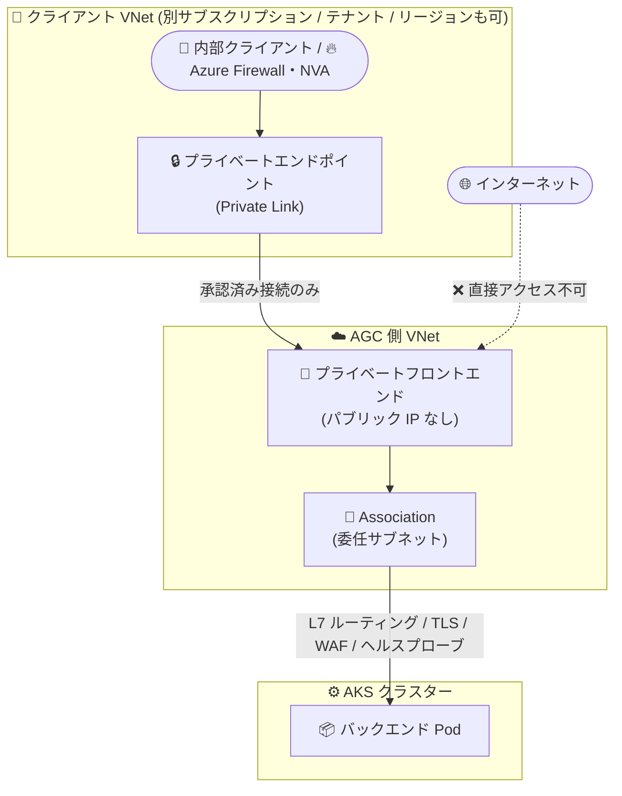

# Application Gateway for Containers: プライベートイングレス (Private Ingress)

**リリース日**: 2026-11-03

**サービス**: Application Gateway for Containers

**機能**: プライベートイングレス (Private Link プライベートエンドポイント経由のみアクセス可能なプライベートフロントエンド)

**ステータス**: In preview

[このアップデートのインフォグラフィックを見る](https://takech9203.github.io/azure-news-summary/20261103-agc-private-ingress.html)

## 概要

Application Gateway for Containers (AGC) に、承認された Azure Private Link プライベートエンドポイント経由でのみ到達可能な「プライベートフロントエンド」が Public Preview として追加されました。プライベートフロントエンドにはパブリック IP アドレスが割り当てられず、インターネットからの直接アクセス経路が構造的に存在しません。明示的にプロビジョニングされ、承認されたプライベートエンドポイント接続のみがトラフィックの入口となります。

プライベートエンドポイントは VNet・サブスクリプション・Microsoft Entra テナント・リージョンをまたいで機能するため、VNet ピアリングや共有アドレス空間、トランジットルーティングなしにクロス境界のプライベート接続を構成できます。CIDR 範囲が重複する環境でも接続可能です。また、1 つの AGC リソース上でパブリックフロントエンドとプライベートフロントエンドを同時にホストでき、それぞれに個別のルーティングルールと WAF ポリシーを適用できます。

プライベート化しても、Kubernetes ネイティブのレイヤー 7 ルーティング、TLS、ヘルスプローブ、WAF といった AGC の機能はそのまま利用できます。社内 API や共有サービス、クラスター間通信をプライベートネットワークに閉じたい組織に向けた機能です。

**アップデート前の課題**

- AGC のフロントエンドの FQDN はパブリック IP に解決され、インターネット上の誰でもリクエストを送信できた。NSG・WAF・アプリケーション層の認証を併用しても、パブリック IP の公開自体が組織ポリシーやコンプライアンス要件に抵触するケースがあった
- 別クラスターのサービスをパブリックフロントエンド経由で呼び出すと、同一リージョン内であってもトラフィックがパブリック IP へヘアピンし、不要な露出とレイテンシーが発生していた
- クロスリージョンの VNet ピアリングはルーティングの複雑さやアドレス空間の重複制約を伴っていた

**アップデート後の改善**

- フロントエンドからパブリック IP とインターネット直接経路を排除し、スキャン・攻撃対象となる公開エンドポイントそのものをなくせる
- 明示的に承認されたプライベートエンドポイント経由のアクセスのみを強制 (未知のソースからの接続はフィルタリングではなく構造的に不可能)
- VNet ピアリング不要で VNet・サブスクリプション・テナント・リージョンをまたぐプライベート接続が可能 (CIDR 重複も許容)
- Azure Firewall やネットワーク仮想アプライアンス (NVA) を Kubernetes ワークロードの前段に配置するトポロジを構成可能

## アーキテクチャ図



クライアントは自身の VNet 内のプライベートエンドポイントを経由して AGC のプライベートフロントエンドに接続し、AGC が AKS のバックエンド Pod へ L7 ルーティングします。パブリック IP が存在しないため、インターネットからの直接経路はありません。

## サービスアップデートの詳細

### 主要機能

1. **パブリック IP を持たないプライベートフロントエンド**
   - フロントエンドの FQDN は、プライベートエンドポイントが接続・承認された後に、クライアントのサブネット内に割り当てられたプライベート IP アドレスにのみ解決される。インターネットからの FQDN 解決は不可能

2. **承認ベースのプライベートエンドポイント接続**
   - 同一サブスクリプション内では接続が自動承認される場合がある (プライベートエンドポイント権限を持つ場合)
   - クロスサブスクリプション・クロステナントでは AGC リソース所有者による手動承認が必要
   - 1 つのプライベートフロントエンドに最大 200 のプライベートエンドポイントを接続可能

3. **クロス境界接続 (VNet / サブスクリプション / テナント / リージョン)**
   - VNet ピアリング不要。CIDR 範囲が重複する VNet 間でも接続可能 (Private Link は VNet 層の IP ルーティングに依存しないため)

4. **パブリック / プライベートフロントエンドの同居**
   - 1 つの AGC リソースでパブリックとプライベートの両フロントエンドを同時にホストし、それぞれに個別のルーティングルールと WAF ポリシーを設定可能

5. **Kubernetes ネイティブの構成**
   - Gateway API では `gatewayClassName: azure-alb-internal`、Ingress API では `kubernetes.io/ingress.class: azure-alb-internal` アノテーションを指定するだけでプライベートフロントエンドを利用 (`azure-alb-external` はパブリック)

6. **WAF サポート**
   - パブリックフロントエンドと同様に、`SecurityPolicy` リソースで WAF ポリシーをプライベートフロントエンドに関連付け可能 (フロントエンド単位・任意)

## 技術仕様

| 項目 | 詳細 |
|------|------|
| ステータス | Public Preview (GA 時期未定) |
| フロントエンドタイプ指定 | Gateway API: `gatewayClassName` に `azure-alb-external` (パブリック) / `azure-alb-internal` (プライベート)。Ingress API: `kubernetes.io/ingress.class` アノテーション |
| プライベートエンドポイント接続数 | プライベートフロントエンドあたり最大 200 |
| 接続承認 | 同一サブスクリプション: 自動承認可 / クロスサブスクリプション・テナント: 手動承認 |
| 対応トポロジ | 同一 VNet、同一リージョンのリモート VNet (ピアリング不要)、別リージョンの VNet (CIDR 重複許容)、別サブスクリプション (同一テナント)、別サブスクリプション (別テナント) |
| 必要 REST API バージョン | 2026-03-01 以降 (プレビュー期間中、`publicNetworkAccess` プロパティは `az network alb frontend create` では未対応のため `az rest` を使用) |
| 必要 ALB Controller バージョン | v1.13 以降 |
| Association の条件 | 2026 年 4 月 23 日以降に作成された Association リソースでのみプライベートフロントエンドを構成可能 |
| DNS 解決 | プライベートエンドポイント接続・承認後にのみ FQDN が解決。プライベート DNS ゾーンまたは hosts エントリで解決を構成 |
| 注意点 | プライベート接続はプライベートエンドポイント経由で拡張される。Association サブネットのプライベート IP への直接アドレス指定は不可 (内部実装の詳細) |

## 設定方法

### 前提条件

1. AGC リソースと ALB Controller (AKS アドオンまたは Helm) のセットアップ (BYO デプロイの場合)、または ALB Controller + `ApplicationLoadBalancer` カスタムリソースによる AGC リソースのプロビジョニング (ALB マネージドデプロイの場合)
2. ALB Controller v1.13 以降
3. 2026 年 4 月 23 日以降に作成された Association リソース

### Azure CLI (BYO デプロイ)

```bash
# 1. プライベートフロントエンドを作成 (API バージョン 2026-03-01、publicNetworkAccess を disabled に設定)
az rest --method PUT \
  --url "https://management.azure.com/subscriptions/${SUBSCRIPTION_ID}/resourceGroups/${RESOURCE_GROUP}/providers/Microsoft.ServiceNetworking/trafficControllers/${AGFC_NAME}/frontends/${FRONTEND_NAME}?api-version=2026-03-01" \
  --body "{
    \"location\": \"${LOCATION}\",
    \"properties\": {
      \"publicNetworkAccess\": \"disabled\",
      \"association\": {
         \"id\": \"/subscriptions/${SUBSCRIPTION_ID}/resourceGroups/${RESOURCE_GROUP}/providers/Microsoft.ServiceNetworking/trafficControllers/${AGFC_NAME}/associations/${AGFC_ASSC_NAME}\"
       }
    }
  }"

# 2. クライアント側 VNet にプライベートエンドポイントを作成
az network private-endpoint create \
  --resource-group $PE_RESOURCE_GROUP \
  --name $PE_NAME \
  --vnet-name $PE_VNET_NAME \
  --subnet $PE_SUBNET_NAME \
  --private-connection-resource-id $AGFC_RESOURCE_ID \
  --group-id $FRONTEND_NAME \
  --connection-name $PE_CONNECTION_NAME

# 3. 保留中の接続を承認 (クロスサブスクリプション / テナントの場合)
az rest --method POST \
  --url "https://management.azure.com${PENDING_CONNECTION_ID}/approve?api-version=2026-03-01" \
  --body '{"properties": {"description": "Approved"}}'
```

### Gateway API リソース

```yaml
apiVersion: gateway.networking.k8s.io/v1
kind: Gateway
metadata:
  name: gateway-01
  namespace: test-infra
  annotations:
    alb.networking.azure.io/alb-id: $RESOURCE_ID
spec:
  gatewayClassName: azure-alb-internal   # プライベートフロントエンドを参照
  listeners:
  - name: http-listener
    port: 80
    protocol: HTTP
    allowedRoutes:
      namespaces:
        from: Same
  addresses:
  - type: alb.networking.azure.io/alb-frontend
    value: $FRONTEND_NAME
```

ALB マネージドデプロイの場合は、`gatewayClassName: azure-alb-internal` を指定した `Gateway` リソースを作成するだけで、ALB Controller がプライベートフロントエンド (`fe-<ランダム 8 文字>`) を自動プロビジョニングします。承認済みプライベートエンドポイントが接続されるまで、コントローラーはアドレスを割り当てません。

DNS 解決は、プライベート DNS ゾーンをクライアント VNet にリンクして A レコードを登録する方法 (複数クライアント・複数 VNet にスケール) か、検証用途であれば hosts ファイルエントリで構成します。

## メリット

### ビジネス面

- パブリック IP の公開を禁止する組織ポリシーやコンプライアンス要件 (インバウンドトラフィックがパブリックインターネットを経由しないことの保証) をネットワーク層で満たせる
- プラットフォームチームが共有サービスサブスクリプションで AGC を一元管理し、別サブスクリプションのアプリケーションチームやパートナー組織 (別テナント) にプライベートに提供する運用モデルが可能
- IP アドレス空間が重複するテスト / ステージング環境でも共有イングレスに接続でき、環境設計の自由度が向上

### 技術面

- インターネット攻撃対象領域の排除 (発見・スキャン・攻撃可能なパブリック IP が存在しない)
- クラスター間通信がパブリック IP へのヘアピンなしに Azure のプライベートネットワークファブリック内で完結し、露出とレイテンシーを削減
- クロスリージョン接続に VNet ピアリングが不要 (ルーティングの複雑さ・アドレス空間制約を回避)
- プライベート化しても L7 ルーティング、TLS、ヘルスプローブ、WAF など AGC の全機能を維持

## デメリット・制約事項

- Public Preview のため、プレビューの補足利用条件が適用される (GA 時期未定)
- 2026 年 4 月 23 日より前に作成された Association リソースでは利用不可 (Association の再作成が必要)
- REST API バージョン 2026-03-01 以降が必要。プレビュー期間中は `az network alb frontend create` コマンドが `publicNetworkAccess` プロパティ未対応のため、`az rest` での作成が必要
- ALB Controller v1.13 以降が必要
- Azure Firewall / NVA を AGC の前段に置くトポロジでは、ファイアウォールが SNAT を行うため元のクライアント IP が失われる (`X-Forwarded-For` にはファイアウォールのプライベート IP が入る)。クライアント IP が必要なワークロード (ジオロケーション、IP ベースのレート制限、不正検知など) では、AGC をファイアウォールの前段に置く逆トポロジの検討が必要

## ユースケース

### ユースケース 1: Azure Firewall / NVA をインターネットエントリポイントにする

**シナリオ**: すべてのインターネットトラフィックを集中管理されたファイアウォール (脅威インテリジェンス、IDPS、TLS インスペクション、コンプライアンスログ) 経由にすることが組織で義務付けられている。

**構成**: `[インターネット] → [Azure Firewall / NVA] → [プライベートエンドポイント] → [AGC プライベートフロントエンド] → [AKS Pod]`

**効果**: ファイアウォールポリシーの例外なしに Kubernetes ワークロードを保護できる。ただしクライアント IP の可視性が失われる点に注意 (上記制約参照)。

### ユースケース 2: インターネットアクセスのない社内アプリケーション

**シナリオ**: 社内 API、コーポレートポータル、データパイプライン、プラットフォームサービスなど、組織内ネットワークからのみアクセスされるワークロード。

**構成**: `[社内クライアント (オンプレミス / 内部 VNet)] → [プライベートエンドポイント] → [AGC プライベートフロントエンド] → [AKS Pod]`

**効果**: インターネット露出なしで、パブリックデプロイと同等の Kubernetes ネイティブ L7 ルーティング・ヘルスプローブ・WAF・TLS を利用できる。

### ユースケース 3: クラスター間サービス通信

**シナリオ**: 別々の Kubernetes クラスターで動作するサービス間の通信。パブリックフロントエンド経由では同一リージョン内でもトラフィックがパブリック IP にヘアピンしてしまう。

**構成**: `[クラスター A の Pod] → [プライベートエンドポイント] → [クラスター B の AGC プライベートフロントエンド] → [クラスター B の AKS Pod]`

**効果**: トラフィックが Azure のプライベートネットワーク内に留まり、露出とレイテンシーを削減。クロスリージョンでも VNet ピアリング不要で、CIDR 重複も許容。サービスディスカバリーは各クラスターの DNS でプライベートフロントエンド FQDN を自サブネットのプライベートエンドポイント IP に解決して実現。

## 料金

プライベートイングレス機能自体の個別料金は、今回のアップデート情報およびドキュメントからは確認できませんでした。Application Gateway for Containers の料金は以下の公式料金ページを参照してください。なお、プライベートエンドポイント (Azure Private Link) には別途料金が発生します。

- [Application Gateway 料金ページ](https://azure.microsoft.com/pricing/details/application-gateway/)
- [Azure Private Link 料金ページ](https://azure.microsoft.com/pricing/details/private-link/)

## 利用可能リージョン

プライベートイングレス機能のプレビュー対象リージョンは個別に明記されていません。参考として、Application Gateway for Containers 自体は以下のリージョンで利用可能です (2026 年 11 月時点の公式ドキュメントより)。

Australia Central 2, Australia East, Australia Southeast, Brazil South, Canada Central, Canada East, Central India, Central US, East Asia, East US, East US 2, France Central, Germany West Central, Italy North, Japan West, Korea Central, North Central US, North Europe, Norway East, South Central US, Southeast Asia, Sweden Central, Switzerland North, UAE North, UK South, West US, West US 2, West US 3, West Europe

## 関連サービス・機能

- **Azure Private Link / プライベートエンドポイント**: 本機能の中核。クライアント VNet 内のプライベート IP を持つネットワークインターフェイス (プライベートエンドポイント) が AGC プライベートフロントエンドへの唯一の接続経路となる
- **Azure Kubernetes Service (AKS)**: AGC のバックエンドターゲット。ALB Controller (または AKS マネージドアドオン) がクラスター内で Gateway API / Ingress リソースを監視し Azure 側に構成を反映
- **Azure Firewall / ネットワーク仮想アプライアンス (NVA)**: プライベートフロントエンドの前段に配置して集中型のトラフィック検査 (IDPS、TLS インスペクション) を実現可能
- **Azure Web Application Firewall (WAF)**: `SecurityPolicy` リソース経由でプライベートフロントエンドにも WAF ポリシーを関連付け可能
- **Azure プライベート DNS ゾーン**: プライベートフロントエンド FQDN をプライベートエンドポイント IP に解決するための推奨手段 (複数クライアント・VNet にスケール)

## 参考リンク

- [インフォグラフィック](https://takech9203.github.io/azure-news-summary/20261103-agc-private-ingress.html)
- [公式アップデート情報](https://azure.microsoft.com/updates?id=576393)
- [Private ingress with Application Gateway for Containers (概要)](https://learn.microsoft.com/azure/application-gateway/for-containers/private-ingress)
- [Configure private ingress - Gateway API (構成手順)](https://learn.microsoft.com/azure/application-gateway/for-containers/how-to-private-ingress-gateway-api)
- [Application Gateway for Containers の概要](https://learn.microsoft.com/azure/application-gateway/for-containers/overview)
- [Application Gateway for Containers のコンポーネント](https://learn.microsoft.com/azure/application-gateway/for-containers/application-gateway-for-containers-components)
- [料金ページ](https://azure.microsoft.com/pricing/details/application-gateway/)

## まとめ

Application Gateway for Containers のプライベートイングレスは、Kubernetes ワークロードのイングレスからパブリック IP を完全に排除し、承認済み Private Link プライベートエンドポイント経由のアクセスのみを許可する機能です。「フィルタリングで守る」のではなく「経路そのものをなくす」アプローチであり、コンプライアンス要件の厳しい組織、共有サービス基盤を運用するプラットフォームチーム、クラスター間通信をプライベート化したいアーキテクチャに大きな価値があります。VNet ピアリング不要でサブスクリプション・テナント・リージョンをまたげる点、CIDR 重複を許容する点も設計の自由度を高めます。

検証する際は、Association リソースの作成日 (2026 年 4 月 23 日以降)、ALB Controller v1.13 以降、REST API 2026-03-01 の利用が前提となる点、およびファイアウォール前段配置時のクライアント IP 可視性のトレードオフに注意してください。

---

**タグ**: Application Gateway for Containers, Networking, Security, Private Link, Private Endpoint, AKS, Gateway API, WAF, Public Preview
