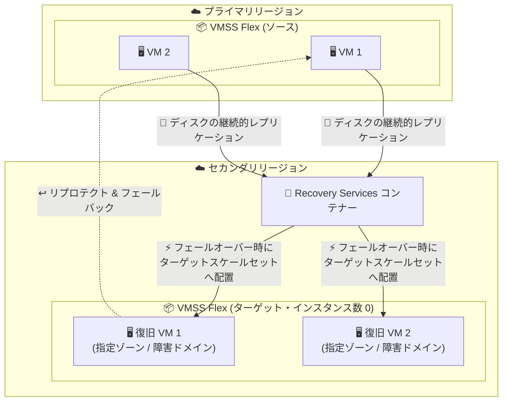

# Azure Site Recovery: VMSS Flex (柔軟なオーケストレーション) サポートの強化が一般提供開始

**リリース日**: 2026-11-03 (GA 時期: 2026 年 10 月)

**サービス**: Azure Site Recovery

**機能**: Enhanced Azure Site Recovery support for VMSS Flex

**ステータス**: Launched (GA)

[このアップデートのインフォグラフィックを見る](https://takech9203.github.io/azure-news-summary/20261103-site-recovery-vmss-flex.html)

## 概要

Azure Site Recovery (ASR) が、柔軟なオーケストレーション (Flexible orchestration) を使用する Virtual Machine Scale Sets (VMSS Flex) 内の仮想マシンに対して、強化されたディザスターリカバリー (DR) エクスペリエンスを提供するようになりました。今回のアップデートでは、ターゲット構成の設定と、フェールオーバー・リプロテクト (再保護)・フェールバックを含むエンドツーエンドの復旧ワークフローが改善されています。

VMSS Flex 内の VM は、リージョン間 (region-to-region) または同一リージョン内の可用性ゾーン間 (zone-to-zone) でレプリケートでき、フェールオーバー時には復旧先にあらかじめ用意したターゲットの VMSS Flex 内に復旧 VM が配置されます。フェールオーバー後はリプロテクトを実行して元のロケーションへフェールバックすることも可能で、DR サイクル全体が VMSS Flex 構成を維持したまま完結します。

保護は VM 単位で行われ、スケールセット内の各 VM は個別のレプリケートアイテムとして扱われます。複数の VM をまとめてフェールオーバーしたい場合は、復旧計画 (Recovery Plan) に追加します。

**アップデート前の課題**

- VMSS Flex 内の VM に対する DR では、ターゲット (復旧先) の構成オプションが限定的で、フェールオーバー後の復旧ワークフロー全体の操作性に改善の余地があった (公式アナウンスで「ターゲット構成とエンドツーエンドの復旧ワークフローを改善」と明記)

**アップデート後の改善**

- ターゲットの VMSS Flex、可用性ゾーン、障害ドメイン (フォールトドメイン) をレプリケーション有効化時に明示的に構成可能
- フェールオーバー時に復旧 VM が、構成したターゲットスケールセット内の指定ゾーン・障害ドメインへ配置される
- フェールオーバー → リプロテクト → フェールバック → 再リプロテクトという DR サイクル全体がサポートされ、フェールバック後も元のスケールセット構成が維持される
- 保護有効化後もターゲットスケールセットの変更が可能 (同じタイプのスケールセットに限る)

## アーキテクチャ図



VMSS Flex 内の各 VM のディスクはセカンダリリージョンへ継続的にレプリケートされ、フェールオーバー時には事前に作成したターゲット VMSS Flex 内の指定ゾーン・障害ドメインに復旧 VM が配置されます。その後リプロテクトとフェールバックにより元のリージョンへ戻すことができます。

## サービスアップデートの詳細

### 主要機能

1. **VM 単位の保護 (個別レプリケートアイテム)**
   - VMSS Flex 内の各 VM を個別のレプリケートアイテムとして保護する。スケールセット全体を一括で保護することはできず、保護したい VM を個別に選択する
   - 複数 VM をまとめてフェールオーバーする場合は復旧計画 (Recovery Plan) を使用する

2. **ターゲットスケールセットの構成**
   - レプリケーション有効化前に、復旧先に VMSS Flex (VM プロファイルなし・インスタンス数 0) を作成しておく
   - レプリケーション有効化時に、ターゲットスケールセットと (該当する場合) 可用性ゾーン・障害ドメインを選択する

3. **フェールオーバー時のスケールセットへの配置**
   - フェールオーバー時、Site Recovery が復旧 VM を作成し、構成済みのターゲットスケールセット内の指定ゾーン・障害ドメインへ配置する
   - テストフェールオーバーでも同様に、ターゲットスケールセット内に検証用 VM が作成される

4. **リプロテクトとフェールバック**
   - フェールオーバー後、元のロケーションに向けてリプロテクトできる。既定では元のソーススケールセット・可用性ゾーン・障害ドメインが使用される
   - フェールバックは元のソース VM に戻すため、ソース VM のスケールセット構成が維持される
   - フェールバック後に再度リプロテクトすると、当初構成したターゲットスケールセットとゾーンを使用してレプリケーションが再開される

5. **保護後のターゲット変更**
   - 保護有効化後もターゲットスケールセットを変更可能 (ただし同じタイプ: リージョナル → リージョナル、ゾーン → ゾーンのみ)
   - ターゲットの可用性ゾーンと障害ドメインは読み取り専用。変更するにはレプリケーションの無効化・再有効化が必要

6. **容量予約 (Capacity Reservation) のサポート**
   - VMSS Flex ではスケールセットレベルの容量予約がサポートされないため、保護対象の各 VM の Site Recovery ターゲット設定で容量予約グループを関連付ける

## 技術仕様

### サポートされるソース VM デプロイ

| ソース VM のデプロイ | リージョン間 DR | ゾーン間 DR |
|------|------|------|
| ゾーン指定の VMSS Flex 内の VM | サポート | サポート |
| リージョナル VMSS Flex 内の VM (障害ドメイン数 1 以上) | サポート | 非サポート |
| 単一インスタンスのゾーン指定 VM | サポート | サポート |
| 単一インスタンスのリージョナル VM | サポート | 非サポート |
| 可用性セット内の VM | サポート | 非サポート |

### サポートされるターゲットスケールセットのタイプ

| ターゲットスケールセット | リージョン間 DR | ゾーン間 DR |
|------|------|------|
| リージョナル (障害ドメイン数 = 1) | サポート | 非サポート |
| リージョナル (障害ドメイン数 > 1) | サポート | 非サポート |
| ゾーン指定 (単一/複数ゾーン、障害ドメイン数 = 1) | サポート | サポート (ソース VM のゾーン以外のゾーンを少なくとも 1 つ含む場合) |

### ターゲットスケールセットに応じた設定項目

| ターゲットのタイプ | スケールセット | 可用性ゾーン | 障害ドメイン |
|------|------|------|------|
| リージョナル (障害ドメイン数 = 1) | 必須 | 対象外 | 不要 (単一の障害ドメインに配置) |
| リージョナル (障害ドメイン数 > 1) | 必須 | 対象外 | 任意 (未指定時はソース VM の障害ドメインを使用、存在しなければプラットフォームが割り当て) |
| 単一ゾーン (障害ドメイン数 = 1) | 必須 | 自動選択 | 不要 |
| 複数ゾーン (障害ドメイン数 = 1) | 必須 | 必須 (スケールセットがまたがるゾーンのみ選択可) | 不要 |

## 設定方法

### 前提条件

1. レプリケーションを有効化する権限を持つ Azure サブスクリプション
2. Recovery Services コンテナー (リージョン間 DR の場合はターゲットリージョンに作成)
3. [Azure-to-Azure サポートマトリックス](https://learn.microsoft.com/en-us/azure/site-recovery/azure-to-azure-support-matrix)の要件を満たし、Site Recovery へのアウトバウンド接続を持つソース VM
4. 復旧先に作成済みのターゲット VMSS Flex (VM プロファイルなし・インスタンス数 0)

### Azure Portal

1. Recovery Services コンテナーで **Site Recovery** > **Azure virtual machines** の **Enable replication** を選択
2. **Source** タブでソースのリージョン・サブスクリプション・リソースグループを選択 (ゾーン間 DR の場合は「Disaster recovery between availability zones?」で **Yes** を選択)
3. **Virtual machines** タブで保護するスケールセット内の VM を個別に選択
4. **Replication settings** タブでターゲットリージョン・リソースグループ・仮想ネットワークを選択
5. **Availability options** で **view/edit availability options** を開き、各 VM について:
   - **Target availability** で **Virtual machine scale set (Flexible)** を選択
   - ターゲットの VMSS Flex を選択 (ゾーン間 DR ではゾーン指定スケールセットのみ表示)
   - スケールセットが複数ゾーンにまたがる場合は **Availability zone** を選択
   - ターゲットがリージョナルで障害ドメイン数が 1 より大きい場合は、任意で **Fault domain** を選択
6. 必要に応じて **Capacity reservation** で容量予約グループを選択
7. **Review + Enable replication** > **Enable replication** を選択

VM 側の **Disaster recovery** ブレードからも同様に有効化できます。

### PowerShell (リプロテクト)

```powershell
# フェールバック後のリプロテクトでターゲットスケールセットと可用性ゾーンを指定
Update-AzRecoveryServicesAsrProtectionDirection -AzureToAzure `
    -ReplicationProtectedItem $item `
    -ProtectionContainerMapping $mapping `
    -LogStorageAccountId $cache.Id `
    -RecoveryResourceGroupId $targetRg.ResourceId `
    -RecoveryVirtualMachineScaleSetId $targetVmss.Id `
    -RecoveryAvailabilityZone "1"
```

## メリット

### ビジネス面

- VMSS Flex 上で稼働する本番ワークロードに対して、GA 品質のディザスターリカバリーを構成でき、事業継続性 (BCP) 要件に対応しやすくなる
- フェールオーバーからフェールバックまでの DR サイクル全体がサポートされ、DR 訓練 (テストフェールオーバー) も実施できるため、復旧手順の信頼性を検証可能

### 技術面

- 復旧 VM がターゲット VMSS Flex 内の指定した可用性ゾーン・障害ドメインに配置され、フェールオーバー後も可用性設計を維持できる
- リージョン間 DR とゾーン間 DR の両方に対応し、ゾーン冗長構成のワークロードにも適用できる
- フェールバック時にソース VM のスケールセット構成が維持されるため、復旧後の構成ドリフトを抑制できる
- 容量予約グループを VM ごとに関連付けることで、フェールオーバー時のキャパシティを確保できる

## デメリット・制約事項

- **Uniform オーケストレーションは非サポート**: 対象は Flexible オーケストレーションのみ
- **スケールセット構成はレプリケートされない**: ターゲットスケールセットの作成、構成、VM プロファイル、自動スケール設定、インスタンス数のコピーは行われず、ユーザー自身がターゲット VMSS Flex を事前に作成・構成する必要がある
- **新規インスタンスは自動保護されない**: レプリケーション有効化後にスケールセットへ追加された VM (自動スケールで作成された VM を含む) は自動的には保護されず、個別に有効化が必要
- **ターゲットリソースグループの制約**: ターゲットスケールセットは復旧 VM が作成されるターゲットリソースグループ内にある必要がある。ゾーン間 DR ではソースと異なるリソースグループが必須
- **近接配置グループ**: ターゲットがスケールセットの場合、近接配置グループの構成はターゲットスケールセットから継承され、Site Recovery 側で個別に選択・構成できない
- **保護後のゾーン・障害ドメインは読み取り専用**: 変更するにはレプリケーションの無効化と再有効化が必要。また、ターゲットスケールセットの変更は同じタイプ (リージョナル/ゾーン) 間のみ可能
- **VM 拡張機能はレプリケートされない**: フェールオーバー後に復旧 VM へ必要な拡張機能をインストールする必要がある

## ユースケース

### ユースケース 1: ゾーン指定 VMSS Flex 上のアプリケーション層のリージョン間 DR

**シナリオ**: プライマリリージョンのゾーン指定 VMSS Flex で稼働するアプリケーションサーバー群を、セカンダリリージョンへレプリケートし、リージョン障害時にもスケールセット構成と可用性ゾーン配置を維持したままフェールオーバーする。

**実装例**:

1. セカンダリリージョンにターゲットリソースグループと、ゾーンにまたがる VMSS Flex (VM プロファイルなし・インスタンス数 0) を作成
2. Recovery Services コンテナーからスケールセット内の各 VM のレプリケーションを有効化し、ターゲットとして作成した VMSS Flex と可用性ゾーンを指定
3. 対象 VM 群を復旧計画 (Recovery Plan) に追加し、まとめてフェールオーバーできるようにする
4. テストフェールオーバーで復旧 VM がターゲットスケールセットの期待するゾーンに配置されることを検証

**効果**: リージョン障害時にもアプリケーション層の可用性設計 (ゾーン配置) を維持した復旧が可能になり、フェールバックまで含めた DR 運用を確立できる。

### ユースケース 2: 同一リージョン内のゾーン間 DR

**シナリオ**: 可用性ゾーンをまたぐ移動が制約されるワークロードや、リージョン間レプリケーションの要件がないワークロードについて、同一リージョン内の別ゾーンへの DR を構成する。

**実装例**: ソースとは異なるリソースグループに、ソース VM のゾーン以外のゾーンを少なくとも 1 つ含むゾーン指定 VMSS Flex を作成し、「Disaster recovery between availability zones?」を **Yes** にしてレプリケーションを有効化する。

**効果**: データセンター (ゾーン) 障害に対する復旧性を、リージョン間 DR より小さい構成変更で確保できる。

## 料金

Azure Site Recovery は保護対象インスタンス数に基づく課金で、課金単位は「月間の 1 日平均保護インスタンス数」です。

- 保護対象の各インスタンスは **最初の 31 日間は無料** で、32 日目以降に課金が開始される (新規に追加した各インスタンスごとに適用)
- Azure リージョン間の DR は「Azure への復旧」と同じレートで課金される
- ライセンス料金とは別に、Azure Storage、ストレージトランザクション、リージョン外へ出る圧縮済みレプリケーションデータの送信 (egress)、フェールオーバー時のコンピューティングの料金が発生し得る

インスタンスあたりの具体的な月額料金は、[Azure Site Recovery 料金ページ](https://azure.microsoft.com/pricing/details/site-recovery/)を参照してください。

## 利用可能リージョン

公式アナウンスにリージョン情報の記載はありません。詳細は [Azure-to-Azure サポートマトリックス](https://learn.microsoft.com/en-us/azure/site-recovery/azure-to-azure-support-matrix)を参照してください。

## 関連サービス・機能

- **Virtual Machine Scale Sets (Flexible orchestration)**: 本アップデートの保護対象。ソース/ターゲットの両方で使用し、ターゲット側はユーザーが事前に作成する
- **Recovery Services コンテナー**: Site Recovery のレプリケーション管理の中核。リージョン間 DR ではターゲットリージョンに作成する
- **復旧計画 (Recovery Plan)**: スケールセット内の複数 VM をグループとしてまとめてフェールオーバーするために使用する
- **容量予約 (Capacity Reservation)**: フェールオーバー時のコンピューティング容量確保のため、保護対象の各 VM のターゲット設定で容量予約グループを関連付ける
- **近接配置グループ (Proximity Placement Group)**: ターゲットスケールセットに設定したものがフェールオーバー時に使用される

## 参考リンク

- [インフォグラフィック](https://takech9203.github.io/azure-news-summary/20261103-site-recovery-vmss-flex.html)
- [公式アップデート情報](https://azure.microsoft.com/updates?id=578926)
- [Microsoft Learn: Enable disaster recovery for VMs in Virtual Machine Scale Sets with Flexible orchestration](https://learn.microsoft.com/en-us/azure/site-recovery/azure-to-azure-how-to-enable-replication-vmss-flex)
- [Microsoft Learn: Azure-to-Azure サポートマトリックス](https://learn.microsoft.com/en-us/azure/site-recovery/azure-to-azure-support-matrix)
- [料金ページ](https://azure.microsoft.com/pricing/details/site-recovery/)

## まとめ

Azure Site Recovery の VMSS Flex サポート強化が一般提供 (GA) となり、VMSS Flex 内の VM について、ターゲットスケールセット・可用性ゾーン・障害ドメインの明示的な構成と、フェールオーバー・リプロテクト・フェールバックを含むエンドツーエンドの復旧ワークフローが本番利用可能になりました。VMSS Flex 上で本番ワークロードを運用している場合は、ターゲット VMSS Flex の事前作成が必要である点、スケールセットへ追加した新規 VM は自動保護されない点に留意しつつ、テストフェールオーバーによる DR 訓練を含めた保護構成の導入を検討することを推奨します。

---

**タグ**: Azure Site Recovery, VMSS Flex, Virtual Machine Scale Sets, Disaster Recovery, Management and governance, Migration, GA
