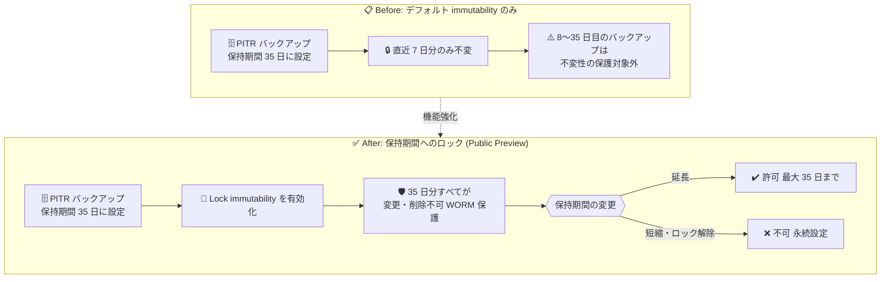

# Azure SQL Database / Azure SQL Managed Instance: PITR バックアップの Immutability (不変性) 拡張

**リリース日**: 2026-11-03

**サービス**: Azure SQL Database / Azure SQL Managed Instance

**機能**: Extend immutability for PITR backups (PITR バックアップの不変性拡張)

**ステータス**: In preview

[このアップデートのインフォグラフィックを見る](https://takech9203.github.io/azure-news-summary/20261103-sql-pitr-backup-immutability.html)

## 概要

Azure SQL Database および Azure SQL Managed Instance のポイントインタイムリストア (PITR) バックアップについて、不変性 (immutability) を構成済みの PITR 保持期間に合わせてロック・拡張できる機能がパブリックプレビューとして発表されました。

Azure SQL の PITR バックアップには、直近最大 7 日分を自動的に保護するデフォルトの immutability が追加費用なしで提供されています。しかし、PITR 保持期間を 7 日より長く (最大 35 日) 設定しても、デフォルトでは直近 7 日分しか不変性の保護対象になりませんでした。今回の機能強化により、「Lock immutability to configured PITR backup retention period」を有効化することで、構成済みの PITR 保持期間全体 (最大 35 日) にわたってバックアップを変更・削除不可の状態で保護できます。これは、35 日間の保持要件を持つことが多い金融業界の顧客に特に有用です。

一度ロックを有効化すると設定はデータベースの存続期間にわたって永続的であり、PITR 保持期間は延長のみ可能で短縮はできなくなります。ランサムウェアや悪意のある操作、侵害された管理者資格情報による復旧ポイントの削除・改ざんに対する防御を強化する機能です。

**アップデート前の課題**

- PITR バックアップのデフォルト immutability は直近最大 7 日分に限定されており、PITR 保持期間を 35 日に設定しても保持期間全体は不変性で保護されなかった
- 金融規制 (SEC Rule 17a-4(f)、CFTC Rule 1.31(d)、FINRA の記録保持要件など) で求められる長期の改ざん防止要件を、PITR バックアップ単体では満たしにくかった

**アップデート後の改善**

- 構成済みの PITR 保持期間 (最大 35 日) 全体に immutability をロック・拡張できるようになった
- マネージドバックアップサービスに統合されており、ストレージアカウントの作成や Azure Storage の immutability ポリシーの管理は不要
- データベースを削除しても、保持されているバックアップは構成された期間中、不変のまま保護される

## アーキテクチャ図



デフォルトでは PITR 保持期間を長く設定しても直近 7 日分しか不変性で保護されませんが、ロックを有効化すると構成済み保持期間全体が WORM (Write Once, Read Many) 相当の保護対象となります。ロック後は保持期間の延長のみ許可されます。

## サービスアップデートの詳細

### 主要機能

1. **デフォルト immutability (既存機能)**
   - 直近最大 7 日分の PITR バックアップを自動的に不変として保護
   - 設定不要・追加費用なしで提供される

2. **構成済み PITR 保持期間への immutability ロック (今回のプレビュー機能)**
   - 「Lock immutability to configured PITR backup retention period」を有効化すると、構成済みの PITR 保持期間 (例: 35 日) 全体に不変性が適用される
   - Azure portal、Azure CLI、Azure PowerShell から設定可能

3. **ロックの永続性**
   - ロックは永続的で、有効化後に無効化することはできない
   - PITR 保持期間は延長のみ可能 (例: 14 日でロック後に 35 日へ延長は可能だが、その後 14 日へ戻すことは不可)

4. **データベース削除時の保護継続**
   - ロックはデータベースの削除自体は妨げない (リソース削除ロックではない)
   - データベースを削除しても、保持されているバックアップは該当する期間中、不変のまま保護される

## 技術仕様

| 項目 | 詳細 |
|------|------|
| 対象サービス | Azure SQL Database、Azure SQL Managed Instance |
| デフォルト immutability | 直近最大 7 日分の PITR バックアップ (自動・設定不要) |
| ロック時の immutability 期間 | 構成済みの PITR 保持期間 (最大 35 日、サービスレベルの上限に依存) |
| PITR 保持期間の変更 | ロック後は延長のみ可能、短縮不可 |
| ロックの解除 | 不可 (永続設定、データベースの存続期間にわたって有効) |
| 基盤技術 | Azure Storage の immutable storage (WORM) 機能 |
| 対象外 | Hyperscale サービスレベル (Hyperscale へ移行するとバックアップは immutability 保護を失う) |
| SQL Managed Instance の条件 | Update policy が **Always-up-to-date** または **SQL Server 2025** のインスタンスのみ (SQL Server 2022 ポリシーは対象外) |

## 設定方法

### 前提条件

1. サービスレベルがバックアップ immutability をサポートしていること (Hyperscale は対象外)
2. SQL Managed Instance の場合、Update policy が Always-up-to-date または SQL Server 2025 であること
3. データベースの短期バックアップ保持ポリシーを更新できる権限を持つアカウントを使用すること
4. ロックは永続的なため、短縮の必要がない保持期間を事前に決定しておくこと

### Azure CLI

```bash
# Azure SQL Database: PITR 保持期間を 35 日に設定し、immutability をロック
az sql db str-policy set \
  --resource-group "myResourceGroup" \
  --server "mySqlServer" \
  --name "myDatabase" \
  --retention-days 35 \
  --lock-immutability true

# Azure SQL Managed Instance: PITR 保持期間を 35 日に設定し、immutability をロック
az sql midb short-term-retention-policy set \
  --resource-group "myResourceGroup" \
  --mi "myManagedInstance" \
  --name "myDatabase" \
  --retention-days 35 \
  --lock-immutability true
```

`--lock-immutability false` を指定してもロック解除操作にはならず、有効化済みのロックは戻せない点に注意が必要です。

### Azure PowerShell

```powershell
# Azure SQL Database
Set-AzSqlDatabaseBackupShortTermRetentionPolicy `
    -ResourceGroupName "myResourceGroup" `
    -ServerName "mySqlServer" `
    -DatabaseName "myDatabase" `
    -RetentionDays 35 `
    -LockImmutability $true
```

### Azure Portal

1. SQL 論理サーバー (または Managed Instance) を開き、**Backups** > **Retention policies** を選択
2. 対象データベースを選択し、**Configure policies** を開く
3. **Point-in-time restore** で PITR バックアップの保持日数 (例: 35 日) を設定
4. **Lock immutability to configured PITR backup retention period** を選択
5. ロック後は保持期間の延長のみ許可される旨の警告を確認し、変更を適用

## メリット

### ビジネス面

- SEC Rule 17a-4(f)、CFTC Rule 1.31(d)、FINRA の記録保持要件など、金融規制のコンプライアンス対応を支援 (Azure Storage の immutable storage は Cohasset により検証済み)
- 35 日間の保持要件を持つ金融顧客のニーズに PITR バックアップで対応可能
- ランサムウェア攻撃や内部不正による復旧ポイント喪失のリスクを低減

### 技術面

- マネージドバックアップサービスに統合されており、ストレージアカウントや Azure Storage の immutability ポリシーを別途管理する必要がない
- 特権管理者の資格情報が侵害された場合でも、保護期間中のバックアップの変更・削除を防止
- データベース削除後もバックアップの不変保護が継続

## デメリット・制約事項

- **ロックは永続的で解除不可**。有効化後は PITR 保持期間の短縮もできないため、一時的なテスト目的で有効化してはならない
- Hyperscale サービスレベルでは利用不可。非 Hyperscale から Hyperscale へ移行するとバックアップは immutability 保護を失う
- SQL Managed Instance では Update policy が SQL Server 2022 のインスタンスは対象外
- ロックはサービスレベルがサポートする最大 PITR 保持期間を引き上げるものではない (35 日がすべてのレベルでサポートされるわけではない)
- ロックは LTR (長期保持) の構成やリソース削除の防止は行わない
- SQL Managed Instance でデータベースの CRUD 操作が非常に多い環境 (月間約 5,000 回) では、一部データベースのバックアップに immutability が適用されない場合がある
- 保持期間の延長は、既に期限切れになったバックアップを復元するものではない (復元可能な履歴は時間の経過とともに拡大する)

## ユースケース

### ユースケース 1: 金融機関における 35 日間の改ざん防止バックアップ

**シナリオ**: 金融規制により 35 日間のバックアップ保持と改ざん防止が求められる基幹データベースで、PITR バックアップ全体を不変として保護したい。

**実装例**:

```bash
az sql db str-policy set \
  --resource-group "finance-rg" \
  --server "finance-sql-server" \
  --name "core-banking-db" \
  --retention-days 35 \
  --lock-immutability true
```

**効果**: 35 日分の PITR バックアップすべてが変更・削除不可となり、特権管理者の資格情報が侵害された場合やランサムウェア攻撃時にも復旧ポイントが保全される。

## 料金

- デフォルトの immutability (最大 7 日) は追加費用なしで提供されます。
- バックアップの保持およびストレージには、既存のサービス料金 (バックアップストレージの従量課金) が引き続き適用されます。保持期間を延長すると、その分バックアップストレージの消費量と費用が増加する点に留意してください。

詳細は料金ページを参照: [Azure SQL Database の料金](https://azure.microsoft.com/pricing/details/azure-sql-database/single/)

## 関連サービス・機能

- **長期保持 (LTR) バックアップの immutability**: 10 年までの LTR バックアップに対しては、時間ベースおよびリーガルホールドの immutability が別機能として提供されている (時間ベースは GA)。今回の機能は短期保持 (PITR) バックアップが対象
- **Azure Storage (immutable storage)**: 本機能の保護を実現する基盤。WORM (Write Once, Read Many) 状態での保存を提供
- **論理サーバーの論理的削除 (soft delete、プレビュー)**: 削除された SQL 論理サーバーを保持期間内に復元できる機能。バックアップ保護とリソース復旧を補完する

## 参考リンク

- [インフォグラフィック](https://takech9203.github.io/azure-news-summary/20261103-sql-pitr-backup-immutability.html)
- [公式アップデート情報](https://azure.microsoft.com/updates?id=579305)
- [Microsoft Learn: Automatic backup immutability for Azure SQL Database and Azure SQL Managed Instance](https://learn.microsoft.com/azure/azure-sql/automatic-backup-immutability)
- [Microsoft Learn: Automated backups in Azure SQL Database](https://learn.microsoft.com/azure/azure-sql/database/automated-backups-overview)
- [Microsoft Learn: Backup immutability for long-term retention backups](https://learn.microsoft.com/azure/azure-sql/database/backup-immutability)
- [料金ページ](https://azure.microsoft.com/pricing/details/azure-sql-database/single/)

## まとめ

Azure SQL Database / Azure SQL Managed Instance の PITR バックアップについて、デフォルトの 7 日間を超えて構成済み保持期間 (最大 35 日) 全体に immutability をロック・拡張できる機能がパブリックプレビューになりました。金融規制などで長期の改ざん防止保持が求められる環境において、追加のストレージ管理なしで復旧ポイントを保全できる重要な機能です。ただし、ロックは永続的で解除や保持期間の短縮ができないため、本番適用前に保持要件・バックアップストレージコスト・対象サービスレベル (Hyperscale 非対応、SQL MI の Update policy 条件) を十分に確認したうえで有効化することを推奨します。

---

**タグ**: Azure SQL Database, Azure SQL Managed Instance, Backup, Immutability, PITR, Security, Compliance, Preview
