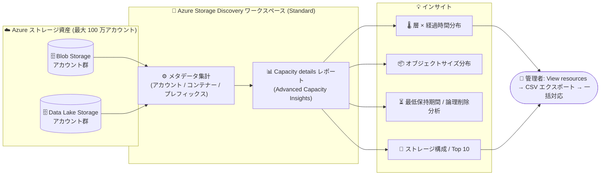

# Azure Storage Discovery: 高度な容量インサイト (Advanced Capacity Insights) がパブリックプレビュー

**リリース日**: 2026-11-03

**サービス**: Azure Storage Discovery

**機能**: Advanced Capacity Insights (高度な容量インサイト)

**ステータス**: In preview

[このアップデートのインフォグラフィックを見る](https://takech9203.github.io/azure-news-summary/20261103-storage-discovery-capacity-insights.html)

## 概要

Azure Storage Discovery において、高度な容量インサイト (Advanced Capacity Insights) がパブリックプレビューとして利用可能になった。Storage Discovery は Azure Blob Storage / Azure Data Lake Storage の利用状況を組織全体 (最大 100 万ストレージアカウント) で可視化するフルマネージドサービスであり、今回のアップデートにより、アクセスパターン、データ年齢、ストレージ層 (アクセス層)、オブジェクトサイズ分布、保持 (retention) の状態、バージョニングといった、より深い分析軸での可視化が可能になった。

新しいインサイトは Azure Portal の Storage Discovery ワークスペース内の「Capacity details」レポートとして提供される。従来の「Capacity overview」レポートが「どれだけのストレージを保有しているか」を示すのに対し、「Capacity details」は「ストレージをどのように消費しているか」を示す位置付けとなる。インサイトはストレージアカウント・コンテナー・設定済みプレフィックスの各レベルでオブジェクトメタデータを集計したものであり、個々の BLOB のインベントリを提供するものではない。

これらのインサイトにより、コスト削減機会の特定、ストレージ増加要因の把握、大規模なストレージ管理の意思決定を支援する。

**アップデート前の課題**

- Storage Discovery の容量レポートは合計容量・オブジェクト数・トレンドなどの概要が中心で、アクセス層やデータの古さ、オブジェクトサイズの内訳といった「消費のされ方」までは把握できなかった
- 階層化 (Tiering) の最適化余地や、最低保持期間内のデータ削除による早期削除課金のリスクを、組織全体のスケールで横断的に評価する手段がなかった
- バージョン、スナップショット、論理削除 (ソフトデリート) 済みデータが容量に占める割合を、複数アカウントを横断して分析することが難しかった

**アップデート後の改善**

- 作成日時・最終アクセス日時・最終更新日時の各時間軸で、Hot / Cool / Cold / Archive 層ごとの容量・オブジェクト数分布を分析でき、不適切な層に置かれたデータを発見できる
- オブジェクトサイズ分布 (0-1 KB 〜 1 TB 超の 5 バケット)、最低保持期間内データの早期削除リスク、ストレージ構成 (現行データ / 旧バージョン / スナップショット / 論理削除済み)、論理削除データの残存保持期間などを可視化できる
- 各チャートから「View resources」で対象リソース一覧へドリルダウンし、CSV エクスポートしてスクリプトや Terraform での一括操作に活用できる

## アーキテクチャ図



組織内の Blob Storage / Data Lake Storage のメタデータを Storage Discovery ワークスペースが集計し、「Capacity details」レポートとして層・サイズ・保持などの高度なインサイトを提供する。各チャートからリソース一覧へドリルダウンし、是正アクションにつなげられる。

## サービスアップデートの詳細

### 主要機能

1. **層 × 経過時間の分析 (Size by tier and recency)**
   - Hot / Cool / Cold / Archive 層ごとの容量またはオブジェクト数を、作成日時・最終アクセス日時・最終更新日時の時間軸 (0-3 日〜 365 日超の 7 区分) で比較
   - ホット層に残る古い非アクティブデータや、コールド層にある高頻度アクセスデータを発見し、ライフサイクル管理の見直しにつなげる

2. **オブジェクトサイズ分布 (Size-bucket distribution)**
   - 0-1 KB / 1 KB-1 MB / 1 MB-1 GB / 1 GB-1 TB / 1 TB 超の 5 区分で、容量とオブジェクト数の割合を比較
   - 小さいオブジェクトの集中 (運用・コスト分析が必要なワークロードの発見) や、容量を支配する大型オブジェクトの特定に活用

3. **最低保持期間の分析 (Minimum retention analysis)**
   - Cool (30 日) / Cold (90 日) / Archive (180 日) の最低保持期間内にあるデータを特定
   - 期間満了前の削除・上書き・層変更による早期削除課金のリスクを、変更前に把握できる

4. **ストレージ構成 (Storage composition)**
   - 現行データ、旧 BLOB バージョン、スナップショット、論理削除済みデータの容量比較
   - 非現行データ・保持データが容量に占める割合を把握し、ライフサイクル / 保持設定の見直し対象を特定

5. **論理削除データの保持分析 (Soft-deleted retention)**
   - 論理削除済みデータの残存保持期間別にサイズ・件数を比較し、復旧可能期間と課金対象容量への影響を把握

6. **Top 10 ランキング**
   - ストレージアカウント・コンテナー・設定済みプレフィックスをサイズまたはオブジェクト数でランキング (上位 / 下位 / 急成長 / 急減少)
   - 調査すべきリソースの優先順位付けに活用

7. **リソースへのドリルダウンと CSV エクスポート**
   - 各チャートの「View resources」からリソース一覧を表示し、フィルター・ソート・列編集・CSV ダウンロードが可能

## 技術仕様

| 項目 | 詳細 |
|------|------|
| 提供レポート | Storage Discovery ワークスペースの「Capacity details」レポート |
| 対象サービス | Azure Blob Storage、Azure Data Lake Storage |
| 集計レベル | ストレージアカウント / コンテナー / 設定済みプレフィックス (個別 BLOB のインベントリは提供しない) |
| 必要プラン | Standard プラン (プレビュー期間中は既存ワークスペースでのみ有効化可能。作成時には有効化不可) |
| データ反映 | 有効化後、最大 48 時間でインサイトが表示開始 |
| プレビュー時のカバレッジ | Discovery スコープあたり最大 50,000 ストレージアカウント (サイズ優先)。フラット名前空間アカウントあたり最大 100 億オブジェクト、階層型名前空間アカウントあたり最大 50 億オブジェクト |
| コンテナーレベルのインサイト | 各アカウントのサイズ上位 100 コンテナーまで |
| 設定済みプレフィックス | ワークスペースあたり最大 100 件 |
| 最終アクセス日時の分析 | 最終アクセス時刻追跡 (last access time tracking) が有効なストレージアカウントのみ対象 |

## 設定方法

### 前提条件

1. Standard プランの Storage Discovery ワークスペース (Free プランの場合は有効化時に Standard へのアップグレードを促される)
2. ワークスペースをデプロイする ID に workspaceRoots (サブスクリプション / リソースグループ) への **Reader** 以上のアクセス権と `Microsoft.Storage/storageAccounts/read` 権限
3. 有効化時の追加アクセスチェックに合格すること
4. プレビュー対応リージョンでの利用 (「利用可能リージョン」参照)

### Azure Portal (Advanced Capacity Insights の有効化)

1. Azure Portal で Storage Discovery ワークスペースを開く
2. ワークスペースの **Overview** ページの **Essentials** セクションで **Capacity details** を探す
3. **Enable** を選択
4. Free プランの場合は、プロンプトに従い **Standard** プランへアップグレード
5. 追加のアクセスチェックを完了 (失敗した場合は報告された権限を修正して再試行)
6. 有効化後、最大 48 時間でインサイトが表示され始める

### Azure CLI (ワークスペースの新規作成)

```bash
# Standard プランで Storage Discovery ワークスペースを作成
az storage-discovery workspace create \
    --resource-group <your-resource-group> \
    --name <your-workspace-name> \
    --location <azure-region> \
    --workspace-roots "/subscriptions/<your-subscription-id>/resourceGroups/<your-resource-group>" \
    --scopes '[{"displayName":"basic","resourceTypes":["Microsoft.Storage/storageAccounts"]}]' \
    --sku Standard \
    --description "Optional description"
```

なお、プレビュー期間中、Advanced Capacity Insights の有効化はワークスペース作成時には行えず、作成済みワークスペースに対して Portal から有効化する。

## メリット

### ビジネス面

- ホット層に滞留する非アクティブデータの発見により、ストレージコスト削減の機会を組織全体のスケールで特定できる
- 早期削除課金のリスク (最低保持期間内データ) を事前に把握し、想定外のコスト発生を回避できる
- ストレージ増加の要因 (急成長リソース、非現行データの蓄積など) を把握し、データ管理方針の意思決定を支援する

### 技術面

- フルマネージドで追加インフラ不要。Blob Inventory のような個別アカウントごとの設定なしに、アカウント・コンテナー・プレフィックスレベルの集計を横断的に取得できる
- 各チャートからリソース一覧へのドリルダウンと CSV エクスポートにより、是正アクション (ライフサイクルポリシー設定、一括操作スクリプト) へスムーズに移行できる
- リージョン、パフォーマンス種別、暗号化、冗長性、タグ、期間などによるフィルターで分析対象を柔軟に絞り込める

## デメリット・制約事項

- プレビュー段階であり、本番用途以外 (非運用環境・テスト) での利用が前提
- Standard プラン (有償) が必須。Free プランでは利用できず、Free プランへ変更すると Advanced Capacity Insights は利用不可になる
- プレビュー期間中は既存ワークスペースでのみ有効化可能 (ワークスペース作成時には有効化できない)
- 有効化後、初期データの反映に最大 48 時間かかる
- カバレッジ制限あり: スコープあたり最大 50,000 アカウント、コンテナーレベルは各アカウントの上位 100 コンテナーのみ、プレフィックスは最大 100 件。オブジェクト数上限を超えるアカウントはレポートに含まれない場合がある
- 「最終アクセス日時」ベースの分析は、最終アクセス時刻追跡が有効なアカウントのみ対象。無効なアカウントがあると結果が不完全になる
- 対応リージョンが限定されている (順次拡大予定)。対応リージョン内でもカバレッジが部分的な場合がある
- 無効化すると新規インサイトの生成が停止し、再有効化時にはアクセスチェックを再度完了する必要がある

## ユースケース

### ユースケース 1: アクセス層の最適化によるコスト削減

**シナリオ**: 数百のストレージアカウントを持つ組織で、長期間アクセスされていないデータがホット層に残っておりコストが膨らんでいる。どのアカウント・コンテナーから階層化を進めるべきか優先順位を付けたい。

**実装例**:

1. ワークスペースの「Capacity details」レポートを開き、分析対象の Discovery スコープを選択
2. 「Size by tier and recency」チャートで View を **Last accessed time**、By を **Size** に設定
3. 「365 日超」かつ Hot 層のセグメントを確認し、**View resources** で該当アカウント・コンテナーを特定
4. **Download as CSV** で一覧をエクスポートし、ライフサイクル管理ポリシー (Cool / Archive への自動階層化) を適用

**効果**: 組織全体から階層化の効果が大きいリソースをデータに基づいて特定し、ストレージコストを削減できる。変更前に「Minimum retention analysis」で早期削除課金のリスクも確認できる。

### ユースケース 2: 非現行データ (バージョン・論理削除) の棚卸し

**シナリオ**: バージョニングとソフトデリートを有効にしているストレージで、課金対象容量のうち現行データ以外が占める割合を把握し、保持設定を見直したい。

**実装例**:

1. 「Capacity details」レポートの「Storage composition」チャートで、現行データ / 旧バージョン / スナップショット / 論理削除済みデータの容量を比較
2. 「Soft-deleted retention」チャートで、論理削除データの残存保持期間と、寄与の大きいアカウント・コンテナーを特定
3. 保持期間設定やバージョンのライフサイクルポリシーを見直し

**効果**: 非現行データによる容量・コストへの影響を定量的に把握し、保持ポリシーの適正化につなげられる。

## 料金

Azure Storage Discovery には Free と Standard の 2 つの料金プランがあり、Advanced Capacity Insights の利用には **Standard プラン** が必要。Standard プランでは、スコープ内のストレージリソース数 (ストレージアカウントなど) とデータオブジェクト数 (BLOB など) に応じて課金される (分析数が増えるほど平均単価は低下)。インサイトの保存・取得・生成自体に追加料金はかからない。ワークスペースごとに個別に課金され、同じストレージリソースを複数の有償ワークスペースに含めるとそれぞれのワークスペースで課金される。

| プラン | 容量インサイト | トランザクション | 構成 | 履歴 |
|------|------|------|------|------|
| Free | トレンド / 分布 / 上位アカウント | なし | なし | バックフィル 15 日 / 保持 15 日 |
| Standard | トレンド / 分布 / 上位アカウント | トレンド / 分布 / 上位アカウント | リソース構成 / セキュリティ構成 | バックフィル 15 日 / 保持 18 か月 |

具体的な単価は [Azure Storage Discovery 料金ページ](https://azure.microsoft.com/pricing/details/azure-storage-discovery) を参照。

## 利用可能リージョン

プレビュー期間中、Advanced Capacity Insights は 50 以上のリージョンで段階的に提供されている (順次拡大予定)。2026 年 10 月 22 日から Australia Central、Belgium Central、Canada Central / East、France Central / South、East Asia、Denmark East など、2026 年 11 月 2 日から East US / East US 2、West Europe、North Europe、UK South、**Japan East / Japan West**、Southeast Asia、Korea Central など多数のリージョンで利用可能。

対応リージョン内でもカバレッジが部分的な場合がある。全リージョンの一覧は [Analyze Blob capacity details](https://learn.microsoft.com/en-us/azure/storage-discovery/analyze-blob-capacity-details) を参照。

## 関連サービス・機能

- **Azure Blob Storage / Azure Data Lake Storage**: 分析対象となるストレージサービス。アクセス層 (Hot / Cool / Cold / Archive)、バージョニング、ソフトデリート、最終アクセス時刻追跡などの機能がインサイトの分析軸となる
- **Blob ライフサイクル管理**: インサイトで特定した非アクティブデータの自動階層化・削除ポリシー設定に活用。本アップデートの主要な是正アクション先
- **Azure Blob Inventory**: 個別 BLOB レベルのインベントリを提供する補完機能。Storage Discovery は集計ベースのインサイトを提供し、両者のレポート比較方法もドキュメント化されている
- **Azure Copilot**: Storage Discovery と統合されており、クエリ言語を使わずに自然言語でインサイトを取得可能

## 参考リンク

- [インフォグラフィック](https://takech9203.github.io/azure-news-summary/20261103-storage-discovery-capacity-insights.html)
- [公式アップデート情報](https://azure.microsoft.com/updates?id=578655)
- [Azure Storage Discovery 概要 (Microsoft Learn)](https://learn.microsoft.com/en-us/azure/storage-discovery/overview)
- [Analyze Blob capacity details (Microsoft Learn)](https://learn.microsoft.com/en-us/azure/storage-discovery/analyze-blob-capacity-details)
- [ワークスペースの作成と Advanced Capacity Insights の有効化 (Microsoft Learn)](https://learn.microsoft.com/en-us/azure/storage-discovery/create-workspace)
- [Storage Discovery の料金 (Microsoft Learn)](https://learn.microsoft.com/en-us/azure/storage-discovery/pricing)
- [料金ページ](https://azure.microsoft.com/pricing/details/azure-storage-discovery)

## まとめ

Azure Storage Discovery の Advanced Capacity Insights により、組織全体の Blob Storage / Data Lake Storage について、アクセス層 × 経過時間、オブジェクトサイズ分布、最低保持期間リスク、バージョン / スナップショット / 論理削除データの構成といった「消費のされ方」まで踏み込んだ分析が可能になった。大規模なストレージ資産を持つ組織にとって、コスト最適化とデータ管理の意思決定を強力に支援するアップデートである。

Standard プランの既存ワークスペースを持つ場合は、「Capacity details」を有効化し (反映まで最大 48 時間)、まず「Size by tier and recency」で階層化の最適化余地を確認することを推奨する。最終アクセス日時ベースの分析を活用するには、対象ストレージアカウントで最終アクセス時刻追跡を有効にしておくこと。プレビュー段階のためカバレッジ制限 (アカウント数・コンテナー数・プレフィックス数) とリージョン制限に注意し、本番の意思決定に用いる際はドキュメントで最新の制限を確認されたい。

---

**タグ**: Storage, Storage Accounts, Azure Storage Discovery, Blob Storage, Data Lake Storage, Cost Optimization, Public Preview
