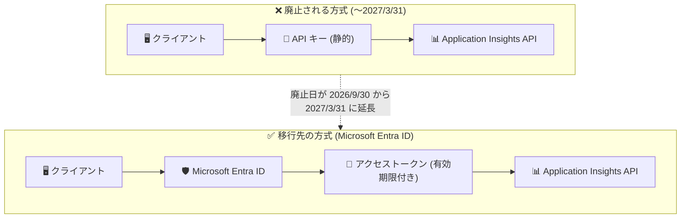

# Azure Monitor: Application Insights API キー廃止日が 2027 年 3 月 31 日に再延長

**リリース日**: 2026-11-04

**サービス**: Azure Monitor / Application Insights

**機能**: Application Insights データクエリ用 API キーの廃止日延長 (Microsoft Entra ID 認証への移行)

**ステータス**: Retirement (廃止日: 2027 年 3 月 31 日)

[このアップデートのインフォグラフィックを見る](https://takech9203.github.io/azure-news-summary/20261104-app-insights-api-keys-retirement-extended.html)

## 概要

Application Insights のデータクエリに使用される API キーの廃止日が、**2027 年 3 月 31 日に再延長** された。この廃止は当初 2026 年 3 月 31 日に予定され、その後 2026 年 9 月 30 日へ延長されていたが ([既存レポート](./2026-04-21-monitor-application-insights-entra-id-retirement.md) 参照)、今回のアナウンスでさらに約半年間延長された形となる。

廃止の内容自体に変更はない。2027 年 3 月 31 日以降、Application Insights のデータをクエリするための API キーは利用できなくなり、Microsoft Entra ID (旧 Azure AD) による認証への移行が必要となる。Entra ID 認証は API キーのすべての機能を提供しつつ、マネージド ID や Azure RBAC を活用したよりセキュアな認証モデルを実現する。

**アップデート前の状況**

- API キーの廃止日は 2026 年 9 月 30 日とされており、移行期限が迫っていた
- API キーは静的な資格情報であり、漏洩リスクやきめ細かなアクセス制御 (RBAC) の困難さといったセキュリティ上の課題が残っていた

**アップデート後の変更**

- 廃止日が 2027 年 3 月 31 日に延長され、移行作業に約 1 年半 (アナウンス時点) の猶予が確保された
- 移行先 (Microsoft Entra ID 認証) と移行手順に変更はなく、引き続き計画的な移行が推奨される

## アーキテクチャ図



API キー認証 (廃止予定) から Microsoft Entra ID による OAuth 2.0 認証への移行を示す。今回のアップデートで移行期限が 2027 年 3 月 31 日に延長されたが、移行先の構成自体に変更はない。

## サービスアップデートの詳細

### 主要な変更点

1. **廃止日の再延長**
   - API キーの廃止日が 2026 年 9 月 30 日から 2027 年 3 月 31 日に延長された
   - 当初の廃止予定日 (2026 年 3 月 31 日) から通算で 2 回目の延長となる

2. **廃止の内容は変更なし**
   - 2027 年 3 月 31 日以降、Application Insights のデータクエリに API キーを使用できなくなる
   - 移行先は Microsoft Entra ID 認証であり、API キーが提供していたすべての機能をカバーする

## 技術仕様

| 項目 | 詳細 |
|------|------|
| 廃止対象 | Application Insights データクエリ用 API キー |
| 新しい廃止日 | 2027 年 3 月 31 日 |
| 従来の廃止日 | 2026 年 9 月 30 日 (さらに前は 2026 年 3 月 31 日) |
| 移行先 | Microsoft Entra ID (旧 Azure AD) 認証 |
| API エンドポイント | `https://api.applicationinsights.io` |
| サポートされる OAuth 2.0 フロー | クライアント資格情報、認可コード、暗黙的フロー |
| 必要な RBAC ロール | Reader ロール (Application Insights リソーススコープ) |
| API アクセス許可 | Application Insights API - Data.Read (委任されたアクセス許可) |

## 移行手順の再確認

移行手順に変更はない。Microsoft Learn のドキュメントに基づく手順の要点は以下の通り。

### クエリ API の Entra ID 認証への移行

1. **アプリケーションの登録**: Microsoft Entra ID にクライアントアプリを登録し、API のアクセス許可で「Application Insights API」の委任されたアクセス許可「Data.Read」を追加する
2. **RBAC ロールの割り当て**: Application Insights リソースの「アクセス制御 (IAM)」で、登録したアプリに「Reader」ロールを割り当てる
3. **トークンの取得とクエリ実行**: OAuth 2.0 フロー (クライアント資格情報など) でアクセストークンを取得し、Bearer トークンで API を呼び出す

```bash
# クライアント資格情報フローでアクセストークンを取得
curl -X POST "https://login.microsoftonline.com/<テナントID>/oauth2/token" \
  -H "Content-Type: application/x-www-form-urlencoded" \
  -d "grant_type=client_credentials" \
  -d "client_id=<クライアントID>" \
  -d "client_secret=<クライアントシークレット>" \
  -d "resource=https://api.applicationinsights.io"

# Bearer トークンでクエリを実行
curl -X POST "https://api.applicationinsights.io/v1/apps/<アプリID>/query" \
  -H "Content-Type: application/json" \
  -H "Authorization: Bearer <アクセストークン>" \
  -d '{"query": "requests | take 10", "timespan": "P1D"}'
```

既存の API キーで使用していたアプリ ID は、Entra ID 認証移行後もそのまま同じ ID を使用できる。

### 移行完了後の推奨設定

移行完了後は、Application Insights リソースの「構成」→「プロパティ」からローカル認証を無効化 (`DisableLocalAuth: true`) し、Entra ID 認証のみに制限することが推奨される。Azure Policy (`Application Insights components should block non-Azure Active Directory based ingestion`) による組織全体での強制も可能である。

## デメリット・制約事項

- 延長されたとはいえ廃止自体は確定しており、移行作業は引き続き必要である
- 以下のシナリオでは Entra ID 認証がサポートされない点に注意が必要 (Microsoft Learn ドキュメントより)
  - Application Insights JavaScript SDK
  - Application Insights Java 2.x SDK (Java Agent 3.2.0 以上が必要)
  - GraalVM ネイティブアプリケーション
  - Azure App Service 上の Python 自動インストルメンテーション

## 関連サービス・機能

- **[Microsoft Entra ID](https://learn.microsoft.com/entra/identity/authentication/overview-authentication)**: 移行先の認証基盤。OAuth 2.0 によるトークンベース認証を提供
- **[Application Insights](https://learn.microsoft.com/azure/azure-monitor/app/app-insights-overview)**: 本廃止の直接的な対象となる APM サービス
- **[マネージド ID](https://learn.microsoft.com/azure/active-directory/managed-identities-azure-resources/overview)**: Azure リソースからのアクセスで推奨される認証方式。資格情報の管理が不要
- **[Azure RBAC](https://learn.microsoft.com/azure/role-based-access-control/)**: Entra ID 認証と組み合わせて、きめ細かなアクセス制御を実現

## 参考リンク

- [インフォグラフィック](https://takech9203.github.io/azure-news-summary/20261104-app-insights-api-keys-retirement-extended.html)
- [公式アップデート情報](https://azure.microsoft.com/updates?id=transition-to-azure-ad-to-query-data-from-azure-monitor-application-insights-by-31-march-2026)
- [Microsoft Learn - Application Insights の Microsoft Entra 認証](https://learn.microsoft.com/azure/azure-monitor/app/azure-ad-authentication)
- [Microsoft Learn - Azure Monitor ログ API のアプリ登録](https://learn.microsoft.com/azure/azure-monitor/logs/api/register-app-for-token)
- [既存レポート: API キーの廃止と Entra ID への移行 (2026-04-21)](./2026-04-21-monitor-application-insights-entra-id-retirement.md)

## まとめ

Application Insights のデータクエリ用 API キーの廃止日が 2026 年 9 月 30 日から 2027 年 3 月 31 日に再延長された。廃止の内容と移行先 (Microsoft Entra ID 認証) に変更はない。

Solutions Architect として推奨されるアクションは以下の通りである。

1. **期限の更新**: 社内の移行計画・期限管理を新しい廃止日 (2027 年 3 月 31 日) に更新する
2. **移行の継続**: 延長を理由に移行を先送りせず、API キーを使用しているアプリケーションや自動化パイプラインの Entra ID 認証 (マネージド ID またはサービスプリンシパル) への移行を計画通り進める
3. **ローカル認証の無効化**: 移行が完了したリソースではローカル認証を無効化し、セキュリティ態勢を強化する

2 回の延長が行われているが、静的な API キーの利用はセキュリティ上のリスクであり、期限を待たずに早期移行することが望ましい。

---

**タグ**: #Azure #AzureMonitor #ApplicationInsights #EntraID #APIKey #Retirement #Security #Authentication #ManagedIdentity
