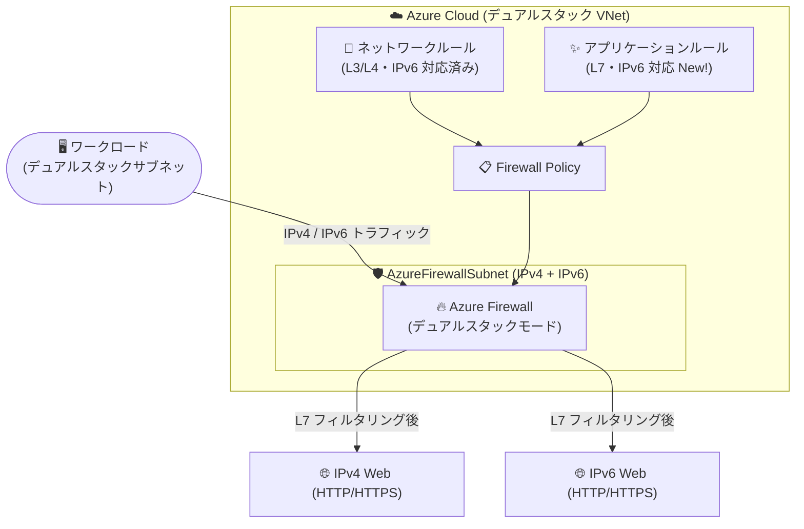

# Azure Firewall: IPv6 アプリケーションルール対応 (Public Preview)

**リリース日**: 2026-11-04

**サービス**: Azure Firewall

**機能**: IPv6 トラフィックに対するアプリケーションルール (L7 フィルタリング)

**ステータス**: In preview

[このアップデートのインフォグラフィックを見る](https://takech9203.github.io/azure-news-summary/20261104-azure-firewall-ipv6-application-rules.html)

## 概要

Azure Firewall の IPv6 サポートにおいて、アプリケーションルールがパブリックプレビューとして利用可能になりました。IPv6 の HTTP および HTTPS トラフィックに対するレイヤー 7 (アプリケーション層) でのフィルタリングが可能になり、IPv6 およびデュアルスタック環境にアプリケーションレベルの制御を拡張できます。

Azure Firewall の IPv6 サポート (デュアルスタックモード) は 2026 年 8 月にパブリックプレビューとして発表されましたが、その時点で IPv6 に対応していたのはネットワークルール (L3/L4) と DNS Proxy のみで、アプリケーションルールは未対応でした。今回のアップデートにより、Microsoft Learn ドキュメント上でもアプリケーションルールが IPv6 トラフィックを完全サポートする機能として記載され、IPv6 トラフィックの許可/拒否ルールをアプリケーション層で作成できるようになりました。これにより、IPv4 と IPv6 の間で一貫したポリシー運用を維持しやすくなります。

**アップデート前の課題**

- Azure Firewall の IPv6 サポート (デュアルスタックモード) ではネットワークルールと DNS Proxy のみが IPv6 に対応しており、アプリケーションルール (FQDN ベースなどの L7 フィルタリング) は IPv6 トラフィックに適用できなかった
- IPv4 ではアプリケーションルールで制御している通信を、IPv6 側ではネットワークルール (IP アドレス/ポートベース) でしか制御できず、IPv4/IPv6 間でポリシーの一貫性を保ちにくかった

**アップデート後の改善**

- IPv6 の HTTP/HTTPS トラフィックに対してアプリケーションルールによるレイヤー 7 フィルタリングが可能になった
- アプリケーションルールで IPv6 トラフィックの許可/拒否ルールを作成でき、デュアルスタック環境でも IPv4 と一貫したアプリケーションレベルの制御を適用できるようになった

## アーキテクチャ図

デュアルスタック構成の Azure Firewall において、従来のネットワークルールに加えてアプリケーションルールが IPv6 に対応し、IPv6 の HTTP/HTTPS アウトバウンドトラフィックもレイヤー 7 でフィルタリングできるようになりました。

## サービスアップデートの詳細

### 主要機能

1. **IPv6 トラフィックに対するアプリケーションルール**
   - アプリケーションルールが IPv6 トラフィックを完全サポートし、IPv6 トラフィックの許可/拒否ルールを作成可能
   - IPv6 の HTTP および HTTPS トラフィックに対するレイヤー 7 フィルタリングを実現

2. **IPv4/IPv6 間で一貫したポリシー運用**
   - デュアルスタック環境において、IPv4 と IPv6 の両方にアプリケーションレベルの制御を適用でき、ポリシーの一貫性を維持しやすくなる

### IPv6 サポート全体の現状 (本アップデート時点)

Microsoft Learn ドキュメントに記載されている、デュアルスタックモードの Azure Firewall でサポートされるシナリオは以下のとおりです。

- **ネットワークルール**: IPv6 トラフィックを完全サポート
- **アプリケーションルール**: IPv6 トラフィックを完全サポート (今回追加)
- **DNS Proxy**: IPv6 ネットワークで構成可能

## 技術仕様

| 項目 | 詳細 |
|------|------|
| 対応トラフィック | IPv6 の HTTP / HTTPS (レイヤー 7 フィルタリング) |
| デプロイモード | IPv4 のみ / デュアルスタック (IPv4 + IPv6)。IPv6 のみのファイアウォールは不可 |
| 対応ルール (IPv6) | ネットワークルール、アプリケーションルール |
| DNS Proxy | IPv6 ネットワークで対応 |
| SNAT | アウトバウンド接続に適用。宛先が ULA 範囲 (`fc00::/7`) の場合は非適用 (仕様) |
| 構成手段 (デュアルスタック化) | Azure Portal、PowerShell、Azure CLI |
| 非対応構成 | Classic Azure Firewall、Virtual Hub (vHub) Firewall |
| 非対応機能 (IPv6) | DNAT ルール、Threat Intelligence、IDPS、Explicit Proxy、IP Groups |
| 元に戻す操作 | デュアルスタック化後、IPv4 のみへ戻すことは不可 (GA 時に解消予定の一時的制限) |

## 設定方法

### 前提条件

1. Azure サブスクリプション
2. デュアルスタックモード (IPv4 + IPv6) で構成された Azure Firewall
   - 既存の IPv4 のみのファイアウォールは、VNet への IPv6 アドレス空間追加、`AzureFirewallSubnet` への IPv6 サブネットプレフィックス追加、パブリック IPv6 アドレスのアタッチによりデュアルスタック化が可能
   - デュアルスタック化の手順は Azure Portal、PowerShell、Azure CLI でドキュメント化されている (詳細: [Deploy Azure Firewall in dual stack mode](https://learn.microsoft.com/en-us/azure/firewall/deploy-dual-stack-firewall))

デュアルスタックファイアウォールが構成済みであれば、Firewall Policy のアプリケーションルールで IPv6 トラフィックの許可/拒否ルールを作成できます。

## メリット

### ビジネス面

- IPv6 移行 (デュアルスタック化) を進める組織が、IPv4 と同等のアプリケーションレベルのセキュリティ制御を IPv6 にも適用でき、移行時のセキュリティ要件を満たしやすくなる
- IPv4/IPv6 で異なる制御方式を使い分ける必要がなくなり、ポリシー管理・監査の一貫性が向上する

### 技術面

- IPv6 の HTTP/HTTPS トラフィックをレイヤー 7 でフィルタリングでき、IP アドレス/ポートベース (ネットワークルール) より粒度の高い制御が可能になる
- 単一の Firewall Policy で IPv4/IPv6 両方のアプリケーションルールを一元管理できる

## デメリット・制約事項

- パブリックプレビューであり、プレビューの補足利用条件が適用される。GA 日は未定
- IPv6 では DNAT ルールが引き続き未サポート
- IPv6 では Threat Intelligence、IDPS、Explicit Proxy、IP Groups ベースのシナリオが引き続き未サポート
- Classic Azure Firewall および Virtual Hub (vHub) Firewall は未対応
- 一度デュアルスタック化すると IPv4 のみのモードへ戻せない (GA 時に解消予定の一時的制限)

## ユースケース

### ユースケース 1: デュアルスタック環境での一貫したアウトバウンド Web フィルタリング

**シナリオ**: デュアルスタック VNet 上のワークロードからインターネットへのアウトバウンド HTTP/HTTPS 通信を、IPv4/IPv6 を問わずアプリケーションルールで制御したい。

**実装ポイント**:

- 既存の IPv4 ファイアウォールをデュアルスタックモードにアップグレードする
- Firewall Policy のアプリケーションルールで IPv6 トラフィックの許可/拒否ルールを定義し、IPv4 と同等の L7 制御を適用する

**効果**: IPv6 側だけ制御が粗くなる (ネットワークルールのみ) 状態を解消し、IPv4/IPv6 で一貫したアウトバウンド制御を実現できる。

## 料金

IPv6 アプリケーションルールに固有の料金情報は公式アップデートに記載されていません。Azure Firewall の料金体系は料金ページを参照してください。

- [Azure Firewall 料金ページ](https://azure.microsoft.com/pricing/details/azure-firewall/)

## 利用可能リージョン

本アップデートでのリージョン別の提供状況は公式情報で確認できませんでした。最新の対応状況は公式ドキュメントを参照してください。

- [Deploy Azure Firewall in dual stack mode (preview)](https://learn.microsoft.com/en-us/azure/firewall/deploy-dual-stack-firewall)

## 関連サービス・機能

- **Azure Firewall Policy**: アプリケーションルール・ネットワークルールの定義と一元管理に使用。IPv4/IPv6 双方のルールを単一ポリシーで管理
- **Azure Virtual Network (デュアルスタック VNet)**: IPv6 アドレス空間と `AzureFirewallSubnet` への IPv6 サブネットプレフィックス追加が前提
- **Azure Public IP (Standard SKU, IPv6)**: デュアルスタックファイアウォールにアタッチするパブリック IPv6 アドレスとして必要

## 参考リンク

- [インフォグラフィック](https://takech9203.github.io/azure-news-summary/20261104-azure-firewall-ipv6-application-rules.html)
- [公式アップデート情報](https://azure.microsoft.com/updates?id=579507)
- [Microsoft Learn: Deploy Azure Firewall in dual stack mode (preview)](https://learn.microsoft.com/en-us/azure/firewall/deploy-dual-stack-firewall)
- [関連レポート: Azure Firewall IPv6 サポート (Public Preview, 2026-08-18)](./2026-08-18-azure-firewall-ipv6-preview.md)
- [料金ページ](https://azure.microsoft.com/pricing/details/azure-firewall/)

## まとめ

2026 年 8 月の Azure Firewall IPv6 サポート (デュアルスタック) 発表時点ではネットワークルールと DNS Proxy に限定されていた IPv6 対応が、今回アプリケーションルール (L7 フィルタリング) に拡張されました。これにより、IPv6 の HTTP/HTTPS トラフィックにも FQDN ベースなどのアプリケーションレベル制御を適用でき、IPv4/IPv6 間で一貫したポリシー運用が可能になります。一方で DNAT、Threat Intelligence、IDPS などは IPv6 で引き続き未対応のため、必要なセキュリティ機能が充足できるかを確認した上で、検証環境でのデュアルスタック構成とアプリケーションルールの評価を進めることを推奨します。

---

**タグ**: Azure Firewall, IPv6, アプリケーションルール, L7 フィルタリング, デュアルスタック, Networking, Security, Public Preview
