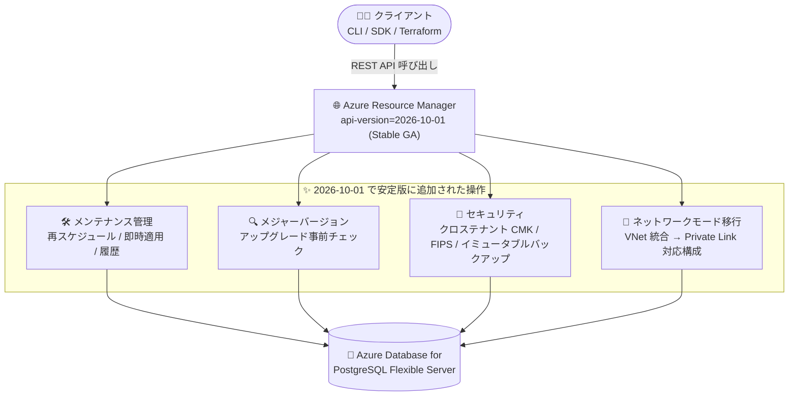

# Azure Database for PostgreSQL: 安定版 REST API バージョン 2026-10-01 の一般提供開始

**リリース日**: 2026-11-04

**サービス**: Azure Database for PostgreSQL

**機能**: 安定版 (stable) REST API バージョン 2026-10-01

**ステータス**: Launched (GA)

[このアップデートのインフォグラフィックを見る](https://takech9203.github.io/azure-news-summary/20261104-postgresql-rest-api-2026-10-01.html)

## 概要

Azure Database for PostgreSQL Flexible Server の REST API バージョン 2026-10-01 が一般提供 (GA) となりました。この安定版 API リリースでは、メンテナンス管理、イミュータブルバックアップ、マルチテナント暗号化 (クロステナントのカスタマーマネージドキー / CMK)、FIPS (Federal Information Processing Standards) 構成、ネットワーク移行、Premium SSD v2 ストレージ、メジャーバージョンアップグレードの事前チェックといった機能が拡張されています。また、自律チューニングの推奨機能が強化され、PostgreSQL バージョンの取り扱いがより柔軟になりました。

これまで 2026-01-01-preview / 2026-04-01-preview などのプレビュー API でのみ提供されていた操作群が、本番環境での利用に適した安定版 API として利用できるようになり、サーバー管理操作の自動化の範囲拡大、セキュリティ強化、データベース管理の効率化が可能になります。

**アップデート前の課題**

- 従来の安定版 API (2025-08-01) では、メンテナンスイベントの照会・再スケジュール、メジャーバージョンアップグレードの事前チェック、クロステナント CMK、FIPS 構成、イミュータブルバックアップ、ネットワークモード移行などの操作がサポートされておらず、これらを利用するにはプレビュー API (2026-01-01-preview、2026-04-01-preview など) を使う必要があった
- PostgreSQL バージョンが API スキーマの列挙型 (enum) で制約されており、新しい PostgreSQL バージョンがリリースされるたびに API スキーマの更新を待つ必要があった
- Terraform の AzureRM プロバイダーなど GA API を前提とするツールからは、プレビュー API でのみ提供される機能を直接利用できなかった (AzAPI プロバイダーによる回避が必要だった)

**アップデート後の改善**

- メンテナンス管理、ネットワーク移行、FIPS、イミュータブルバックアップ、メジャーバージョンアップグレード事前チェック、クロステナント CMK などの操作が、本番利用可能な安定版 API で実行できるようになった
- PostgreSQL バージョンの列挙型制約が撤廃され、API スキーマの更新を待たずに、新しくリリースされた PostgreSQL バージョンでのサーバー作成・メジャーバージョンアップグレードが可能になった
- 自律チューニングのオプションに `vacuumTable` が追加され、チューニング推奨機能が強化された

## アーキテクチャ図



クライアントは Azure Resource Manager 経由で安定版 API (2026-10-01) を呼び出し、これまでプレビュー API でしか利用できなかったメンテナンス管理・セキュリティ・ネットワーク移行などの操作を本番環境で実行できます。

## サービスアップデートの詳細

### 主要機能

Microsoft Learn の API リリースノートによると、バージョン 2026-10-01 は従来の安定版 API のすべての機能を含み、以下が追加されています。

1. **メンテナンス管理 (Maintenance management)**
   - 計画メンテナンスの再スケジュール、利用可能なメンテナンス更新のオンデマンド適用、今後のメンテナンスの確認、メンテナンス履歴の取得をサポート

2. **ネットワークモード移行 (Networking)**
   - 仮想ネットワーク (VNet) 統合から、パブリックアクセスおよびプライベートエンドポイント対応のネットワーク構成へのサーバー移行をサポート

3. **FIPS 準拠 (FIPS compliance)**
   - FIPS を有効にしたサーバーの作成、および既存サーバーでの FIPS の有効化・無効化をサポート

4. **イミュータブルバックアップ (Immutable backups)**
   - イミュータブルバックアップを有効にしたサーバーの作成をサポート

5. **メジャーバージョンアップグレードの事前チェック (Major version upgrade prechecks)**
   - PostgreSQL のメジャーバージョンアップグレードを開始する前に、事前検証チェックを実行可能

6. **自律チューニングの強化 (Autonomous tuning)**
   - 自律チューニングのサポート対象オプションに `vacuumTable` を追加

7. **クロステナント カスタマーマネージドキー (Cross-tenant CMK)**
   - geo 冗長バックアップの有無にかかわらず、カスタマーマネージドキーによるクロステナント暗号化の構成をサポート (`primaryFederatedIdentityClientId` / `geoBackupFederatedIdentityClientId` プロパティ)

8. **PostgreSQL バージョンの柔軟な取り扱い (PostgreSQL version flexibility)**
   - PostgreSQL バージョンの列挙型制約を撤廃し、API スキーマ更新なしで新リリースの PostgreSQL バージョンによるサーバー作成・メジャーバージョンアップグレードをサポート

なお、Azure Updates の発表では Premium SSD v2 ストレージに関する機能拡張も言及されています (Premium SSD v2 のストレージプロパティは 2026-07-01-preview で導入されたものです)。

## 技術仕様

| 項目 | 詳細 |
|------|------|
| API バージョン | `2026-10-01` |
| リリース種別 | Stable (GA) |
| 対象サービス | Azure Database for PostgreSQL Flexible Server |
| 従来の安定版 | `2025-08-01` (PG 17/18 サポート、テーブル推奨、Elastic Cluster の既定データベース名指定など) |
| 取り込まれた主なプレビュー | `2026-01-01-preview` (ネットワーク移行)、`2026-04-01-preview` (メンテナンスイベント、MVU 事前チェック、クロステナント CMK) |
| 主な安定版操作グループ | Servers、Backups、Data Encryption、Maintenance Events、Major Version Upgrade Prechecks、Network Mode Migration、Performance Tuning、Read Replicas、Virtual Endpoints など |

## 設定方法

### REST API の利用

Microsoft Learn の REST API リファレンスに記載されている共通の利用方法に従い、`{api-version}` に `2026-10-01` を指定します。

```bash
# 例: az rest で安定版 API 2026-10-01 を指定してサーバー情報を取得
az rest --method get \
  --url "https://management.azure.com/subscriptions/{subscriptionId}/resourceGroups/{resourceGroupName}/providers/Microsoft.DBforPostgreSQL/flexibleServers/{serverName}?api-version=2026-10-01"
```

- `Content-Type` ヘッダーに `application/json` を設定する
- `Authorization` ヘッダーに Microsoft Entra ID から取得した JSON Web Token を設定する

### Terraform からの利用

GA API に追従する AzureRM プロバイダーへの反映を待たずに新機能を使いたい場合は、AzAPI プロバイダーで任意の API バージョン (本バージョンを含む) を直接指定して呼び出せます。

## メリット

### ビジネス面

- プレビュー API に依存せず本番環境でサーバー管理操作を自動化でき、運用の信頼性が向上する
- FIPS 構成、イミュータブルバックアップ、クロステナント CMK により、規制業界やマルチテナント SaaS でのコンプライアンス・セキュリティ要件に対応しやすくなる
- メンテナンスの再スケジュールやオンデマンド適用により、業務影響の少ない時間帯にメンテナンスを計画できる

### 技術面

- メジャーバージョンアップグレードの事前チェックにより、アップグレード失敗のリスクを事前に検出・低減できる
- PostgreSQL バージョンの enum 制約撤廃により、新バージョンリリース時に API スキーマ更新を待たずに追従できる
- VNet 統合からプライベートエンドポイント対応構成へのネットワーク移行を API で実行できる

## デメリット・制約事項

- API バージョンは基本的に以前のバージョンの機能を引き継ぐが、プレビュー機能は変更・削除される可能性がある (リリースノートの注記より)
- 2026-07-01-preview で導入された Database Agent (DBAgent) リソースや PostgreSQL 19 の enum 追加などのプレビュー機能は、引き続きプレビュー API での利用となる
- リリースノートに記載のない古い API バージョンはサポートされている場合もあるが、近く廃止 (retire) される予定とされている

## ユースケース

### ユースケース 1: メジャーバージョンアップグレードの安全な自動化

**シナリオ**: 多数の PostgreSQL Flexible Server を運用する環境で、メジャーバージョンアップグレードを計画的かつ安全に実施したい。

**実装例**:

```bash
# 事前チェック (MajorVersionUpgradePrecheck) を実行してからアップグレードを開始する
# 運用パイプラインから api-version=2026-10-01 で事前検証 → 結果確認 → アップグレードの順に自動化
```

**効果**: アップグレード前に検証チェックを実行することで、互換性問題などを事前に検出し、計画外のダウンタイムを回避できる。

### ユースケース 2: マルチテナント SaaS でのクロステナント CMK 暗号化

**シナリオ**: SaaS プロバイダーが、顧客 (別テナント) が管理する Key Vault のキーでデータ暗号化を構成したい。

**効果**: `primaryFederatedIdentityClientId` などのプロパティを使い、geo 冗長バックアップの有無にかかわらずクロステナントの CMK 暗号化を安定版 API で構成できる。

## 料金

REST API バージョン自体に関する個別の料金情報は、今回の発表では確認できませんでした。Azure Database for PostgreSQL の料金は以下のページを参照してください。

- [Azure Database for PostgreSQL の料金](https://azure.microsoft.com/pricing/details/postgresql/)

## 利用可能リージョン

リージョンに関する個別の情報は今回の発表では確認できませんでした。サービスのリージョン別提供状況は以下を参照してください。

- [リージョン別の利用可能な製品](https://azure.microsoft.com/explore/global-infrastructure/products-by-region/)

## 関連サービス・機能

- **Azure Resource Manager (ARM)**: 本 REST API は ARM 経由で呼び出す管理プレーン API であり、ARM テンプレート / Bicep からも利用される
- **Azure Key Vault**: カスタマーマネージドキー (CMK) によるデータ暗号化 (クロステナント構成を含む) のキー管理に使用
- **Terraform (AzureRM / AzAPI プロバイダー)**: AzureRM プロバイダーは GA API をベースに更新され、AzAPI プロバイダーでは任意の API バージョンを直接指定可能
- **Private Link / プライベートエンドポイント**: ネットワークモード移行により、VNet 統合からプライベートエンドポイント対応構成へ移行できる

## 参考リンク

- [インフォグラフィック](https://takech9203.github.io/azure-news-summary/20261104-postgresql-rest-api-2026-10-01.html)
- [公式アップデート情報](https://azure.microsoft.com/updates?id=579300)
- [REST API リリースノート (Microsoft Learn)](https://learn.microsoft.com/azure/postgresql/release-notes/release-notes-api#api-releases)
- [Azure Database for PostgreSQL REST API リファレンス](https://learn.microsoft.com/rest/api/postgresql/)
- [安定版 API 仕様一覧 (GitHub: azure-rest-api-specs)](https://github.com/Azure/azure-rest-api-specs/tree/main/specification/postgresql/resource-manager/Microsoft.DBforPostgreSQL/PostgreSql/stable)
- [料金ページ](https://azure.microsoft.com/pricing/details/postgresql/)

## まとめ

Azure Database for PostgreSQL Flexible Server の安定版 REST API 2026-10-01 の GA により、メンテナンス管理、メジャーバージョンアップグレード事前チェック、クロステナント CMK、FIPS、イミュータブルバックアップ、ネットワークモード移行といった運用・セキュリティ関連の操作が本番品質の API で利用可能になりました。IaC や運用自動化パイプラインで PostgreSQL Flexible Server を管理している場合は、API バージョンを `2026-10-01` に更新し、プレビュー API への依存を解消することを推奨します。特に、PostgreSQL バージョンの enum 制約撤廃は、今後の新バージョン追従を容易にする重要な変更です。

---

**タグ**: Azure Database for PostgreSQL, REST API, Databases, Hybrid + multicloud, GA, Feature
