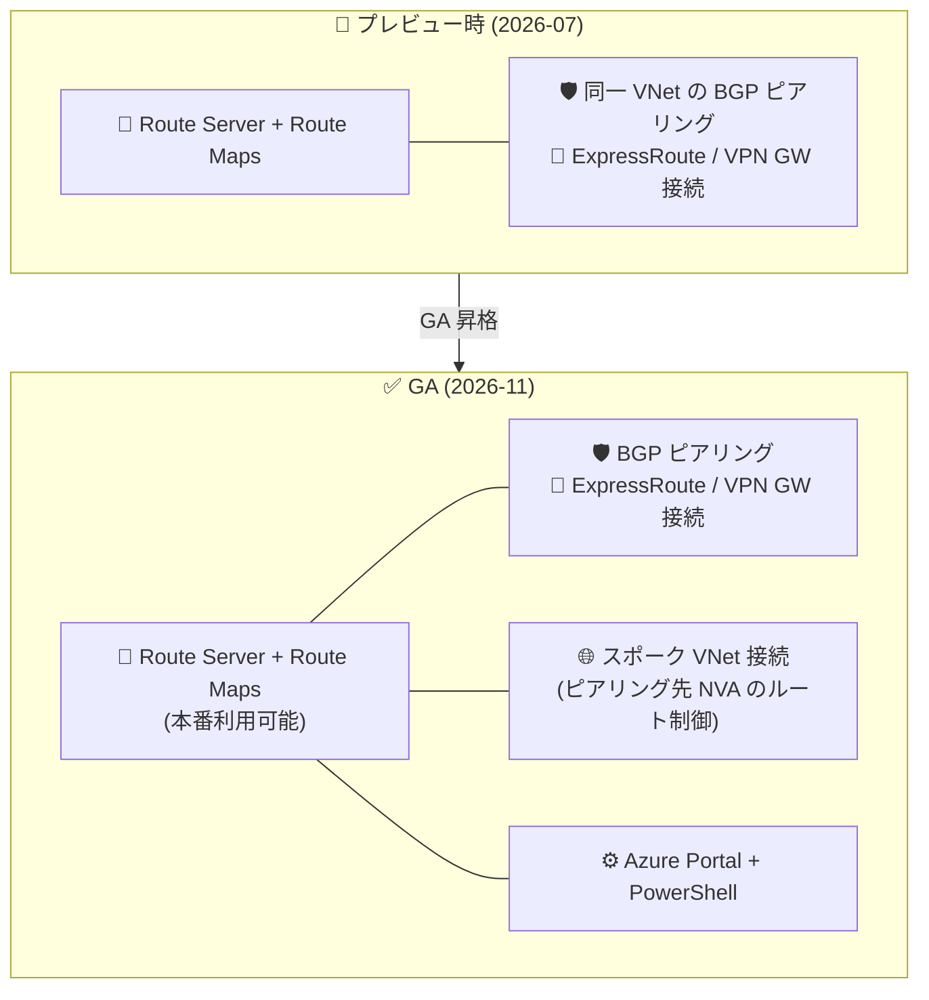

# Azure Route Server: Route Maps (GA)

**リリース日**: 2026-11-04

**サービス**: Azure Route Server

**機能**: Route Maps for Azure Route Server

**ステータス**: Launched (GA)

[このアップデートのインフォグラフィックを見る](https://takech9203.github.io/azure-news-summary/20261104-route-server-route-maps-ga.html)

## 概要

Azure Route Server の Route Maps (ルートマップ) 機能が、Azure パブリッククラウドで一般提供 (GA) になりました。Route Maps は、ハイブリッド接続全体にわたるインバウンド / アウトバウンドのルーティングをきめ細かく制御する機能で、Azure Route Server と Network Virtual Appliance (NVA) 間の BGP ピアリング、同一 VNet 内の ExpressRoute ゲートウェイ接続・VPN ゲートウェイ接続に対して、広報 (advertise) / 受信するルートを管理できます。ルート集約 (summarization)、ルート制御 (フィルタリング)、AS-PATH 操作による経路選択 (path selection)、BGP Community によるルートのタグ付け (route tagging) が主要なユースケースです。

本機能は 2026-07-31 にパブリックプレビューとして発表されており、今回のアップデートは GA への昇格です。GA 時点のドキュメントでは、プレビュー時の適用対象 (BGP ピアリング / ExpressRoute ゲートウェイ接続 / VPN ゲートウェイ接続) に加えて、ピアリングされたスポーク VNet への「仮想ネットワーク接続 (Virtual network connection)」にもルートマップを適用できることが記載されており、ハブ & スポーク構成でスポーク内の NVA と交換するルートも制御できるようになっています。また、設定方法として Azure Portal に加えて Azure PowerShell (BGP ピアリングへの適用) がサポートされています。

**プレビュー時点の課題 (アップデート前)**

- パブリックプレビューのため SLA の対象外であり、本番環境での利用は非推奨だった
- ルートマップの適用対象は Route Server と同一 VNet 内の BGP ピアリング / ExpressRoute ゲートウェイ接続 / VPN ゲートウェイ接続で、スポーク VNet 内の NVA と交換するルートを接続単位で制御する仕組みは記載されていなかった
- 設定方法は Azure Portal のみが案内されていた

**GA での改善 (アップデート後)**

- 一般提供となり、本番環境で利用可能になった (Azure Updates のステータス定義で Launched は本番利用可能なリリースを指す)
- ピアリングされたスポーク VNet への「仮想ネットワーク接続」にルートマップを適用できることが明記され、ハブの Route Server からスポーク NVA のルート (スポークのアドレスプレフィックスおよびスポーク NVA が広報する BGP ルートを含む) をインバウンド / アウトバウンドで制御可能
- BGP ピアリングへのルートマップ適用は Azure Portal に加えて Azure PowerShell でも構成可能 (ゲートウェイ接続・仮想ネットワーク接続への適用は Azure Portal)

## アーキテクチャ図

プレビューでは同一 VNet 内の BGP ピアリングとゲートウェイ接続が適用対象でしたが、GA ではピアリングされたスポーク VNet への仮想ネットワーク接続にもルートマップを適用でき、PowerShell による構成 (BGP ピアリング) もサポートされます。

## サービスアップデートの詳細

### 主要機能 (GA 時点)

1. **ルート集約 (Route summarization)**
   - ExpressRoute や VPN 経由でオンプレミスと接続し、広報可能なルート数の制限を受ける場合に、複数の詳細ルートを集約して広報ルート数を削減できる (例: 10.2.1.0/24、10.2.2.0/24、10.2.3.0/24 を 10.2.0.0/16 に集約)
   - 注意: 集約されたルートからは BGP Community と AS-PATH 属性が削除される (インバウンド / アウトバウンド両方向に適用)

2. **ルート制御 (Route filtering)**
   - BGP ピアリング、ExpressRoute ゲートウェイ接続、VPN ゲートウェイ接続、仮想ネットワーク接続で広報 / 受信するルートから特定ルートを除外 (Drop) できる

3. **経路選択 (Path selection)**
   - AS-PATH などの BGP 属性を変更し、複数経路で到達可能なプレフィックスに対して経路の優先度を制御できる

4. **ルートのタグ付け (Route tagging)**
   - BGP Community 属性の追加 / 置換 / 削除により、ルートのタグ付けと管理が容易になる

### 適用ポイントと方向

| 適用対象 | 説明 |
|----------|------|
| BGP ピアリング | Route Server と NVA 間の BGP ピアリング |
| ExpressRoute ゲートウェイ接続 | 同一 VNet 内の ExpressRoute ゲートウェイへの接続 |
| VPN ゲートウェイ接続 | 同一 VNet 内の VPN ゲートウェイへの接続 |
| 仮想ネットワーク接続 (GA で明記) | ピアリングされたスポーク VNet への接続。スポーク内 NVA と交換するルートにルートマップを関連付ける (VNet ピアリングや BGP ピアリングを作成 / 置換するものではない) |

- **インバウンド**: Route Server が受信するルートに適用 (仮想ネットワーク接続の場合、スポークの構成済みアドレスプレフィックスとスポーク NVA が広報する BGP ルートを含む)
- **アウトバウンド**: Route Server が送信 (広報) するルートに適用
- 各接続には方向ごとに 1 つのルートマップのみ適用可能
- アウトバウンド ルートマップは広報内容の変更のみで、Route Server の最適経路選択には影響しない (経路選択はアウトバウンド ルートマップ適用前に実施される)
- Route Server と同一 VNet 内の NVA には既存の BGP ピアリングに適用する (別途の仮想ネットワーク接続は不要)

## 技術仕様

| 項目 | 詳細 |
|------|------|
| match 条件 | Route-prefix / Community / AS-Path (それぞれ Equals または Contains)。複数条件は AND 評価 |
| アクション (Drop) | マッチしたルートを広報から除外 |
| アクション (Modify) | Route-prefix の Replace (集約)、AS-Path の Add / Replace (値なし Replace で全 ASN 削除)、Community の Add / Replace / Remove (値なし Replace で Community 削除) |
| ルール制御 | 順序付きルールのシーケンス。「Next step」で後続ルールへの継続 / 終了 (Terminate) を制御 |
| デフォルト動作 | どのルールにもマッチしない場合は許可 (deny ではない) |
| 適用単位 | 接続 × 方向 (インバウンド / アウトバウンド) ごとに 1 つ |
| ASN サポート | 2 バイト ASN のみ |
| 設定方法 | BGP ピアリング: Azure Portal / Azure PowerShell。ゲートウェイ接続・仮想ネットワーク接続: Azure Portal |

## 設定方法

### 前提条件

1. Azure Route Server がデプロイされた仮想ネットワーク
2. スポーク VNet の NVA に適用する場合は、事前にルートマップを作成したうえで仮想ネットワーク接続を作成する (VNet ピアリング要件は公式ドキュメントの制限事項を参照)

### Azure Portal / Azure PowerShell

ルートマップの作成、match 条件とアクションを含むルールの定義、BGP ピアリング / ゲートウェイ接続 / 仮想ネットワーク接続への適用 (方向指定) を行います。BGP ピアリングへの適用は Azure Portal と Azure PowerShell の両方で、ゲートウェイ接続と仮想ネットワーク接続への適用は Azure Portal で構成します。詳細な手順は [How to configure route maps](https://learn.microsoft.com/azure/route-server/route-maps-how-to) を参照してください。

**注意**: Azure Route Server で初めてルートマップを作成すると、Route Server のアップグレードが実行され、最大 30 分かかります。

## メリット

### ビジネス面

- GA となり本番環境のハイブリッドネットワークでルートマップを採用できるようになった
- NVA 側の複雑なルーティング設定を Azure 側のマネージド機能で代替でき、運用負荷とベンダー依存を軽減できる
- ルート数上限に起因する接続障害リスクを、ルート集約により低減できる

### 技術面

- ハイブリッド接続 (ExpressRoute / VPN) と NVA を組み合わせた環境で、Route Server を経由するルートを一元的に制御できる
- ハブ & スポーク構成で、スポーク VNet 内の NVA と交換するルートも接続単位で制御できる
- AS-PATH 操作による経路選択の制御で、複数経路環境 (ExpressRoute + VPN 併用など) のトラフィックエンジニアリングが可能
- PowerShell による構成 (BGP ピアリング) で自動化に組み込みやすくなった

## デメリット・制約事項 (GA 時点)

- ルート集約を行うと、集約後のルートから BGP Community と AS-PATH 属性が削除される (インバウンド / アウトバウンド両方向)
- ExpressRoute 接続にルートマップを適用する場合、AS プリペンドにプライベート ASN を使用しない (ExpressRoute がプライベート ASN を除去するため)
- AS プリペンドに Azure 予約 ASN (パブリック: 8074、8075、12076 / プライベート: 65515、65517、65518、65519、65520) は使用不可
- Azure の BGP Community (65517:12001、65517:12002、65517:12003、65517:12005、65517:12006、65518:65518、65517:65517、65517:12076、65518:12076、65515:10000、65515:20000) は削除してはならない
- 2 バイト ASN のみサポート
- デフォルトルート (0.0.0.0/0) の変更は、オンプレミスまたは NVA 由来の場合のみ可能
- Route Server が広報する VNet アドレス空間の変更・フィルタリングには使用できない
- ルート集約 (サマライズ) のみサポート。より詳細な (specific) ルートの作成には使用不可
- ExpressRoute 接続の MSEE (Microsoft Enterprise Edge) 側には適用できない
- Azure VPN Gateway のポイント対サイト (P2S) 構成はサポートされない。VPN ゲートウェイに P2S 構成がある場合、Route Server でのルートマップ作成は失敗する
- 初回のルートマップ作成時に最大 30 分のアップグレードが発生する
- Route Maps の利用には追加料金が発生する

## ユースケース

### ユースケース 1: ルート数上限への対処 (ルート集約)

**シナリオ**: オンプレミスから ExpressRoute 経由で多数の詳細ルートが広報され、Route Server や ExpressRoute のルート数上限に近づいている。

**実装例**: ExpressRoute ゲートウェイ接続のインバウンド ルートマップで、10.2.1.0/24、10.2.2.0/24、10.2.3.0/24 などの詳細ルートを 10.2.0.0/16 に集約 (Route-prefix / Replace) する。

**効果**: 広報ルート数が削減され、ルート数上限による接続リスクを低減できる。

### ユースケース 2: スポーク VNet 内 NVA のルート制御 (GA で明記された構成)

**シナリオ**: ハブ VNet に Route Server、ピアリングされたスポーク VNet に NVA を配置しており、スポーク NVA と交換するルートを制御したい。

**実装例**: ルートマップを作成したうえで、対象スポークへの仮想ネットワーク接続を作成し、インバウンド / アウトバウンド方向にルートマップを関連付ける。

**効果**: ハブ & スポーク構成でもスポーク NVA のルートを接続単位でフィルタリング・属性変更でき、意図しないトラフィックフローを防止できる。

### ユースケース 3: AS-PATH プリペンドによる経路選択の制御

**シナリオ**: ExpressRoute と VPN の両方でオンプレミスと接続しており、特定経路を優先させたい。

**実装例**: 優先度を下げたい接続のルートマップで、AS-Path / Add により ASN をプリペンドし、経路の優先度を下げる (ExpressRoute 接続ではプライベート ASN を使用しない)。

**効果**: 複数経路環境で意図した経路にトラフィックを誘導できる。

## 料金

Route Maps の利用には Azure Route Server 本体の料金に加えて追加料金が発生します (公式ドキュメントに明記)。最新の単価と課金項目は [Azure Route Server 料金ページ](https://azure.microsoft.com/pricing/details/route-server/) を参照してください。

## 利用可能リージョン

Azure パブリッククラウドで一般提供です。リージョンごとの提供状況は [Azure Products by Region](https://azure.microsoft.com/explore/global-infrastructure/products-by-region/) を参照してください。

## 関連サービス・機能

- **Network Virtual Appliance (NVA)**: Route Server と BGP ピアリングを構成する対象。同一 VNet 内は BGP ピアリング、スポーク VNet 内は仮想ネットワーク接続経由でルートマップを適用
- **ExpressRoute ゲートウェイ**: 同一 VNet 内の ExpressRoute ゲートウェイ接続に適用可能 (MSEE 側には適用不可)
- **VPN ゲートウェイ**: 同一 VNet 内の VPN ゲートウェイ接続に適用可能 (P2S 構成がある場合は作成不可)
- **VNet ピアリング**: スポーク VNet への仮想ネットワーク接続はピアリングを前提とする (接続自体がピアリングを作成・置換するものではない)
- **Virtual WAN Route-map**: Virtual WAN ハブにも同様の Route-map 機能があり、Virtual WAN を利用する場合はそちらを使用する

## 参考リンク

- [インフォグラフィック](https://takech9203.github.io/azure-news-summary/20261104-route-server-route-maps-ga.html)
- [公式アップデート情報](https://azure.microsoft.com/updates?id=578966)
- [About route maps for Azure Route Server (Microsoft Learn)](https://learn.microsoft.com/azure/route-server/route-maps-about)
- [How to configure route maps (Microsoft Learn)](https://learn.microsoft.com/azure/route-server/route-maps-how-to)
- [Apply route maps to an NVA in a spoke virtual network (Microsoft Learn)](https://learn.microsoft.com/azure/route-server/route-maps-scenario-spoke-network-virtual-appliance)
- [What is Azure Route Server? (Microsoft Learn)](https://learn.microsoft.com/azure/route-server/overview)
- [料金ページ](https://azure.microsoft.com/pricing/details/route-server/)
- [プレビュー時のレポート (2026-07-31)](2026-07-31-route-server-route-maps.md)

## まとめ

2026 年 7 月にパブリックプレビューとなった Route Maps for Azure Route Server が GA に昇格し、本番環境のハイブリッドネットワークで利用できるようになりました。GA 時点のドキュメントでは、ピアリングされたスポーク VNet への仮想ネットワーク接続を介したルートマップ適用と、PowerShell による構成 (BGP ピアリング) が確認でき、ハブ & スポーク構成での適用範囲が広がっています。プレビューで検証済みの環境は本番適用を検討できますが、集約時の BGP 属性削除、P2S 構成の非サポート、初回作成時の最大 30 分のアップグレード、追加料金の発生といった制約を事前に確認することを推奨します。

---

**タグ**: Azure Route Server, Route Maps, BGP, Networking, NVA, ExpressRoute, VPN, Hybrid Connectivity, GA
