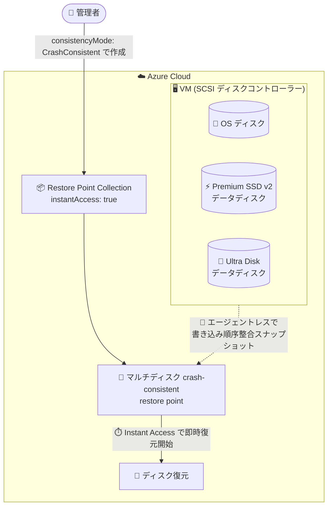

# Azure Virtual Machines / Azure Disk Storage: Premium SSD v2 / Ultra Disk 対応マルチディスク crash-consistent VM restore points (SCSI ディスクコントローラー VM) がパブリックプレビュー

**リリース日**: 2026-11-04

**サービス**: Azure Virtual Machines / Azure Disk Storage

**機能**: Multi-disk crash-consistent VM restore points for Premium SSD v2 and Ultra Disks on VMs with SCSI disk controller

**ステータス**: In preview

[このアップデートのインフォグラフィックを見る](https://takech9203.github.io/azure-news-summary/20261104-vm-restore-points-premium-ssd-v2-ultra-scsi.html)

## 概要

Premium SSD v2 および Ultra Disk をデータディスクとして持つ Azure 仮想マシン (SCSI ディスクコントローラー搭載) で、マルチディスク crash-consistent (クラッシュ整合性) restore point がパブリックプレビューとして利用可能になった。これにより、エージェントレスで VM のクラッシュ整合性のある復元ポイントを取得できる。2026 年 6 月からのプライベートプレビューを経て、今回パブリックプレビューに拡大された。

このプレビューは、既存のマルチディスク crash-consistent restore point のサポートを Premium SSD v2 と Ultra データディスクに拡張するもの。Standard HDD / Standard SSD / Premium SSD に対する既存サポートに変更はない。

さらに本プレビューでは、マルチディスク crash-consistent restore point に対する Instant Access もサポートされる (Premium SSD v2 / Ultra データディスクを持つ VM のみ対象)。Instant Access を使うと、バックグラウンドのデータコピー完了を待たずに、restore point 作成直後からディスクの復元を開始でき、RTO (目標復旧時間) の短縮に役立つ。

**アップデート前の課題**

- Premium SSD v2 / Ultra Disk を使う VM では、VM restore points はアプリケーション整合性 (application consistency) モードのみサポートされ、マルチディスク crash-consistent restore point は利用できなかった
- crash-consistent restore point が使えないため、VM エージェントに依存しないエージェントレスな復元ポイント取得を、高性能ディスク (Premium SSD v2 / Ultra Disk) 構成の VM に適用できなかった

**アップデート後の改善**

- SCSI ディスクコントローラーの VM であれば、Premium SSD v2 / Ultra データディスクを含むマルチディスク crash-consistent restore point を作成可能になった (`consistencyMode` に `CrashConsistent` を指定)
- VM エージェント不要 (エージェントレス) で、全ディスクの書き込み順序整合性を保ったスナップショットを取得できる
- Instant Access により、restore point 作成直後からディスク復元を開始でき、RTO を短縮できる

## アーキテクチャ図



SCSI ディスクコントローラーの VM に接続された OS ディスクと Premium SSD v2 / Ultra データディスクを、エージェントレスで書き込み順序整合性を保ったままスナップショット取得し、Instant Access によりバックグラウンドコピー完了を待たずに復元を開始できる。

## サービスアップデートの詳細

### 主要機能

1. **Premium SSD v2 / Ultra Disk へのマルチディスク crash-consistent restore point 拡張**
   - 従来 Standard HDD / Standard SSD / Premium SSD のみだったマルチディスク crash-consistent restore point のサポートが、Premium SSD v2 と Ultra データディスクに拡張された
   - 対象は SCSI ディスクコントローラーを持つ VM のみ (プレビュー)

2. **エージェントレスな crash-consistent スナップショット**
   - crash-consistent モードは全ディスクの書き込み順序整合性のあるスナップショットを取得する (電源断・クラッシュ直後の VM 状態と同等)
   - VSS (Windows) や pre/post スクリプト (Linux) を使うアプリケーション整合性モードと異なり、VM エージェントに依存しない
   - crash consistency ではすべての OS がサポートされる

3. **Instant Access のサポート**
   - マルチディスク crash-consistent restore point でも Instant Access を利用可能 (Premium SSD v2 / Ultra データディスクを持つ VM のみ)
   - restore point collection で `instantAccess` を `true` に設定すると、バックグラウンドのデータコピー (ハイドレーション) 完了を待たずにディスク復元を開始できる
   - `instantAccessDurationMinutes` (60〜300 分、既定 300 分) で Instant Access の有効時間を指定

## 技術仕様

| 項目 | 詳細 |
|------|------|
| 対象ディスク | Premium SSD v2 / Ultra Disk (データディスク) ※Standard HDD / Standard SSD / Premium SSD の既存サポートは変更なし |
| 対象 VM | SCSI ディスクコントローラーの VM のみ (NVMe ディスクコントローラーは非サポート) |
| 整合性モード | crash-consistent (`consistencyMode: CrashConsistent`) |
| エージェント | 不要 (エージェントレス) |
| crash-consistent restore point の最小作成間隔 | 1 時間 |
| API スロットリング | crash-consistent restore point 作成: VM あたり 3 回/時 |
| restore point 保持上限 | VM あたり最大 500 restore point |
| crash-consistent restore point の API バージョン | 2021-07-01 以降 |
| Instant Access の API バージョン | 2025-04-01 以降 |
| Instant Access 有効時間 | `instantAccessDurationMinutes`: 60〜300 分 (既定: 300 分) |
| Instant Access 同時作成上限 | サブスクリプション・リージョンあたり 50 |
| Instant Access の操作手段 | REST API / Azure SDK / CLI / ARM テンプレート (Azure Portal は現時点で非対応) |
| crash consistency の OS サポート | すべての OS |

## 設定方法

### 前提条件

1. VM が SCSI ディスクコントローラーを使用していること (NVMe ディスクコントローラーおよび Azure Boost ハードウェア上の VM はディスクタイプを問わず非サポート)
2. マネージドディスクを使用していること (書き込みアクセラレータ有効ディスク、エフェメラル OS ディスク、共有ディスクは crash consistency モード非サポート)
3. プレビュー対象リージョンであること (後述の「利用可能リージョン」参照)

### REST API

restore point collection 内に restore point を作成する際、`consistencyMode` を `CrashConsistent` に設定する。

```json
{
  "properties": {
    "consistencyMode": "CrashConsistent"
  }
}
```

Instant Access を使う場合は、restore point collection 側で `instantAccess` を `true` に設定し (API バージョン 2025-04-01 以降)、restore point 側で `instantAccessDurationMinutes` (60〜300 分) を指定する。

### Azure Boost ハードウェアへの配置に関する注意

SCSI ディスクコントローラー + Premium SSD v2 / Ultra データディスクの VM は、米国リージョンでは新世代の Azure Boost ハードウェアに配置される場合がある。その場合 crash-consistent restore point の作成は `UserErrorCrashConsistentSnapshotNotSupportedForAzureBoostVms` エラーで失敗する。

回避策として VM に `LegacyVMNVA` タグを適用して Azure Boost ハードウェアへの配置を回避する。既存 VM の場合はタグ適用だけでは配置は変わらないため、以下の手順が必要 (ダウンタイムを計画すること):

1. VM を停止する
2. VM に `LegacyVMNVA` タグを適用する
3. VM を再デプロイしてタグに従った配置にする
4. crash-consistent restore point の作成を再試行する

## メリット

### ビジネス面

- Instant Access との組み合わせで restore point 作成直後から復元を開始でき、RTO (目標復旧時間) を短縮できる
- 高性能ディスク (Premium SSD v2 / Ultra Disk) を使うワークロードでも、定期的な crash-consistent restore point によりデータ損失リスクを低減できる

### 技術面

- エージェントレスのため VM エージェントや VSS / pre-post スクリプトに依存せず、復元ポイントを取得できる (アプリケーション整合性モードで多い VM エージェント起因の失敗を回避)
- 複数ディスクにまたがる書き込み順序整合性が保証されるため、OS ディスクと複数データディスクを持つ VM 全体を一貫した時点で保護できる
- crash consistency はすべての OS でサポートされる
- restore point はインクリメンタル (初回はフルコピー、以降は差分のみ) でストレージコストを抑制できる

## デメリット・制約事項

- パブリックプレビューのため、本番環境での利用は非推奨 (非本番・テスト用途向け)
- SCSI ディスクコントローラーの VM のみ対象。NVMe ディスクコントローラーの VM および Azure Boost ハードウェア上の VM は、ディスクタイプを問わずマルチディスク crash consistency 非サポート
- 米国リージョンでは SCSI VM でも Azure Boost ハードウェアに配置されることがあり、`LegacyVMNVA` タグの適用と VM の再デプロイ (ダウンタイムあり) が必要になる場合がある
- 一部リージョン (South Central US、West US 3、East US 2) ではプレビューを利用できない
- crash-consistent restore point の最小作成間隔は 1 時間 (アプリケーション整合性は 3 時間)。これを下回る頻度での作成は失敗する
- 書き込みアクセラレータ有効ディスク、エフェメラル OS ディスク、共有ディスクは crash consistency モード非サポート
- Instant Access は現時点で Azure Portal 非対応 (REST API / SDK / CLI / ARM テンプレートのみ)
- 同一 VM に対する restore point の同時作成は不可。VM あたりの restore point 保持上限は 500

## ユースケース

### ユースケース 1: 高性能データベース VM のエージェントレス保護

**シナリオ**: Premium SSD v2 / Ultra Disk を複数データディスクとして使用するデータベースサーバーで、VM エージェントや VSS に依存せず、1 時間ごとに VM 全体の整合性ある復元ポイントを取得したい。

**実装例**: restore point collection を作成し、`consistencyMode: CrashConsistent` を指定した restore point を 1 時間間隔で作成する (最小間隔 1 時間、VM あたり 3 回/時のスロットリングに注意)。

**効果**: 全ディスクの書き込み順序整合性が保たれた復元ポイントを定期取得でき、障害時にはクラッシュ直後と同等の状態へ VM を復元できる。

### ユースケース 2: Instant Access による RTO 短縮

**シナリオ**: 障害発生時に、restore point のバックグラウンドデータコピー完了を待たずに即座にディスクを復元したい。

**実装例**: restore point collection で `instantAccess: true` を設定し (API バージョン 2025-04-01 以降)、restore point 作成時に `instantAccessDurationMinutes` を指定する。

**効果**: スナップショットのハイドレーション完了を待たずに復元を開始でき、RTO を大幅に短縮できる。

## 料金

restore point 自体の料金に関する公式情報は今回のアップデートでは確認できなかった。スナップショットは Managed Disks の料金体系に従う。

Instant Access スナップショットは使用量ベースの課金で、以下の 2 種類の料金が発生する (Microsoft Learn ドキュメントで確認):

| 項目 | 料金 |
|------|------|
| スナップショットストレージ | 作成時はコストなし。ソースディスクの変更に伴い増加した差分データ分のみ課金 |
| 復元操作 | 復元のたびに、復元時点のディスクのプロビジョニングサイズに基づく一回限りの料金 |

詳細: [Managed Disks の料金ページ](https://azure.microsoft.com/pricing/details/managed-disks/)

## 利用可能リージョン

プレビューは以下を除くすべてのパブリックリージョンで利用可能:

- South Central US
- West US 3
- East US 2

## 関連サービス・機能

- **Azure Disk Storage (Premium SSD v2 / Ultra Disk)**: 今回のプレビューで crash-consistent restore point の対象に追加された高性能マネージドディスク
- **Instant Access スナップショット**: Premium SSD v2 / Ultra データディスク向けの即時復元機能。本プレビューのマルチディスク crash-consistent restore point でも利用可能
- **VM restore points (アプリケーション整合性モード)**: VSS / pre-post スクリプトを使う既存の整合性モード。Premium SSD v2 / Ultra Disk では従来からサポート
- **Azure Backup**: VM のバックアップ・リストアのマネージドサービス。restore points は API ベースのより粒度の細かい保護手段として補完関係にある

## 参考リンク

- [インフォグラフィック](https://takech9203.github.io/azure-news-summary/20261104-vm-restore-points-premium-ssd-v2-ultra-scsi.html)
- [公式アップデート情報](https://azure.microsoft.com/updates?id=579162)
- [Microsoft Learn: Use virtual machine restore points](https://learn.microsoft.com/azure/virtual-machines/virtual-machines-create-restore-points)
- [Microsoft Learn: Support matrix for VM restore points](https://learn.microsoft.com/azure/virtual-machines/concepts-restore-points)
- [Microsoft Learn: プレビュー詳細 (aka.ms/mdccPv2PublicPreview)](https://aka.ms/mdccPv2PublicPreview)
- [料金ページ (Managed Disks)](https://azure.microsoft.com/pricing/details/managed-disks/)

## まとめ

Premium SSD v2 / Ultra Disk を使う VM でマルチディスク crash-consistent restore point が利用可能になったことで、高性能ディスク構成のワークロードでもエージェントレスな VM 保護が実現できる。Instant Access との組み合わせで RTO の短縮も見込める。ただし SCSI ディスクコントローラー限定であり、NVMe / Azure Boost ハードウェアは非サポート、米国の一部リージョンでは利用不可かつ `LegacyVMNVA` タグによる配置制御が必要になる場合がある点に注意。Premium SSD v2 / Ultra Disk を使う VM の保護戦略を検討している場合は、非本番環境でプレビューを評価することを推奨する。

---

**タグ**: Storage, Compute, Azure Disk Storage, Virtual Machines, Compliance, Management, Feature
