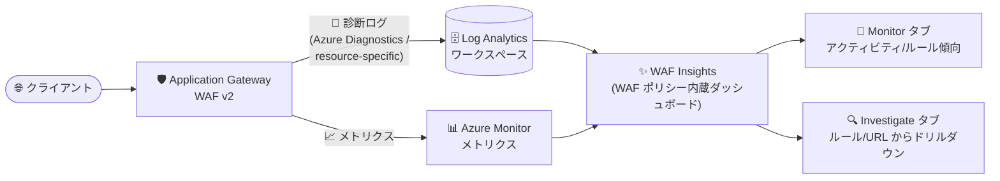

# Azure Application Gateway: WAF Insights の一般提供開始 (GA)

**リリース日**: 2026-11-05

**サービス**: Azure Application Gateway / Azure Web Application Firewall (WAF)

**機能**: WAF Insights

**ステータス**: Launched (GA)

[このアップデートのインフォグラフィックを見る](https://takech9203.github.io/azure-news-summary/20261105-app-gateway-waf-insights.html)

## 概要

Azure Application Gateway の Web Application Firewall (WAF) 向け機能「WAF Insights」が一般提供 (GA) となりました。WAF Insights は WAF ポリシーに組み込まれたビルトインのダッシュボード体験で、WAF のログとメトリクスをインタラクティブなダッシュボードに統合します。これにより、クエリを書くことなく、ブロックされたリクエストの調査、攻撃パターンの分析、誤検知 (false positive) の特定が可能になります。

ダッシュボードは Azure Monitor ブックとして実装されており、「Monitor」タブで WAF アクティビティと最もアクティブなルールを追跡し、「Investigate」タブでルールまたは URL から、該当する個々のリクエストと一致したすべてのルールまでドリルダウンできます。セキュリティチームと運用チームが同じビューを使って、ポリシーの有効性検証やインシデント対応を迅速化できる機能です。

GA に伴い、以下の機能強化が行われました。

- Azure Diagnostics 形式と resource-specific (リソース固有) 形式の両方のログに対応
- 「Triage」タブを「Investigate」タブに改名
- 各リクエストを最終的な WAF の判定結果 (final WAF outcome) に基づいて 1 回だけカウントするように変更

**アップデート前の課題**

- WAF のブロック状況や攻撃パターンを調査するには、Log Analytics で KQL クエリを手動で記述する必要があった
- Preview 時点では Azure Diagnostics モードのログのみ対応しており、resource-specific テーブルはサポートされていなかった
- ログとメトリクスが別々の場所にあり、横断的な分析に手間がかかっていた

**アップデート後の改善**

- クエリを書かずに、WAF ポリシー内のビルトインダッシュボードからブロックされたリクエストの調査・攻撃パターンの分析・誤検知の特定が可能
- Azure Diagnostics 形式と resource-specific 形式の両方のログをサポート
- 各リクエストが最終的な WAF 判定結果で 1 回だけカウントされるため、集計の正確性が向上

## アーキテクチャ図

Application Gateway WAF の診断ログ (Log Analytics 経由) とメトリクスを WAF Insights が統合し、Monitor タブと Investigate タブのインタラクティブなダッシュボードとして可視化するデータフローです。

## サービスアップデートの詳細

### 主要機能

1. **Monitor タブ (継続的な可視化)**
   - WAF アクティビティ全体と最もアクティブなルールを追跡する
   - 「WAF logs」ビュー: Log Analytics のログに基づき、ルールグループ別のリクエスト数、アクション種別 (Blocked など)、ブロックされた上位 URI、トリガーされた上位ルール、ルールの時系列推移、クライアント IP やホスト・インスタンスを含むイベント詳細を可視化。Tracking ID による相関分析や上位の攻撃元 IP の確認も可能
   - 「WAF metrics」ビュー: Azure Monitor メトリクスに基づき、総リクエスト数、マネージドルールの一致数 (ブロック/非ブロック)、JavaScript チャレンジのリクエスト数、カスタムルールの一致数をほぼリアルタイムで表示

2. **Investigate タブ (ドリルダウン調査)** ※ GA で「Triage」から改名
   - **ルール起点の調査 (by Rule)**: WAF ポリシーのスコープ (Listener / URI Path / Global) を選択し、トリガーされたルールの概要 (ルール ID、アクション、ルールセットバージョン、影響リクエスト数) から、影響を受けたホスト・URL・個々のトランザクションへドリルダウン。ノイズの多いルールの特定や誤検知の検出に有効
   - **URL 起点の調査 (by URL)**: URL パスを起点に、対象の Application Gateway とポリシースコープを選択し、特定 URL を狙うホスト/IP と、該当リクエストでトリガーされたルールを確認。ログインページなど機密性の高いエンドポイントへの攻撃調査に有効

3. **両ログ形式のサポート (GA 新機能)**
   - Azure Diagnostics 形式に加えて、resource-specific (リソース固有) テーブルのログに対応

4. **正確なリクエストカウント (GA 新機能)**
   - 各リクエストを最終的な WAF 判定結果 (final WAF outcome) に基づいて 1 回だけカウント

## 技術仕様

| 項目 | 詳細 |
|------|------|
| 実装形態 | Azure Monitor ブック (カスタマイズ・拡張が可能) |
| 提供場所 | WAF ポリシーに組み込まれたビルトイン体験 |
| データソース (メトリクス) | 分間隔で集計されるカウンター。傾向分析・ほぼリアルタイムの異常検知向け。保持期間は Azure Monitor メトリクスの保持設定に従う |
| データソース (ログ) | WAF 診断ログによるリクエスト単位の完全なイベントデータ。フォレンジック調査・監査向け。保持期間は Log Analytics ワークスペースの保持ポリシーに従う |
| 対応ログ形式 | Azure Diagnostics 形式および resource-specific 形式 (GA で両対応) |
| 調査モード | Investigate by Rule / Investigate by URL |

## 設定方法

### 前提条件

1. Application Gateway (WAF) で **診断設定 (Diagnostic Settings)** を有効化し、WAF ログを Log Analytics ワークスペースに送信していること。診断ログがない場合、ダッシュボードに WAF データは表示されない
2. ログに加えてメトリクスも併用することが推奨されている (可視性と詳細度のバランスのため)

### Azure Portal

WAF ポリシーに組み込まれたビルトイン体験として提供され、WAF ポリシーから Monitor タブ / Investigate タブのダッシュボードを開いて利用します。

## メリット

### ビジネス面

- KQL クエリのスキルがなくても WAF の調査・分析ができるため、セキュリティ運用の属人化を軽減できる
- インシデント対応の迅速化 (ルールや URL から該当リクエストまでのドリルダウン) により、ダウンタイムや誤ブロックによる機会損失を抑制できる
- ログベースの詳細データにより、監査・コンプライアンスレビューを支援する

### 技術面

- ログ (詳細なフォレンジック情報) とメトリクス (ほぼリアルタイムの傾向) を単一のダッシュボードで相互補完的に活用できる
- 誤検知 (false positive) の特定とノイズの多いルールの把握により、WAF ポリシーのチューニングが容易になる
- Azure Monitor ブックとして実装されているため、運用・セキュリティ要件に応じた可視化のカスタマイズ・拡張が可能

## デメリット・制約事項

- **遅延**: メトリクスはほぼリアルタイムだが、ログにはインジェストの遅延がある (通常 1〜5 分)
- **保持期間**: コンプライアンス・監査要件に合わせて Log Analytics の保持期間を適切に設定する必要がある
- **スケール**: 診断ログの量が多い場合、クエリの待ち時間とストレージコストが増加する可能性がある

## ユースケース

### ユースケース 1: 誤検知 (false positive) の特定と WAF ルールのチューニング

**シナリオ**: 正規ユーザーのリクエストが WAF にブロックされているとの報告を受け、原因となっているルールを特定したい。

**実装例**: Investigate タブの「by Rule」で WAF ポリシーのスコープ (Listener / URI Path / Global) を選択し、トリガー回数の多いルールの一覧から対象ルールを選択。影響を受けたホスト・URL・個々のリクエストまでドリルダウンし、一致したすべてのルールを確認する。

**効果**: クエリを書かずに誤検知の原因ルールを特定でき、除外設定やルール調整の判断を迅速に行える。

### ユースケース 2: 機密エンドポイントへの攻撃調査

**シナリオ**: ログインページなど特定の URL に対する不審なアクセスの増加を検知し、攻撃元と攻撃パターンを調査したい。

**実装例**: Monitor タブで WAF アクティビティの急増やブロックされた上位 URI を確認した後、Investigate タブの「by URL」で該当 URL パスを選択。その URL を狙うホスト/IP と、トリガーされたルールを確認し、攻撃パターンをマッピングする。

**効果**: 異常検知から該当リクエストの特定までを同一ダッシュボード内で完結でき、インシデント対応を迅速化できる。

## 料金

Application Gateway の料金ページでは、WAF Insights 自体の追加料金に関する記載は確認できませんでした。なお、WAF_v2 SKU では WAF ポリシーおよび WAF ルールの利用に追加料金はかからないことが FAQ に明記されています。

WAF_v2 の料金は以下の 2 要素で構成されます。

| 項目 | 料金 |
|------|------|
| 固定料金 | ゲートウェイ時間あたりの課金 |
| Capacity Unit 料金 | Capacity Unit 時間あたりの課金 (コンピュートユニット・永続接続・スループットの 3 指標で算定) |

このほか、前提条件である診断ログの送信に伴い、Log Analytics ワークスペースのインジェスト・保持のコストが別途発生する点に留意してください。最新の単価は [Application Gateway 料金ページ](https://azure.microsoft.com/pricing/details/application-gateway/) を参照してください。

## 関連サービス・機能

- **Azure Web Application Firewall (WAF)**: 本機能の対象。WAF ポリシー内のビルトイン体験として WAF Insights が提供される
- **Azure Monitor (メトリクス / ブック)**: ダッシュボードは Azure Monitor ブックとして実装され、「WAF metrics」ビューは Azure Monitor メトリクスをデータソースとする
- **Log Analytics ワークスペース**: WAF 診断ログの保存先。「WAF logs」ビューと Investigate タブのデータソースとなり、保持期間はワークスペースのポリシーに従う
- **Application Gateway 診断設定**: WAF Insights の前提条件。診断設定で WAF ログを Log Analytics へ送信する必要がある

## 参考リンク

- [インフォグラフィック](https://takech9203.github.io/azure-news-summary/20261105-app-gateway-waf-insights.html)
- [公式アップデート情報](https://azure.microsoft.com/updates?id=579280)
- [Microsoft Learn: Azure Application Gateway WAF Insights](https://learn.microsoft.com/azure/web-application-firewall/ag/insights)
- [Microsoft Learn: Azure Web Application Firewall のログの監視](https://learn.microsoft.com/azure/web-application-firewall/ag/web-application-firewall-logs)
- [Microsoft Learn: Application Gateway の診断ログ](https://learn.microsoft.com/azure/application-gateway/application-gateway-diagnostics)
- [料金ページ](https://azure.microsoft.com/pricing/details/application-gateway/)

## まとめ

WAF Insights の GA により、Azure Application Gateway WAF のログとメトリクスを、KQL クエリを書くことなく WAF ポリシー内蔵のインタラクティブなダッシュボードで分析できるようになりました。GA では Azure Diagnostics と resource-specific の両ログ形式への対応、Investigate タブへの改名、最終 WAF 判定に基づく正確なリクエストカウントが加わっています。Application Gateway WAF を運用している環境では、まず診断設定で WAF ログを Log Analytics に送信していることを確認のうえ、日常の監視に Monitor タブ、インシデント調査や誤検知のチューニングに Investigate タブを組み込むことを推奨します。

---

**タグ**: Networking, Security, Application Gateway, Web Application Firewall, Features, GA
