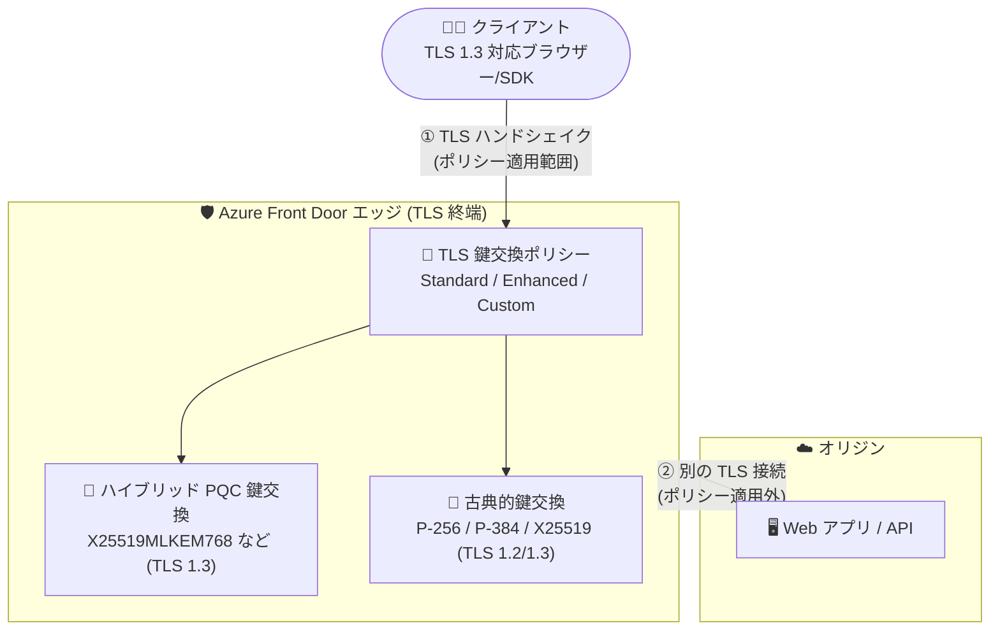

# Azure Front Door: TLS 鍵交換ポリシー (ポスト量子対応) が一般提供開始

**リリース日**: 2026-11-05

**サービス**: Azure Front Door

**機能**: TLS key exchange policy with post-quantum support

**ステータス**: Launched (GA)

[このアップデートのインフォグラフィックを見る](https://takech9203.github.io/azure-news-summary/20261105-front-door-tls-post-quantum.html)

## 概要

Azure Front Door (Standard / Premium) で、構成可能な **TLS 鍵交換ポリシー (TLS key exchange policy)** が一般提供 (GA) となりました。ハイブリッドポスト量子鍵交換 (Hybrid Post-Quantum Key Exchange) を含む鍵交換方式をドメイン単位で制御でき、将来の量子コンピューティングによる暗号解読の脅威 ("Harvest Now, Decrypt Later" など) に備えつつ、クライアント互換性の要件とのバランスを取ることができます。

ハイブリッド方式は、従来の楕円曲線鍵交換と NIST 標準の **ML-KEM (Module-Lattice-Based Key-Encapsulation Mechanism)** を組み合わせることで、共有シークレットを量子計算の脅威から保護します。事前定義の **Standard** / **Enhanced** ポリシーから選択するか、**Custom** ポリシーで X25519 を含む古典的グループとハイブリッドポスト量子グループを個別に選択できます。ハイブリッドポスト量子鍵交換は TLS 1.3 が必須で、保護対象は「クライアント ⇔ Front Door エッジ」間の接続です (Front Door ⇔ オリジン間には適用されません)。

あわせて、TLS Policy で最小 TLS バージョンを 1.3 に設定している場合に、**TLS_AES_128_GCM_SHA256 暗号スイートを無効化**できるようになり、鍵交換と暗号スイートの両面でアプリケーションのセキュリティ要件に合わせた細かな制御が可能になりました。

**アップデート前の課題**

- クライアント ⇔ Front Door 間の TLS 鍵交換方式 (supported groups) をユーザーが制御する手段がなく、セキュリティ・コンプライアンス要件に合わせた調整ができなかった
- 量子コンピューティングの脅威に備えたポスト量子暗号への移行を Front Door 配下のアプリケーションで準備する手段がなかった

**アップデート後の改善**

- 事前定義 (Standard / Enhanced) または Custom ポリシーにより、ドメイン単位で古典的・ハイブリッドポスト量子の鍵交換グループを選択可能になった
- X25519MLKEM768 / SecP256r1MLKEM768 / SecP384r1MLKEM1024 のハイブリッドポスト量子鍵交換により、エッジへの TLS 1.3 接続を量子耐性のある鍵確立で保護できるようになった
- 最小 TLS 1.3 構成時に TLS_AES_128_GCM_SHA256 暗号スイートを無効化でき、AES-256 のみの運用が可能になった

## アーキテクチャ図

TLS 鍵交換ポリシーはクライアント ⇔ Front Door エッジ間のハンドシェイクにのみ適用され、ポリシーに基づき古典的またはハイブリッドポスト量子の鍵交換がネゴシエートされます。Front Door ⇔ オリジン間は別の TLS 接続であり、このポリシーの対象外です。

## サービスアップデートの詳細

### 主要機能

1. **事前定義ポリシー (Standard / Enhanced)**
   - **Standard**: `SecP256r1MLKEM768`, `X25519MLKEM768`, `prime256v1`, `secp384r1`, `secp521r1` をサポート。新規・既存プロファイルの既定値であり、ほとんどのワークロードの推奨開始点
   - **Enhanced**: X25519 ベースの鍵交換を除外した事前定義ポリシー (`SecP256r1MLKEM768`, `prime256v1`, `secp384r1`, `secp521r1`)
   - 既存プロファイルは後方互換性のため自動的に Standard となり、移行作業は不要

2. **Custom ポリシー**
   - `SecP256r1MLKEM768`, `SecP384r1MLKEM1024`, `X25519MLKEM768`, `prime256v1`, `secp384r1`, `secp521r1`, `X25519` から明示的に選択可能
   - セキュリティ、コンプライアンス、アプリケーション互換性の要件に合わせた細かな制御が可能

3. **ハイブリッドポスト量子鍵交換**
   - 古典的な楕円曲線鍵交換と ML-KEM を組み合わせ、量子計算の脅威から共有シークレットを保護
   - TLS 1.3 専用。TLS 1.2 接続では、ポリシー内の互換性のある古典的グループがネゴシエートされる

4. **TLS_AES_128_GCM_SHA256 暗号スイートの無効化**
   - TLS Policy で最小 TLS バージョンを 1.3 に構成している場合、この暗号スイートを無効化可能

### TLS Policy との関係

| 構成 | 制御対象 |
|------|---------|
| TLS Policy | プロトコルバージョン (TLS 1.2 / 1.3) と暗号スイート |
| TLS 鍵交換ポリシー | 鍵交換方式 (TLS supported groups) |
| TLS 証明書構成 | ドメインの証明書 |

## 技術仕様

| 項目 | 詳細 |
|------|------|
| 対象 SKU | Azure Front Door Standard / Premium |
| 適用範囲 | クライアント ⇔ Front Door エッジ間の TLS 接続 (オリジンへの接続は対象外) |
| 設定単位 | カスタムドメイン単位 (既定の Front Door ドメインは常に Standard で変更不可) |
| 既定ポリシー | Standard (新規・既存プロファイルとも) |
| ハイブリッド PQC の要件 | TLS 1.3 必須 + 対応クライアント |
| ML-KEM | Module-Lattice-Based Key-Encapsulation Mechanism (ML-KEM-768 / ML-KEM-1024) |

**サポートされる鍵交換グループ:**

| 鍵交換 | TLS supported group | TLS バージョン | カテゴリ |
|--------|--------------------|--------------|---------|
| P-256 (secp256r1) | `prime256v1` | TLS 1.2, 1.3 | 古典的 |
| P-384 (secp384r1) | `secp384r1` | TLS 1.2, 1.3 | 古典的 |
| P-521 (secp521r1) | `secp521r1` | TLS 1.2, 1.3 | 古典的 |
| X25519 | `X25519` | TLS 1.2, 1.3 | 古典的 |
| P-256 + ML-KEM-768 | `SecP256r1MLKEM768` | TLS 1.3 のみ | ハイブリッド PQC |
| X25519 + ML-KEM-768 | `X25519MLKEM768` | TLS 1.3 のみ | ハイブリッド PQC |
| P-384 + ML-KEM-1024 | `SecP384r1MLKEM1024` | TLS 1.3 のみ | ハイブリッド PQC |

## 設定方法

### 前提条件

1. Azure Front Door Standard または Premium のプロファイル
2. カスタムドメイン (既定ドメインはポリシーのカスタマイズ不可)

### 設定手順 (カスタムドメイン単位)

1. ドメインの TLS 鍵交換ポリシーとして **Standard**、**Enhanced**、**Custom** のいずれかを選択する
2. **Custom** を選択した場合、Front Door がネゴシエートできる鍵交換グループを選択する
3. 選択したグループがドメインの TLS プロトコル構成およびクライアントと互換性があることを確認する (TLS 1.2 を許可する場合は古典的グループを少なくとも 1 つ含める)
4. 本番トラフィックに適用する前に、代表的なクライアントで構成をテストする

最小 TLS バージョンと暗号スイートは、別途 [TLS Policy](https://learn.microsoft.com/en-us/azure/frontdoor/tls-policy) で構成します。ドメインがサポートする暗号スイートの検証には SSL Server Test や `sslscan` ツールが利用できます。

## メリット

### ビジネス面

- "Harvest Now, Decrypt Later" (今収集して将来復号する) 攻撃への備えとして、ポスト量子暗号への移行をエッジ側から段階的に開始できる
- 事前定義ポリシーが既定で有効なため、既存環境は移行作業なしで最新のセキュリティ構成を利用できる
- セキュリティ・コンプライアンス要件 (特定アルゴリズムの除外など) にドメイン単位で対応できる

### 技術面

- アプリケーションやオリジン側の変更なしに、エッジでハイブリッドポスト量子鍵交換を有効化できる
- Enhanced ポリシーにより X25519 ベースの鍵交換を除外するなど、アルゴリズム選択を明示的に制御できる
- TLS 1.3 構成時に TLS_AES_128_GCM_SHA256 を無効化し、暗号強度の要件に合わせられる

## デメリット・制約事項

- ハイブリッドポスト量子鍵交換は **TLS 1.3 専用**。TLS 1.2 を許可する場合、Custom ポリシーには古典的グループを少なくとも 1 つ含める必要がある (ハイブリッドのみのポリシーは TLS 1.2 クライアントをサポートできない)
- ポリシーは **クライアント ⇔ エッジ間のみ** に適用され、Front Door ⇔ オリジン間の TLS 接続には適用されない
- クライアントがポリシー内のいずれのグループもサポートしない場合、TLS ハンドシェイクが失敗しそのドメイン経由で接続できなくなる
- ハイブリッドグループを含めても、すべての接続でハイブリッド方式が使われるとは限らない (クライアントと TLS バージョンに依存)
- ポスト量子鍵交換はハンドシェイクメッセージが大きくなるため、レイテンシやネットワーク機器の互換性、接続成功率のテストが推奨される
- 既定の Front Door ドメイン (azurefd.net など) は常に Standard で、カスタマイズ不可
- Front Door (classic) / Microsoft CDN (classic) は対象外 (TLS 設定は従来の最小 TLS 1.2 のまま)

## ユースケース

### ユースケース 1: 長期機密データを扱うアプリのポスト量子移行の開始

**シナリオ**: 金融・医療など、通信内容が長期間機密であるべきアプリケーションで、将来の量子計算機による復号リスクに先行して対処したい。

**実装**: カスタムドメインの TLS Policy で最小 TLS 1.3 を構成し、鍵交換ポリシーは Standard (既定) のまま運用。TLS 1.3 対応クライアントは `X25519MLKEM768` などのハイブリッド鍵交換を自動的にネゴシエートする。

**効果**: アプリケーションコードの変更なしに、エッジへの接続が量子耐性のある鍵確立で保護される。

### ユースケース 2: コンプライアンス要件による特定アルゴリズムの除外

**シナリオ**: 組織のセキュリティポリシーで X25519 ベースの鍵交換の使用が認められていない。

**実装**: 事前定義の **Enhanced** ポリシーを選択するか、**Custom** ポリシーで NIST 曲線ベースのグループ (`prime256v1`, `secp384r1`, `secp521r1`, `SecP256r1MLKEM768` など) のみを選択する。適用前に主要クライアントが X25519 以外の方式をネゴシエートできることを検証する。

**効果**: ドメイン単位でアルゴリズム要件を強制でき、コンプライアンス監査に対応しやすくなる。

## 料金

TLS 鍵交換ポリシー自体に対する追加料金の記載は、料金ページでは確認できませんでした。Azure Front Door Standard / Premium の基本的な料金体系は以下のとおりです (詳細は料金ページを参照)。

| 項目 | Standard | Premium |
|------|----------|---------|
| 基本料金 | $35/月 | $330/月 (WAF・Private Link 込み) |
| リクエスト (1 万件あたり、最初の 2.5 億件) | $0.009〜 (地域による) | $0.015〜 (地域による) |
| データ転送 (エッジ → クライアント、最初の 10 TB/月) | $0.083/GB〜 (ゾーンによる) | 同左 |

最新の料金は [Azure Front Door 料金ページ](https://azure.microsoft.com/pricing/details/frontdoor/) を参照してください。

## 関連サービス・機能

- **TLS Policy (Azure Front Door)**: プロトコルバージョンと暗号スイートを制御する別の構成。鍵交換ポリシーと組み合わせて TLS 設定全体を構成する
- **エンドツーエンド TLS 暗号化**: クライアント ⇔ エッジ、エッジ ⇔ オリジンの 2 つの TLS 接続の仕組み。鍵交換ポリシーは前者のみに適用
- **カスタムドメイン / 証明書構成**: 鍵交換ポリシーはカスタムドメイン単位で設定し、証明書要件は従来どおり適用される
- **相互 TLS (mTLS) 認証**: Azure Front Door がサポートするクライアント認証機能

## 参考リンク

- [インフォグラフィック](https://takech9203.github.io/azure-news-summary/20261105-front-door-tls-post-quantum.html)
- [公式アップデート情報](https://azure.microsoft.com/updates?id=577668)
- [TLS key exchange policy - Azure Front Door (Microsoft Learn)](https://learn.microsoft.com/en-us/azure/frontdoor/tls-key-exchange-policy)
- [Configure an Azure Front Door TLS Policy (Microsoft Learn)](https://learn.microsoft.com/en-us/azure/frontdoor/tls-policy)
- [料金ページ](https://azure.microsoft.com/pricing/details/frontdoor/)

## まとめ

Azure Front Door の TLS 鍵交換ポリシーの GA により、エッジへのクライアント接続に NIST 標準 ML-KEM ベースのハイブリッドポスト量子鍵交換を適用できるようになりました。既定の Standard ポリシーにはすでにハイブリッドグループが含まれており、既存プロファイルは移行不要でこの恩恵を受けられます。Solutions Architect としては、(1) 長期機密データを扱うワークロードでの TLS 1.3 最小バージョン化の検討、(2) コンプライアンス要件がある場合の Enhanced / Custom ポリシーの評価、(3) ポリシー変更前のクライアント互換性・レイテンシテストの計画、の 3 点を推奨します。保護範囲はクライアント ⇔ エッジ間のみで、オリジンへの接続は対象外である点に留意してください。

---

**タグ**: Azure Front Door, Networking, Security, TLS, Post-Quantum Cryptography, ML-KEM, GA
