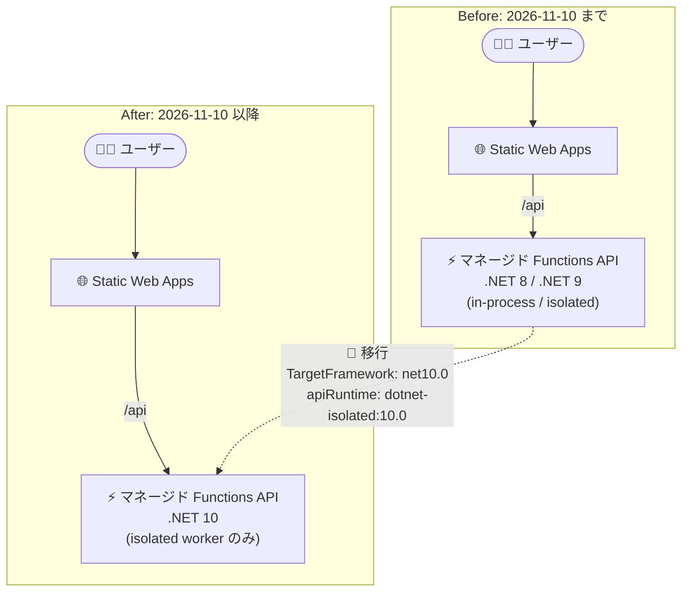

# Azure Static Web Apps: .NET 8 / .NET 9 サポート終了 (2026 年 11 月 10 日)

**リリース日**: 2026-11-09

**サービス**: Azure Static Web Apps

**機能**: マネージド Functions API における .NET 8 / .NET 9 サポートの終了

**ステータス**: Retirement (リタイアメント通知)

[このアップデートのインフォグラフィックを見る](https://takech9203.github.io/azure-news-summary/20261109-static-web-apps-dotnet8-9-retirement.html)

## 概要

Azure Static Web Apps のマネージド Functions API における .NET 8 および .NET 9 のサポートが **2026 年 11 月 10 日** に終了します。この日までに、マネージド Functions API を .NET 10 に移行する必要があります。

サポート終了後もアプリは動作を継続しますが、セキュリティ更新プログラムは提供されなくなり、Azure Functions 上での .NET 8 / .NET 9 のサポートも終了します。サポートされていないランタイムやバージョンでアプリを実行し続けると、セキュリティおよびパフォーマンス上の問題につながる可能性があります。

また、2026 年 11 月に、Azure Static Web Apps のマネージド Functions API の既定の .NET ランタイムが .NET 10 に更新される予定です。`staticwebapp.config.json` で `apiRuntime` を明示的に設定することで、意図したランタイムでのビルド・実行が保証されます。

**アップデート前 (現状)**

- マネージド Functions API を .NET 8 (in-process / isolated) または .NET 9 (isolated) で実行可能
- .NET 8 では in-process モデルも利用可能

**アップデート後 (2026 年 11 月 10 日以降)**

- .NET 8 / .NET 9 へのセキュリティ更新の提供が終了 (アプリ自体は動作を継続)
- サポートされる .NET ランタイムは .NET 10 (isolated worker モデルのみ) に
- マネージド Functions API の既定の .NET ランタイムが .NET 10 に更新

## アーキテクチャ図



2026 年 11 月 10 日以降は .NET 10 (isolated worker モデル) のみがサポート対象となるため、in-process モデルの .NET 8 アプリは isolated worker モデルへの移行も必要です。

## サービスアップデートの詳細

### 影響範囲

1. **マネージド Functions API (.NET 8 in-process)**
   - `apiRuntime: dotnet:8.0` で稼働中の API が対象
   - .NET 10 は isolated worker モデルのみサポートのため、isolated worker モデルへの移行が必須

2. **マネージド Functions API (.NET 8 / .NET 9 isolated)**
   - `apiRuntime: dotnet-isolated:8.0` / `dotnet-isolated:9.0` で稼働中の API が対象
   - プロジェクトのターゲットを `net10.0` に更新する必要がある

3. **Bring your own functions (リンクされた Function Apps)**
   - デプロイライフサイクルが別管理のため、個別にアップグレードとデプロイが必要

## 技術仕様

Static Web Apps のマネージド Functions でサポートされる .NET ランタイム (Microsoft Learn より):

| ランタイムバージョン | モデル | `apiRuntime` 値 | サポート終了日 |
|------|------|------|------|
| .NET 8.0 | in-process | `dotnet:8.0` | 2026 年 11 月 10 日 |
| .NET 8.0 | isolated | `dotnet-isolated:8.0` | 2026 年 11 月 10 日 |
| .NET 9.0 | isolated | `dotnet-isolated:9.0` | 2026 年 11 月 10 日 |
| .NET 10.0 | isolated | `dotnet-isolated:10.0` | - |

- .NET 10.0 は **isolated worker モデルのみ** のサポート
- マネージド Functions のサポートは [Azure Functions 言語ランタイムサポートポリシー](https://learn.microsoft.com/azure/azure-functions/language-support-policy) に準拠

## 移行手順

### in-process モデルを使用している場合

[Migrate C# apps from the in-process model to the isolated worker model](https://learn.microsoft.com/azure/azure-functions/migrate-dotnet-to-isolated-model?tabs=net10) の .NET 10 向け手順に従い、API プロジェクト、パッケージ、スタートアップコード、関数コード、構成を isolated worker モデル用に更新します。

### すでに isolated worker モデルを使用している場合

[Update language versions in Azure Functions](https://learn.microsoft.com/azure/azure-functions/update-language-versions?pivots=programming-language-csharp) の C# 向け手順に従い、API プロジェクトのターゲットを `net10.0` に更新します。

### 両方の構成に共通の手順

1. API プロジェクトが `net10.0` をターゲットにしていることを確認し、Functions SDK とワーカーパッケージを [.NET 10 isolated worker のプロジェクト・パッケージ要件](https://learn.microsoft.com/azure/azure-functions/dotnet-isolated-process-guide#project-and-package-references) を満たすように更新する。ローカルでビルド・テストを実施する。

   ```xml
   <Project Sdk="Microsoft.NET.Sdk">
     <PropertyGroup>
       <TargetFramework>net10.0</TargetFramework>
     </PropertyGroup>
   </Project>
   ```

2. `staticwebapp.config.json` で API ランタイムを設定する。

   ```json
   {
     "platform": {
       "apiRuntime": "dotnet-isolated:10.0"
     }
   }
   ```

   API プロジェクトの `TargetFramework` と `staticwebapp.config.json` の `platform.apiRuntime` の値は同じランタイムを指す必要があります。

3. 静的 Web アプリを再デプロイし、Static Web Apps がマネージド API を .NET 10 でリビルド・公開するようにする。

2026 年 11 月 10 日までに、必要なアップグレードをすべて完了し、API が in-process モデルから移行済みであることを確認してください。

## デメリット・制約事項

- .NET 10 は isolated worker モデルのみのサポートのため、in-process モデルのアプリはコード変更を伴う移行が必要
- 期限 (2026 年 11 月 10 日) までに移行しない場合、アプリは動作を継続するものの、セキュリティ更新が提供されず、セキュリティ・パフォーマンス上のリスクが生じる
- Bring your own functions (リンクされた Function Apps) は別のデプロイライフサイクルを持つため、個別のアップグレードとデプロイが必要

## 関連サービス・機能

- **Azure Functions**: Static Web Apps のマネージド Functions API の基盤。言語サポートポリシーも Azure Functions に準拠する
- **Bring your own functions**: マネージド Functions の制約を回避したい場合に、既存の Azure Functions アプリをリンクする構成。今回のリタイアメントでも個別のアップグレードが必要

## 参考リンク

- [インフォグラフィック](https://takech9203.github.io/azure-news-summary/20261109-static-web-apps-dotnet8-9-retirement.html)
- [公式アップデート情報](https://azure.microsoft.com/updates?id=575106)
- [Supported languages and runtimes in Azure Static Web Apps](https://learn.microsoft.com/azure/static-web-apps/languages-runtimes)
- [Azure Functions language support policy](https://learn.microsoft.com/azure/azure-functions/language-support-policy)
- [.NET support policy](https://dotnet.microsoft.com/platform/support/policy/dotnet-core)
- [Migrate C# apps from the in-process model to the isolated worker model](https://learn.microsoft.com/azure/azure-functions/migrate-dotnet-to-isolated-model?tabs=net10)
- [Update language versions in Azure Functions](https://learn.microsoft.com/azure/azure-functions/update-language-versions?pivots=programming-language-csharp)
- [Bring your own functions to Azure Static Web Apps](https://learn.microsoft.com/azure/static-web-apps/functions-bring-your-own)

## まとめ

Azure Static Web Apps のマネージド Functions API における .NET 8 / .NET 9 のサポートが **2026 年 11 月 10 日** に終了します。Solutions Architect としては、以下のアクションを推奨します。

1. **棚卸し**: `staticwebapp.config.json` の `apiRuntime` が `dotnet:8.0` / `dotnet-isolated:8.0` / `dotnet-isolated:9.0` の Static Web Apps を特定する
2. **in-process モデルの移行**: `dotnet:8.0` (in-process) を使用しているアプリは、まず isolated worker モデルへ移行する (.NET 10 は isolated のみサポート)
3. **.NET 10 への更新**: `TargetFramework` を `net10.0`、`apiRuntime` を `dotnet-isolated:10.0` に揃えて再デプロイする
4. **Bring your own functions の確認**: リンクされた Function Apps は別途アップグレード・デプロイが必要

期限を過ぎてもアプリは停止しませんが、セキュリティ更新が提供されなくなるため、**2026 年 11 月 10 日までの移行完了** を強く推奨します。また、同月にマネージド Functions API の既定 .NET ランタイムが .NET 10 に変更されるため、`apiRuntime` の明示的な設定により意図しないランタイム変更を防いでください。

---

**タグ**: Azure Static Web Apps, Azure Functions, .NET 8, .NET 9, .NET 10, Retirement, Compute, Web
