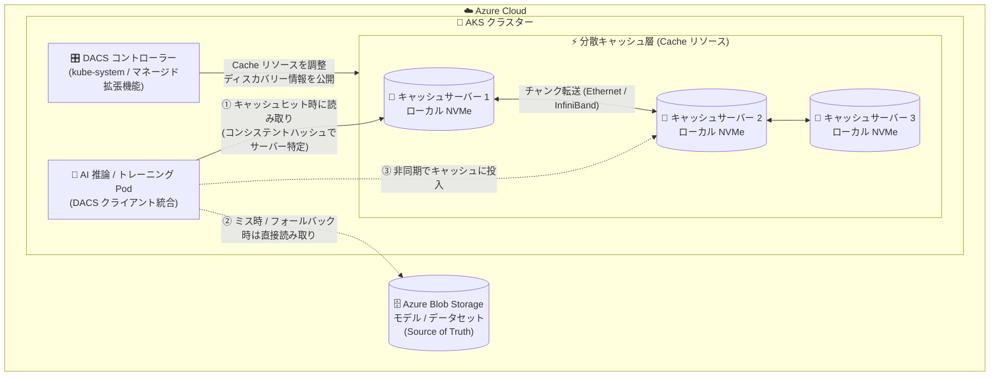

# Azure Container Storage: Distributed accelerator for cloud storage (DACS) on AKS パブリックプレビュー

**リリース日**: 2026-11-10

**サービス**: Azure Container Storage / Azure Kubernetes Service (AKS)

**機能**: Distributed accelerator for cloud storage (DACS)

**ステータス**: In preview

[このアップデートのインフォグラフィックを見る](https://takech9203.github.io/azure-news-summary/20261110-aks-distributed-accelerator-cloud-storage.html)

## 概要

Azure Kubernetes Service (AKS) 上の AI ワークロード向けに、Distributed accelerator for cloud storage (DACS) がパブリックプレビューとして公開されました。DACS は AKS クラスター内で動作する分散型の読み取りスルー (read-through) キャッシュで、クラスター内の複数ノードに搭載されたローカル NVMe ディスクを活用し、Azure Blob Storage 上の頻繁に読み取られるデータを GPU コンピュートの近くに保持します。2026 年 6 月のプライベートプレビューを経て、今回パブリックプレビューに到達しました。

推論 (inference) ワークロードでは、スケールアウト・再起動・ノード置換からの復旧時に発生するウォームモデルのロード時間と Blob Storage への繰り返し読み取りを削減します。新規ノードや置換ノードは、Blob Storage から再ダウンロードする代わりに、クラスター内に既にキャッシュされたモデルデータを再利用できます。また、データセットの同じ部分を繰り返し読み取るトレーニングワークロードの高速化にも利用できます。性能向上の度合いは、データの再利用頻度とキャッシュがコールドかウォームかに依存します。

DACS は Azure Container Storage を通じて有効化・管理し、Run:ai Model Streamer、BlobFuse2、またはネイティブ Python クライアントを使用してワークロードと統合します。Azure Blob Storage は引き続き永続的な「信頼できる唯一の情報源 (source of truth)」であり、データがキャッシュされていない場合やキャッシュが利用できない場合、クライアントは Blob Storage から直接読み取ります。

**アップデート前の課題**

- 推論 Pod が大きなモデルファイルのダウンロード完了を待たないとリクエストを処理できなかった
- GPU ノードを追加するたびに、同じモデルデータが Blob Storage から繰り返しダウンロードされていた
- Pod の再起動、ノード置換、ローリングアップグレードのたびに同じモデルデータを再取得する必要があった

**アップデート後の改善**

- 頻繁に読み取られるモデルチャンクを、Blob Storage ではなくローカル/ピアの NVMe から提供し、ウォームモデルのロードが高速化
- 新規・置換ノードがクラスター内の既存キャッシュデータを再利用でき、スケールアウトと復旧が高速化
- プリフェッチ機能により、計画的なスケールイベントの前にモデルデータを事前投入可能
- リクエストされたバイト範囲をカバーするチャンクのみをキャッシュする範囲ベースのキャッシングに対応

## アーキテクチャ図



アプリケーションの DACS クライアントがコンシステントハッシュリングでチャンクの所有サーバーを特定し、キャッシュヒット時は NVMe から、ミス時は Blob Storage から直接読み取ってキャッシュへ非同期投入します。コントローラーはリソース管理のみを担い、データ読み取りのプロキシにはなりません。

## サービスアップデートの詳細

### 主要機能

1. **分散 read-through キャッシュ**
   - モデルデータをチャンクに分割し、複数のキャッシュサーバーに分散配置
   - コンシステントハッシュリングでチャンクをサーバーにマッピングし、データパスに集中管理ポイントを持たない
   - キャッシュサーバー間のデータ転送は、VM サイズとクラスタートポロジーに応じて Ethernet または InfiniBand を使用

2. **マネージドデプロイ**
   - Azure CLI の `--enable-azure-container-storage distributedAccelerator` で有効化
   - `distributedaccelerator` マネージド拡張機能が、DACS コントローラーと NVMe 前提 DaemonSet を `kube-system` にデプロイし、Cache カスタムリソース定義 (CRD) を登録
   - 前提 DaemonSet がラベル付けされたキャッシュノード上のローカル NVMe ディスクを検出・フォーマット・マウント

3. **Cache カスタムリソースによるキャッシュ定義**
   - サーバー数、容量、CPU/メモリ制限、対象ノードを Kubernetes の `Cache` リソース (`storage.azure.com/v1`) で宣言的に定義
   - コントローラーがキャッシュサーバー Pod を調整し、クライアント向けのディスカバリー情報を公開

4. **複数のクライアント統合方式**

   | 統合方式 | 適するケース | アプリケーション変更 |
   |---------|------------|-------------------|
   | BlobFuse2 (Azure Blob CSI ドライバー経由) | Linux ファイルシステムパスで Blob データを読む場合 | 読み取り専用の BlobFuse2 ボリュームを構成。既存のファイル読み取りコードはそのまま |
   | ネイティブ Python クライアント | 明示的な同期/非同期キャッシュ操作が必要な場合 | DACS クライアントをインポートして呼び出し |
   | Run:ai Model Streamer | Run:ai Model Streamer でモデルをロードする場合 | モデルロードワークフローに DACS 統合を構成 |

5. **プリフェッチと安全なフォールバック**
   - 推論 Pod 起動前に選択したモデルデータを事前投入するプリフェッチに対応
   - キャッシュが利用不可の場合、クライアントは Azure Blob Storage に自動フォールバック

6. **オープンソースプロジェクト**
   - DACS は Azure AI Platform と Azure Storage の協業によるオープンソースプロジェクト ([Azure/dacs](https://github.com/Azure/dacs))
   - キャッシュサーバー、ネイティブ C/C++ クライアント、Python アダプター、Rust ラッパー、Kubernetes チャートなどを公開
   - ただし、オープンソース版とマネージドプレビュー版はデプロイ・サポート範囲が異なる

## 技術仕様

| 項目 | 詳細 |
|------|------|
| オーケストレーター | AKS (Kubernetes 1.35 以降) |
| 対象ワークロード | 主に推論のモデルロード、トレーニングの繰り返しデータセット読み取り |
| オリジン | Azure Blob Storage のみ (Hugging Face への直接アクセスは非対応) |
| キャッシュメディア | Linux キャッシュノード上のローカル NVMe (例: `Standard_L*s_v3` VM ファミリー) |
| スケール | 最大 100 ノード |
| CPU アーキテクチャ | x64 および Arm64 |
| ネットワーク | Ethernet、対応 VM サイズでは InfiniBand |
| ウォームアップ | オンデマンド投入およびプリフェッチ |
| コールドリード調整 | 同時コールドリードの調整機能はプレビューでは非対応 |
| インストール | Azure CLI で有効化する専用マネージド拡張機能 (`microsoft.distributedaccelerator`) |
| 必要な CLI 拡張 | `aks-preview` 22.0.0b9 以降 |
| NVMe マウントポイント | `/var/lib/ssd/cacheserver` |

## 設定方法

### 前提条件

1. DACS プレビュー要件を満たす既存の AKS クラスター (Kubernetes 1.35 以降)
2. ローカル NVMe データディスクを持つ Linux キャッシュノードプール (例: `Standard_L*s_v3` VM ファミリー)
3. モデルデータを格納した Azure Storage アカウントと Blob コンテナー
4. Azure CLI (`aks-preview` 拡張 22.0.0b9 以降)、`kubectl`、コンテナーイメージビルドツール
5. AKS 拡張機能のインストール、Kubernetes リソース管理、ノードプールラベル更新、ストレージデータアクセスロール割り当ての権限

### Azure CLI

```bash
# aks-preview 拡張機能のインストール/更新
az extension add --name aks-preview --upgrade --yes

# キャッシュノードプールにラベルを付与 (ノード置換後もラベルを維持)
az aks nodepool update \
  --resource-group $RESOURCE_GROUP \
  --cluster-name $CLUSTER_NAME \
  --name $CACHE_NODE_POOL \
  --labels dacs.azure.com/processing-unit=cpu

# DACS を有効化 (distributedAccelerator の大文字 A が必須)
az aks update \
  --resource-group $RESOURCE_GROUP \
  --name $CLUSTER_NAME \
  --enable-azure-container-storage distributedAccelerator

# 拡張機能の状態を確認
az k8s-extension show \
  --cluster-type managedClusters \
  --cluster-name $CLUSTER_NAME \
  --resource-group $RESOURCE_GROUP \
  --name distributedaccelerator \
  --query '{extensionType:extensionType,provisioningState:provisioningState,currentVersion:currentVersion}' \
  --output table
```

### Cache リソースの作成

```bash
# NVMe 前提 DaemonSet の準備完了を確認してから Cache リソースを作成
kubectl rollout status daemonset/dacs-prereq --namespace kube-system --timeout=10m

cat <<EOF | kubectl apply -f -
apiVersion: storage.azure.com/v1
kind: Cache
metadata:
  name: cache-sample
  namespace: dacs-cache-system
spec:
  scaling:
    static:
      numServers: 3
  serverSizeInGB: 1000
  serverThreads: 80
  cpuLimit: 4
  memoryLimitMB: 32000
  port: 9065
  metricsPort: 9096
  nodeSelectorKey: dacs.azure.com/processing-unit
  nodeSelectorValue: cpu
  storage:
    hostPath:
      nodeCacheFolderPath: /var/lib/ssd/cacheserver
EOF

# キャッシュの準備完了を待機し、ディスカバリー URL を取得
kubectl wait --namespace dacs-cache-system --for=condition=Ready cache/cache-sample --timeout=10m
kubectl get cache cache-sample --namespace dacs-cache-system -o jsonpath='{.status.discoveryURL}'
```

### Blob へのアクセス権付与

```bash
# AKS kubelet マネージド ID にコンテナースコープで最小権限の読み取りロールを割り当て
az role assignment create \
  --assignee-object-id $KUBELET_OBJECT_ID \
  --assignee-principal-type ServicePrincipal \
  --role "Storage Blob Data Reader" \
  --scope "$STORAGE_ID/blobServices/default/containers/$STORAGE_CONTAINER"
```

## メリット

### ビジネス面

- 推論エンドポイントのスケールアウト・復旧が高速化し、需要変動への追従性とサービス可用性が向上
- Blob Storage への繰り返し読み取りが削減され、オリジンへのトラフィックを抑制
- DACS ソフトウェア自体の追加課金なし (既存の VM・Blob Storage・ネットワーク料金のみ)
- オープンソースとして公開されており、実装の検証やコミュニティ貢献が可能

### 技術面

- コンシステントハッシュによる分散設計で、データパスに単一障害点となる集中コンポーネントがない
- キャッシュ不可用時は Blob Storage への自動フォールバックがあり、可用性への影響を抑えられる
- 範囲ベースキャッシングにより、ファイル全体ではなく必要なバイト範囲のチャンクのみをキャッシュ
- BlobFuse2 統合ならアプリケーションコードの変更なしで導入可能
- Prometheus 形式のメトリクス (クライアントのキャッシュヒット/ミス、サーバーのリクエストカウンター) で動作を検証可能

## デメリット・制約事項

- プレビュー段階のため SLA はなく、本番ワークロードでの利用は非推奨
- キャッシュデータはエフェメラルで耐久性のためのレプリケーションはない。キャッシュノード喪失時は該当チャンクが失われ、Blob Storage から再取得される
- 永続ボリューム・StorageClass ではなく、Blob Storage の代替でもない (トレーニング出力やチェックポイントの永続化には使えない)
- オリジンは Azure Blob Storage のみ。Hugging Face などへの直接アクセスは非対応 (事前に Blob Storage へ配置が必要)
- KV キャッシュ、コンテナーイメージキャッシュ、汎用共有ファイルアクセスはプレビューの対象外
- コールドキャッシュ時の同時読み取りは調整されず、複数クライアントが同じデータを独立に取得する可能性がある (プリフェッチで緩和)
- クラスター規模は最大 100 ノードまで
- キャッシュ投入は非同期のため、直後の再読み取りがミスになる場合がある
- キャッシュはマルチテナント分離を提供しないため、信頼できるクラスター内でのみ使用する
- NVMe ディスクはキャッシュ専用にする必要がある (他のソフトウェアと共有不可)

## ユースケース

### ユースケース 1: LLM 推論エンドポイントのスケールアウト高速化

**シナリオ**: 大規模モデルを使った推論サービスで、負荷増に応じて GPU ノードを追加すると、各ノードが Blob Storage から数十 GB のモデルファイルをダウンロードするため、Pod がサービス開始可能になるまで時間がかかる。

**実装例**:

```bash
# DACS を有効化し Cache リソースを作成後、
# Run:ai Model Streamer または BlobFuse2 経由でモデルをロード
# 計画的なスケールイベント前にプリフェッチでモデルデータを事前投入
```

**効果**: 新規・置換ノードはクラスター内の NVMe キャッシュからモデルデータを取得でき、ウォームモデルのロード時間と Blob Storage への繰り返し読み取りが削減される。

### ユースケース 2: トレーニングでのデータセット繰り返し読み取りの高速化

**シナリオ**: 複数のトレーニングワーカーが、エポックやジョブをまたいで同じデータセットの一部を繰り返し読み取る。

**実装例**:

```bash
# ネイティブ Python クライアント (PyPI: dacs-client) で Blob 上の
# データセットを読み取り、2 回目以降はクラスター内キャッシュから取得
pip install "dacs-client==0.1.0"
```

**効果**: データの再利用頻度が高いほどキャッシュヒット率が向上し、Blob Storage へのオリジン読み取りが削減される。効果はワーキングセットサイズとキャッシュのウォーム状態に依存する。

## 料金

DACS ソフトウェア自体への課金はありません。ただし、キャッシュノードの Azure VM、Azure Blob Storage、ネットワークの料金は通常どおり発生します。

| 項目 | 料金 |
|------|------|
| DACS ソフトウェア | 無料 (プレビュー時点) |
| キャッシュノード (NVMe 搭載 VM、例: `Standard_L*s_v3`) | 通常の VM 料金 |
| Azure Blob Storage | 通常のストレージ/トランザクション料金 |
| ネットワーク | 通常のネットワーク料金 |

詳細は各料金ページを参照してください: [Virtual Machines の料金](https://azure.microsoft.com/pricing/details/virtual-machines/linux/) / [Blob Storage の料金](https://azure.microsoft.com/pricing/details/storage/blobs/)

## 利用可能リージョン

プレビューはすべての Azure パブリッククラウドリージョンで利用可能です (ドキュメント記載の DACS preview support requirements による)。

## 関連サービス・機能

- **Azure Container Storage**: DACS の有効化・ライフサイクル管理を担う。永続ボリュームが必要な場合はローカル NVMe / Elastic SAN ベースの Azure Container Storage を使用
- **Azure Blob Storage**: モデル・データセットの永続的な Source of Truth。キャッシュミス/フォールバック時の読み取り先
- **Azure Kubernetes Service (AKS)**: DACS の実行基盤。マネージド拡張機能としてインストール
- **BlobFuse2 / Azure Blob CSI ドライバー**: ファイルシステムパス経由の統合方式
- **Azure Managed Lustre**: マネージド並列ファイルシステムが必要な場合の代替選択肢
- **Microsoft Entra ID**: ワークロードの Blob Storage アクセスには Entra ID (マネージド ID) または SAS を使用

## 参考リンク

- [インフォグラフィック](https://takech9203.github.io/azure-news-summary/20261110-aks-distributed-accelerator-cloud-storage.html)
- [公式アップデート情報](https://azure.microsoft.com/updates?id=578454)
- [What is distributed accelerator for cloud storage? (Microsoft Learn)](https://learn.microsoft.com/azure/storage/container-storage/distributed-accelerator-for-cloud-storage-overview)
- [Get started with distributed accelerator for cloud storage on AKS (クイックスタート)](https://learn.microsoft.com/azure/storage/container-storage/distributed-accelerator-for-cloud-storage-quickstart)
- [Azure Container Storage ドキュメント](https://learn.microsoft.com/azure/storage/container-storage/)
- [Azure DACS リポジトリ (GitHub)](https://github.com/Azure/dacs)

## まとめ

DACS は、AKS 上の AI 推論・トレーニングワークロードにおける「同じモデル/データセットを繰り返し Blob Storage からダウンロードする」という典型的なボトルネックを、クラスター内の NVMe を束ねた分散 read-through キャッシュで解消するプレビュー機能です。Blob Storage を Source of Truth としたまま、アプリケーション変更を最小限 (BlobFuse2 なら変更なし) に導入でき、DACS 自体は無料でオープンソースとしても公開されています。NVMe 搭載ノードプール (例: `Standard_L*s_v3`) と Kubernetes 1.35 以降が前提となるため、LLM 推論のスケールアウトに課題を持つチームは、非本番環境でキャッシュヒット率と実測のロード時間短縮効果を検証することを推奨します。

---

**タグ**: Azure Container Storage, AKS, DACS, 分散キャッシュ, NVMe, Blob Storage, AI 推論, Public Preview, Containers
